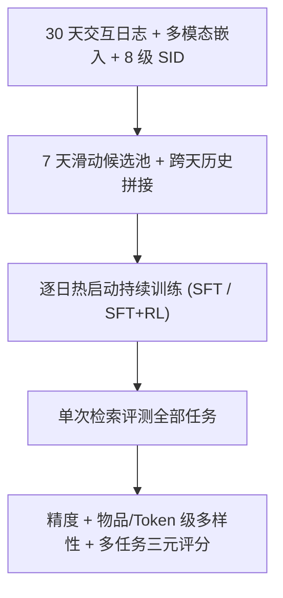
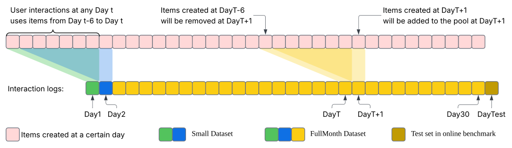

# KuaiRecV2: Benchmarking Large-Scale Continual Learning for Diversified and Multi-task Recommendation (KuaiRecV2：面向多样化与多任务推荐的大规模持续学习基准)

- **会议/期刊**: NeurIPS 2026 (Evaluations & Datasets Track)
- **作者与机构**: Chenxu Li, Shuchang Liu, Hantao Shu 等（中国科学技术大学、快手科技）
- **推荐链路定位**: 端到端生成式（生成式检索 / 召回）
- **研究方向**: 去偏公平、可信隐私与工业架构 / 生成式推荐与离散语义 ID
- **论文原文**: [https://arxiv.org/abs/2611.16795v1](https://arxiv.org/abs/2611.16795v1)
- **开源代码**: [https://github.com/cxli2333/KuaiRecV2](https://github.com/cxli2333/KuaiRecV2)

## TL;DR (1分钟核心速览)

离线静态评测与线上结果长期脱节，而现有基准既无动态物品池下的持续学习协议，也缺乏 Token 级多样性与多任务可控性评测。本文发布 KuaiRecV2：快手 30 天、12.4 万用户、2489 万物品、4.84 亿交互的工业数据集，配合"逐日连续训练 + 7 天滑动候选池 + 跨天历史拼接"的长程推荐流水线，并以"精度–多级多样性–多任务"三元评分体系（仅当全部指标提升才算有效进展）重估 5 个基线。结果显示生成式模型在 NDCG@50 上达 19.22（SASRec 仅 1.92），但 Gini 系数高达 0.89–0.96、Day-1 回测 HR@50 从 39.09 崩至 0.19，暴露灾难性遗忘与多样性瓶颈。

## Background & Motivation (背景与核心矛盾)

- **主流范式**: LLM 风格生成式推荐以"物品分词器 + 可扩展序列模型 + 生成式检索器"为骨架，期望随数据与模型规模获得更优 scaling law。
- **前人局限一（动态池）**: 现有基准（KuaiRec、MUSE、FORGE）均为静态快照或仅做 SID 质量评估，无法刻画"每日新增/淘汰物品"下的分布漂移与灾难性遗忘。
- **前人局限二（多样性）**: 精度–多样性权衡只在物品级研究，而生成式推荐每个物品由多 Token 组成，Token 级偏置会组合放大，现有工作无组合多样性度量。
- **前人局限三（多任务）**: 判别式模型可用多专家头直接建模多目标，生成式模型只能靠多任务 SFT（推理成本翻倍）或单一 RL 奖励，二者孰优无定论。
- **核心洞察 (Key Insight)**: 离线–线上鸿沟的根源不是模型容量，而是**评测环境不真实**——缺少时间演化、候选池更替与多目标约束。
- **本文切入点**: 用工业级真实数据 + 严格持续学习流水线 + 三元评分体系，把"是否真正进步"定义为所有指标同时提升。

## Method (核心方法设计)

### 1. 整体框架 (Overall Architecture)

KuaiRecV2 本身是基准而非单一模型，其"方法"由数据组织与训练流水线构成：数据侧对 30 天交互做用户侧 100-core 过滤，每日仅保留前 7 天内创建的物品构成滑动候选池（第 $t$天移除第$t-7$天物品、加入第$t$天新物品）；训练侧从随机初始化开始，第$t$天以第$t-1$天收敛参数$\theta_{t-1}$热启动，在新数据$\mathcal{D}_t$上继续训练得到$\theta_t$，并为每个用户拼接前一日末尾若干交互作为跨天上下文；评测侧对每日数据做 leave-one-out，同时计算精度、物品级/Token 级多样性与多行为指标，最终以实例加权聚合$M_{\text{FullMonth}}=\sum_t N_t M_t / \sum_t N_t$汇报，并额外做"第$k$ 天检查点回测第 1 天"的后向迁移评估。

<figure class="paper-figure" markdown="span">
  <figcaption>图1：KuaiRecV2 的数据组织。</figcaption>
</figure>

### 2. 关键设计拆解 (Key Designs)

1. **动态候选池与逐日热启动（持续学习协议）**：静态基准允许"学未来、评过去"，本文强制时间因果。核心递推为 $\theta_t = \mathrm{Train}(\theta_{t-1}, \mathcal{D}_t)$，且$\mathcal{D}_t$的候选集$\mathcal{C}_t = \{i \mid \text{create}(i) \in [t-6, t]\}$。物理直觉：这模拟了真实平台"新物品零交互冷启 + 老物品过期下架"的双重非平稳性，使遗忘与适应同时可测。
2. **Token 级组合多样性度量**：针对"多 Token 组合放大偏置"，定义平均路径多样性、平均层唯一 Token 数、平均层熵与 Top-$K$层多样性。以层熵为例$H_l = -\sum_{v} p_{l,v}\log p_{l,v}$，其中$p_{l,v}$为第$l$层生成 Token$v$ 的频率。直觉：物品级 Gini 只能看到"推荐了哪些物品"，层熵能定位"多样性在哪一层坍缩"，从而指导 beam search 的分层控制。
3. **多行为 RL 奖励与 SFT/RL 交替训练**：将 $k$类行为（长播、点赞、评论、讨厌等）加权为$R_{\mathcal{B}}=\sum_{b\in\mathcal{B}}\alpha_b R_b$，仅作训练信号不作评测指标；训练策略上对比 RL-only、SFT-only 与逐日"先 SFT 适应新分布、再 RL 对齐偏好"的交替方案。直觉：RL 擅长偏好对齐但不擅长吸收新物品分布，SFT 反之，交替可互补。

## Experimental Setup & Evaluation Protocol (实验设置与评估协议)

- **数据集与预处理**（用户侧 100-core 过滤，物品仅保留近 7 天创建）：

| 数据集 | #Users | #Items | #Interactions | 稀疏度 | 特征/场景说明 |
| :--- | :---: | :---: | :---: | :---: | :--- |
| FullMonth | 124,055 | 24,898,648 | 484,045,145 | 99.9843% | 30 天连续日志，第 30 天留出做榜单 |
| Small | 124,054 | 2,452,987 | 38,955,949 | 99.9871% | 前 2 天，用于快速验证与静态对比 |

  每个物品附 64 维多模态嵌入、固定 RQ-VAE 分词器生成的 8 级语义 ID、MLLM 推断的标签 ID；分词器与嵌入模型均未在发布日志上训练，避免信息泄漏。

- **数据划分与防穿越**: 逐日 `Leave-One-Out`（用户当日最后一条作验证，其余作训练），30 天严格按时间流式推进，杜绝"学未来评过去"。
- **排名评测协议**: 单次检索评测全部任务（single-retrieval evaluate-all），即一个模型同时为所有行为指标供分；未采用采样负例，属全库候选池排序。
- **对比基线与超参**: SASRec、GRU4Rec（判别式）、LLaDA-Rec（5.3M）、TIGER-Tiny（4.9M）、TIGER-Small（30M）、MiniOneRec（0.5B）；结果取 3 个随机种子（42/2026/999）均值与标准差，但**未做显著性检验**（作者自述）。

## Key Experimental Results (实验关键数据)

### 1. 主实验对比 (Main Results)

KuaiRecV2-Small 上的检索精度（$\times 10^{-3}$）：

| Model | NDCG@10 | NDCG@50 | HR@10 | HR@50 |
| :--- | :---: | :---: | :---: | :---: |
| SASRec | 0.97 | 1.92 | 1.96 | 6.61 |
| GRU4Rec | 1.20 | 2.82 | 2.71 | 10.99 |
| LLaDA-Rec | 3.10 | 5.60 | 6.47 | 17.31 |
| TIGER-Tiny | 4.01 | 6.98 | 8.01 | 20.52 |
| TIGER-Small | 7.37 | 12.90 | 15.58 | 41.07 |
| **MiniOneRec** | **12.01** | **19.22** | **23.59** | **62.63** |
| Improv. (vs 最强判别式) | +901% | +582% | +771% | +470% |

物品级多样性（越小越多样 / 越大越覆盖）：

| Model | Gini@10 ($\times 10^{-2}$) | Gini@50 | Coverage@50 ($\times 10^{-4}$) |
| :--- | :---: | :---: | :---: |
| LLaDA-Rec | 93.10 | 92.41 | 98.86 |
| TIGER-Tiny | 96.42 | 95.87 | 48.73 |
| TIGER-Small | 91.50 | 93.10 | 54.38 |
| MiniOneRec | **89.60** | **90.69** | 18.80 |

### 2. 消融/专项实验 (Ablation & Diagnostics)

| 实验 | 设置 | 关键数值 |
| :--- | :--- | :--- |
| 后向迁移（Day-1 HR@50） | MiniOneRec 原生 | 39.09 → 0.19（Day 7） |
| 同上 | + EWC LoRA | 38.67 → 0.20 |
| 同上 | + Replay (5%) | 39.09 → **3.20** |
| 训练策略（Day 20 起） | SFT-only / SFT+RL 交替 / RL-only | 交替最优；RL-only 在 Day 21 物品池更替后骤降 |
| Token 层多样性（Day 21） | 层 1 → 层 8 平均层熵 | 2.74 → 5.47（前几层已饱和） |

### 3. 关键实验发现 (Key Findings)

1. **架构选择比模型规模更关键**：4.9M 的 TIGER-Tiny（HR@50 = 20.52）已远超最强判别式 GRU4Rec（10.99），说明 Token 化生成范式在大物品池上的可扩展性优势是结构性的，而非参数量的胜利。
2. **灾难性遗忘被严重低估**：即便最强基线 MiniOneRec，7 天后对 Day-1 偏好的 HR@50 仅剩 0.19（相对下降 99.5%）；Replay 5% 虽将留存提升至 3.20（约 16 倍），但绝对水平仍极低，说明"长期偏好保持"是开放难题。
3. **多样性与精度呈系统性冲突**：MiniOneRec 精度最高但 Coverage@50 仅 18.80，远低于 LLaDA-Rec 的 98.86；Token 层熵在第 3–4 层即接近饱和（5.09/5.32），证明多样性瓶颈主要发生在靠后的 Token 层，需分层 beam 控制而非全局重排。

## Highlights & Limitations (亮点、对比与审稿批判)

- **与代表作对比 (vs. Prior Work)**: 相较 KuaiRec（1,411 用户、静态全观测），本文规模扩大约 3 个数量级并引入时间演化；相较 MUSE（聚焦终身用户兴趣建模）与 FORGE（聚焦 SID 质量），本文首次把持续学习、组合多样性与多任务纳入同一评分体系，并提出"全指标提升才算有效进展"的判定准则。
- **可迁移亮点**: (1) "逐日热启动 + 跨天历史拼接"的流水线可直接迁移到任何流式推荐离线仿真；(2) Token 层熵/路径多样性指标可作为生成式召回的分层 beam search 调控信号。
- **审稿级局限批判**: (1) 未提供显著性检验，且仅用 3 个种子，主表中部分标准差（如 TIGER-Tiny HR@50 的 3.27）相对均值偏大，结论稳健性存疑；(2) 30 天窗口与 7 天候选池是人为设定，物品生命周期更长的场景（如电商）适配性未知；此外 RL 奖励权重 $\alpha_b$ 的敏感性未系统分析。

## Rating (四维评分)

- **方法创新性 (Novelty)**: ⭐⭐⭐⭐ （基准类工作，创新在于"动态池 + Token 级组合多样性 + 多任务单次检索"三元评测范式，而非新算法）
- **评估协议与实验扎实度 (Protocol & Experiments)**: ⭐⭐⭐⭐ （30 天流式协议与后向迁移设计严谨，但缺显著性检验、种子数偏少）
- **写作与数学规范度 (Clarity & Rigor)**: ⭐⭐⭐⭐ （流水线与指标定义清晰，公式简洁；但部分指标细节下放附录，正文自洽性略弱）
- **工业落地与复现价值 (Industrial & Practical Value)**: ⭐⭐⭐⭐⭐ （真实快手数据、代码与 HuggingFace 榜单全开源，可直接作为生成式推荐的离线仿真沙盒）

