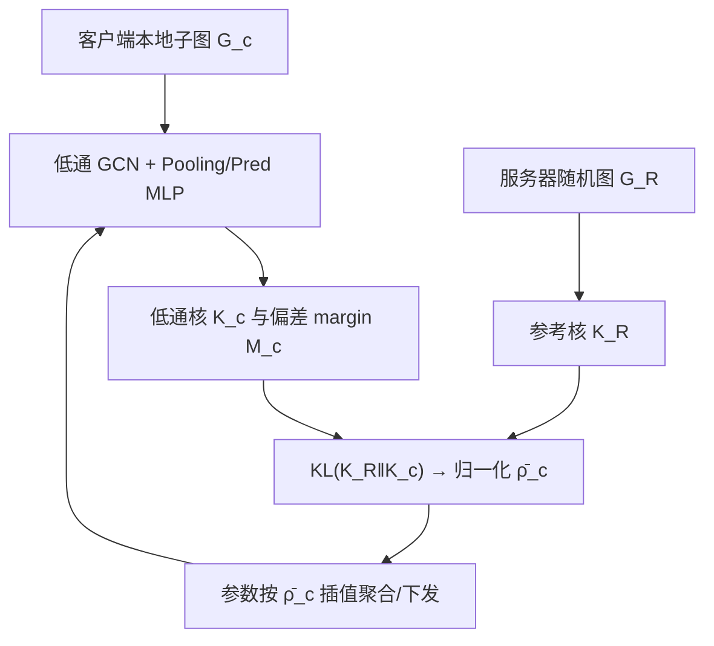
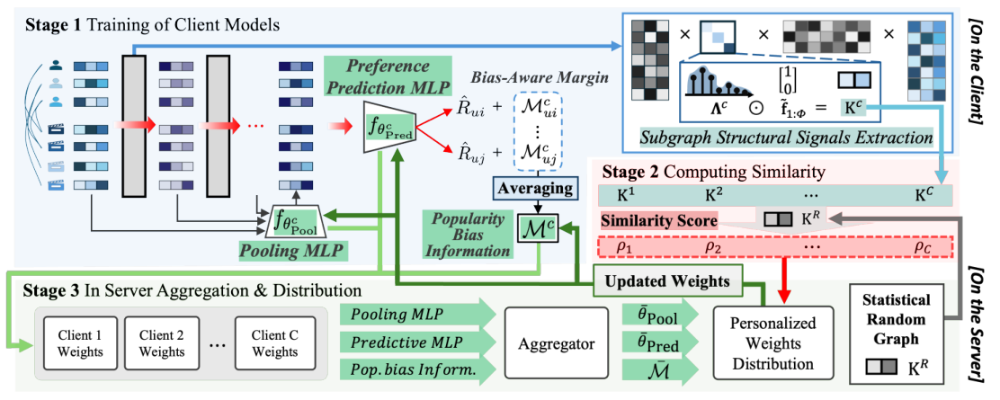

# Low-pass Personalized Subgraph Federated Recommendation (低通个性化子图联邦推荐)

- **会议/期刊**: ICLR 2026
- **作者与机构**: Wooseok Sim, Hogun Park (Sungkyunkwan University)
- **推荐链路定位**: 召回（联邦图协同过滤表征学习）
- **研究方向**: 去偏公平、可信隐私与工业架构 / 图神经网络与知识图谱推荐
- **论文原文**: [https://arxiv.org/abs/2603.20338v1](https://arxiv.org/abs/2603.20338v1)
- **开源代码**: [https://github.com/dntjr41/LPSFed](https://github.com/dntjr41/LPSFed)

## TL;DR (1分钟核心速览)

联邦推荐中客户端子图在规模与连通度上剧烈失衡，空间 GNN 的多跳消息传递对此高度敏感，导致各客户端表征错位、联邦聚合失稳，并放大局部流行度偏置。LPSFed 用图傅里叶变换 + 低通滤波提取对尺度/噪声不敏感的低频结构信号，以与"中性随机图锚点"的 KL 散度作为个性化聚合权重；同时把子图内 item 度分布压缩为偏差感知 margin 注入对比损失。在 5 个数据集、8:1:1 划分、Recall/NDCG@20 协议下，Amazon-Book 上 NDCG@20 相对最优基线提升 24.2%。

## Background & Motivation (背景与核心矛盾)

- **主流范式**: 子图式 FRS 将全局交互图按客户端切分，客户端本地跑 GNN（NGCF/LightGCN/PinSage 类），服务器只聚合参数；个性化方向有 PFedRec、FedRAP，谱方向有 FedSSP、S2FGL。
- **前人局限**: (1) 空间 GNN 的多跳聚合对局部拓扑极度敏感，子图规模从 <8K 节点到 >40K 节点、平均度从 12.8 到 42.3 时，表征严重错位；(2) 稠密客户端被高度数 hub item 主导、稀疏客户端只能依赖少数相对高度数 item，形成局部流行度偏置的自增强回路，而联邦隔离使客户端无法获得全局上下文来纠偏。
- **核心洞察 (Key Insight)**: 图1 显示按谱聚类切出的 15 个客户端在拉普拉斯特征值分布上呈现明显谱分歧，且 NDCG@20 随结构分歧单调下降——说明**低频谱信号是跨子图尺度稳定的结构指纹**，可作为个性化权重的可靠依据。
- **本文切入点**: 用低通滤波后的特征值分布替代原始拓扑做客户端相似度度量，并把局部流行度偏置压缩为标量 margin 参与全局校正。

<figure class="paper-figure" markdown="span">
  <figcaption>图1：在 Amazon-Book（He et al., 2020）数据集上联邦推荐系统的经验观察。(a) 子图规模-度变化：每个点为一个客户端子图，共15个，使用谱聚类划分，按节点数和平均度分为大-稠密（LD）、中-均衡（MB）、小-稀疏（SS）。(b) 结构差异：各组平均的拉普拉斯特征值直方图，突出不同的谱信号。(c) 分组性能差距：FedAvg（McMahan et al., 2017）、PFedRec（Zhang et al., 2023a）、FedPUB（Baek et al., 2023）的 NDCG@20，以及一个</figcaption>
</figure>

## Method (核心方法设计)

### 1. 整体框架 (Overall Architecture)

三阶段闭环：客户端阶段 1 在本地子图上跑多层低通 GCN（LGCN），层间用 Pooling MLP 汇聚各层节点表征，Predictive MLP 输出偏好角 $\hat{R}_{ui}\in[0,\pi]$，同时用偏差感知对比损失训练；阶段 2 客户端从本地子图构造低通卷积核分布$K_c$，与服务器下发的参考图核$K_R$计算 KL 散度得到结构相似度$\rho_c$（仅上传标量，不上传核）；服务器阶段 3 对 Pooling/Predictive MLP 参数与平均 margin$\bar{M}$做均值聚合，再按归一化相似度$\bar{\rho}_c$ 在全局参数与本地参数间插值下发，客户端用插值后的 refined margin 进入下一轮本地训练。

<figure class="paper-figure" markdown="span">
  <figcaption>图2：LPSFed 概览——客户端侧：阶段1应用低通GCN和局部流行度偏差感知损失来训练客户端子图。阶段2使用结构信号计算每个客户端子图与服务器提供的随机图之间的相似度。服务器侧：阶段3聚合客户端参数，并基于个性化相似度分数进行分发。彩色箭头表示各阶段间的交互。</figcaption>
</figure>

### 2. 关键设计拆解 (Key Designs)

1. **低通谱个性化权重（Low-pass Spectral Personalization）**：痛点是用原始拓扑度量客户端相似度会被规模与噪声污染。本文对归一化拉普拉斯做特征分解，只保留前 $\Phi$个特征向量构造低通卷积$Z^{(l)}=\bar{P}\mathrm{diag}(\bar{k}^{(l)})\bar{P}^{\top}Z^{(l-1)}$，并把客户端核分布$K_c(i)=\lambda_i^{(c)}/\sum_{q\le\Phi}\lambda_q^{(c)}$与参考核的 KL 散度作为分歧度：$\rho_c=D_{\mathrm{KL}}(K_R\|K_c)$，再 min-max 反转为相似度$\bar{\rho}_c$。直觉是低频分量对应社区级连通模式，对节点数与度数扰动不敏感，因此跨子图可比。定理 3.1 证明该 KL 估计以$4\Phi\exp(-c\min(n_1,n_2)\epsilon^2/8)$概率收敛，误差被$\min(\delta_1,\delta_2)$的倒数上界控制；定理 3.2 进一步给出滤波后表征方差偏差$\le C'/\delta$，即同一特征间隙同时治理相似度与正则化，这是个性化权重的理论依据。

2. **局部流行度偏差感知 Margin（Localized Popularity Bias-aware Margin）**：痛点是无全局 item 统计时无法做传统 IPS/BC-Loss 去偏。本文将用户/物品流行度分数经编码器映射为嵌入，用其余弦角 $\hat{\xi}_{ui}$先训一个辅助对比损失$\mathcal{L}_{\text{bias}}$，再构造自适应 margin$M^{c}_{ui}=\min\{\gamma\hat{\xi}_{ui},\ \pi-\hat{R}_{ui}\}$，与全局上下文插值得到$\tilde{M}^{c}_{ui}=\omega M^{c,\text{updated}}+(1-\omega)M^{c}_{ui}$，注入主损失$\mathcal{L}_{\text{BC}}=-\sum\log\frac{\exp(\cos(\hat{R}_{ui}+\tilde{M}^{c}_{ui})/\tau)}{\exp(\cdot)+\sum_{j\in N_u}\exp(\cos(\hat{R}_{uj})/\tau)}$。直觉是越流行的物品被施加越大角度惩罚，且$\pi-\hat{R}_{ui}$ 保证单调衰减，从而打断反馈回路。

3. **隐私友好的偏差上下文压缩与训练目标**：客户端只把 margin 均值 $M^c=\frac{1}{MN}\sum_{u,i}M^c_{ui}$这一不可逆标量上传，服务器聚合为$\bar{M}$后按$\bar{\rho}_c$插值下发，避免共享细粒度偏差编码器参数。总损失为$\mathcal{L}=\mathcal{L}_{\text{BC}}+\lambda\mathcal{L}_{\text{bias}}$；负采样沿用对比损失的 in-batch 负例集$N_u$，无需额外 hard negative 挖掘。推理侧低通卷积复杂度$O(n\Phi^2)$，特征分解用 Lanczos 求解器在预处理阶段一次性完成，不进入每轮通信开销。

## Experimental Setup & Evaluation Protocol (实验设置与评估协议)

- **数据集与预处理**: 五个真实数据集，Yelp2018 沿用 10-core 设置，其余按原论文标准过滤：

| 数据集 | #Users | #Items | #Interactions | 密度 | 场景说明 |
| :--- | :---: | :---: | :---: | :---: | :--- |
| Amazon-Book | 52,643 | 91,599 | 2,984,108 | 0.062% | 电商图书 |
| Gowalla | 29,858 | 40,981 | 1,027,370 | 0.084% | LBSN 签到 |
| Movielens-1M | 6,040 | 3,900 | 1,000,290 | 5.431% | 电影评分 |
| Yelp2018 | 31,668 | 38,048 | 1,561,406 | 0.130% | 本地生活 |
| Tmall-Buy | 885,759 | 1,144,124 | 7,592,214 | 0.010% | 电商极端稀疏 |

- **数据划分与防穿越 (Splitting Strategy)**: 统一 `8:1:1` 比例划分训练/验证/测试；客户端子图用谱聚类切分（主实验切 4 份，结构失衡分析切 15 份），并做 ±20% 边分布扰动以制造结构多样性；结果取 2 种划分 × 3 次运行的 6 次平均。
- **排名评测协议 (Ranking Protocol)**: 采用 `Full-Ranking` 全库未交互物品排序，报告 Recall@20 与 NDCG@20。
- **对比基线与超参设置**: 9 个基线覆盖标准 FL（FedAvg）、联邦矩阵分解（FedMF、F2MF）、个性化 FRS（PFedRec、FedRAP）、图联邦（FedPerGNN、FedHGNN）、公平/谱方向（FedPUB、FedSSP）；参考图用 GNMK 生成（优于 ER）；关键超参 $\gamma$、$\Phi=128$、$\tau$、$\omega$ 经敏感性分析确定。

## Key Experimental Results (实验关键数据)

### 1. 主实验对比 (Main Results)

| 数据集 | Amazon-Book R / N | Gowalla R / N | Movielens-1M R / N | Yelp2018 R / N | Tmall-Buy R / N |
| :--- | :---: | :---: | :---: | :---: | :---: |
| FedAvg | 0.0642 / 0.0312 | 0.1425 / 0.0660 | 0.2454 / 0.1240 | 0.0721 / 0.0292 | 0.0317 / 0.0164 |
| FedPUB | 0.0633 / 0.0322 | 0.1433 / 0.0667 | 0.2558 / 0.1209 | 0.0684 / 0.0296 | 0.0333 / 0.0180 |
| PFedRec | 0.0713 / 0.0242 | 0.1371 / 0.0478 | 0.1508 / 0.0997 | 0.0750 / 0.0225 | 0.0323 / 0.0170 |
| FedHGNN | 0.0647 / 0.0298 | 0.1230 / 0.0608 | 0.2163 / 0.1031 | 0.0721 / 0.0268 | 0.0362 / 0.0171 |
| FedSSP | 0.0649 / 0.0356 | 0.1528 / 0.0729 | 0.2564 / 0.1265 | 0.0733 / 0.0315 | 0.0370 / 0.0186 |
| LPSFed (BPR) | 0.0643 / 0.0322 | 0.1529 / 0.0711 | 0.2604 / 0.1281 | 0.0769 / 0.0301 | 0.0362 / 0.0186 |
| **LPSFed** | **0.0738 / 0.0442** | **0.1621 / 0.0909** | **0.2646 / 0.1342** | **0.0783 / 0.0379** | **0.0385 / 0.0218** |
| Improv.% (vs 次优) | ↑3.5% / ↑24.2% | ↑6.1% / ↑17.0% | ↑3.2% / ↑6.1% | ↑4.4% / ↑20.3% | ↑4.1% / ↑17.2% |

### 2. 消融实验 (Ablation Study)

| 变体 | Amazon-Book R / N | Gowalla R / N | Yelp2018 R / N | Tmall-Buy R / N |
| :--- | :---: | :---: | :---: | :---: |
| w/o LGCN（换 NGCF） | 0.0388 / 0.0216 | 0.0965 / 0.0427 | 0.0471 / 0.0207 | 0.0256 / 0.0121 |
| w/o bias-aware | 0.0643 / 0.0322 | 0.1529 / 0.0711 | 0.0769 / 0.0301 | 0.0362 / 0.0186 |
| w/o per（去个性化） | 0.0652 / 0.0368 | 0.1576 / 0.0788 | 0.0775 / 0.0315 | 0.0370 / 0.0190 |
| w/o per & bias-aware | 0.0642 / 0.0312 | 0.1425 / 0.0660 | 0.0712 / 0.0292 | 0.0317 / 0.0164 |
| w/o statistics for $G_R$ | 0.0714 / 0.0403 | 0.1581 / 0.0856 | 0.0764 / 0.0372 | 0.0393 / 0.0199 |
| **LPSFed** | **0.0738 / 0.0442** | **0.1621 / 0.0909** | **0.0783 / 0.0379** | **0.0419 / 0.0206** |

### 3. 关键实验发现 (Key Findings)

1. **低通谱结构是性能主引擎，偏差 margin 是排序精度的放大器**：去掉 LGCN 换成空间 NGCF 后 Amazon-Book NDCG 从 0.0442 崩至 0.0216（-51%），说明结构失衡下空间聚合几乎失效；而 LPSFed(BPR) 与完整版对比显示，仅谱个性化已能追平 FedSSP，叠加 margin 后 NDCG 再涨 37%，两者互补而非冗余。
2. **结构越失衡，收益越大**：15 客户端分组实验中，Large-Dense 组提升 +14.9% Recall / +17.9% NDCG，Medium-Balanced 仅 +4.2% / +9.7%，Small-Sparse +4.4% / +11.5%——稠密组收益最大，印证 margin 有效打断了 hub item 主导的反馈回路。
3. **长尾与头部同时受益，而非此消彼长**：Balanced 设置下 Tail 组 NDCG 相对 FedAvg 提升 271%、Head 组仍提升 32%，Overall 提升 48%；Imbalanced 设置下 Overall 提升 42%。对比 PFedRec、FedSSP 在 Tail 有增益但 Head 明显下滑，LPSFed 是唯一全谱段不劣化的方法。

## Highlights & Limitations (亮点、对比与审稿批判)

- **与代表作对比 (vs. Prior Work)**: 与 FedSSP/S2FGL 相比，本文不是把低通滤波当作去噪卷积层，而是把**滤波后的特征值分布本身**作为跨客户端可比的结构指纹与个性化权重，且针对二部图、无节点特征、度严重偏斜的推荐场景重新论证；与 PFedRec/FedRAP 相比，个性化信号来自谱结构而非可学习参数，通信量仅为标量；与 BC-Loss 等集中式去偏方法相比，用单标量 margin 均值替代全局 item 统计，在隐私约束下近似复现了全局偏差上下文。
- **可迁移亮点**: (1) "随机图锚点 + KL 散度"是一种无需共享原始图的轻量相似度协议，可迁移到跨域/多场景联邦的客户端聚类与权重分配；(2) 把局部统计压缩为不可逆标量再全局插值的做法，可作为联邦场景下任何需要全局先验（如曝光分布、位置偏置）的去偏模板。
- **审稿级局限批判**: (1) 低通核依赖拉普拉斯特征分解，虽用 Lanczos 预处理，但客户端子图规模增大时 $\Phi$截断与特征求解的稳定性、以及参考图$G_R$ 的生成模型（ER vs GNMK）选择仍带来额外超参敏感度，论文仅在附录给出有限敏感性分析；(2) 实验全部基于谱聚类人工切分的模拟联邦环境，缺乏真实跨地域/跨业务的生产级划分与线上 A/B 验证，且未报告与集中式 LightGCN 上界的差距，难以判断联邦隐私代价的实际量级。

## Rating (四维评分)

- **方法创新性 (Novelty)**: ⭐⭐⭐⭐ （把低通谱分布从"去噪工具"升格为"跨子图可比结构指纹"，并有特征间隙统一治理相似度与正则化的双定理支撑，视角新颖）
- **评估协议与实验扎实度 (Protocol & Experiments)**: ⭐⭐⭐⭐ （5 数据集 + 9 基线 + Full-Ranking + 6 次平均 + 结构分组/长尾分桶/消融/超参四类分析齐全，但缺少真实联邦划分与集中式上界对照）
- **写作与数学规范度 (Clarity & Rigor)**: ⭐⭐⭐⭐ （三阶段流程与算法伪代码清晰，定理证明完整收录附录，符号表规范；主文公式密度偏高，部分推导需跳转附录）
- **工业落地与复现价值 (Industrial & Practical Value)**: ⭐⭐⭐⭐ （仅传标量与 MLP 参数、预处理阶段完成谱分解、代码已开源，工程开销可控；但依赖客户端可做特征分解，超大规模子图下需进一步验证）
