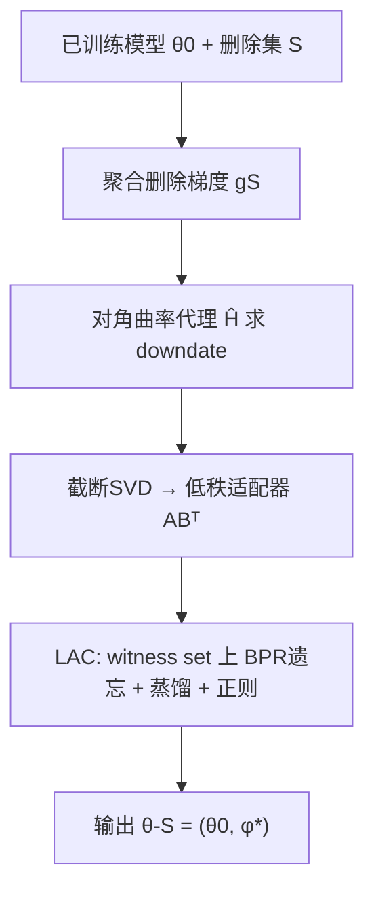
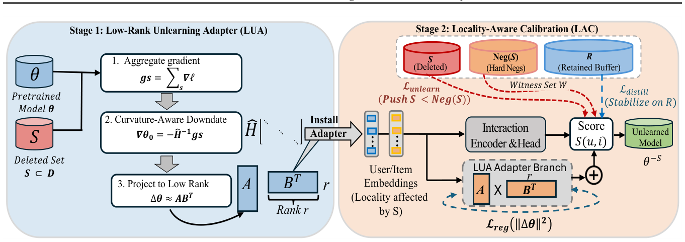

# Obliviate: Efficient Unlearning in Recommender Systems (Obliviate：推荐系统中的高效机器遗忘)

- **会议/期刊**: ICML 2026
- **作者与机构**: Tushar Prakash, Brijraj Singh, Niranjan Pedanekar, Narayan Chaturvedi (Sony Research India; Graphic Era University)
- **推荐链路定位**: 模型更新 / 训练后遗忘（架构无关，可挂载于 MF-BPR、LightGCN 等召回/表征模型）
- **研究方向**: 去偏公平、可信隐私与工业架构 / 协同过滤
- **论文原文**: [https://arxiv.org/abs/2607.22665v1](https://arxiv.org/abs/2607.22665v1)
- **开源代码**: 暂未开源

## TL;DR (1分钟核心速览)

针对 GDPR/CCPA "被遗忘权" 下推荐模型删除用户交互需全量重训的痛点，本文提出两阶段遗忘框架 Obliviate：Stage I 用 Adam 二阶矩构造对角曲率代理，做 Newton 式 downdate 并投影为低秩适配器（LUA）以局部化遗忘；Stage II 用删除集+硬负例+保留缓冲构成的 witness set 做 BPR 遗忘与知识蒸馏校准（LAC）。在 ML-1M/Amazon/Yelp 上以 20% 高删除率、Full-Ranking 协议评估，相对原模型 Recall@20 提升最高约 9.8%，遗忘时间从数百秒降至数十秒（约 3× 以上加速）。

## Background & Motivation (背景与核心矛盾)

- **主流范式**: 推荐遗忘分三派——分片重训（SISA/RecEraser/UltraRE）、闭式精确遗忘（限特定模型族）、影响函数近似（SCIF/IFRU，依赖 Hessian-vector product 迭代）。
- **前人局限**: ① 影响函数法需反复计算二阶统计量，大模型/高频删除下不可扩展；② IFRU 类方法遗忘完整但忽视效用保持，删除后推荐质量下降；③ RRL 类反向学习保效用但残留影响，完整性不足。
- **核心洞察 (Key Insight)**: 删除集只影响少量用户/物品嵌入，重训诱导的参数漂移 $\Delta\theta$近似低秩；且 Adam 二阶矩$\hat{v}$ 可作为对角曲率代理，无需显式 Hessian。
- **本文切入点**: 把遗忘视为"反事实 ERM"的局部敏感性分析，用一次曲率感知 downdate + 低秩投影完成主体遗忘，再用轻量校准补回效用。

## Method (核心方法设计)

### 1. 整体框架 (Overall Architecture)

输入为已训练模型 $\theta_0$与删除集$S$。Stage I（LUA）先聚合删除梯度$g_S$，用对角曲率代理求 Newton 式 downdate$\Delta\theta_0$，再截断 SVD 投影为低秩适配器$AB^\top$挂载到受影响参数块，主干冻结。Stage II（LAC）构造 witness set，仅优化适配器参数$\phi$，联合 BPR 遗忘损失与对原模型的蒸馏损失，并加参数范数正则约束在 LUA 解附近（等价 trust-region）。最终输出$\theta_{-S}=(\theta_0,\phi^\star)$，适配器可插拔、可逆。

<figure class="paper-figure" markdown="span">
  <figcaption>图2. Obliviate 的概览。LUA 使用删除集 S 执行曲率感知的低秩降秩更新，以局部化遗忘。LAC</figcaption>
</figure>

### 2. 关键设计拆解 (Key Designs)

1. **曲率感知低秩 downdate（LUA）**：全 Hessian 求逆不可行 $\to$用 Adam 二阶矩构造正定对角代理$\hat{H}=\mathrm{diag}(\sqrt{\hat{v}}+\varepsilon)$，得$\Delta\theta_0=-\hat{H}^{-1}g_S$，即加权范数下的最速下降；再将$\Delta W_0$做截断 SVD 得最优秩$r$近似$\Delta W=AB^\top$（$A=U_r\Sigma_r^{1/2},B=V_r\Sigma_r^{1/2}$）。直觉：高梯度方差坐标被阻尼，避免激进更新伤效用；低秩投影保留主导遗忘方向且使遗忘模块化可逆。
2. **局部感知校准（LAC）**：downdate 的近似/投影误差造成效用缺口 $\to$冻结主干仅调适配器，在 witness set$\mathcal{W}=S\cup\mathrm{Neg}(S)\cup R$ 上优化
$$\mathcal{L}_{net}=\lambda_{un}\mathcal{L}_{BPR}+\lambda_{dis}\mathcal{L}_{distill}+\lambda_{reg}\|\Delta\theta(\phi)\|_F^2$$
其中 BPR 把删除物品压到负例之下，蒸馏在保留缓冲 $R$ 上对齐原模型打分。直觉：三项分别对应遗忘、保效用、限制漂移，正则项使 LAC 等价于 LUA 解附近的 trust-region 精修。
3. **训练目标与推理开销**：无需负采样训练主干，LAC 阶段对 $S$ 采硬负例；遗忘仅需秒级（ML-1M MF-BPR 19.95s vs 重训 533.5s），适配器参数量远小于主干，支持多次删除请求增量叠加。

## Experimental Setup & Evaluation Protocol (实验设置与评估协议)

- **数据集与预处理**:

| 数据集 | #Users | #Items | #Interactions | 稀疏度 | 说明 |
| :--- | :---: | :---: | :---: | :---: | :--- |
| ML-1M | 6,040 | 3,706 | 1,000,209 | 0.04468 | 评分≥4 视为正反馈 |
| Amazon Fashion | 11,400 | 9,983 | 136,057 | 0.00120 | 5-core，评分≥4 为正 |
| Yelp 2018 | 31,668 | 38,048 | 1,561,406 | 0.00130 | 10-core 过滤 |

- **数据划分与防穿越**: 沿用前作标准预处理；删除集采用**合成注入协议**——随机选 20% 用户，注入其低预测分物品的交互（约为原交互量 80%）作为 $S$，避免删除真实偏好导致分布漂移混淆评估。
- **排名评测协议**: 报告 Recall@K 与 NDCG@K（K=10/20/50），对比 Original / Retrained / Unlearned 三态；完整性用 Demotion Rate $\Pr[s(u,i_{del})<s(u,i_{neg})]$ 直接度量。
- **对比基线与超参**: 基线 SISA、RecEraser、IFRU、RRL；主干 MF-BPR 与 LightGCN，嵌入维度 $d=100$，batch 2048；适配器秩$r=4$（ML-1M/Amazon）、$r=6$（Yelp）。

## Key Experimental Results (实验关键数据)

### 1. 主实验对比 (Main Results)

以 LightGCN 为例（R@20 / N@20，∆% 为相对各自 Original 的提升）：

| 方法 | ML-1M R@20 | ∆% | Amazon R@20 | ∆% | Yelp R@20 | ∆% |
| :--- | :---: | :---: | :---: | :---: | :---: | :---: |
| Retrained（上界） | 0.2429 | – | 0.0242 | – | 0.0559 | – |
| IFRU | 0.2098 | +1.30 | 0.0198 | +1.54 | 0.0444 | +2.07 |
| RRL | 0.2321 | +0.65 | 0.0218 | +1.40 | 0.0520 | +1.17 |
| SISA | 0.1701 | +4.42 | 0.0174 | +29.85 | 0.0406 | +16.33 |
| RecEraser | 0.1316 | +5.36 | 0.0129 | +46.59 | 0.0304 | +53.54 |
| **Obliviate** | **0.2332** | **+1.13** | **0.0221** | **+2.79** | **0.0530** | **+3.11** |

MF-BPR 上 Obliviate 在 Amazon 达 R@10 +9.84%、N@10 +7.78%，为全表最大相对增益；SISA/RecEraser 的"高增益"源于其 Original 基线本身被分片削弱，绝对分数仍远低于 Obliviate。

### 2. 消融实验 (Ablation Study)

| 变体 | ML-1M R@20 | Amazon R@20 | Yelp R@20 |
| :--- | :---: | :---: | :---: |
| 完整 Obliviate (MF-BPR) | 0.1932 | 0.0232 | 0.0331 |
| No-LUA | 0.1921 | 0.0227 | 0.0327 |
| No-LAC | 0.1907 | 0.0221 | 0.0323 |
| w/o $\mathcal{L}_{distill}$ | 0.1922 | 0.0228 | 0.0326 |

### 3. 关键实验发现 (Key Findings)

1. **LAC 是效用保持的主引擎**：去掉 LAC 后 ML-1M R@20 从 0.1932 降至 0.1907（−1.3%），稀疏数据集 Amazon/Yelp 降幅更明显，说明仅靠 downdate 无法弥合近似误差。
2. **蒸馏损失贡献独立且稳定**：w/o $\mathcal{L}_{distill}$ 在所有数据集与双主干上一致下降，验证保留缓冲上的打分对齐是恢复协同信号的关键。
3. **完整性显著领先**：Demotion Rate 上 Obliviate 在 Yelp LightGCN 达 0.7220，高于 IFRU 0.6697 与 RRL 0.6664；且遗忘耗时 57.2s vs 重训 1984s，实现"更彻底遗忘 + 更快速度"的双赢。

## Highlights & Limitations (亮点、对比与审稿批判)

- **与代表作对比 (vs. Prior Work)**: 相比 IFRU 的迭代 HVP 二阶计算，本文用 Adam 统计量一次性替代 Hessian 求逆，复杂度从迭代降为单次；相比 RRL 仅做反向学习，本文显式补偿平稳性条件偏移 $g_S$ 并加低秩投影，完整性更强；相比 SISA/RecEraser 的分片重训，避免跨分片删除导致的重训成本爆炸。
- **可迁移亮点**: ① "优化器二阶矩即曲率代理"可迁移到任意用 Adam 训练的推荐模型做增量参数修正；② witness set（删除+硬负+保留缓冲）作为全量目标的紧凑代理，可用于其他需要局部微调而不破坏全局性能的场景。
- **审稿级局限批判**: ① 曲率代理强依赖 Adam 统计量，换优化器（SGD/LAMB）需重新设计，作者亦承认此为局限；② 合成删除协议虽可控，但与真实用户撤回偏好的分布漂移场景存在 gap，且未报告大规模工业线上验证与多次连续删除请求下的误差累积。

## Rating (四维评分)

- **方法创新性 (Novelty)**: ⭐⭐⭐⭐ （将影响函数局部敏感性分析与 LoRA 式低秩适配结合，曲率代理设计巧妙，但二阶 downdate 思路在遗忘领域已有渊源）
- **评估协议与实验扎实度 (Protocol & Experiments)**: ⭐⭐⭐⭐ （三数据集双主干、20% 高删除率、Demotion Rate 完整性指标与耗时对比齐全，但删除协议为合成注入，缺真实撤回场景）
- **写作与数学规范度 (Clarity & Rigor)**: ⭐⭐⭐⭐ （定理-命题-附录误差界链条完整，trust-region 视角解释清晰，符号略多但组织有序）
- **工业落地与复现价值 (Industrial & Practical Value)**: ⭐⭐⭐⭐ （秒级遗忘、适配器可插拔可逆、架构无关，工程价值高；但代码未开源且依赖 Adam 统计量存储）
