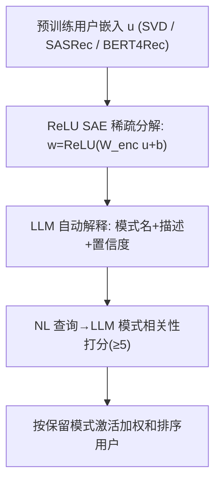

# User Embeddings are Superpositions of Interpretable Behavioral Modes (用户嵌入是可解释行为模式的叠加)

- **会议/期刊**: NeurIPS 2026
- **作者与机构**: Jonathan Kozaczuk, Zheng Dong, Noyan Evirgen 等 (Amazon)
- **推荐链路定位**: 召回（受众检索 / 用户画像，事后分析层）
- **研究方向**: 去偏公平、可信隐私与工业架构 / 大语言模型推荐
- **论文原文**: [论文原文链接](https://arxiv.org/abs/2611.08487v2)
- **开源代码**: 暂未开源

## TL;DR (1分钟核心速览)

用户嵌入稠密不可解释，既无法审计"为何推荐"，也不能用自然语言检索受众。本文把机制可解释性的**叠加假设 (Superposition)** 迁移到用户嵌入：证明在线性均值池化下用户嵌入是稀疏行为模式质心的线性叠加，进而用**稀疏自编码器 (SAE)** 事后分解出可被 LLM 自动命名的行为模式。在合成数据（75 个已知模式）上 SAE 恢复 73/75 个模式；在两个真实数据集上零样本自然语言受众检索的 Lift 达 1.93×/5.30×（Open e-commerce）与 2.53×（MovieLens），全面超越 PCA/ICA/K-Means 与文本嵌入基线。

## Background & Motivation (背景与核心矛盾)

- **主流范式**: 推荐/个性化系统普遍用稠密用户嵌入（SVD 计数矩阵、Transformer 序列编码器）表征用户，直接用于召回与下游模型输入。
- **前人局限**: ① 嵌入不可解释，无法审计其编码了哪些用户信息，也无法像文本语义搜索那样用自然语言查询嵌入空间；② 现有替代方案（先验分类体系、逐用户 LLM 打标）都需原始交互数据、不在嵌入空间操作，且规模化 LLM 打标成本过高。
- **核心洞察 (Key Insight)**: 若用户行为由稀疏混合模型 $p_U(z)=\sum_k w_k p_k(z)$生成（$w$稀疏非负、$\sum_k w_k=1$），则均值池化嵌入在期望上恰为模式质心的稀疏叠加$u\approx\sum_k w_k d_k$，$d_k=\mathbb{E}_{z\sim p_k}[f(z)]$——这正是叠加假设所预测的结构，且质心非正交、需过完备字典。
- **本文切入点**: 把"恢复行为模式"转化为**稀疏字典学习**问题，用 SAE 在预训练嵌入上事后分解，无需改动上游模型。

## Method (核心方法设计)

### 1. 整体框架 (Overall Architecture)

输入是任意预训练用户嵌入 $\{u_i\}$（SVD 计数嵌入或 SASRec/BERT4Rec 均值池化隐状态）。核心是一个 ReLU SAE：编码器把$u$映射到过完备稀疏码$\hat{w}$，解码器用单位化字典列重建$u$；训练后每个 latent 对应一个候选行为模式方向。随后用 LLM 做**自动解释**：把高激活正例与随机负例的交互历史喂给 LLM，产出模式名$\hat{N}_k$、描述$\hat{D}_k$ 与置信度。查询时 LLM 对自然语言受众查询与各模式名打分（0–10，≥5 保留），按保留模式上的激活加权和排序用户。整个流程事后、模型无关。

### 2. 关键设计拆解 (Key Designs)

1. **叠加结构的生成模型论证（为何 SAE 可行）**：前人只把 SAE 用于文本/图像嵌入，其语义来自输入模态；行为嵌入无语义锚点。本文给出线性池化下的精确推导 $u\approx\sum_k w_k d_k$，并指出质心非正交（如"咖啡爱好者"与"家庭咖啡师"）且$m<K$时被迫共享方向，故必须用**过完备**字典而非正交分解（这直接解释了 PCA 为何失效）。对非线性 Transformer，借叠加假设把残差流特征方向聚合成模式级质心$\tilde{d}_k$，均值池化后结构近似保留。
2. **SAE 分解与特征分裂处理**：$\hat{u}=W_{dec}\,\mathrm{ReLU}(W_{enc}u+b)$，损失$\mathcal{L}=\|\hat{u}-u\|_2^2+\lambda\sum_j\hat{w}_j$（ReLU 后非负故去绝对值），解码列单位化。过完备导致**人为特征分裂**（一个真实模式被拆成多个 latent），本文用解码方向余弦 >0.45 的事后合并修复；真实数据上用解码器正交性准则选$\lambda$ 以在训练中抑制分裂。
3. **训练目标、负采样与推理效率**：无负采样（纯重建 + L1 稀疏）。合成数据用自适应 $\lambda$匹配真实平均$L_0$；真实数据固定$\lambda$、4× 过完备（Open e-commerce$d_{hidden}=512$、$L_0\approx23$；MovieLens$d_{hidden}=1024$、$L_0\approx80$）。推理仅需一次前向编码 + 稀疏码加权求和，开销远低于逐用户 LLM 打标；成本主要落在一次性 LLM 自动解释（每 latent 一次）。

## Experimental Setup & Evaluation Protocol (实验设置与评估协议)

- **数据集与预处理**:

| 数据集 | #Users | #Items | #Interactions | 稀疏度/密度 | 特征/场景说明 |
| :--- | :---: | :---: | :---: | :---: | :--- |
| Synthetic | 99,832 | 778,639 | 5.80M | 极稀疏 | 75 个已知模式，2–6 个/用户，5–20% 噪声 |
| Open e-commerce 1.0 | 5,027 | 939,082 | 1.8M | 极稀疏 | 6 个月窗口、1864 类目、TF-IDF+SVD→128 维 |
| MovieLens 1M | 6,040 | 3,706 | 1M | 密度较高 | SASRec/BERT4Rec 均值池化→256 维 |

- **数据划分与防穿越 (Splitting Strategy)**: Open e-commerce 按 **6 个月时间窗**切分，类目任务仅用 2021 前窗口排序、正例为 2021 后购买（严格防穿越）；生活事件任务用 2021 起窗口。MovieLens 按**时间顺序**训练序列推荐器。
- **排名评测协议 (Ranking Protocol)**: 受众检索为**全库排序**（对全体评估用户打分），指标 Lift@$n_{pos}$、AUROC、AUROC_scored（仅非零分用户）、Coverage、FVU（未解释方差）。合成数据用逐特征 Pearson$r$、code–GT 余弦对齐、cos≥0.7 模式恢复率。
- **对比基线与超参设置**: 基线含 PCA、FastICA、K-Means encoding、NMF、随机投影、soft-frozen decoder SAE、LDA（原始计数）与文本嵌入基线（all-MiniLM-L6-v2）。SAE 4× 过完备，5 个训练种子，跨种子配对 Wilcoxon 检验（$p<0.05$）。

## Key Experimental Results (实验关键数据)

### 1. 主实验对比 (Main Results)

**Open e-commerce 零样本 NL 受众检索**（按任务块平均）：

| 任务块 | 方法 | FVU↓ | Lift↑ | AUROC↑ | AUROC_scored↑ | Coverage↑ |
| :--- | :--- | :---: | :---: | :---: | :---: | :---: |
| 类目 | **SAE (ours)** | **0.075** | **1.93×** | **0.705** | **0.678** | 0.735 |
| 类目 | FastICA | 0.083 | 1.86× | 0.695 | 0.660 | 0.770 |
| 类目 | K-Means | 0.388 | 1.85× | 0.680 | 0.663 | 0.614 |
| 类目 | Text-emb | — | 1.39× | 0.633 | 0.633 | 1.000 |
| 生活事件 | **SAE (ours)** | **0.075** | **5.30×** | **0.715** | **0.741** | 0.876 |
| 生活事件 | FastICA | 0.083 | 4.75× | 0.713 | 0.717 | 0.932 |
| 生活事件 | K-Means | 0.388 | 4.29× | 0.676 | 0.693 | 0.738 |
| 生活事件 | Text-emb | — | 2.13× | 0.636 | 0.636 | 1.000 |

**MovieLens 零样本 NL 受众检索**（2 种子 × 32 查询）：

| 编码器 | 方法 | FVU↓ | Lift↑ | AUROC↑ | AUROC_scored↑ | Coverage↑ |
| :--- | :--- | :---: | :---: | :---: | :---: | :---: |
| SASRec | **SAE (ours)** | **0.041** | **2.53** | **0.692** | **0.687** | **0.977** |
| SASRec | K-Means | 0.136 | 2.16 | 0.678 | 0.663 | 0.811 |
| BERT4Rec | **SAE (ours)** | **0.032** | 2.38 | 0.690 | **0.688** | **0.984** |
| BERT4Rec | K-Means | 0.108 | 2.41 | **0.697** | 0.676 | 0.848 |
| — | Text-emb | — | 1.64 | 0.701 | 0.701 | 1.000 |

### 2. 消融实验 (Ablation Study)

合成数据（$d=256$SASRec 嵌入，匹配$L_0$）的模式恢复对比：

| 方法 | Code–GT 对齐↑ | 逐特征 $r$ 中位数↑ | 恢复模式数 (cos≥0.7)↑ |
| :--- | :---: | :---: | :---: |
| Oracle (线性上界) | 0.78 | — | — |
| **SAE** | **0.58** | 0.28 | **0.97** |
| SAE (合并后) | 0.54 | **0.54** | 0.95 |
| FastICA | 0.53 | 0.62 | 0.59 |
| K-Means | 0.45 | 0.30 | 0.52 |
| PCA | 0.25 | 0.17 | 0.00 |
| LDA (原始计数) | 0.37 | 0.27 | — |

### 3. 关键实验发现 (Key Findings)

1. **SAE 在强叠加下仍逼近线性上界**：$m<K=75$时 SAE 的 code–GT 对齐紧贴 oracle，且随维度从$m=16$ 到 128 恢复率由 0.47 升至 0.98；PCA 因强制正交在任何维度恢复率 ≤9%，直接印证"质心非正交必须过完备字典"的理论判断。
2. **特征分裂是人为伪影、可事后修复**：原始 SAE 逐特征 $r\approx0.35$，按解码余弦 >0.45 合并后升至$\approx0.70$（$m=128$），说明一个真实模式被拆成多个 latent 而非模式本身更细。
3. **SAE 的优势是"结构性覆盖"而非单纯排序**：MovieLens 上与 K-Means 在 Lift/AUROC 打平（$p\ge0.1$），但 Coverage 98% vs. 81–85%（$p<10^{-4}$）、FVU 0.032–0.041 vs. 0.108–0.136；根源是 SAE 解码器近正交（平均绝对余弦 0.06–0.08）而 K-Means 质心重叠（0.17–0.29），重叠质心复述同一区域、遗漏其他区域。受众画像上 K-Means 对同一概念的冗余特征数是 SAE 的 2.2×（2.20 vs 1.00）。

## Highlights & Limitations (亮点、对比与审稿批判)

- **与代表作对比 (vs. Prior Work)**: 相比 MacridVAE/DisenHAN 等**训练时端到端解耦**，本文完全事后、不改上游模型；相比 LDA/主题模型在**原始交互计数**上分解，本文直接在嵌入空间操作，利用共看序列、评分强度等计数无法捕捉的信号（合成数据上 LDA 对齐 0.37 vs. SAE 0.58）；相比 Spíšák 等把 SAE 插入 CF 自编码器做推荐操控，本文目标是**可解释性与受众检索**，且有 ground-truth 模式验证。
- **可迁移亮点**: ① "解码器正交性准则选 $\lambda$" 可迁移到任何过完备字典学习的稀疏度调参；② 用 LLM 自动命名 + 置信度门控（≥0.6）把无语义锚点的行为 latent 转成可查询文本接口，可复用到任意稠密向量库的语义检索。
- **审稿级局限批判**: ① 真实数据无 ground-truth 模式，检索优势部分来自 LLM 命名质量——换用 Llama 3.3 70B 命名后 SAE 对 K-Means 的 AUROC 领先从 0.031 缩到 <0.01，说明结论幅度对解释模型敏感；② 仅测 ReLU SAE、仅两个正反馈消费域、仅 Transformer 序列编码器，且单点读出（[CLS]/last-token）的线性池化论证不成立，泛化性待验证；③ 自然语言可查询嵌入本身带来隐私风险（可低成本推断生活事件等敏感属性），论文虽提出可枚举剔除敏感方向，但未做量化评估。

## Rating (四维评分)

- **方法创新性 (Novelty)**: ⭐⭐⭐⭐ （首次把叠加假设与 SAE 系统迁移到行为嵌入，并给出线性池化下的精确生成模型推导，理论动机扎实）
- **评估协议与实验扎实度 (Protocol & Experiments)**: ⭐⭐⭐⭐ （合成 ground-truth + 两真实数据集 + 5 种子配对 Wilcoxon 检验完整，但真实数据缺 ground-truth、解释模型敏感性仅单种子复现）
- **写作与数学规范度 (Clarity & Rigor)**: ⭐⭐⭐⭐ （生成模型到 SAE 的推导链条清晰，特征分裂与合并的论证严谨；非线性情形仅作合理性论证而非严格证明）
- **工业落地与复现价值 (Industrial & Practical Value)**: ⭐⭐⭐⭐ （事后、模型无关、仅需预训练嵌入，可直接用于推荐审计与受众圈选；但未开源，LLM 自动解释有一次性成本）
