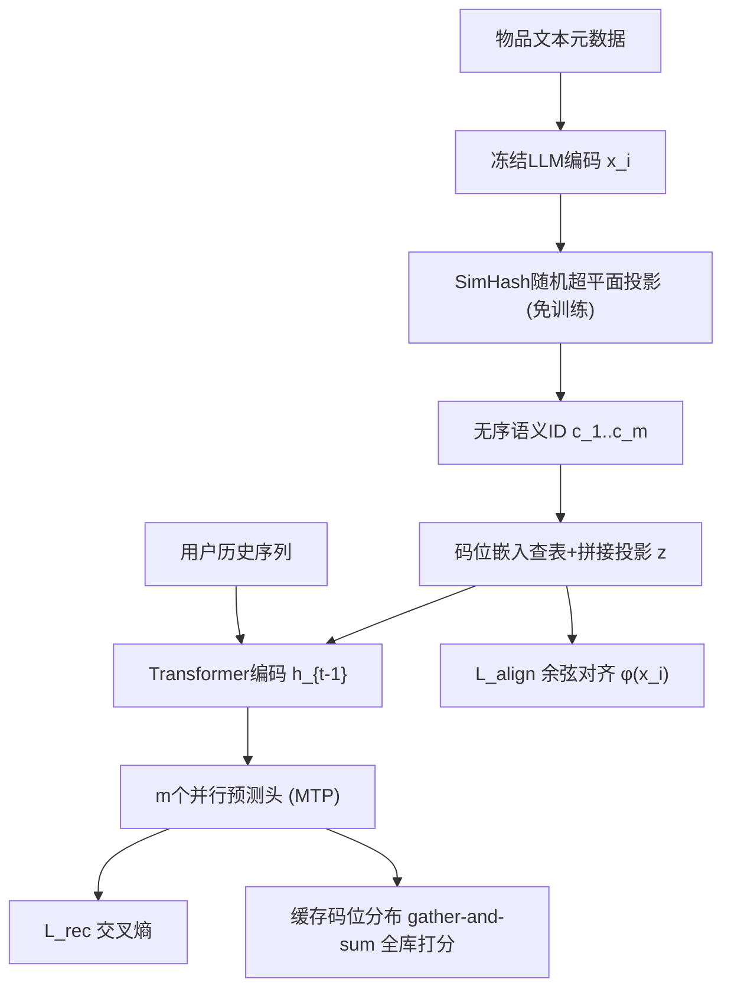

# Rethinking Semantic ID Construction for Generative Recommendation: SimHash with Parallel Decoding and Semantic Alignment (重思生成式推荐的语义ID构建：SimHash、并行解码与语义对齐)

- **会议/期刊**: NeurIPS 2026
- **作者与机构**: Yuqing Liu, Huiyuan Chen, Yibo Wang, Wooseong Yang, Philip S. Yu (University of Illinois Chicago; Amazon)
- **推荐链路定位**: 端到端生成式（语义ID构建 + 序列生成式检索）
- **研究方向**: 生成式推荐与离散语义ID / 序列推荐
- **论文原文**: [论文原文链接](https://arxiv.org/abs/2610.07402v1)
- **开源代码**: [开源代码仓库链接](https://github.com/KevinC2015/Flash)

## TL;DR (1分钟核心速览)

TIGER 的消融实验让"LSH/SimHash 分词天生劣于 RQ-VAE"成为共识，本文指出该结论是**归因错误**：真正的病灶是 SimHash 产生的无序、无残差依赖的码与自回归（AR）解码的序列依赖假设**结构错配**，叠加刚性离散化的信息损失。作者提出 FLASH：Stage I 用冻结 LLM 文本嵌入 + SimHash 免训练构建语义ID；Stage II 用多 token 预测（MTP）并行解码对齐无序结构，并加余弦对齐损失把物品表征锚回 LLM 嵌入空间。在 Amazon 四域、全库排序协议下，FLASH 全面超越 TIGER/RPG，NDCG@5 相对提升 5.51%–14.46%，分词耗时从数十秒降至 0.5 秒内。

## Background & Motivation (背景与核心矛盾)

- **主流范式**: 语义ID生成式推荐把物品编码为离散 token 序列，用序列模型生成下一物品的 ID。RQ 系（TIGER、LETTER、DIGER）用 RQ-VAE 产生层级依赖码并配 AR 解码；PQ 系（RPG、VQ-Rec）用 OPQ 产生无序码并配并行解码。
- **前人局限**: ① 两类方法都依赖**需训练的量化器**，引入额外训练复杂度且与推荐目标存在错位；② RQ 系受 AR 推理成本约束，语义ID 通常只能 4 个 token，细粒度语义表达受限；③ TIGER 的消融把 SimHash 判为"显著更差"，但该对比**未控制解码范式**，结论被污染。
- **核心洞察 (Key Insight)**: 作者做初步实验（图1）：仅把 LSH 分词的解码从 AR 换成并行解码，Recall@10/NDCG@10 即大幅回升并逼近 RQ-VAE，说明差距主要来自**归纳偏置错配**而非哈希本身；但残余差距表明还需补偿离散化信息损失。由此提炼两条设计原则——**结构兼容性**（解码范式须匹配分词诱导的依赖结构）与**语义接地**（显式补偿离散化损失）。
- **本文切入点**: 用"免训练 SimHash + 并行 MTP 解码 + LLM 嵌入对齐"三件套同时兑现两条原则，把分词器从"学习量化"降级为"随机投影"，把省下的复杂度预算投入到解码结构与语义监督上。

## Method (核心方法设计)

### 1. 整体框架 (Overall Architecture)

FLASH 是两阶段框架。Stage I 完全离线、免训练：用冻结 LLM 对物品文本元数据（标题、描述、类目）编码得 $\mathbf{x}_i\in\mathbb{R}^{d_{\text{text}}}$，对每个码位$j$采样$B=\lceil\log_2 M\rceil$个高斯随机超平面做符号投影并转整数，得到无序语义ID。Stage II 训练序列模型：每个码位查独立码本嵌入表，拼接后线性投影聚合为物品表征$\mathbf{z}$，送入 Transformer 编码用户历史；末端接$m$个并行预测头，以 MTP 目标同时预测目标物品全部码位，并附加余弦对齐损失把$\mathbf{z}$锚回$\phi(\mathbf{x}_i)$。推理时先缓存各码位全码本概率分布，再对候选物品做 gather-and-sum 打分，复杂度与物品数解耦。

### 2. 关键设计拆解 (Key Designs)

1. **免训练 SimHash 语义ID构建（Stage I）**：痛点是用 RQ-VAE/OPQ 学量化器需数十至数百秒训练且与推荐目标错位。本文对每个码位 $j$采样独立高斯超平面$\{\mathbf{r}_{j,b}\}_{b=1}^{B}$，直接对 LLM 嵌入做符号投影：
$$c_j^{(i)}=\Big(\sum_{b=1}^{B}\mathbb{I}[\mathbf{x}_i\cdot\mathbf{r}_{j,b}>0]\cdot 2^{b-1}\Big)\boldsymbol{o}d M+1$$
码本大小 $M$ 取 2 的幂使模映射在码本上分布更均匀。直觉：SimHash 的局部敏感性保证语义相近物品投影后汉明距离小，粗粒度相似性得以保留，而超平面全局共享、零参数、零训练。

2. **并行解码 + MTP 目标（结构兼容性）**：SimHash 码位间无残差依赖、无内在顺序，AR 解码强加的序列依赖是有害归纳偏置。本文采用因子化分解 $P((c_1^{(t)},\dots,c_m^{(t)})|\mathbf{h}_{t-1})=\prod_{j=1}^{m}p_j(c_j^{(t)}|\mathbf{h}_{t-1})$，每个码位一个轻量 MLP 头$f_j(\cdot)$，与码本嵌入做带温度$\tau_j$ 的点积 softmax：
$$p_j(c|\mathbf{h}_{t-1})=\frac{\exp\big(f_j(\mathbf{h}_{t-1})^{\top}\mathbf{e}_c^{(j)}/\tau_j\big)}{\sum_{c'\in\mathcal{C}_j}\exp\big(f_j(\mathbf{h}_{t-1})^{\top}\mathbf{e}_{c'}^{(j)}/\tau_j\big)}$$
关键副作用：并行解码**解除了 AR 的 ID 长度瓶颈**，使 $m$ 可放大到 32/64 以提升表征容量；同时训练时施加码位级码本 dropout（整位掩码后重缩放），防止模型过度依赖特定码位。

3. **语义对齐损失（语义接地）与训练目标**：SimHash 缺少 RQ-VAE 重建目标那样的隐式语义锚，离散化必然丢失细粒度信息。本文引入可训练线性投影 $\phi:\mathbb{R}^{d_{\text{text}}}\to\mathbb{R}^{d}$，用负余弦相似度把序列中的物品表征拉回冻结 LLM 嵌入空间：
$$\mathcal{L}_{\text{align}}=-\frac{1}{|\mathcal{S}|}\sum_{i\in\mathcal{S}}\cos\big(\mathbf{z}_i,\phi(\mathbf{x}_i)\big),\qquad \mathcal{L}=\mathcal{L}_{\text{rec}}+\lambda_{\text{align}}\mathcal{L}_{\text{align}}$$
其中 $\mathcal{L}_{\text{rec}}=-\frac{1}{m}\sum_{j=1}^{m}\log p_j(c_j^{(t)}|\mathbf{h}_{t-1})$。训练采用全库 softmax 交叉熵（**免负采样**），无需 BPR/InfoNCE 式负例构造。推理时先算各码位全码本分布$\mathbf{q}^{(j)}=\text{softmax}(\mathbf{E}^{(j)}f_j(\mathbf{h}_{t-1})/\tau_j)\in\mathbb{R}^{M}$并缓存，物品得分$\text{score}(i)=\sum_{j=1}^{m}\log q^{(j)}_{c_j}$，总开销$O(mMd+Nm)$，优于逐物品相似度评估的$O(Nmd)$。

## Experimental Setup & Evaluation Protocol (实验设置与评估协议)

- **数据集与预处理**: Amazon Product Reviews 四个类目，沿用 TIGER/RPG 的标准预处理（含 5-core 过滤与元数据拼接）：

| 数据集 | #Users | #Items | #Interactions | 稀疏度/密度 | 特征/场景说明 |
| :--- | :---: | :---: | :---: | :---: | :--- |
| Beauty | 22,363 | 12,101 | 198,502 | 99.93% 稀疏 | 美妆，文本元数据丰富 |
| Toys | 19,412 | 11,924 | 167,597 | 99.93% 稀疏 | 玩具游戏 |
| Sports | 35,598 | 18,357 | 296,337 | 99.95% 稀疏 | 运动户外 |
| CDs | 75,258 | 64,443 | 1,097,503 | 99.98% 稀疏 | 音乐CD，物品规模最大 |

- **数据划分与防穿越 (Splitting Strategy)**: 采用 `Leave-One-Out` 序列划分（最后一交互测试、倒数第二验证），与 TIGER 一致；冷启动实验额外留出部分目标物品**训练期完全不可见**，仅用于评测。
- **排名评测协议 (Ranking Protocol)**: 无偏 `Full-Ranking`（对全库未交互物品排序），指标 Recall@K 与 NDCG@K，$K\in\{5,10\}$；无采样负例，杜绝采样偏差。
- **对比基线与超参设置**: 三类基线——Item-ID 系（Caser、GRU4Rec、HGN、BERT4Rec、SASRec、S³-Rec）、RQ 系（TIGER、LETTER、DIGER）、PQ 系（RecJPQ、VQ-Rec、RPG）。FLASH 网格搜索 $m\in\{4,8,16,32,64\}$、$M\in\{128,256,512,1024\}$、$\lambda_{\text{align}}\in[0,1]$、学习率$[0.001,0.01]$，码位 dropout 固定 0.2，batch 256，最多 300 epoch、20 轮早停；显著性用配对$t$检验（$p<0.05$）。

## Key Experimental Results (实验关键数据)

### 1. 主实验对比 (Main Results)

| Model | Beauty R@10 | Beauty N@10 | Toys R@10 | Toys N@10 | Sports R@10 | Sports N@10 | CDs R@10 | CDs N@10 |
| :--- | :---: | :---: | :---: | :---: | :---: | :---: | :---: | :---: |
| SASRec | 0.0605 | 0.0318 | 0.0675 | 0.0374 | 0.0350 | 0.0192 | 0.0619 | 0.0263 |
| S³-Rec | 0.0647 | 0.0327 | 0.0700 | 0.0376 | 0.0385 | 0.0204 | 0.0375 | 0.0182 |
| TIGER (RQ) | 0.0648 | 0.0384 | 0.0712 | 0.0432 | 0.0400 | 0.0225 | 0.0748 | 0.0411 |
| LETTER (RQ) | 0.0689 | 0.0402 | 0.0727 | 0.0437 | 0.0420 | 0.0232 | 0.0723 | 0.0398 |
| DIGER (RQ) | 0.0692 | 0.0421 | 0.0719 | 0.0442 | 0.0388 | 0.0241 | 0.0717 | 0.0369 |
| VQ-Rec (PQ) | 0.0664 | 0.0383 | 0.0737 | 0.0423 | 0.0300 | 0.0173 | 0.0520 | 0.0292 |
| RPG (PQ) | 0.0809 | 0.0464 | 0.0869 | 0.0490 | 0.0463 | 0.0263 | 0.0735 | 0.0415 |
| **FLASH** | **0.0832** | **0.0489** | **0.0914** | **0.0544** | **0.0487** | **0.0285** | **0.0769** | **0.0446** |
| Improv. (vs best) | +2.84% | +5.39% | +5.18% | +11.02% | +5.18% | +8.37% | +2.81% | +7.47% |

（N@5 维度提升更显著：Beauty +5.51%、Toys +14.46%、Sports +9.72%、CDs +9.47%。）

### 2. 消融实验 (Ablation Study)

**分词器替换（统一并行解码 + 对齐损失，Beauty/Toys）**：

| Tokenizer | Beauty R@10 | Beauty N@10 | Toys R@10 | Toys N@10 | 分词耗时(s)↓ |
| :--- | :---: | :---: | :---: | :---: | :---: |
| Random | 0.0432 | 0.0261 | 0.0612 | 0.0324 | 0.02 |
| RQ-VAE | 0.0832 | 0.0483 | 0.0856 | 0.0481 | 67.08 / 77.41 |
| RQ-KMeans | 0.0812 | 0.0462 | 0.0861 | 0.0490 | 8.19 / 12.07 |
| OPQ | 0.0851 | 0.0498 | 0.0905 | 0.0523 | 292.89 / 111.08 |
| **SimHash** | 0.0832 | **0.0489** | **0.0914** | **0.0544** | **0.06 / 0.09** |

**语义对齐损失开关（R@10 / N@10 相对增益）**：

| Model | Beauty R@10 | Beauty N@10 | Toys R@10 | Toys N@10 |
| :--- | :---: | :---: | :---: | :---: |
| SASRec w/ align | +13.06% | +13.84% | +8.30% | +12.30% |
| TIGER w/ align | +9.57% | +4.43% | +7.02% | +5.09% |
| FLASH w/ align | +7.49% | +10.38% | +6.40% | +8.80% |

### 3. 关键实验发现 (Key Findings)

1. **结构兼容性是被误判的主因，而非哈希本身**：在统一并行解码+对齐后，SimHash 在 Toys 上 R@10 达 0.0914，反超 OPQ 的 0.0905 与 RQ-VAE 的 0.0856；而 Random 码在同等管线下跌超 40% N@10，证明"结构兼容"必须叠加"语义信息"才成立——这直接推翻了 TIGER 消融的归因。
2. **对齐损失是跨范式的通用正则，且对弱模型增益更大**：SASRec 加对齐后 Beauty R@10 提升 13.06%、TIGER 提升 9.57%、FLASH 提升 7.49%，呈"基线越弱、边际收益越大"的规律，说明语义接地补偿的是离散化/ID化共有的信息损失，而非 FLASH 专属补丁。
3. **容量应加在序列长度而非码本粒度上**：$m$从 4 增至 32 收益显著、到 64 边际递减；$M$从 128 到 256 小幅提升后即回落。同时 SimHash 在 Beauty 上碰撞数从$m=4$的 78 降至$m=64$ 的 1，分词比 RQ-VAE（GPU）快 146×–2448×，实现"更长ID + 更低成本"的双赢；冷启动下相对 TIGER 的 N@10 提升达 5.1%–18.2%。

## Highlights & Limitations (亮点、对比与审稿批判)

- **与代表作对比 (vs. Prior Work)**: 与 TIGER 的本质区别在于**放弃学习量化器**并把解码从 AR 换成 MTP，同时用对齐损失替代 RQ-VAE 的重建目标作为语义锚；与 RPG 同属并行解码阵营，但 RPG 仍需 OPQ 训练（Beauty 上 292.89 秒），FLASH 仅 0.06 秒且精度更高；与 LETTER/DIGER 的差异在于不引入额外层级或难度感知的量化结构。
- **可迁移亮点**: ① "分词结构—解码范式匹配"这一诊断框架可直接用于评估任何新 SID 方案（如扩散/双向解码）；② 余弦对齐损失作为即插即用正则，可无痛加到 SASRec、TIGER 等任意序列推荐模型上，代码改动极小。
- **审稿级局限批判**: ① 强依赖冻结 LLM 文本嵌入质量，文本稀疏或噪声大的类目（如纯图像驱动的短视频/时尚）可能退化，且未验证多模态；② 哈希碰撞虽在当前规模可控，但 CDs（64k 物品）已显规模压力，工业亿级物品下碰撞与码本冲突风险未评估；③ 全部实验限于 Amazon 公开离线基准，缺线上 A/B 与延迟实测，$m$ 增大带来的打分 gather 开销在真实 QPS 下仍是未知数。

## Rating (四维评分)

- **方法创新性 (Novelty)**: ⭐⭐⭐⭐ （以"结构错配"重新归因并推翻既有共识，洞察锋利；但组件本身——SimHash、MTP、余弦对齐——均为已有技术的巧妙重组，理论新意有限）
- **评估协议与实验扎实度 (Protocol & Experiments)**: ⭐⭐⭐⭐ （四域全库排序、配对 t 检验、分词器替换与对齐开关双消融、冷启动与超参分析齐备；缺线上验证与更大规模碰撞压力测试）
- **写作与数学规范度 (Clarity & Rigor)**: ⭐⭐⭐⭐ （两条设计原则贯穿全文、公式简洁且推理复杂度推导清晰；对 SimHash 局部敏感性的理论刻画偏直觉，缺形式化误差界）
- **工业落地与复现价值 (Industrial & Practical Value)**: ⭐⭐⭐⭐⭐ （分词零训练、CPU 亚秒级、推理 $O(mMd+Nm)$ 且代码开源，是少数"降复杂度还涨点"的方案，工程迁移门槛极低）

