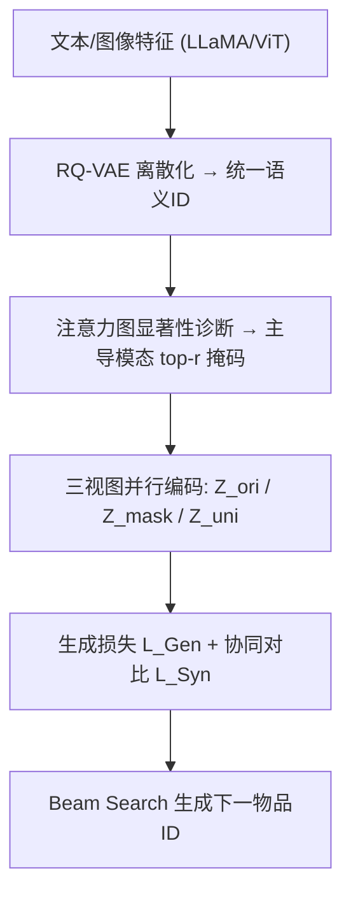
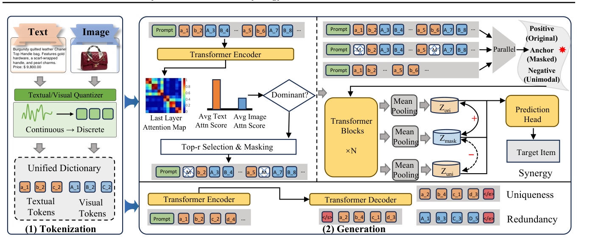

# SynGR: Unleashing the Potential of Cross-Modal Synergy for Generative Recommendation (释放跨模态协同潜力用于生成式推荐)

- **会议/期刊**: ICML 2026
- **作者与机构**: Wei Chen, Xingyu Guo, Shuang Li, Fuwei Zhang, Meng Yuan, Jing Fan, Zhao Zhang, Deqing Wang, Fuzhen Zhuang（北京航空航天大学）
- **推荐链路定位**: 端到端生成式（语义 ID 自回归生成）
- **研究方向**: 生成式推荐 / 多模态推荐
- **论文原文**: [https://arxiv.org/abs/2605.18920v2](https://arxiv.org/abs/2605.18920v2)
- **开源代码**: 暂未开源

## TL;DR (1分钟核心速览)

多模态生成式推荐（GR）现有方法以"对齐"为核心融合视觉与文本，只强化冗余信息，几乎不挖掘仅由跨模态交互涌现的协同信息（PID 实测 MACRec 仅 7.5%）。SynGR 用显著性感知掩码主动压制主导模态捷径，再以协同对比学习把表征逼向协同分量 $S$。在 Arts/Games/Instruments 三数据集、Leave-One-Out + Full-Ranking 协议下，相对最强基线 MACRec 平均提升约 10%，Instruments 上 HR@10 提升 28.58%。

## Background & Motivation (背景与核心矛盾)

- **主流范式**: TIGER 开创 RQ-VAE 语义 ID + 自回归生成；MQL4GRec、MACRec 进一步把视觉/文本量化进统一码本，以对齐（alignment）方式融合多模态。
- **前人局限**: ①对齐目标本质是最大化 $I(X_v;X_t)=R$，只强化冗余，协同分量$S$ 完全不在优化目标内；②文本离散紧凑、视觉连续高维，同等码本容量下信息密度不对等，文本成为"阻力最小路径"，模型注意力严重偏向文本（图 1(c)），单模态收敛压制高阶交互。
- **核心洞察 (Key Insight)**: 用 PID 分解 $I(X_v,X_t;Y)=R+S+U_v+U_t$，可证明现有目标满足$I(X_v;Y)+I(X_t;Y)-I(X_v;X_t)<I(X_v,X_t;Y)$，即协同项$S$被系统性遗漏；而$S$ 恰是"品牌调性+价格定位"这类单模态无法推断的涌现语义。
- **本文切入点**: 不改进融合算子，而是**主动破坏单模态捷径**——掩掉主导模态的高显著 token，迫使生成目标只能靠跨模态交互满足。

## Method (核心方法设计)

### 1. 整体框架 (Overall Architecture)

两阶段：先用冻结 LLaMA/ViT 提特征，经模态专属 RQ-VAE（4 层、码本 256）离散化为带大小写前缀的统一词表序列 $x_i=[a_1,b_2,c_3,A_1,B_2,C_3]$；生成阶段对每条历史并行构造三视图——原始$H_{ori}$、显著性掩码锚点$H_{mask}$、单模态捷径$H_{uni}$，共享参数 Transformer 编码后做掩码均值池化得$Z_{ori},Z_{mask},Z_{uni}$，联合优化生成 NLL 与协同对比损失，推理时仅用 beam search（size=20）自回归解码，对比分支不参与推理。

<figure class="paper-figure" markdown="span">
  <figcaption>图2. 所提出的SynGR框架概览。(1) 在分词阶段，连续文本与视觉特征被离散化</figcaption>
</figure>

### 2. 关键设计拆解 (Key Designs)

1. **显著性感知掩码（Saliency-Aware Masking）**：痛点是对齐式训练让主导模态垄断梯度。取编码器末层多头注意力，聚合每个 token 收到的注意力质量 $\ell_i=\frac{1}{MN}\sum_{m}\sum_{j}A^{(m)}_{j,i}$，按模态求均值$\bar{\ell}_t,\bar{\ell}_v$判定主导模态$M_{dom}=\arg\max\{\bar{\ell}_t,\bar{\ell}_v\}$，再掩掉其中 top-$r$显著 token：$\tilde{x}_i=[\text{MASK}]$if$i\in\text{top-}r(M_{dom})$。直觉：被掩的是"最容易猜中答案"的捷径特征，掩掉后模型只能从另一模态与交互中重建语义，逼近 Definition 1 的 Unimodal Obscuration 条件。

2. **协同对比学习（Synergistic Contrastive Learning）**：把理论目标 $\max I(Z_{syn};Y)\ \text{s.t.}\ \min\sum_m I(Z_{syn};Z_m)$落地为三元组 InfoNCE——锚点$Z_{mask}$拉近原始$Z_{ori}$、推远单模态$Z_{uni}$：
$$\mathcal{L}_{Syn}=-\log\frac{e^{\text{sim}(Z_{mask},Z_{ori})/\tau}}{e^{\text{sim}(Z_{mask},Z_{ori})/\tau}+e^{\text{sim}(Z_{mask},Z_{uni})/\tau}}$$
关键在负样本不是 batch 内随机样本，而是**构造的单模态硬负样本**，直接惩罚"只靠文本/只靠图像"的表征；文本、视觉两个子任务对称各算一次。

3. **训练目标与推理效率**：总损失 $\mathcal{L}=\mathcal{L}_{Gen}+\lambda\mathcal{L}_{Syn}$，其中$\mathcal{L}_{Gen}$对三视图均算 NLL 以保留$R$与$U$；无额外负采样器。显著性复用前向注意力图（$O(MN^2)$），对比仅$O(Nd)$ 池化，推理零额外开销，训练反而比 MACRec 快 22–23%。

## Experimental Setup & Evaluation Protocol (实验设置与评估协议)

- **数据集与预处理**: Amazon Reviews 三个类目，采用 5-core 过滤；预训练语料为另外 6 个类目共约 7.1M 交互（884,918 用户 / 255,181 物品）。

| 数据集 | #Users | #Items | #Interactions | 稀疏度 | 平均序列长 |
| :--- | :---: | :---: | :---: | :---: | :---: |
| Arts | 22,171 | 9,416 | 174,079 | 99.92% | 7.85 |
| Games | 42,259 | 13,839 | 373,514 | 99.94% | 8.84 |
| Instruments | 17,112 | 6,250 | 136,226 | 99.87% | 7.96 |

- **数据划分与防穿越**: `Leave-One-Out`（最后一项测试、倒数第二项验证），与 MQL4GRec/MACRec 协议一致。
- **排名评测协议**: 无偏 `Full-Ranking`（全物品库排序），指标 HR@{1,5,10}、NDCG@{5,10}；所有生成式模型统一 beam size=20。
- **对比基线与超参设置**: 三类基线——序列推荐（GRU4Rec/SASRec/BERT4Rec/FDSA/S³-Rec/P5-CID）、多模态序列（MISSRec）、生成式（VIP5/TIGER/MQL4GRec/MACRec）。骨干为 4 层 T5、$d=64$、6 头；RQ-VAE 码本 256、4 层；batch 1024，$\tau=0.07$，$\lambda$网格$\{0.001,\dots,0.009\}$，掩码率$r$网格$\{0,0.1,\dots,1.0\}$。

## Key Experimental Results (实验关键数据)

### 1. 主实验对比 (Main Results)

| Model | Arts HR@10 | Arts N@10 | Games HR@10 | Games N@10 | Instr. HR@10 | Instr. N@10 |
| :--- | :---: | :---: | :---: | :---: | :---: | :---: |
| SASRec (ICDM'18) | 0.1250 | 0.0706 | 0.0985 | 0.0461 | 0.1233 | 0.0746 |
| BERT4Rec (CIKM'19) | 0.0922 | 0.0575 | 0.0725 | 0.0366 | 0.1081 | 0.0739 |
| MISSRec (MM'23) | 0.1321 | 0.0815 | 0.1048 | 0.0499 | 0.1361 | 0.0880 |
| TIGER (NeurIPS'23) | 0.1167 | 0.0806 | 0.0857 | 0.0453 | 0.1221 | 0.0950 |
| MQL4GRec (ICLR'25) | 0.1327 | 0.0950 | 0.1033 | 0.0548 | 0.1375 | 0.1060 |
| MACRec (AAAI'26) | 0.1329 | 0.0953 | 0.1078 | 0.0565 | 0.1363 | 0.1046 |
| **SynGR (Ours)** | **0.1449** | **0.1010** | **0.1092** | **0.0596** | **0.1768** | **0.1189** |
| Improv.% | +4.55% | +5.98% | +1.30% | +5.49% | +28.58% | +12.17% |

（HR@1 提升更显著：Arts +4.09%、Games +17.79%、Instruments +2.04%；NDCG@5 分别 +5.88%/+8.28%/+6.96%。）

### 2. 消融实验 (Ablation Study)

| 变体 | Arts HR@10 | Arts N@10 | Games HR@10 | Games N@10 |
| :--- | :---: | :---: | :---: | :---: |
| SynGR 完整 | **0.1449** | **0.1010** | **0.1092** | **0.0596** |
| w/o SM（随机掩码替代显著性掩码） | 下降 | 下降 | 下降 | 下降 |
| w/o UN（batch 随机负替代单模态硬负） | 下降 | 下降 | 下降 | 下降 |
| w/o SCL（去掉协同对比损失） | 进一步下降 | 进一步下降 | 降幅最大 | 降幅最大 |

（原文以图 5 柱状图呈现，此处按趋势整理；完整数值见原文图 5。）

### 3. 关键实验发现 (Key Findings)

1. **协同信息越稀缺的域收益越大**：Instruments 上 HR@10 提升 28.58%，远高于 Games 的 1.30%，说明当单模态线索本身已足够强（Games 文本描述信息量大）时协同增益有限，而乐器类目依赖"外观工艺+规格描述"联合判断，正是 $S$ 的主场。
2. **掩码必须"定向"而非"随机"**：w/o SM 用随机掩码即明显掉点，证明增益不来自数据增广式的扰动，而来自精准压制主导模态的高显著捷径 token；$r$的敏感性曲线在$[0.2,0.4]$达峰、$r>0.5$ 后掉点，印证"适度破坏、过度伤语义"。
3. **硬负样本比对比损失本身更关键**：w/o UN 的掉点说明 batch 内随机负无法提供有效梯度，构造的单模态视图才是把 $Z_{mask}$ 推离捷径分布的关键；而 w/o SCL 在 Games 上降幅最大，表明纯生成目标完全无法自发摆脱模态主导。

## Highlights & Limitations (亮点、对比与审稿批判)

- **与代表作对比 (vs. Prior Work)**: 与 MACRec 的本质区别在于优化目标——MACRec 用多方位量化+显式对齐强化 $R$，SynGR 则把$S$ 写进损失；与 MQL4GRec 的"量化语言统一"相比，SynGR 不改 tokenization，只在生成阶段做表征干预，因而可即插即用；与通用多模态对比学习（如 SGL 类图增广）相比，其负样本是语义明确的"单模态捷径"而非随机扰动视图。
- **可迁移亮点**: ①用前向注意力图做零成本"主导模态诊断"，可迁移到任何多源特征融合的生成式模型做捷径检测；②"构造单模态硬负样本"的思路可直接用于多场景/多行为序列建模中的主导行为抑制。
- **审稿级局限批判**: ①协同性的验证仍以 PID 近似指标（Algorithm 1 的归一化差值）为主，缺乏对 $S$的直接可解释度量，Lemma 1 也自认只是归纳偏置而非有限样本保证；②仅在 Amazon 三个类目、单一 T5-4 层小骨干上验证，未报告线上 A/B 或更大规模工业场景，且掩码率$r$、$\lambda$ 需逐数据集调参，跨域鲁棒性存疑。

## Rating (四维评分)

- **方法创新性 (Novelty)**: ⭐⭐⭐⭐ （用 PID 把"对齐≠协同"讲成可证明的信息论缺口，掩码+硬负对比的组合简洁且直击痛点）
- **评估协议与实验扎实度 (Protocol & Experiments)**: ⭐⭐⭐⭐ （Leave-One-Out + Full-Ranking 严谨，12 个基线覆盖三类范式，但消融仅以柱状图呈现、缺显著性检验）
- **写作与数学规范度 (Clarity & Rigor)**: ⭐⭐⭐⭐ （PID 推导与 Lemma 1 证明完整，复杂度分析清晰；Lemma 结论的"近似"性质表述诚实但削弱了理论强度）
- **工业落地与复现价值 (Industrial & Practical Value)**: ⭐⭐⭐⭐ （推理零额外开销、训练比 MACRec 快 22–23%、收敛快近一半，工程友好；但代码未开源、依赖两阶段预训练成本）

