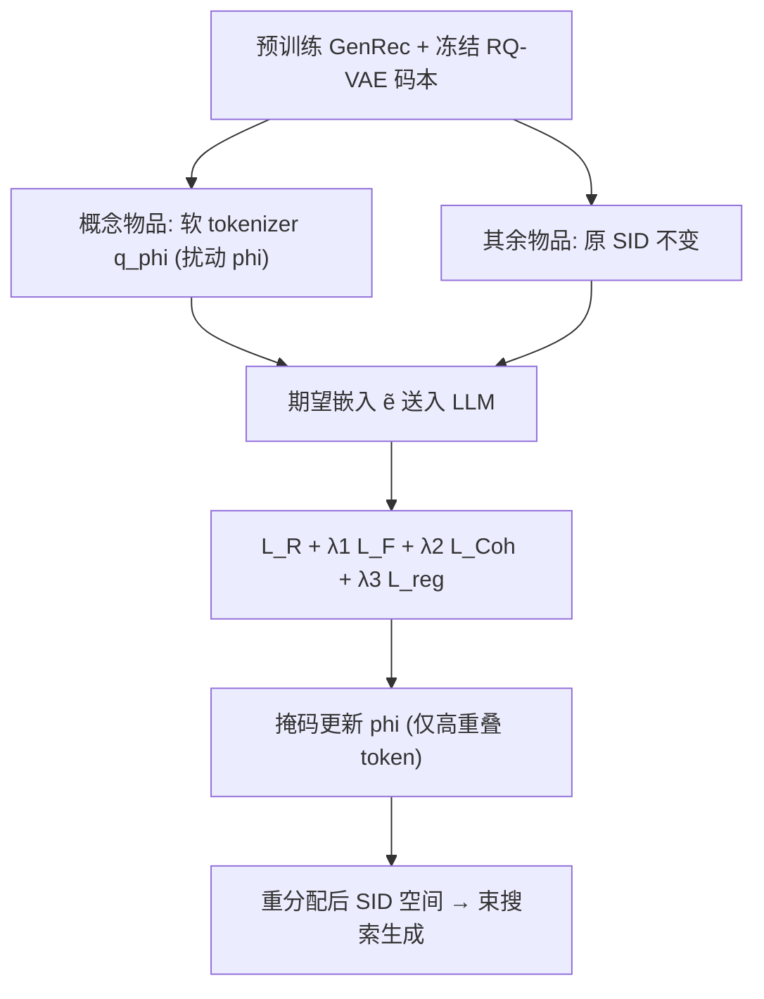

# TRACER: Token ReAssignment for Concept ERasure in Generative Recommendation (面向生成式推荐概念擦除的 Token 重分配)

- **会议/期刊**: NeurIPS 2026
- **作者与机构**: Ziheng Chen (Stony Brook), Jiali Cheng (UMass Lowell), Zezhong Fan (Columbia), Hadi Amiri (UMass Lowell), Diyuan Wu (ISTA), Gabriele Tolomei (Sapienza), Yang Zhang (NUS)
- **推荐链路定位**: 端到端生成式（模型后处理 / 遗忘阶段）
- **研究方向**: 生成式推荐 / 去偏公平与可信隐私
- **论文原文**: [https://arxiv.org/abs/2606.07688v2](https://arxiv.org/abs/2606.07688v2)
- **开源代码**: 暂未开源

## TL;DR (1分钟核心速览)

生成式推荐（GenRec）把物品编码为语义 ID（SID）序列后自回归生成，但 SID 是**无语义的抽象标识符**，遗忘集与保留集物品大量共享同一 token，直接套用 LLM 遗忘方法（抑制 forget token 似然）会同时打伤保留集，产生严重梯度冲突。TRACER 提出**可微 token 重分配**：把概念相关物品的 SID 软松弛为码本上的概率分布并加可学习扰动 $\phi$，让遗忘目标把概念物品"推"向保留集罕用的 token，再配语义连贯正则。在 Amazon 三域、5 个 GenRec 骨干上，遗忘集 HR@5 较最强基线 PISCES 再降 20%+，同时保留原始模型约 97.1% 的效用、语义相似度仅掉 2.0%。

## Background & Motivation (背景与核心矛盾)

- **主流范式**: TIGER/LETTER/ETEGRec/MiniOneRec 等先用 RQ-VAE 把物品文本编码为分层 SID $s_i=[s^1_i,\dots,s^L_i]$，再用 LLM 自回归预测下一物品的 SID；物品身份完全由离散 token 序列决定。
- **前人局限**: ① LLM 遗忘方法（ELM/RMU/RepNoise/FLAT）依赖"概念可定位到可解释词 token"这一前提，而 SID 不可解释且被遗忘/保留物品共享，抑制共享 token 必然误伤保留集；② 生成时过滤概念物品只改输出不改内部表征，概念仍通过用户历史影响预测，且被屏蔽位置会填上不匹配的替代品，效用骤降。
- **核心洞察 (Key Insight)**: 作者用"无概念数据重训练"的 oracle 模型做对照（图 1）：重训练后遗忘-保留 token 重叠分数显著下降、重叠 token 的嵌入由高度聚集变为分散，而无关 token 基本稳定。即**成功遗忘的本质是重塑 SID 分配结构、降低重叠 $\Omega$**，而非压低 forget 似然。
- **本文切入点**: 不抑制共享 SID，而是把概念物品的 token **重分配**到保留集罕用的码字上，从源头切断遗忘-保留的 token 级干扰。

## Method (核心方法设计)

### 1. 整体框架 (Overall Architecture)

输入为预训练 GenRec 模型（冻结码本）与遗忘集 $\mathcal{D}_f$（目标概念物品的交互）。TRACER 只对概念物品$i\in\mathcal{I}_c$启用软 tokenizer：每层码本上的硬 argmin 被替换为带扰动$\phi$的温度 softmax，得到软分配$q_\phi$与期望 token 嵌入$\tilde{e}^l_i$送入 LLM；其余物品$\phi\equiv 0$、SID 完全不变。训练目标由保留损失、遗忘损失、连贯损失与$\phi$的 L1 正则联合构成，且仅对"高重叠 token"对应的$\phi$ 条目做掩码更新。推理时直接沿用重分配后的 SID 空间做束搜索生成。

### 2. 关键设计拆解 (Key Designs)

1. **可微软 token 重分配 (Differentiable Token Reassignment)**：痛点是把 argmin 硬查表变成可训练会破坏原 tokenizer 语义层级。做法是把第 $l$层残差$r^l_i$到码字$c^l_k$的负平方距离作为 logit，叠加可学习扰动$\phi^l_{i,k}$ 后过温度 softmax：
$$q_\phi(s^l_i=k)=\frac{\exp\big((-\\|r^l_i-c^l_k\\|^2+\phi^l_{i,k})/\tau\big)}{\sum_{j}\exp\big((-\\|r^l_i-c^l_j\\|^2+\phi^l_{i,j})/\tau\big)},\quad \mathcal{L}_{reg}=\sum_{i,l,k}|\phi^l_{i,k}|$$
   软分配以期望嵌入 $\tilde{e}^l_i=\sum_k q_\phi(s^l_i=k)e^l_k$接入 LLM，$\tau$从 2.0 退火到 0.1。直觉：初始$q_\phi$ 近似原硬分配（继承语义结构），L1 约束保证只做"小而定向"的偏移，梯度可把概念物品推向保留集低频码字。

2. **语义连贯损失 (Coherence Loss)**：直接压低概念物品 SID 会连带惩罚非概念专属 token，导致推荐跑偏（如把 iPad 换成冰箱）。对每个遗忘目标 $i$，用冻结文本编码器在**重分配前**的$z_i$检索 top-$K$保留集相似物品构成正集$\mathcal{P}(i)$，要求模型在同一历史下仍能生成这些语义近邻：
$$\mathcal{L}_{Coh}=-\frac{1}{K}\sum_{(H_f,i)\in\mathcal{D}_f}\sum_{i_p\in\mathcal{P}(i)}\sum_{\ell=1}^{L}\log p_\theta\big(s^\ell_p\mid \mathcal{T}(H_f),s^{<\ell}_p\big)$$
   即"忘掉品牌，但保留'同类平板'的推荐能力"。

3. **掩码选择性更新与理论支撑**：全量更新 $\phi$会扰动无关分配，故定义掩码$M^l_{i,t}=\mathbb{I}[\rho^l(t)>\bar{\rho}_{i,\ell}]\cdot\mathbb{I}[\nabla_{\phi^l_{i,b}}\mathcal{L}_F>0]$，其中$\rho^l(t)$为 token$t$在保留集的频率、$\bar{\rho}_{i,\ell}$为当前软分配下的期望频率——只更新"高重叠且梯度指向遗忘"的条目。理论侧：Proposition 4 证明一步遗忘梯度后保留损失变化被$\eta\alpha\frac{\xi^2}{L}\Omega+C_U$上界控制（$\Omega$为平均 token 重叠），Lemma 6 证明掩码更新同时降低$\mathcal{L}_F$与$\Omega$，从而抑制重叠介导的遗忘-保留干扰。总损失$\mathcal{L}=\mathcal{L}_R+\lambda_1\mathcal{L}_F+\lambda_2\mathcal{L}_{Coh}+\lambda_3\mathcal{L}_{reg}$（$\lambda_1{=}0.4,\lambda_2{=}\lambda_3{=}0.08$），无需负采样，仅对概念物品做梯度更新，开销远低于基线。

## Experimental Setup & Evaluation Protocol (实验设置与评估协议)

- **数据集与预处理**: 三个 Amazon 子域，按 [30] 做 `5-core` 过滤后按时间 80/10/10 划分：

| 数据集 | 领域 | 过滤/划分 | 遗忘集构造 | 特征说明 |
| :--- | :---: | :---: | :---: | :--- |
| Industrial & Scientific | 工业科研 | 5-core, 时序 8:1:1 | 随机 5% 品牌为目标概念，约占全量 10% 交互 | 品牌元数据显式可得 |
| Sports & Outdoors | 运动户外 | 同上 | 同上 | 另附价格带概念实验 |
| Toys & Games | 玩具游戏 | 同上 | 同上 | 补充实验 |

- **数据划分与防穿越**: 全局时间戳切分（时序 80/10/10），遗忘集由目标概念物品的**目标侧**交互构成，保留集为其余交互。
- **排名评测协议**: 生成式束搜索（beam width 10）产出 SID 后映射回物品，在候选集上计算 HR@5/10、NDCG@5/10、MRR；遗忘集指标越低越好、保留集越高越好；另设语义相似度 Sim.（生成物品与原始目标物品描述的编码余弦相似度）衡量连贯性。
- **对比基线与超参**: 5 个 GenRec 骨干（MOR/Qwen2.5-7B、TIGER/P5-SID/LETTER/ETEGRec 基于 T5），基线为 ELM、RMU、RepNoise、FLAT、BLUR、PISCES；RQ-VAE 三层、码本 256/层、维度 64；LLM 用 AdamW ($3\times10^{-5}$)、$\phi$用 Adam ($10^{-2}$)，5 次运行取均值，报告标准差。

## Key Experimental Results (实验关键数据)

### 1. 主实验对比 (Main Results)

Industrial & Scientific 与 Sports & Outdoors 上 MOR / LETTER 骨干结果（Forget↓ / Retain↑ / Sim.↑）：

| 骨干-数据集 | 方法 | Forget HR@5 | Forget NDCG@5 | Retain HR@5 | Retain NDCG@5 | Sim.↑ |
| :--- | :--- | :---: | :---: | :---: | :---: | :---: |
| MOR-Industrial | Original | 0.170 | 0.110 | 0.126 | 0.100 | 0.851 |
| | FLAT | 0.119 | 0.074 | 0.119 | 0.091 | 0.710 |
| | BLUR | 0.139 | 0.087 | 0.120 | 0.095 | 0.680 |
| | PISCES | 0.101 | 0.066 | 0.115 | 0.090 | 0.790 |
| | **TRACER** | **0.080** | **0.058** | **0.123** | **0.097** | **0.828** |
| MOR-Sports | PISCES | 0.052 | 0.038 | 0.072 | 0.063 | 0.773 |
| | **TRACER** | **0.044** | **0.034** | **0.078** | **0.066** | **0.825** |
| LETTER-Industrial | PISCES | 0.125 | 0.077 | 0.117 | 0.092 | 0.807 |
| | **TRACER** | **0.102** | **0.068** | **0.124** | **0.098** | **0.822** |
| LETTER-Sports | PISCES | 0.061 | 0.045 | 0.077 | 0.063 | 0.782 |
| | **TRACER** | **0.054** | **0.041** | **0.078** | **0.067** | **0.821** |

Forget HR@5 相对 PISCES 提升：MOR-Industrial **20.8%**、LETTER-Industrial **18.4%**；Retain 侧 25 项比较中 24 项最优或并列最优，平均保留原始效用 **97.1%**（HR@10 0.159 vs 0.162，保留 98.0%）。

### 2. 消融实验 (Ablation Study)

| 配置 | Retain HR@10 | Forget HR@10 | 说明 |
| :--- | :---: | :---: | :--- |
| w/ Reassign (完整) | 0.160–0.172 | 0.087–0.148 | 5 骨干均值最优 |
| w/o Reassign | 0.133–0.164 | 0.110–0.166 | 遗忘效果退化 13%–35% |
| w/o $\mathcal{L}_{Coh}$ | 下降 | 略降 | 连贯性/语义相似度显著受损 |
| w/o $\mathcal{L}_{reg}$ | 下降 | — | 效用保持变差 |

### 3. 关键实验发现 (Key Findings)

1. **重分配是遗忘效果的主引擎**：去掉 reassignment 后 Forget HR@10 在 MiniOneRec/TIGER/P5-SID/LETTER/ETEGRec 上分别恶化 26%/35%/20%/13%/13%，且 Retain 同步下滑，说明"降重叠"同时利好遗忘与保留，而非零和。
2. **BLUR 的失败印证了梯度冲突假设**：专为 retain-forget 冲突设计的 BLUR 遗忘效果最差（Forget HR@5 0.139 vs TRACER 0.080），因其显式优先保留性能；TRACER 通过结构性重分配而非损失加权来解冲突。
3. **遗忘是"表征级"而非"输出级"**：逐层线性探针显示 TRACER 与 PISCES 的品牌探针准确率在所有层仅略高于随机猜测；且经 2000 步、含 20% 目标概念物品的微调攻击后遗忘效果仍稳健，同时运行速度比 PISCES/RepNoise 快 33.5%/36.7%。

## Highlights & Limitations (亮点、对比与审稿批判)

- **与代表作对比 (vs. Prior Work)**: 与 ELM/RMU 等 LLM 遗忘方法相比，TRACER 不假设概念可定位到可解释 token，而是直接改写 SID 分配结构；与 PISCES 的偏好感知参数擦除相比，TRACER 在离散码本空间做**结构性**干预，遗忘更彻底且保留更好；与 BLUR 的 bi-level 损失加权相比，TRACER 从重叠 $\Omega$ 这一可证明的干扰源入手，避免"保效用即弱遗忘"的两难。
- **可迁移亮点**: ① "软 tokenizer + 可学习扰动 + L1 约束"是把离散码本分配变成可端到端优化的通用手段，可迁移到 SID 去偏、长尾物品码字再平衡；② 用"无概念重训练 oracle"的 token 重叠/嵌入分散度作为遗忘成功性的诊断指标，可复用于其他生成式检索的审计。
- **审稿级局限批判**: ① 方法假设敏感信息绑定在**语义概念**上，若隐私直接编码进 SID 或隐表征则失效；② 重分配把概念 token 推向保留集低频码字，可能与物品流行度分布交互，导致与重分配目标共享 token 的低流行保留物品被不成比例影响，论文未做公平性/流行度分桶分析；③ 仅在英文 Amazon 三域验证，多语言与跨域泛化未知。

## Rating (四维评分)

- **方法创新性 (Novelty)**: ⭐⭐⭐⭐ （首个 GenRec 概念遗忘工作，软 tokenizer 重分配 + 重叠 $\Omega$ 的双侧理论界给出机制性解释，而非启发式损失加权）
- **评估协议与实验扎实度 (Protocol & Experiments)**: ⭐⭐⭐⭐ （5 骨干 × 3 数据集 × 6 基线，含探针、微调攻击、效率与 item 级泛化；但缺流行度/公平性分桶与显著性检验细节）
- **写作与数学规范度 (Clarity & Rigor)**: ⭐⭐⭐⭐ （Proposition 4 与 Lemma 6 推导完整、假设明确；主表指标列较多、部分附录表格排版略拥挤）
- **工业落地与复现价值 (Industrial & Practical Value)**: ⭐⭐⭐⭐ （仅更新概念物品的 $\phi$、无需重训练、比基线快 2–3.5 倍，契合 GDPR 删除请求；但代码未开源、依赖品牌等显式概念元数据）
