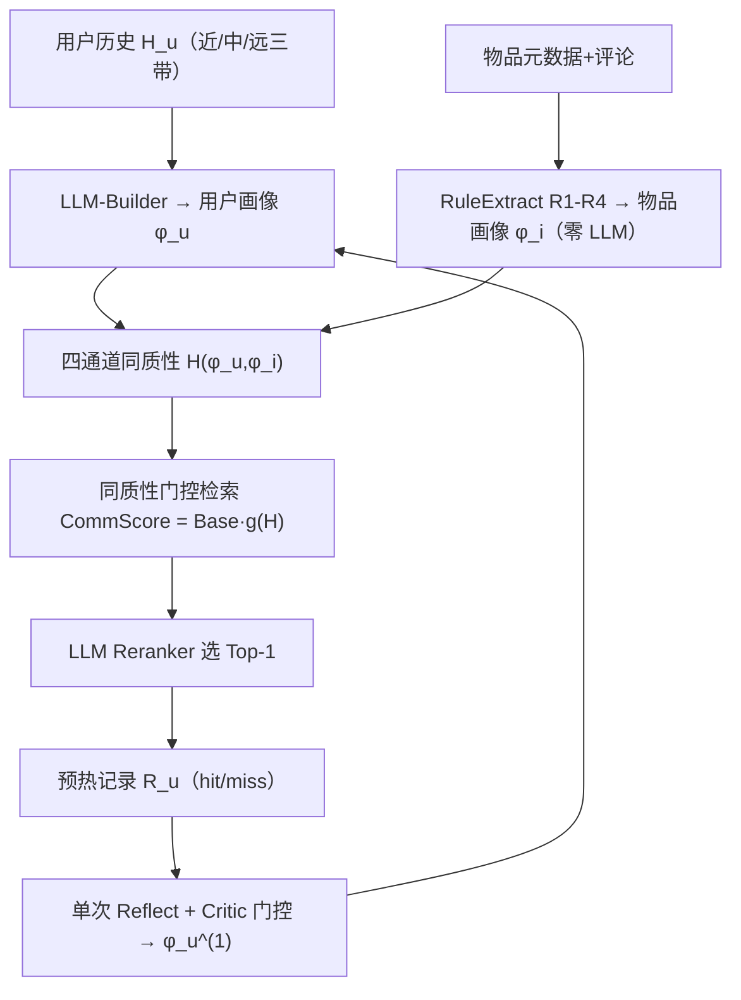

# HARP: Training-Free Dual-Profile Agentic Communication for LLM-Based Recommendation (基于双画像同质性感知智能体通信的免训练 LLM 推荐)

- **会议/期刊**: NeurIPS 2026
- **作者与机构**: Zhen Tao, Xun Zhou, Xuhui Chen, Ziyue Qiao, Qingqiang Sun（哈尔滨工业大学（深圳）、大湾区大学、深圳循环经济研究院）
- **推荐链路定位**: 召回（检索侧重加权）+ 重排（LLM Reranker）
- **研究方向**: 大语言模型推荐 / 图神经网络与知识图谱推荐
- **论文原文**: [https://arxiv.org/abs/2611.05319v1](https://arxiv.org/abs/2611.05319v1)
- **开源代码**: [https://github.com/Jove-Zhen/HARP](https://github.com/Jove-Zhen/HARP)

## TL;DR (1分钟核心速览)

现有记忆增强型 LLM 推荐把用户当作唯一有画像的智能体：物品侧无结构化画像、画像只塞进带宽受限的重排 prompt、且预热后冻结不再更新。HARP 将推荐重构为 BUILD–TRANSMIT–UNDERSTAND–SYNC 四阶段通信，用三个**免训练**算子补齐缺口：规则抽取的对称物品画像、四通道可分解的画像级同质性门控（作用于**检索侧**而非 prompt）、单次反思式画像更新。在 Yelp/Books/MovieTV/Goodreads 四个 InstructRec 基准上，Hit@1 相对最强基线 MemRec 提升 6.9%–24.0%（Holm 校正 $p<10^{-9}$）。

## Background & Motivation (背景与核心矛盾)

- **主流范式**: 记忆增强智能体推荐（AgentCF、iAgent、i²Agent、RecBot、MemRec）把用户建模为带持久记忆的 LLM 智能体，将协同邻居记忆路由进重排 prompt 产生推荐。
- **前人局限**: ①**单边 BUILD**——用户有多字段结构化画像，物品侧却无同 schema 画像，两侧无法"对话"；②**带宽受限的 UNDERSTAND**——画像只能拼进重排 prompt，而 prompt 预算被记忆块占满，画像与协同记忆是零和替换；③**缺失 SYNC**——预热构建的画像从不依据推荐结果校准。
- **核心洞察 (Key Insight)**: 三代推荐架构（CF→GNN→Agent）共享的协同信号本质是**交互重叠度**，它是"规模盲"的：描述集宽度差异大时，重叠相似度会因度数而非相关性被虚高，且该虚高被预排序候选列表继承。因此需要**查询侧视角的非对称、画像级覆盖度量**。
- **本文切入点**: 把同质性从"边级/类标签级"提升到"画像级、四语义通道可加分解"，并在**检索阶段**消费它，而非在重排 prompt 内。

## Method (核心方法设计)

### 1. 整体框架 (Overall Architecture)

HARP 冻结 LLM 主干（gpt-4o-mini），在标准两阶段（检索 Top-k 协同邻居 → LLM 重排选 Top-1）之上叠加三个算子：用户画像由一次 LLM 调用按七字段 JSON schema 生成（历史按近/中/远三带压缩，配 Ebbinghaus 式时间权重 $w_j=\beta+\exp(-\lambda d_j/|H_u|)$）；物品画像由零 LLM 调用的确定性规则抽取器（R1–R4）生成同构四通道 schema；检索阶段用画像级同质性$H(\phi_u,\phi_i)$ 对协同分数做乘性门控；预热窗口上跑一遍完整管线得到命中/未命中记录，触发一次反思式画像改写并经保守 critic 接受/拒绝。

### 2. 关键设计拆解 (Key Designs)

1. **对称结构化画像与通道可分解同质性（BUILD）**：痛点是对称性缺失导致无第二套词表可对齐。物品侧用确定性浅层语义解析器（本体投影、词典引导编码、质量信号归纳、通道互斥投影）把元数据/评论路由到四个**两两不相交**的通道字段（preference/quality/context/audience）。通道相似度采用**非对称归一化**的词组覆盖率：

$$sem(A,B)=\frac{|\{a\in A:\exists b\in B,\ substr(a,b)\vee substr(b,a)\}|}{|A|}\in[0,1]$$

分母固定在查询侧 $A=\phi_u^{(c)}$，读作"用户声称的偏好有多少被物品回响"，使词表更宽泛的物品无法靠规模白拿分。聚合为$H(\phi_u,\phi_i)=\sum_{c\in\mathcal{C}}w_c H_c(\phi_u,\phi_i)$。当通道退化为单一类标签时，$H$即边同质性比率的逐边示性函数，故$H$是图同质性概念向多通道多粒度语义的自然推广。通道互斥 + 线性聚合保证**可加分解**：扰动通道$c$恰好改变$w_c\Delta H_c$，无跨通道耦合，使逐通道消融等价于对$H$ 的可加扰动。

2. **同质性门控检索（UNDERSTAND）**：痛点是"行为邻居即偏好邻居"的假设在稀疏异构场景下因跨类误导邻居而失效。引入单调有界门 $g(H)=\alpha+(1-\alpha)H$，重加权协同分数：

$$CommScore(u,n)=BaseScore(u,n)\cdot g\big(H(\phi_u,\phi_{i_n})\big)$$

$\alpha$为同质性下限（主实验$\alpha_{ui}=0.4$、$\alpha_{uu}=0.3$，分别作用于不相交的邻居子集），保证$H\to0$时协同信号不被清零；$g$单调保序，不扭曲通道诱导的排序。**为何放检索侧而非 prompt 侧**：prompt 预算$B$硬约束下，画像 token 与记忆块$M_{collab}$ 是零和替换；且冻结 LLM 无法学会平衡两源，一旦误导候选占满记忆块，prompt 侧信息不可逆地无法替换它们。

3. **单次反思式更新（SYNC）与训练目标**：无梯度更新，把测试项前 $T$条交互作为预热窗口自监督信号$R_u=\{(C_j,\hat{y}_j,y_j)\}_{j=1}^{T}$，命中集刻画有效覆盖、未命中集定位盲区；一次结构化 CoT 反思提出$\tilde{\phi}_u=\text{Reflect}(R_u^{hit},R_u^{miss},\phi_u)$，再由**零额外 LLM 调用**的确定性 critic 做覆盖度检查给出二值接受决策$\hat{s}\in\{\text{accept},\text{reject}\}$。每用户仅一次（$T_{evo}=1$），避免重复消耗同一预热记录。总开销：每用户 1 次画像构建 + 1 次反思 + 每候选 1 次重排，物品侧零 LLM 调用。

## Experimental Setup & Evaluation Protocol (实验设置与评估协议)

- **数据集与预处理**: 采用 InstructRec 官方划分与自然语言指令版本：

| 数据集 | #Users | #Items | 稀疏度/密度 | 特征/场景说明 |
| :--- | :---: | :---: | :---: | :--- |
| Amazon Books | 7.4K | 120.9K | 极稀疏 | 内容驱动、偏好稳定（题材/作者） |
| Goodreads | 11.7K | 57.4K | 较稠密 | 社区交互强、系列感知阅读 |
| MovieTV | 5.6K | 29.0K | 稀疏 | 偏好波动、时效性强 |
| Yelp | 3.0K | 31.6K | 稀疏 | 强类目约束（菜系）、价格/位置关键 |

- **数据划分与防穿越 (Splitting Strategy)**: 沿用 InstructRec 原始划分；SYNC 的预热窗口严格取测试项之前的交互，反思仅见预热记录，无测试标签泄漏。
- **排名评测协议 (Ranking Protocol)**: 候选列表 $C(u)$由评测协议给定，LLM 在候选内选 Top-1，报告 Hit@{1,3,5} 与 NDCG@{3,5}；检索预算$k$在开发集从$\{4,8,16\}$选定并固定$k=16$。
- **对比基线与超参设置**: 三类基线——传统（LightGCN、SASRec、P5）、单边 LLM/智能体（Vanilla LLM、iAgent、RecBot、AgentCF、i²Agent）、记忆增强（MemRec，最强已发表基线）；基线数值均引自原论文（†）。主干 gpt-4o-mini 冻结，通道权重偏好主导且**不针对下游指标调参**。显著性：逐数据集单侧二项检验 + Wilson 95% CI，跨数据集 Holm–Bonferroni 族错误率 $\alpha=0.05$，阶梯跃迁用精确配对 McNemar。

## Key Experimental Results (实验关键数据)

### 1. 主实验对比 (Main Results)

| 范式 | 模型 | Books H@1 | Books N@3 | Goodreads H@1 | Goodreads N@3 | MovieTV H@1 | MovieTV N@3 | Yelp H@1 | Yelp N@3 |
| :--- | :--- | :---: | :---: | :---: | :---: | :---: | :---: | :---: | :---: |
| 传统 | LightGCN† | .175 | .260 | .250 | .443 | .348 | .474 | .344 | .472 |
| 传统 | SASRec† | .091 | .200 | .132 | .258 | .340 | .447 | .231 | .346 |
| 传统 | P5† | .219 | .299 | .157 | .251 | .170 | .255 | .144 | .244 |
| 单边 | Vanilla LLM† | .314 | .453 | .286 | .395 | .405 | .610 | .169 | .370 |
| 单边 | AgentCF† | .346 | .496 | .295 | .465 | .391 | .552 | .193 | .333 |
| 单边 | i²Agent† | .445 | .565 | .310 | .483 | .491 | .626 | .421 | .552 |
| 记忆增强 | MemRec† | .512 | .615 | .400 | .554 | .588 | .701 | .487 | .605 |
| 通信 | **HARP** | **.547** | **.647** | **.469** | **.612** | **.645** | **.758** | **.604** | **.712** |
| — | Rel. Improv. | +6.9% | +5.2% | +17.2% | +10.4% | +9.7% | +8.1% | +24.0% | +17.7% |

HARP 在全部 4 数据集 × 5 指标上均最优；相对最强传统基线 Hit@1 达 1.8×–2.5×，相对 i²Agent 为 +23%/+51%/+31%/+43%。Wilson 95% CI 下界严格压过 MemRec 点估计，边际 +2.38/+5.98/+4.38/+9.93pp（Books/Goodreads/MovieTV/Yelp），逐数据集 $p<10^{-9}$。

### 2. 消融实验 (Ablation Study)

Yelp 1,000 用户子划分（CH = 检索侧同质性门控，RI = 重排 prompt 注入，Sync = 反思）：

| 配置 | $\phi_u$|$\phi_i$ | CH | RI | Sync | H@1 | H@3 | N@3 | N@5 |
| :--- | :---: | :---: | :---: | :---: | :---: | :---: | :---: | :---: | :---: |
| MEMORY | | | | | | .580 | .761 | .683 | .722 |
| MONOLOGUE | ✓ | | | ✓ | | .578 | .738 | .671 | .707 |
| CONSULT | ✓ | ✓ | | ✓ | | .580 | .750 | .678 | .716 |
| DIALOGUE | ✓ | ✓ | ✓ | | | .635 | .804 | .728 | .763 |
| **HARP** | ✓ | ✓ | ✓ | ✓ | ✓ | **.643** | **.808** | **.734** | **.767** |

### 3. 关键实验发现 (Key Findings)

1. **检索侧门控是唯一主引擎**：MONOLOGUE→DIALOGUE 单级跃升 +5.7pp H@1（McNemar $p=7.2\times10^{-6}$），而 prompt 侧注入（MONOLOGUE vs MEMORY，$p=0.94$）与双画像无门控（CONSULT）均停在 .578–.580，与 MEMORY 无统计差异；CONSULT→HARP 显著（$p=2.5\times10^{-7}$），反向 DIALOGUE→CONSULT 显著为负（−5.5pp，$p=1.0\times10^{-5}$），直接证伪"画像塞 prompt 即可"的直觉。
2. **修复来源分解给出 75%–84% 归因于门控**：Yelp/MovieTV/Books 净修复 +63/+34/+19 用户，Dial-rep 与 Sync-rep 比例 5.3:1 / 3.2:1 / 3.0:1；且相对增益随 $k$ 单调收缩（Yelp +24.0%→+14.3%→+9.4% @Hit{1,3,5}），说明 HARP 是把真值**推进** Top-1 而非重排已正确的候选池。
3. **反思是"改组成而非改长度"且存在保守性代价**：DIALOGUE→HARP 残余增益 +0.8/+0.5/+1.3pp（Yelp/MovieTV/Goodreads），Books 上 −0.4pp 回退；画像长度代理与逐用户增益的 Pearson 相关仅 $\rho\in[-0.048,-0.005]$，证明反思重塑画像构成而非堆长度；Yelp 逐通道观测拆分为 +3.2/+0.7/+1.1/+0.6pp（偏好/质量/情境/受众），偏好通道占过半。

## Highlights & Limitations (亮点、对比与审稿批判)

- **与代表作对比 (vs. Prior Work)**: 相比 AgentCF（双侧自由文本记忆但无结构化通道对齐画像）与 i²Agent（有反思但**无接受规则**、每次提议必应用），HARP 首次给物品侧同 schema 结构化画像、把同质性信号路由到检索而非生成、并对画像演化加接受检查；相比 MemRec（记忆图管理），HARP 不改主干、零梯度、零物品侧 LLM 调用。
- **可迁移亮点**: ①"检索侧 vs prompt 侧"的零和预算论证可直接迁移到任何冻结 LLM + 有限上下文的 RAG 重排系统；②非对称归一化的词组覆盖率（分母固定查询侧）是低成本、抗规模偏置的语义相似度替代品，可替换 embedding 内积做冷启动粗筛。
- **审稿级局限批判**: ①SYNC 净收益小且 Books 上为负，反思的收益/风险比高度依赖 critic 保守度，缺少 critic 开关的独立消融；②物品画像依赖数据集级本体映射与领域词典（R1–R4），跨域迁移需重建词表，且规则抽取的覆盖度统计仅在附录；③逐通道 Hit@1 归因是 Yelp 单数据集的观测性拆分而非四次留一消融，作者自承不可外推；④每用户额外 1 次画像 + 1 次反思 LLM 调用，大规模用户下的离线预处理成本与在线延迟未量化。

## Rating (四维评分)

- **方法创新性 (Novelty)**: ⭐⭐⭐⭐ （四阶段通信框架作为诊断工具颇具解释力，画像级多通道同质性是图同质性概念的干净推广，但三个算子本身均为已有原语的组合）
- **评估协议与实验扎实度 (Protocol & Experiments)**: ⭐⭐⭐⭐ （四基准全指标 SOTA + Wilson CI + Holm 校正 + 配对 McNemar + 修复来源分解，统计严谨度高于同类；扣分在逐通道归因仅单数据集观测性拆分）
- **写作与数学规范度 (Clarity & Rigor)**: ⭐⭐⭐⭐ （Remark 1 可加分解与 Lemma 1 通道消融恒等式证明完整，检索-提示设计论证明确标注为"设计理由而非定理"，边界诚实）
- **工业落地与复现价值 (Industrial & Practical Value)**: ⭐⭐⭐⭐ （完全免训练、主干冻结、物品侧零 LLM 调用，代码已开源，可叠加于任意 LLM 推荐主干；扣分在规则抽取器的跨域词表维护成本与反思调用的规模化开销）

