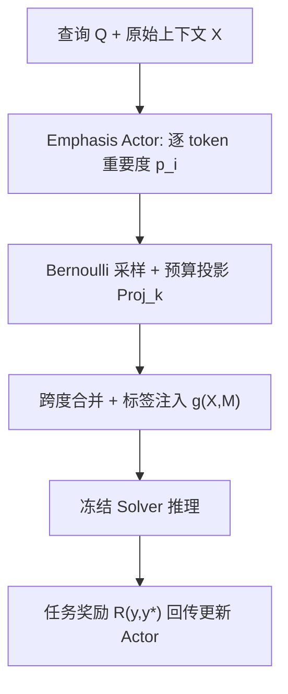

# Learning Evidence Highlighting for Frozen LLMs (面向冻结大模型的证据高亮学习)

- **会议/期刊**: NeurIPS 2026
- **作者与机构**: Shaoang Li, Yanhang Shi, Yufei Li, Mingfu Liang, Xiaohan Wei, Yunchen Pu, Fei Tian, Chonglin Sun, Frank Shyu, Sandeep Pandey, Luke Simon, Xi Liu, Jian Li（Stony Brook University & Meta AI）
- **推荐链路定位**: 重排（LLM 生成式重排前的输入侧预处理层）
- **研究方向**: 大语言模型推荐 / 序列推荐
- **论文原文**: [https://arxiv.org/abs/2604.22565v3](https://arxiv.org/abs/2604.22565v3)
- **开源代码**: [HuggingFace Datasets 加载器](https://huggingface.co/docs/datasets)（仅数据加载，模型代码暂未开源）

## TL;DR (1分钟核心速览)

长上下文推荐与 QA 的核心瓶颈不是推理能力，而是**证据选择**：决定性信号被大量噪声稀释（Lost-in-the-Middle）。HiLight 将证据选择与推理解耦，训练一个轻量 Emphasis Actor 在**未经改写的原始上下文**中插入极少量高亮标签，冻结 Solver 只负责推理。Actor 用 Solver 的任务奖励做弱监督分组策略梯度，无需证据标注、无需 Solver 梯度。在 Amazon-Beauty 全库重排上 HR@10 相对最强基线 DSPy 提升 5.38%、相对 MI 提升 27.53%，且策略可零样本迁移到未见 Solver 家族（含 GPT-5 mini API）。

## Background & Motivation (背景与核心矛盾)

- **主流范式**: 长上下文处理分两派——硬选择（检索 top-k 段落、历史剪枝、chunk 重排）与软选择（摘要、压缩记忆、上下文蒸馏）；另一条线是自动提示优化（APO），在**任务级**搜索一个静态 system prompt。
- **前人局限**: ① 硬选择/剪枝会丢弃消歧、桥接实体与话语结构，多跳 QA 上直接掉点；② 压缩/改写本质有损，可能抹掉细微但决定性的细节；③ APO 只优化一个全局 prompt，无法针对**每个实例**不同的噪声分布与证据位置做适配。
- **核心洞察 (Key Insight)**: 长上下文失败源于把「证据选择」和「多步推理」耦合进一次前向。LLM 在干净输入上是强推理器，但注意力机制在低信噪比下无法可靠隔离稀疏证据；而"在哪里"是实例级、任务相关的隐变量，恰好可由一个廉价模块单独学出来。
- **本文切入点**: 不改写、不删除、不碰 Solver 内部，只做**输入侧非破坏性干预**——学一个预算受限的实例级高亮策略，把证据"标出来"而非"抽出来"。

## Method (核心方法设计)

### 1. 整体框架 (Overall Architecture)

给定查询 $Q$与上下文$X=(x_1,\dots,x_L)$，轻量 Actor 编码$[Q;X]$并输出逐 token 重要度$p_i$；采样掩码后经预算投影保留至多$k=\lfloor\gamma L\rfloor$个 token，再做**跨度合并 + 标签注入**得到强调上下文$\hat{X}=g(X,M)$（原文 token 内容与顺序完全不变）；冻结 Solver 在$(Q,\hat{X})$上生成答案$y$。训练时对同一实例采样一组掩码、各查一次 Solver、用任务指标构造组内归一化优势更新 Actor；推理时取 top-$k$ 确定性掩码，一次 Actor 前向 + 一次 Solver 调用。

### 2. 关键设计拆解 (Key Designs)

1. **预算受限的实例级高亮策略（把"选哪里"变成可学决策）**：痛点是无 token 级证据标注且 Solver 不可微。Actor 用冻结 LM 骨干 + LoRA + 策略头，取最后四层隐状态的凸组合 $\bar{h}_t=\sum_{i=1}^{4}w_i h^{(L-4+i)}_t$，再经温度 sigmoid 得$p_t=\sigma(\boldsymbol{w}_p^\top\mathrm{LN}(\bar{h}_t)/\tau)$，构成 Bernoulli 因子化策略。硬预算$\sum_i M_i\le\gamma L$通过确定性投影实现：训练时保留$p_i$最大的$k$个采样 token（保留探索且保证可行），推理时直接 top-$k$。直觉：预算既防"全高亮"退化，又让高亮结果可审计。

2. **非破坏性标签注入（emphasis 而非 pruning）**：token 级掩码易碎片化，故合并相邻选中 token 并桥接间隔 $\le\delta$ 的短空隙，再在跨度端点插入 `<start_important>…<end_important>`。与剪枝的本质差别在于：Solver 仍能看到全部原始上下文，高亮只是**注意力分配的显式控制面**。这解释了为何多跳 QA 上剪枝掉点而高亮涨点——桥接实体与话语线索被保留。

3. **分组策略梯度 + 双重正则（无证据标签的弱监督）**：目标为 $J(\theta)=\mathbb{E}[R(y,y^*)]$，用组内标准化优势降方差：
$$\hat{A}_j=\frac{r_j-\mu_r}{\sigma_r+\epsilon},\quad \mathcal{L}_{PG}=-\frac{1}{G}\sum_{j=1}^{G}\hat{A}_j\log\pi_\theta(\tilde{M}_j\mid Q,X)$$
其中 log-prob 在**投影前**的 Bernoulli 分布上计算，投影后掩码仅用于构造 $\hat{X}_j$ 与取奖励。总损失
$$\mathcal{L}=\mathcal{L}_{PG}+\lambda_{len}\Big(\tfrac{1}{|\Omega|}\sum_{i\in\Omega}p_i-\gamma\Big)^2+\beta_{ent}\mathcal{L}_{ENT}$$
长度正则把期望高亮率拉向 $\gamma$，防止靠"尖峰式"选择凑满硬预算；熵奖励防策略早塌。**免负采样、免证据标注、免 Solver 梯度**；训练仅需 12K 次 Solver 查询（PRL 为 120K、APE 为 60K），推理侧 Solver token 开销$<1.01\times$，Actor 延迟占端到端 1.3%–2.9%。

## Experimental Setup & Evaluation Protocol (实验设置与评估协议)

- **数据集与预处理**:

| 数据集 | 规模/场景 | 上下文特点 | 高亮预算 $\gamma$ | Actor 规模 |
| :--- | :--- | :--- | :---: | :---: |
| Amazon-Beauty | 1000 测试样本，序列推荐 | 超长噪声用户评论历史，证据极稀疏 | 0.25 | Qwen3-1.7B |
| HotpotQA | 1000 测试样本，多跳 QA | 多段落，需桥接实体 | 0.15 | Qwen3-4B |
| SQuAD 2.0 | 1000 测试样本，阅读理解（含不可答） | 中等长度 | 0.15 | Qwen3-0.6B |
| PubMedQA (artificial) | 1000 测试样本，生物医学三分类 | 短摘要 | 0.15 | Qwen3-0.6B |

- **数据划分与防穿越**: Amazon-Beauty 采用**用户级序列切分**——最后一件物品为标签 $y_u=i_T$，前缀$[i_1,\dots,i_{T-1}]$为输入，交互数$<2$的用户丢弃；候选集由训练历史构建的 item-item 共现图（滑窗 + 指数时间衰减$\alpha=0.85$，取最近$M=10$ 个物品）召回 40 个候选，不足补热门。QA 任务沿用官方划分。
- **排名评测协议**: 推荐任务为 **40 候选的列表级重排**（非全库 Full-Ranking），指标 HR@10 / NDCG@10；QA 用 EM / F1 / Acc. / M-F1。训练奖励为复合指标（Beauty: $0.7\times$HR@10$+0.3\times$NDCG@10；QA:$0.5\times$F1$+0.5\times$EM）。
- **对比基线与超参**: 基线含 Manual Instruction (MI)、PRL（RL 生成 prompt）、BFRS（bootstrapping 搜索）、OPRO（LLM-as-optimizer）、DSPy/MIPROv2（贝叶斯优化）、APE（程序合成）。默认 Solver 为 Qwen3-14B；Adam，lr $1\times10^{-4}$，wd$1\times10^{-2}$，组大小$G=4$，$\beta_{ent}=1.0$，$\lambda_{len}=0.01$，LoRA$r=8,\alpha=16$，跨度桥接$\delta=10$。

## Key Experimental Results (实验关键数据)

### 1. 主实验对比 (Main Results)

| 方法 | Beauty HR@10 | Beauty NDCG@10 | HotpotQA EM | HotpotQA F1 | SQuAD2.0 EM | SQuAD2.0 F1 | PubMedQA Acc. | PubMedQA M-F1 |
| :--- | :---: | :---: | :---: | :---: | :---: | :---: | :---: | :---: |
| MI | 0.02256 | 0.01247 | 0.556 | 0.706 | 0.586 | 0.647 | 0.921 | 0.776 |
| PRL | 0.02692 | 0.01432 | 0.571 | 0.719 | 0.644 | 0.673 | 0.924 | 0.735 |
| BFRS | 0.02363 | 0.01248 | 0.593 | 0.700 | 0.573 | 0.694 | 0.922 | 0.761 |
| OPRO | 0.02332 | 0.01346 | 0.591 | 0.723 | 0.620 | 0.672 | 0.922 | 0.768 |
| DSPy | 0.02730 | 0.01410 | 0.565 | 0.721 | 0.590 | 0.685 | 0.930 | 0.767 |
| APE | 0.02390 | 0.01311 | 0.581 | 0.722 | 0.592 | 0.669 | 0.926 | 0.727 |
| **HiLight** | **0.02877** | **0.01587** | **0.606** | **0.741** | **0.661** | **0.721** | **0.940** | **0.821** |
| Improv.% (vs. Best Base.) | +5.38% | +10.82% | +2.19% | +2.49% | +2.64% | +3.89% | +1.08% | +5.80% |

### 2. 消融实验 (Ablation Study)

| 变体 | Beauty HR@10 | Beauty NDCG@10 | HotpotQA EM | HotpotQA F1 |
| :--- | :---: | :---: | :---: | :---: |
| MI（无高亮） | 0.02256 | 0.01247 | 0.556 | 0.706 |
| Random（同预算随机高亮） | 0.02380 | 0.01270 | 0.521 | 0.635 |
| Few-shot（3-shot 高亮示例） | 0.02403 | 0.01315 | 0.556 | 0.695 |
| Pruned（仅喂选中跨度） | 0.02740 | 0.01448 | 0.525 | 0.658 |
| **HiLight** | **0.02877** | **0.01587** | **0.606** | **0.741** |

### 3. 关键实验发现 (Key Findings)

1. **收益与证据稀疏度强相关，且集中在"利用质量"而非"命中翻转"**：Beauty 上相对 MI 提升 27.53% HR@10，而 PubMedQA 仅 +2.06% Acc.；同时 NDCG@10 提升（+10.82%）显著大于 HR@10（+5.38%），说明高亮主要把已命中的真值物品在列表内**上移**，而非单纯把 miss 变 hit。
2. **非破坏性是关键，剪枝在推理密集任务上反噬**：Beauty 上 Pruned 已能拿到 0.02740 HR@10（接近 HiLight），说明稀疏信号场景下"过滤"本身有效；但 HotpotQA 上 Pruned 的 EM 从 0.556 掉到 0.525，Random 也掉到 0.521，唯有保留完整上下文的 HiLight 涨到 0.606——桥接实体与话语线索不可删。
3. **策略学到的是可迁移的证据结构，而非某个骨干的偏好**：用 Qwen3-14B 训练的 Actor 零样本迁移到 Qwen3-4B/8B/32B、Gemma-3-27B、Llama-3-70B，HR@10 相对各自 MI 提升 +8.78%~+19.17%，NDCG@10 提升 +8.48%~+31.56%，全面优于目标模型自高亮的 Self-Mark（如 Qwen3-8B 上 NDCG 仅 +0.45%）；在 GPT-5 mini API 上仍得 +1.43% HR@10 / +6.65% NDCG@10。此外 Actor 从未见过证据标注，其高亮与 HotpotQA 人工 supporting facts 的 token 级 F1 达 0.78（0.6B→8B 单调从 0.68 升至 0.78），与下游增益同步。

## Highlights & Limitations (亮点、对比与审稿批判)

- **与代表作对比 (vs. Prior Work)**: 与 PRL/OPRO/APE 等 APO 方法的本质区别是**优化对象**——APO 在任务级搜一个静态 prompt，HiLight 在实例级优化数据上下文本身；与检索式硬选择/剪枝的区别是**不删除**，保留完整上下文只加控制面；与 attention/attribution 事后解释方法的区别是**事前干预**且兼容黑盒 API。
- **可迁移亮点**: ① "冻结 Solver + 组内标准化策略梯度 + 硬预算投影"这套弱监督范式可直接套用到任何只有黑盒输出、只有任务指标的输入侧控制问题（如 query 改写、特征描述重排、生成式推荐的用户画像摘要标注）；② 跨度合并 + 桥接阈值 $\delta$ 的标签注入方式，是把 token 级打分转成人类可读、跨 tokenizer 可迁移干预的实用技巧。
- **审稿级局限批判**: ① 推荐实验仅 40 候选的列表级重排，未做全库 Full-Ranking，且 Beauty 仅 1000 测试样本，统计功效与工业规模验证不足；② 训练需对每个实例采样 $G=4$次并调用 Solver，虽比 APO 省 5–10× 查询，但仍是黑盒在线采样，且论文明确未处理多轮对话下的 KV-cache 复用，实际服务化需额外系统层；③ 高亮预算$\gamma$与桥接宽度$\delta$ 虽显示鲁棒，但最优值随任务漂移（Beauty 0.25 vs 其余 0.15），Actor 规模也需按证据选择难度手工选型。

## Rating (四维评分)

- **方法创新性 (Novelty)**: ⭐⭐⭐⭐ （把"证据选择 vs 推理"解耦为输入侧非破坏性干预，并用纯任务奖励的组策略梯度学实例级预算高亮，视角干净且与 APO/剪枝形成清晰正交）
- **评估协议与实验扎实度 (Protocol & Experiments)**: ⭐⭐⭐⭐ （四任务八指标 + 消融 + 预算/标记/规模/长度敏感性 + 跨 5 个 Solver 与 API 迁移，覆盖全面；扣分在推荐侧仅 40 候选重排、样本量偏小）
- **写作与数学规范度 (Clarity & Rigor)**: ⭐⭐⭐⭐ （问题形式化、预算投影与损失各项定义清晰，算法伪代码完整；投影前后 log-prob 的处理交代到位，但缺策略梯度方差与收敛性的理论分析）
- **工业落地与复现价值 (Industrial & Practical Value)**: ⭐⭐⭐⭐ （Solver token 开销 $<1.01\times$、Actor 延迟占比 1.3%–2.9%、查询预算省 5–10×，天然兼容 API 黑盒；扣分在模型代码未开源、多轮 cache 场景未验证）
