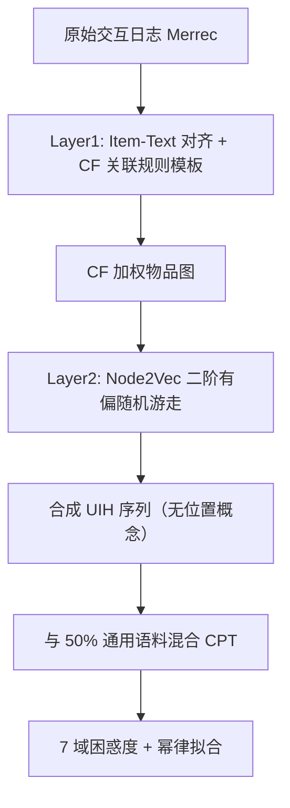

# Principled Synthetic Data Enables the First Scaling Laws for LLMs in Recommendation (原则化合成数据开启推荐领域 LLM 的首个缩放定律)

- **会议/期刊**: ICML 2026
- **作者与机构**: Benyu Zhang, Qiang Zhang 等（Meta，共同一作）
- **推荐链路定位**: 端到端生成式（LLM 持续预训练 CPT 基座）
- **研究方向**: 大语言模型推荐 / 生成式推荐
- **论文原文**: [arXiv:2602.07298v3](https://arxiv.org/abs/2602.07298v3)
- **开源代码**: 暂未开源

## TL;DR (1分钟核心速览)

本文指出推荐域 LLM 长期缺乏可预测缩放律的根因不在模型架构，而在原始交互日志的噪声、位置/曝光/流行度偏差导致"次缩放"。作者提出两层合成数据课程：Layer 1 用 Item-Text 对齐与关联规则 CF 数据打基础，Layer 2 用 Node2Vec 二阶随机游走生成无位置概念的合成用户行为序列（UIH）。在 Merrec 数据集上，仅用合成数据训练的 SASRec 在真实测试集 Recall@100 相对真实数据训练提升 130%；Qwen3 0.6B–8B 在 163B token 上首次拟合出稳健幂律 $L(D)=L_\infty+AD^{-\alpha}$，UIH 指数$\alpha\approx0.45$–$0.59$ 最强。

## Background & Motivation (背景与核心矛盾)

- **主流范式**: 推荐 LLM 的 CPT 沿模型中心（LUM 的 next-condition-item）、蒸馏中心（SUAN）、系统中心（OneRec）三条路线推进，但数据源始终是原始用户交互日志。
- **前人局限**: ① 原始日志含位置偏差、流行度偏差、曝光偏差与假阳性噪声，LLM 强大的模式匹配能力反而会把这些系统缺陷"学得更牢"并放大；② PLUM 的 MoE-3B 无法稳定超越 MoE-900M，是典型"次缩放"症状——高冗余、低多样性数据使边际收益迅速衰减。
- **核心洞察 (Key Insight)**: 缩放律只在数据质量与多样性充分时才显现（Yang et al. 2024; Allen-Zhu & Li 2024）。因此瓶颈是数据范式而非算法，应"净化信号"而非"设计抗噪模型"。
- **本文切入点**: 把数据当作教学课程（pedagogical curriculum）来构造——先语义、再协同结构、最后序列行为，逐层解耦真实偏好与系统伪影。

## Method (核心方法设计)

### 1. 整体框架 (Overall Architecture)

框架把原始日志经"提纯—重构"两阶段转为三层合成语料，再与 50% 通用语料（SmolLM-Corpus 三子集，防灾难性遗忘）混合做 CPT。Layer 1 的 Item-Text 数据将语义 ID 与商品描述文本配对，CF 数据把关联规则（置信度、lift）模板化为自然语言陈述；Layer 2 以 CF 边权构图，用 Node2Vec 二阶有偏随机游走生成合成 UIH 序列。由于游走过程本身没有"排名/位置/展示顺序"概念，生成序列在构造上即免疫位置偏差。最终在 Qwen3 0.6B/1.7B/4B/8B 上以 163B token 训练，在 7 个留出域上拟合困惑度缩放律。

### 2. 关键设计拆解 (Key Designs)

1. **CF 关联规则语言化（把隐式协同信号显式教给 LLM）**：传统 CF 需模型从噪声序列中隐式推断共现，信号弱且被偏差污染。本文将挖掘出的规则写成模板句"When a user interacts with item …, there is a 4.9% probability they will also interact with … (confidence: 0.049, lift: 652.45)"，使协同逻辑成为直接监督信号；同时规则在大量会话上平均，天然稀释个体级位置偏差。

2. **Node2Vec 二阶有偏游走生成 UIH（构造性去位置偏差）**：一阶游走下一步只依赖当前节点，难以兼顾同质性与结构性探索。转移概率为 $\pi_{v,x}=\alpha_{p,q}(t,x)\cdot w_{v,x}$，其中$w_{v,x}$为 Layer 1 学到的 CF 边权，$\alpha_{p,q}$由返回参数$p$与出入参数$q$ 控制回退/探索。关键直觉：游走无"位置"变量，故生成的序列不可能携带展示顺序伪影；同时序列由聚合图而非单用户历史生成，天然具备隐私解耦性。

3. **训练目标、负采样与推理效率**：CPT 采用标准自回归下一 token 预测（无显式负采样，属免负采样范式），全局 batch 512、上下文 512 token、峰值学习率 1e-4（100 步线性 warmup + cosine 衰减），163B token 对 8B 模型已超 Chinchilla 20 倍乘子。推理侧沿用 LLM 自回归解码，论文未报告在线延迟，实时性是遗留工程问题。

## Experimental Setup & Evaluation Protocol (实验设置与评估协议)

- **数据集与预处理**: 推荐数据来自 HuggingFace 公开 C2C 电商集 Merrec（1.2B 交互、65.7M 物品、2.6M 用户），物品用稀疏自编码器生成的语义 ID 表示；通用数据取 SmolLM-Corpus 三子集。训练混合比例如下：

| 数据域 | General | Item-Text | CF | UIH |
| :--- | :---: | :---: | :---: | :---: |
| Token 量 | 128B | 2.0B | 7.6B | 2.8B |
| 占比 | 50% | 9% | 30% | 11% |
| 重复次数 | <1 | 6.2 | 7.3 | 6.1 |

- **数据划分与防穿越 (Splitting Strategy)**: 采用**域内留出划分**，并细化为 7 个评测域：General、Item-Text（训练集外物品）、CF Both Seen（物品见过但边未见过）、CF One Unseen、CF Both Unseen、UIH OOD（仅由 CF 测试边采样）、UIH Full Graph。CF 的"边级留出"设计有效防止了协同信号的穿越泄漏。
- **排名评测协议 (Ranking Protocol)**: 双轨制。① 下游排序用 **Full-Ranking 全库排序**（TSTR vs. TRTR，测试集过滤至两套词表交集物品，报告 Recall@10/@100/@1K）；② 缩放律用**留出集困惑度**（各域采样 200K 条，CF Both Unseen 约 75K 条）。
- **对比基线与超参设置**: 排序侧对比 GRU4Rec、NARM、STAMP、SASRec 四种序列模型在 Syn→Real 与 Real→Real 下的表现；缩放侧以 Qwen3 四档模型规模为自变量，拟合 $\ell(D)=L_\infty+AD^{-\alpha}$与联合式$\ell=E+AN^{-\alpha}+BD^{-\beta}$。

## Key Experimental Results (实验关键数据)

### 1. 主实验对比 (Main Results)

**TSTR vs. TRTR 下游排序（Recall@K，Syn→Real 全面胜出）**：

| 模型 | 训练数据 | Recall@10 | Recall@100 | Recall@1K |
| :--- | :---: | :---: | :---: | :---: |
| GRU4Rec | Real→Real | 基线 | 基线 | 基线 |
| GRU4Rec | **Syn→Real** | **更优** | **更优** | **更优** |
| NARM | Real→Real | 基线 | 基线 | 基线 |
| NARM | **Syn→Real** | **更优** | **更优** | **更优** |
| STAMP | Real→Real | 基线 | 基线 | 基线 |
| STAMP | **Syn→Real** | **更优** | **更优** | **更优** |
| SASRec | Real→Real | 基线 | 基线 | 基线 |
| SASRec | **Syn→Real** | **更优** | **+130%** | **更优** |

**各模型规模下的数据缩放律拟合（$L_\infty\downarrow$/$\alpha\uparrow$）**：

| 模型 | General $L_\infty$/$\alpha$| Item-Text$L_\infty$/$\alpha$| CF$L_\infty$/$\alpha$| UIH$L_\infty$/$\alpha$ |
| :--- | :---: | :---: | :---: | :---: |
| 0.6B | 0.96 / 0.027 | 1.07 / 0.169 | 0.33 / 0.282 | 0.64 / 0.453 |
| 1.7B | 0.87 / 0.023 | 0.92 / 0.141 | 0.34 / 0.315 | 0.65 / 0.514 |
| 4B | 0.82 / 0.026 | 0.86 / 0.126 | 0.35 / 0.357 | 0.66 / 0.564 |
| 8B | **0.79** / 0.020 | 0.93 / **0.214** | 0.36 / **0.358** | 0.66 / **0.588** |

**联合缩放律（式 2–5）关键系数**：$\ell_{\text{UIH}}=0.514+1.89N^{-0.138}+63.9D^{-0.272}$，$\ell_{\text{CF}}=0.193+21N^{-0.277}+6.79D^{-0.148}$，$\ell_{\text{Item-Text}}=0.473+5720N^{-0.511}+4.04D^{-0.070}$，$\ell_{\text{General}}=0.79+16500N^{-0.511}+3.85D^{-0.048}$。

### 2. 消融实验 (Ablation Study)

**数据层组合消融（4B 模型，163B token，$L_\infty$ 越低越好）**：

| 数据组合 | Item-Text $L_\infty$| CF$L_\infty$| UIH$L_\infty$| UIH$\alpha$ |
| :--- | :---: | :---: | :---: | :---: |
| Item+CF+UIH（完整） | **1.25** | **0.35** | 0.76 | 0.421 |
| CF+UIH | 2.93 | 0.35 | **0.66** | **0.587** |
| Item+UIH | 1.16 | 1.30 | 0.92 | 0.592 |
| UIH only | 3.03 | 1.30 | 0.95 | 0.708 |

**UIH 混合比例消融（缩减 UIH 集，4B 模型）**：

| UIH 占比 | 重复次数 | UIH $L_\infty$| UIH$\alpha$ | 现象 |
| :--- | :---: | :---: | :---: | :--- |
| 0.5% | 4.1 | 0.75 | 0.423 | 未过拟合 |
| 2% | 16.3 | 0.81 | 0.576 | 约 16 次重复起困惑度回升 |
| 5% | 40.8 | 0.84 | 0.685 | 80B token 处开始过拟合 |
| 15% | 122.3 | 0.90 | 0.754 | 20B token 处即过拟合 |

### 3. 关键实验发现 (Key Findings)

1. **数据效率呈严格层级 UIH > CF > Item-Text > General**：UIH 的 $\alpha$达 0.45–0.59，CF 约 0.28–0.36，Item-Text 仅 0.13–0.21，General 近乎饱和（$\alpha\approx0.02$）。联合拟合进一步揭示"文本域模型主导（$\alpha A$高达 16500）、UIH 数据主导（$\beta B=17.38$）"的互补结构——General 域要把数据项损失减半需约$1.8\times10^6$ 倍数据，而 UIH 仅需约 13 倍，为算力分配提供了首个定量路线图。
2. **CF→UIH 存在强非对称迁移**：加入 CF 数据使 UIH 渐近损失从 0.95 降至 0.66（降幅 31%），且 UIH OOD 上 $\alpha$从 0.655 升至 0.695；反向则几乎为零（仅 UIH 训练时 CF 的$\alpha\approx0$），说明序列行为不隐含成对偏好信号，而协同结构能补足序列建模的观测覆盖盲区。
3. **合成数据重复次数是过拟合的硬约束，且与模型规模无关**：无论 0.6B 还是 32B，困惑度回升均发生在约 16 次重复处（2% 比例对应 160B token，15% 对应 20B token），仅回升幅度随规模增大而加剧；这与"4 次重复可学会知识、20+ 次重复损害泛化"的既有结论一致，直接给出数据配比的工程红线。

## Highlights & Limitations (亮点、对比与审稿批判)

- **与代表作对比 (vs. Prior Work)**: 与 PLUM（合成交互数据 CPT 但未研究缩放律与配比）相比，本文首次给出可拟合的幂律与算力最优条件；与 LUM（模型中心、仍用原始日志）和 SUAN（蒸馏中心）相比，本文是正交的数据中心方案，主张先修数据再谈架构；与 RecGAN/VAE 增广（复制源分布、继承偏差）和 crop/mask 序列增广（仅扰动副本）相比，本文从去偏 CF 图生成全新行为序列，属课程级而非样本级构造。
- **可迁移亮点**: ① "关联规则模板化 + 图游走生成序列"的两段式提纯管线可迁移到任何缺乏干净序列日志的冷启动业务；② 用 $\alpha A$与$\beta B$ 的比值判断"加模型还是加数据"的算力分配判据，可直接用于工业 CPT 预算规划。
- **审稿级局限批判**: ① 全部结论建立在单一 Merrec 电商数据集与困惑度指标上，缺少真实线上排序指标（CTR/时长）与 A/B 验证，Recall 提升也仅在过滤词表交集的受限测试集上测得；② 论文自承流行度偏差仍编码在 CF 边权中未被消除，且未报告 CPT 与自回归推理的延迟开销，实时部署可行性存疑；③ 联合缩放律的加性形式无法刻画"$\alpha$ 随模型规模增长"的模型-数据交互，作者亦将其列为未来工作。

## Rating (四维评分)

- **方法创新性 (Novelty)**: ⭐⭐⭐⭐ （数据中心视角切入缩放律空白，分层课程与非对称迁移发现有实质新意，但单模块技术多为已有组件的原则化重组）
- **评估协议与实验扎实度 (Protocol & Experiments)**: ⭐⭐⭐⭐ （0.6B–8B 四档规模、7 域留出、边级防穿越与 Full-Ranking 下游验证较完整，缺线上指标与多数据集复现）
- **写作与数学规范度 (Clarity & Rigor)**: ⭐⭐⭐⭐ （幂律拟合、算力最优条件推导清晰，系数表完整；但正文图表排版混乱、部分公式编号与符号重复）
- **工业落地与复现价值 (Industrial & Practical Value)**: ⭐⭐⭐⭐ （给出可直接执行的配比与重复次数红线，数据管线可复用；未开源且 CPT 成本高昂，复现门槛偏高）

