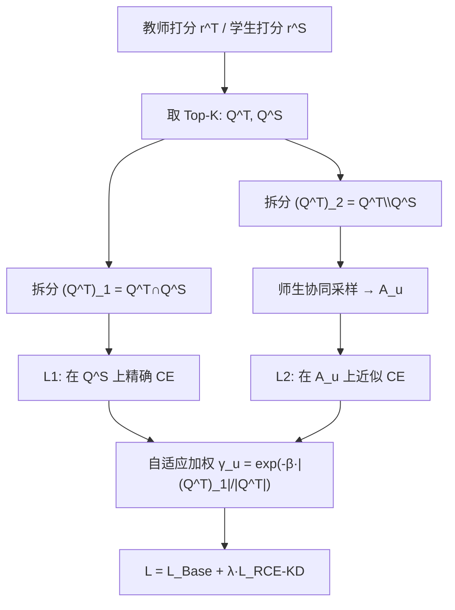

# Rejuvenating Cross-Entropy Loss in Knowledge Distillation for Recommender Systems (重焕推荐系统知识蒸馏中的交叉熵损失)

- **会议/期刊**: ICLR 2026
- **作者与机构**: Zhangchi Zhu, Wei Zhang (华东师范大学 / 上海创智学院)
- **推荐链路定位**: 精排（模型压缩/蒸馏，教师大模型 → 学生小模型）
- **研究方向**: 大语言模型推荐 / 协同过滤与双塔召回
- **论文原文**: [https://arxiv.org/abs/2509.20989v2](https://arxiv.org/abs/2509.20989v2)
- **开源代码**: [https://github.com/BDML-lab/RCE-KD](https://github.com/BDML-lab/RCE-KD)

## TL;DR (1分钟核心速览)

推荐系统知识蒸馏（KD）只能在物品子集上计算损失，而主流 CE 损失在此场景下常劣于点式/列表式基线。本文证明：子集 CE 最小化仅当子集满足"闭包假设"（包含学生所有高排物品）时才能最大化 partial NDCG 下界，而教师 Top 物品恰恰被学生排得很低，二者矛盾。据此提出 RCE-KD：将教师 Top 物品按学生是否高排拆为两子集，分别用精确 CE 与师生协同采样近似 CE 建模，并按重叠率指数自适应加权。在三个数据集、五种师生架构（含 HSTU 生成式骨干）的 Full-Ranking 协议下，NDCG@20 相对最优基线提升 2.86%–11.76%。

## Background & Motivation (背景与核心矛盾)

- **主流范式**: 推荐模型 scaling law 驱动超大模型（HSTU 等），推理成本高；响应式 KD 用教师 logits 蒸馏小模型，CV/NLP 中 CE 损失是绝对主力。
- **前人局限**: ① 推荐 KD 只关心教师 Top 物品间的排序，且物品量级巨大只能在小子集上算损失；② 现有 LTR 中 CE-NDCG 界（Bruch et al. 2019）仅针对二值标签与全库场景，无法覆盖"教师连续打分作标签 + 子集采样"的 KD 设定。
- **核心洞察 (Key Insight)**: 作者证明子集 CE 要绑定 partial NDCG，子集必须满足**闭包性**——学生认为比子集内任一物品排得更高的物品也必须在子集内。但图 2/图 4 显示：训练初期教师 Top-100 物品常被学生排到 200 名开外，闭包性天然不成立，vanilla CE 因此失效。
- **本文切入点**: 不换损失，而是**改造子集**——用师生协同构造近似满足闭包的物品集，让 CE 重新获得 NDCG 下界保证。

## Method (核心方法设计)

### 1. 整体框架 (Overall Architecture)

RCE-KD 在标准 KD 流程上增加一个"子集拆分—双损失—自适应融合"环节：先取教师 Top-K 集 $Q_u^T$与学生 Top-K 集$Q_u^S$，将$Q_u^T$拆为交集$(Q_u^T)_1=Q_u^T\cap Q_u^S$与差集$(Q_u^T)_2=Q_u^T\setminus(Q_u^T)_1$；对前者直接在$Q_u^S$上算 CE（严格满足闭包），对后者用师生协同采样构造扩展集$A_u$ 后算 CE（近似满足闭包）；两损失按用户级重叠率指数加权，与 BPR 基损失相加训练学生。推理阶段仅部署学生，无额外开销。

### 2. 关键设计拆解 (Key Designs)

1. **闭包性理论与 partial NDCG 界（问题诊断）**：定义仅衡量子集内排序的 partial NDCG，并证明若 $J_u$满足$\bigcup_{i\in J_u}\{j\mid \pi^{-1}(j)\le\pi^{-1}(i)\}\subseteq J_u$，则最小化$J_u$上的 CE 可最大化$\mathrm{NDCG}_{J_u}$下界，相关性取$y=\log_2(\sigma(\boldsymbol{r}_u^T)+1)$。直觉：CE 的 softmax 分母必须覆盖"所有可能压过子集内物品的竞争者"，否则下界推导中的 Jensen 不等式链断裂。全库 CE 是$J_u=\mathcal{I}$ 的特例。

2. **双子集拆分 + 师生协同采样（核心修复）**：$(Q_u^T)_1$天然落在$Q_u^S$内，故$L_1$在$Q_u^S$上算 CE 即精确满足闭包；对$(Q_u^T)_2$，为每个物品$i$把学生排名高于$i$的物品得分$+1$累加得$z_j$，按$p_j\propto e^{z_j/\tau}$（$\tau=10$）从$\mathcal{I}\setminus Q_u^T$采样$L$个物品构成$A_u$，再算 CE。该采样是自适应的：学生把$(Q_u^T)_2$排得低时近似均匀采样以广覆盖，排得高时聚焦学生高分物品——正是闭包假设最需要的部分。实测$A_u$ 与理想闭包集的 Jaccard 重叠率在训练 2% 时已超 60%，20% 时达约 95%，收敛时约 98%。

3. **自适应损失融合与训练目标**：$\mathcal{L}_{\text{RCE-KD}}=(1-\gamma)\mathcal{L}_1+\gamma\mathcal{L}_2$，其中$\gamma=\exp(-\beta\cdot|(Q_u^T)_1|/|Q_u^T|)$每 epoch 按用户更新。重叠率低（学生尚未对齐教师）时$\gamma$大、侧重$L_2$拉高教师 Top 物品排名；重叠率高时侧重$L_1$精调细粒度排序。总损失$\mathcal{L}=\mathcal{L}_{\text{Base}}+\lambda\cdot\mathcal{L}_{\text{RCE-KD}}$，$\mathcal{L}_{\text{Base}}$ 为 BPR。负采样即上述协同采样（免均匀负采样），教师打分离线预存、蒸馏时不重跑教师，训练开销与 CD/RRD 同量级。

## Experimental Setup & Evaluation Protocol (实验设置与评估协议)

- **数据集与预处理**（过滤交互数 <10 的用户/物品）：

| 数据集 | #Users | #Items | #Interactions | 稀疏度 | 场景说明 |
| :--- | :---: | :---: | :---: | :---: | :--- |
| CiteULike | 5,219 | 25,181 | 125,580 | 99.89% | 学术论文推荐 |
| Gowalla | 29,858 | 40,981 | 1,027,370 | 99.92% | LBSN 签到 |
| Yelp2018 | 41,801 | 26,512 | 1,022,604 | 99.91% | 本地商户 |

- **数据划分与防穿越**: 按时间戳 8:1:1 比例切分为训练/验证/测试，严格时序防穿越。
- **排名评测协议**: 无偏 **Full-Ranking**（全库未交互物品排序），指标 Recall@{10,20} 与 NDCG@{10,20}，5 次独立运行取均值并做配对 t 检验（$p\le0.05$）。
- **对比基线与超参**: 5 个响应式 KD 基线 CD / RRD / DCD / HetComp / TARec；骨干 MF、LightGCN、HSTU（生成式），教师/学生同构（维度 400/300/1000 → 20）与异构（LGCN→MF、HSTU→MF）共 5 种设置；$\lambda\in\{5,10,50\}$、$\beta\in\{3,5,7\}$、$K,L\in\{50,100\}$ 为最优区间。

## Key Experimental Results (实验关键数据)

### 1. 主实验对比 (Main Results)

选取最具代表性的三种同构设置（NDCG@20，加粗为最优）：

| T→S | 方法 | CiteULike N@20 | Gowalla N@20 | Yelp N@20 |
| :--- | :--- | :---: | :---: | :---: |
| MF→MF | Teacher | 0.0198 | 0.1053 | 0.0339 |
| | Student | 0.0128 | 0.0939 | 0.0299 |
| | CD | 0.0158 | 0.0977 | 0.0310 |
| | RRD | 0.0169 | 0.0987 | 0.0319 |
| | DCD | 0.0173 | 0.0999 | 0.0330 |
| | HetComp | 0.0177 | 0.1010 | 0.0331 |
| | TARec | 0.0171 | 0.0993 | 0.0327 |
| | **RCE-KD** | **0.0194** | **0.1047** | **0.0345** |
| | Improv. | +9.60% | +3.66% | +4.23% |
| LGCN→LGCN | 最优基线 (HetComp) | 0.0160 | 0.1120 | 0.0350 |
| | **RCE-KD** | **0.0171** | **0.1163** | **0.0369** |
| | Improv. | +6.21% | +3.84% | +4.83% |
| HSTU→HSTU | 最优基线 (HetComp) | 0.0331 | 0.1018 | 0.0377 |
| | **RCE-KD** | **0.0366** | **0.1058** | **0.0400** |
| | Improv. | +10.57% | +3.62% | +4.71% |

异构设置 LGCN→MF 与 HSTU→MF 上 NDCG@20 分别提升 5.44% 与 3.30%（Gowalla），CiteULike 上最高达 9.86%；所有 $p$值均$\le0.05$。RCE-KD 在多数设置下已逼近甚至反超教师（如 HSTU→HSTU 的 Yelp N@20 0.0400 vs 教师 0.0417）。

### 2. 消融实验 (Ablation Study)

Gowalla 上 NDCG@20（三种同构设置，趋势一致）：

| 变体 | MF→MF | LGCN→LGCN | HSTU→HSTU |
| :--- | :---: | :---: | :---: |
| **RCE-KD (完整)** | **0.1047** | **0.1163** | **0.1058** |
| w/o sep（不拆子集，合并算 CE） | 0.1031 | 0.1148 | 0.1042 |
| w/o S（仅教师 Top 物品） | 0.1012 | 0.1129 | 0.1031 |
| w/o T（仅学生 Top 物品） | 0.1024 | 0.1141 | 0.1037 |
| w/ const（固定 $\gamma$） | 0.1038 | 0.1152 | 0.1046 |
| full-CE（全库 CE） | 0.1040 | 0.1155 | 0.1049 |

### 3. 关键实验发现 (Key Findings)

1. **闭包性是 CE 生效的开关**：w/o S（只用教师 Top 物品，即 vanilla CE 的设定）在所有设置下最差，Gowalla 上比完整模型低 3.3%；而 w/o T 反而优于 w/o S，直接印证"学生 Top 物品天然满足闭包、教师 Top 物品不满足"的理论诊断。
2. **拆分与自适应加权各自贡献独立增益**：w/o sep 与 w/ const 均稳定劣于完整模型，说明"两子集分开建模"与"按重叠率指数调度 $\gamma$"缺一不可；且 RCE-KD 在多数场景略超 full-CE，说明子集近似反而获得比全库 CE 更紧的 NDCG 界（与 Xu et al. 2024 结论一致）。
3. **效率与精度双赢**：训练每 epoch 耗时（Gowalla/MF：99.3s）与 CD（82.8s）、RRD（132.4s）同量级，显著低于 DCD（145.9s）与 HetComp（137.6s）；GPU 显存（6.37GB）亦低于全部基线，且精度全面领先，打破了基线"精度—开销"的权衡困境。

## Highlights & Limitations (亮点、对比与审稿批判)

- **与代表作对比 (vs. Prior Work)**: RRD 用 ListMLE 式列表损失最大化教师列表似然，但无 NDCG 界保证；DCD 用师生预测差异决定蒸馏内容，属启发式纠偏；HetComp 构造易到难知识序列，面向异构教师集成。RCE-KD 首次给出"子集 CE ↔ partial NDCG"的严格界与可操作的闭包条件，把损失设计转化为子集构造问题，理论动机更硬。
- **可迁移亮点**: ① "闭包集构造 + 协同采样"可直接迁移到 LLM 蒸馏轻量召回/精排模型的 top-K 对齐场景；② 用户级重叠率 $s_u$ 作为"师生对齐度"信号，可用于早停、样本加权或课程学习调度。
- **审稿级局限批判**: ① 理论保证依赖近似闭包，采样集 $A_u$的重叠率虽高但无误差界，$L$与$\tau$ 的敏感性分析仅停留在经验层面；② 实验限于三个中等规模公开数据集与离线 Full-Ranking，未报告线上 A/B 或工业级千万物品规模下的采样开销；③ 教师打分需离线全量预存，存储成本随物品数线性增长，论文未讨论该工程约束。

## Rating (四维评分)

- **方法创新性 (Novelty)**: ⭐⭐⭐⭐ （把 CE 蒸馏失效归因于闭包假设违背，理论—诊断—修复闭环完整，但本质仍是子集构造工程）
- **评估协议与实验扎实度 (Protocol & Experiments)**: ⭐⭐⭐⭐⭐ （三数据集 × 五师生架构 × 同构/异构 + 全库排序 + 配对 t 检验 + 完整消融与效率对比，覆盖充分）
- **写作与数学规范度 (Clarity & Rigor)**: ⭐⭐⭐⭐ （定理与证明链条清晰，附录含采样近似验证与 $\gamma$ 调度三原则论证；部分符号在正文与附录间略有重复）
- **工业落地与复现价值 (Industrial & Practical Value)**: ⭐⭐⭐⭐ （代码开源、训练开销与 CD/RRD 同级、推理零额外成本，唯教师打分预存带来存储约束）

