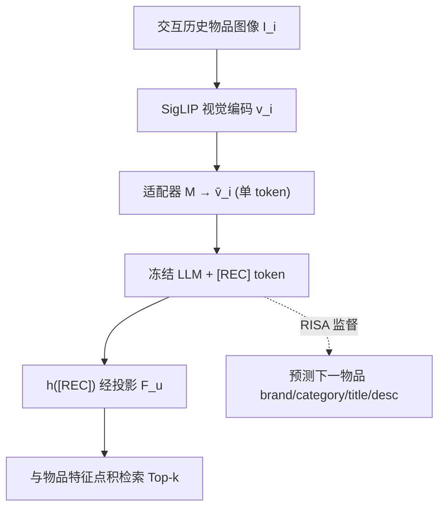
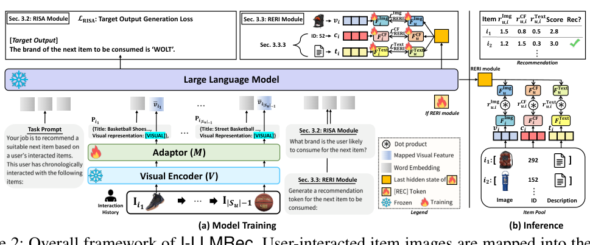

# Token-Efficient Item Representation via Images for LLM Recommender Systems (面向 LLM 推荐系统的图像化 Token 高效物品表征)

- **会议/期刊**: ICLR 2026
- **作者与机构**: Kibum Kim, Sein Kim, HongSeok Kang, Jiwan Kim, Heewoong Noh, Yeonjun In, Kanghoon Yoon, Jinoh Oh (Amazon Alexa), Julian McAuley (UCSD), Chanyoung Park (KAIST)
- **推荐链路定位**: 召回（检索式 Next-Item 推荐）
- **研究方向**: 大语言模型推荐 / 多模态推荐
- **论文原文**: [https://arxiv.org/abs/2503.06238v2](https://arxiv.org/abs/2503.06238v2)
- **开源代码**: [https://github.com/rlqja1107/torch-I-LLMRec](https://github.com/rlqja1107/torch-I-LLMRec)

## TL;DR (1分钟核心速览)

LLM 推荐中物品的文本表征存在"效率-效果"两难：属性式（约 10 token）快但语义贫乏，描述式（约 160 token）语义丰富但 Transformer 复杂度随序列长度 $|S_u|$ 二次膨胀。本文观察到物品图像与描述在 CLIP 空间余弦相似度约 0.31，甚至高于 COCO 正样本对的 0.26，遂提出 I-LLMRec：用**单张图像 token** 替代整段描述，并以 RISA 模块对齐视觉-语言空间、以 RERI 模块将推荐重构为检索任务。在 Amazon 四域 Leave-One-Out + 100 负采样协议下，Hit@5 较属性式 TALLRec 提升约 22%，推理速度较描述式 TRSR 快约 2.93 倍。

## Background & Motivation (背景与核心矛盾)

- **主流范式**: LLM4Rec 将用户交互序列转为自然语言 prompt，物品表征分两派——属性式（TALLRec 拼接 brand/category/title）与描述式（TRSR 用大模型摘要描述后喂给小模型）。
- **前人局限**: 属性式 token 少但语义不足，性能较描述式低 13% 以上；描述式语义丰富，但输入长度随 $|S_u|$线性增长、注意力开销$O((|f(D_i)||S_u|)^2 d)$ 二次膨胀，且摘要过程引入信息损失、全文描述又夹带 HTML 噪声。
- **核心洞察 (Key Insight)**: 用 CLIP 度量 Amazon Sport/Art 的物品图像-描述对，平均相似度约 0.31，高于 COCO 精心标注图文正样本对的 0.26（负样本对仅 0.07），说明图像已"蕴含"描述的大部分语义，二者高度冗余。
- **本文切入点**: 把这种冗余从"多模态融合的障碍"翻转为"效率红利"——既然图像覆盖描述语义，就用 1 个视觉 token 换掉 160 个文本 token。

## Method (核心方法设计)

### 1. 整体框架 (Overall Architecture)

用户交互历史中的每个物品被表示为 `{Title: ..., Visual Representation: [VISUAL]}`，其中 `[VISUAL]` 占位符在进入 Transformer 前被适配器映射后的视觉特征 $\bar{v}_i = M(v_i)$替换（$v_i$由 SigLIP 视觉编码器提取）。LLM（Sheared LLaMA-2.7B，全程冻结）在序列末尾的 `[REC]` 可学习 token 上聚合用户偏好，其末层隐状态$h(\text{[REC]})$ 经投影后与物品侧特征做点积检索。训练由 RISA（对齐适配器）与 RERI（检索式推荐）两部分损失联合驱动，推理时对 Image/CF/Text 三路亲和分求和取 Top-k。

<figure class="paper-figure" markdown="span">
  <figcaption>图 2：I-LLMRec 的整体框架。用户交互过的物品图像通过适配器映射到 LLM 中，该适配器连接图像空间与语言空间。为确保两个空间之间的对齐，适配器通过 RISA 模块进行优化。此外，推荐过程通过 RERI 模块被形式化为检索任务。</figcaption>
</figure>

### 2. 关键设计拆解 (Key Designs)

1. **RISA：面向推荐的图像-LLM 语义对齐**：视觉特征与语言空间天然错位，直接拼接会让 LLM 读不懂图像。作者不改 LLM，只训练适配器 $M$，用"输入-目标输出"式 prompt 让 LLM 基于图像特征预测下一物品的 brand/category/title/description 四类属性（每类 5 个模板，每步随机抽 1 个共 20 种），损失为$\mathcal{L}_{\text{RISA}}=\max_{M}\sum_{k=1}^{|y|}\log P_{\theta,M}(y_k\mid x,y_{<k})$。直觉是：让视觉 token 承担"预测下一物品语义"的监督信号，比通用图文对齐更贴合推荐语境。

2. **RERI：把推荐重构为检索而非生成**：标题生成式推荐可能吐出语料库中不存在的物品，且依赖昂贵的 beam search；item token 式则需扩充词表、难以扩展。RERI 用 `[REC]` 隐状态与物品特征在共享空间做点积打分 $r^{\text{Img}}_{u,i}=o^{\text{Img}}_u \circledast o^{\text{Img}}_i$，以 BCE 训练：
$$\mathcal{L}^{\text{Img}}_{\text{RERI}}=-\sum_{u\in\mathcal{U}}\left[\log\sigma(r^{\text{Img}}_{u,i})+\log(1-\sigma(r^{\text{Img}}_{u,i^-}))\right]$$
其中 $i^-$ 为随机负样本。检索式建模保证推荐必在库内，且无需扩词表。

3. **多特征类型扩展与训练目标**：同一套投影框架可无缝接入 CF 特征（SASRec 预训练 ID 嵌入）与文本特征（SBERT 编码描述），总损失 $\mathcal{L}_{\text{final}}=\mathcal{L}_{\text{RISA}}+\mathcal{L}^{\text{Img}}_{\text{RERI}}+\mathcal{L}^{\text{CF}}_{\text{RERI}}+\mathcal{L}^{\text{Text}}_{\text{RERI}}$，各项权重固定为 1 以避免调参开销。负采样为每正样本随机 1 个负例；LLM 冻结使训练仅需优化适配器与投影器，视觉特征可离线预计算，在线开销极低。

## Experimental Setup & Evaluation Protocol (实验设置与评估协议)

- **数据集与预处理**: Amazon 四域，按前人工作过滤交互数 $<5$ 的用户与物品（`5-core`）：

| 数据集 | #Users | #Items | #Interactions | 平均序列长 | 场景说明 |
| :--- | :---: | :---: | :---: | :---: | :--- |
| Sport | 24,665 | 9,884 | 179,491 | 7.28 | 运动户外 |
| Grocery | 84,896 | 25,632 | 739,628 | 8.71 | 日用杂货（最大规模） |
| Art | 14,986 | 5,801 | 121,917 | 8.13 | 艺术品（最小规模） |
| Phone | 59,307 | 19,671 | 403,194 | 6.80 | 手机数码 |

- **数据划分与防穿越**: `Leave-One-Out`——最近一次交互为测试集、倒数第二次为验证集、其余为训练集。
- **排名评测协议**: `Sampled Ranking`，每用户随机采 100 个未交互负例 + 1 个真值正例计算 Hit@5/10 与 NDCG@5/10（非 Full-Ranking，存在一定乐观偏差）。
- **对比基线与超参设置**: CF 类（GRU4Rec、VBPR、BERT4Rec、SASRec）、LLM 类（TALLRec 属性式、A-LLMRec CF 式、TRSR 描述式）、图像感知 LLM 类（UniMP、I-LLMRec+D）。统一 LLM 骨干 Sheared LLaMA-2.7B、视觉编码器 SigLIP、适配器为 2 层 MLP（中间维 512）、学习率 0.001、batch 32、单卡 A6000。

## Key Experimental Results (实验关键数据)

### 1. 主实验对比 (Main Results)

| 数据集 | 指标 | SASRec | TALLRec (A) | A-LLMRec (CF) | TRSR (D) | UniMP (I) | **I-LLMRec (I)** | Improv. vs TRSR |
| :--- | :---: | :---: | :---: | :---: | :---: | :---: | :---: | :---: |
| Sport | Hit@5 | 0.3841 | 0.3801 | 0.4070 | 0.4302 | 0.4030 | **0.4570** | +6.2% |
| Sport | NDCG@5 | 0.3129 | 0.2938 | 0.3352 | 0.3375 | 0.3364 | **0.3711** | +10.0% |
| Grocery | Hit@5 | 0.4684 | 0.4589 | 0.4823 | 0.4917 | 0.4506 | **0.5069** | +3.1% |
| Grocery | NDCG@5 | 0.3753 | 0.3477 | 0.3860 | 0.3802 | 0.3710 | **0.3956** | +4.1% |
| Art | Hit@5 | 0.5374 | 0.5663 | 0.5681 | 0.5841 | 0.5315 | **0.5883** | +0.7% |
| Art | NDCG@5 | 0.4561 | 0.4572 | 0.4652 | 0.4758 | 0.4565 | **0.4839** | +1.7% |
| Phone | Hit@5 | 0.4366 | 0.4986 | 0.4502 | 0.5148 | 0.4427 | **0.5156** | +0.2% |
| Phone | NDCG@5 | 0.3299 | 0.3721 | 0.3403 | 0.3886 | 0.3388 | **0.3900** | +0.4% |

### 2. 消融实验 (Ablation Study)

| 配置 | RISA | RERI-Img | RERI-CF | RERI-Text | Sport Hit@5 | Sport NDCG@5 | Art Hit@5 | Art NDCG@5 |
| :--- | :---: | :---: | :---: | :---: | :---: | :---: | :---: | :---: |
| (a) 仅图像 | | ✓ | | | 0.3953 | 0.3043 | 0.5040 | 0.3915 |
| (b) +RISA | ✓ | ✓ | | | 0.4316 | 0.3403 | 0.5564 | 0.4447 |
| (c) +CF | | ✓ | ✓ | | 0.4075 | 0.3256 | 0.5502 | 0.4517 |
| (d) Img+CF | ✓ | ✓ | ✓ | | 0.4491 | 0.3630 | 0.5795 | 0.4769 |
| (e) 全特征 | ✓ | ✓ | ✓ | ✓ | **0.4570** | **0.3711** | **0.5883** | **0.4839** |

### 3. 关键实验发现 (Key Findings)

1. **RISA 是图像表征生效的前提**：去掉 RISA 后 Sport Hit@5 从 0.4316 掉到 0.3953（-8.4%），说明未经推荐语境对齐的视觉特征几乎无法被冻结 LLM 有效解读，通用多模态对齐（如 UniMP 的预对齐 MLLM）不足以替代任务定制对齐。
2. **图像与描述高度冗余，叠加无增益**：I-LLMRec+D 在 Sport 上 Hit@5 为 0.4554，反而略低于纯图像的 0.4570，印证了图像已覆盖描述语义；而 TALLRec 加描述（等价 TRSR）却显著提升，说明"文本→图像"的替换是信息等价而非信息丢失。
3. **图像与 CF 特征呈冷热互补**：按交互频次五等分后，图像特征在冷门组（Group 1-2）优于 CF，CF 在热门组（Group 5）反超图像；二者融合后在冷门组超过纯 CF、在热门组超过纯图像，最终三特征全开在全部组别最优。

## Highlights & Limitations (亮点、对比与审稿批判)

- **与代表作对比 (vs. Prior Work)**: 相比 TALLRec（属性式，token 少但语义弱）与 TRSR（描述式，语义强但 $O(|S_u|^2)$ 开销），本文用 1 个视觉 token 同时拿下两端；相比 UniMP（图像感知但依赖预对齐 MLLM + OOV token 生成），本文的 RISA 任务定制对齐 + RERI 检索式打分在四域全面领先；相比 Semantic ID 方法（LC-Rec 需 4 个离散码），单图像 token 更省且在全库候选下 Hit@5 更高（16.28 vs 15.86）。
- **可迁移亮点**: (1) "用冗余模态替换昂贵模态"的表征压缩思路可迁移到长文本用户画像、评论摘要等场景；(2) 冻结 LLM + 仅训适配器/投影器 + 离线预计算视觉特征的范式，对工业部署的算力友好度极高。
- **审稿级局限批判**: (1) 评测采用 100 负采样的 Sampled Ranking，未报告 Full-Ranking 结果，绝对数值可能偏乐观，且与 Semantic ID 的对比仅在附录小规模设置下给出；(2) 强依赖高质量物品图像，缺失图像场景仅在附录讨论，且图像-描述冗余度在非电商域（如新闻、音乐）未必成立，跨域泛化性存疑。

## Rating (四维评分)

- **方法创新性 (Novelty)**: ⭐⭐⭐⭐ （把多模态冗余从"障碍"重构为"效率红利"的视角转换颇具巧思，RISA+RERI 组合虽为工程拼装但动机自洽）
- **评估协议与实验扎实度 (Protocol & Experiments)**: ⭐⭐⭐ （四域 + 充分消融 + 冷热分组分析扎实，但仅用 100 负采样排序、缺 Full-Ranking 与显著性检验，削弱说服力）
- **写作与数学规范度 (Clarity & Rigor)**: ⭐⭐⭐⭐ （复杂度分析 $O((|f(\cdot)||S_u|)^2 d)$ 推导清晰，动机图与消融逻辑链完整，公式简洁无冗余）
- **工业落地与复现价值 (Industrial & Practical Value)**: ⭐⭐⭐⭐⭐ （代码开源、LLM 冻结、视觉特征可离线预计算、推理较描述式快 2.93 倍，工程落地门槛极低）
