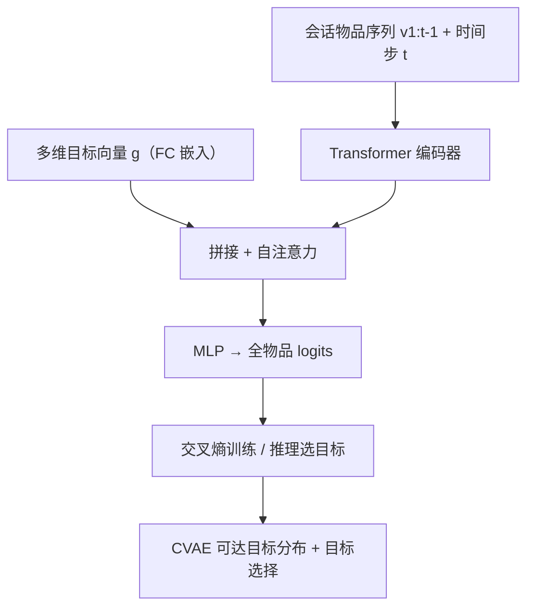
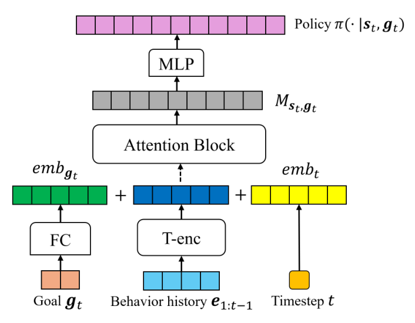

# Goal-Conditioned Supervised Learning for Multi-Objective Recommendation (面向多目标推荐的目标条件监督学习)

- **会议/期刊**: NeurIPS 2026
- **作者与机构**: Shijun Li, Hilaf Hasson, Jing Hu, Joydeep Ghosh (UT Austin / Intuit AI Research / Intuit Inc.)
- **推荐链路定位**: 召回（会话级下一物品预测）
- **研究方向**: 多任务学习与列表级重排 / 序列推荐
- **论文原文**: [https://arxiv.org/abs/2412.08911v4](https://arxiv.org/abs/2412.08911v4)
- **开源代码**: [https://github.com/xiwenchao/MOGCSL](https://github.com/xiwenchao/MOGCSL)

## TL;DR (1分钟核心速览)

多目标推荐长期依赖 MMOE 塔结构或 DWA/PE/Nash-MTL 等梯度/损失约束来平衡冲突目标，带来额外参数与调参开销，且对所有样本一视同仁、无法剔除噪声交互。本文提出 MOGCSL，把 GCSL 的标量目标推广为多维向量目标（每维对应一个目标的会话级累积奖励），仅用 Transformer 编码器 + 交叉熵即可端到端训练，天然按"未来多目标收益"对样本加权去噪；并给出基于 CVAE 的可达目标分布建模与目标选择算法。在 RetailRocket/Challenge15 的 Full-Ranking 协议下，购买目标 HR@10 相对最强基线提升约 4%–17%，模型仅 9.1M 参数、训练 3.0Ks。

## Background & Motivation (背景与核心矛盾)

- **主流范式**: 多目标推荐分两派——架构派（Shared-Bottom、MMOE 为每目标建独立塔）与优化派（Fixed-Weights、DWA 动态损失权重、PE 求 Pareto 效率、Nash-MTL、FAMO 梯度平衡）。
- **前人局限**: ① 架构/约束派引入显著空间与时间开销（MMOE-PE 训练 60.5Ks、RMTL 100.2Ks），且权重网格搜索需 $O(m^{n-1})$ 次重复实验；② 所有方法对所有样本等权，而真实推荐数据中"用户对展示列表全无兴趣""临时分心"造成的无信息/噪声交互被同等学习，损害长期偏好建模。
- **核心洞察 (Key Insight)**: 若把"当前动作在未来多个目标上的累积收益"作为条件输入，则高目标样本天然对应低噪声交互（点击后继续浏览 vs. 点击后立即退出），模型在高目标条件下推理时即自动偏向干净数据。
- **本文切入点**: 用向量化目标替代标量目标，把多目标优化转化为一个无约束的监督学习问题，并系统研究推理期"如何选一个可达且高的多维目标"这一被忽视的问题。

## Method (核心方法设计)

### 1. 整体框架 (Overall Architecture)

将用户会话建模为 MOMDP：轨迹 $\tau=\{(s_t,a_t,\boldsymbol{r}_t)\}$，奖励为向量，目标定义为会话级累积奖励$\boldsymbol{g}_t=\sum_{t'=t}^{|\tau|}\boldsymbol{r}_{t'}$。训练时先把每条$(s_t,a_t,\boldsymbol{r}_t)$重标注为$(s_t,a_t,\boldsymbol{g}_t)$；物品序列经 Transformer 编码器得到历史表征，与时间步嵌入、目标嵌入拼接后再过一层自注意力，MLP 映射到全物品 logits，交叉熵优化。推理时由目标选择模块给出期望目标$\boldsymbol{g}'$，与当前状态一起送入策略网络输出下一物品分布。

<figure class="paper-figure" markdown="span">
  <figcaption>图1：MOGCSL的模型结构。</figcaption>
</figure>

### 2. 关键设计拆解 (Key Designs)

1. **向量化目标的条件策略（Vector-Valued Goal Conditioning）**：痛点是把多目标压成标量需人工权重且丢失目标结构；本文令 $\boldsymbol{g}_t\in\mathbb{R}^d$ 每维独立保留一个目标的累积奖励，状态表征为
$$\boldsymbol{M}_{s_t,\boldsymbol{g}_t}=\mathrm{Atten}\big(\mathrm{Concat}(\mathrm{T\text{-}enc}(\boldsymbol{e}_{1:t-1}),\ \mathrm{emb}_t,\ \mathrm{emb}_{\boldsymbol{g}_t})\big)$$
直觉：目标向量作为"未来期望"的条件信号，使同一状态在不同目标下产生不同动作分布，从而无需任何损失加权即可隐式解耦多目标。

2. **基于 CVAE 的可达目标建模与选择（Goal-Choosing Algorithm）**：经典 GCSL 用"训练集均值 × 固定因子"选标量目标，多维下不可行。作者先证明定理：轨迹实际达成目标 $\boldsymbol{g}_a$的分布由$(s_1,\boldsymbol{g}_1,\pi)$唯一决定；再用两个 CVAE 分别学习先验$q(\boldsymbol{g}'|s')$与可达分布$P(\boldsymbol{g}_a|s',\boldsymbol{g}',\pi)$，损失为
$$\mathcal{L}_{\mathrm{CVAE}}=\mathbb{E}_{(s,g),z}\big[-\log P(g|z,c)+D_{\mathrm{KL}}(Q(z|g,c)\|P(z))\big]$$
推理时采样 $K$ 个候选目标、估计各自期望可达目标，按支配关系（式 8）选非被支配的高目标。直觉：只在"可达集"内选高目标，天然规避目标冲突导致的不可实现问题。

3. **训练目标、负采样与推理效率**：总损失即标准交叉熵 $\mathcal{L}(\theta)=\mathbb{E}_{(s_t,a_t,\boldsymbol{g}_t)}[-\log\pi_\theta(a_t|s_t,\boldsymbol{g}_t)]$，全库 softmax、**免负采样**、免权重调参；推理仅多一次 CVAE 采样与前向，模型 9.1M 参数、训练 3.0Ks，均为全部基线中最低。

## Experimental Setup & Evaluation Protocol (实验设置与评估协议)

- **数据集与预处理**:

| 数据集 | 目标维度 | 场景说明 | 目标相关性 (Pearson) |
| :--- | :---: | :--- | :---: |
| RetailRocket | 2 (click, purchase) | 电商会话，点击/购买二值标签 | 0.72（弱冲突） |
| Challenge15 | 2 (click, purchase) | 电商会话，点击/购买二值标签 | 0.33（强冲突） |
| Tenrec | 2 (click, like) | 高目标密度补充数据集 | 0.52（中等） |

- **数据划分与防穿越 (Splitting Strategy)**: 会话级序列建模，按会话切分训练/验证/测试（验证集用于调 $\lambda$ 等超参），5 个随机种子取均值与标准差。
- **排名评测协议 (Ranking Protocol)**: 下一物品预测的 top-$k$ 排序，报告 HR@10/20 与 NDCG@10/20；所有基线共享同一 Transformer 编码器与自注意力基座以保证公平。
- **对比基线与超参设置**: 8 个经典多目标基线（Share/MMOE × Fix/DWA/PE/Nash/FAMO）、离线 RL 的 RMTL、监督式 PMORS、以及作者构造的标量 GCSL 变体 MOPRL（奖励加权和 $r'=w_c r_c+w_p r_p$）。

## Key Experimental Results (实验关键数据)

### 1. 主实验对比 (Main Results)

RetailRocket（%，均值±标准差，节选核心列）：

| 方法 | Purchase HR@10 | Purchase NG@10 | Purchase HR@20 | Click HR@10 | Click NG@10 |
| :--- | :---: | :---: | :---: | :---: | :---: |
| Share-FAMO | 48.92±0.17 | 46.11±0.10 | 50.19±0.09 | 35.97±0.14 | 26.17±0.09 |
| MMOE-Nash | 47.88±0.27 | 46.49±0.29 | 51.17±0.22 | 35.79±0.18 | 26.02±0.27 |
| MMOE-FAMO | 47.93±0.32 | 46.42±0.23 | 51.24±0.19 | 35.92±0.21 | 26.14±0.17 |
| RMTL | 62.84±0.24 | 49.92±0.20 | 67.04±0.15 | 33.95±0.35 | 24.23±0.41 |
| PMORS | 63.14±0.15 | 51.02±0.17 | 67.45±0.20 | 34.16±0.26 | 24.09±0.23 |
| MOPRL | 61.18±0.19 | 50.74±0.10 | 64.76±0.25 | 33.99±0.11 | 24.31±0.08 |
| **MOGCSL** | **65.43±0.15** | **52.92±0.11** | **69.28±0.14** | **36.30±0.25** | **25.24±0.15** |
| Improv. vs 最强基线 | +3.6% | +3.7% | +2.7% | +0.9% | — |

Challenge15（%，节选）：

| 方法 | Purchase HR@10 | Purchase NG@10 | Purchase HR@20 | Click HR@10 | Click NG@10 |
| :--- | :---: | :---: | :---: | :---: | :---: |
| Share-FAMO | 39.06±0.13 | 25.94±0.21 | 44.97±0.18 | 43.25±0.13 | 27.02±0.11 |
| MMOE-PE | 36.40±0.36 | 24.66±0.19 | 41.52±0.33 | 44.04±0.09 | 27.44±0.03 |
| RMTL | 53.34±0.46 | 33.65±0.36 | 62.89±0.49 | 41.41±0.41 | 24.87±0.38 |
| PMORS | 54.98±0.31 | 34.77±0.28 | 63.52±0.24 | 42.36±0.39 | 25.10±0.42 |
| MOPRL | 54.79±0.37 | 35.37±0.26 | 63.10±0.45 | 42.14±0.21 | 25.62±0.18 |
| **MOGCSL** | **56.82±0.25** | **35.93±0.15** | **65.64±0.55** | 42.47±0.15 | 25.64±0.11 |
| Improv. vs 最强基线 | +3.3% | +1.6% | +3.3% | -1.2% (vs MMOE-PE) | — |

### 2. 消融与目标选择策略对比 (Ablation & Goal-Choosing)

| 变体 | RetailRocket P-HR@10 | Challenge15 P-HR@10 | Tenrec Like-HR@10 | 说明 |
| :--- | :---: | :---: | :---: | :--- |
| MOGCSL-S（统计目标） | **65.43** | **56.82** | 5.96 | 均值×$\lambda$，$\lambda\in[1,2]$ 最优 |
| MOGCSL-C（CVAE 目标） | 65.01 | 55.13 | **6.78** | 高目标稀疏时反而退化 |
| MOPRL（标量目标） | 61.18 | 54.79 | — | 任意权重组合均劣于 MOGCSL |
| 复杂度：MOGCSL vs MMOE-PE | 9.1M / 3.0Ks | vs 14.1M / 60.5Ks | — | 参数与训练时间均大幅下降 |

### 3. 关键实验发现 (Key Findings)

1. **目标冲突越强，MOGCSL 相对 Pareto 方法的优势越大**：Challenge15 上 click-purchase 相关性仅 0.33，MOGCSL 购买 HR@10 比 MMOE-PE 高约 20%，仅牺牲 1–2% 点击；RetailRocket 相关性 0.72 时购买提升约 17% 而点击几乎持平——说明严格 Pareto 约束在强冲突下严重压制高价值目标。
2. **向量目标本身即带来增益，而非仅靠架构**：MOPRL 在所有奖励加权组合下均劣于 MOGCSL（图 2），证明把标量目标拆成多维向量、免去人工权重是性能提升的关键来源。
3. **CVAE 目标选择依赖高目标数据密度**：RetailRocket/Challenge15 平均累积奖励仅约 5.3（click）/0.2（purchase），高目标空间训练样本稀疏，MOGCSL-C 退化；Tenrec 平均目标达 28.3/1.2 时 MOGCSL-C 反超 MOGCSL-S（Like HR@10 5.96→6.78），揭示"可达目标建模 + 数据密度"的互补关系。

## Highlights & Limitations (亮点、对比与审稿批判)

- **与代表作对比 (vs. Prior Work)**: 相比 MMOE/PE 等依赖塔结构或 KKT 求解的方法，MOGCSL 无额外塔、无权重搜索、无梯度相似度计算；相比 MOPRL/RMTL 将多目标压成标量奖励，本文保留向量结构并显式建模推理目标可达性，这是标量 GCSL 完全缺失的问题。
- **可迁移亮点**: ① "未来累积收益作为条件输入"可迁移到任何序列推荐模型做隐式样本重加权去噪；② CVAE 建模状态条件可达目标分布，可用于多目标重排的目标设定与线上策略调节。
- **审稿级局限批判**: ① 仅在两个目标维度上验证，$d$ 增大时 CVAE 采样与支配关系选择的计算与稀疏性问题未讨论；② 缺乏线上 A/B 测试，且 MOGCSL-C 在高目标稀疏场景退化，实际部署需先诊断数据目标密度再选策略。

## Rating (四维评分)

- **方法创新性 (Novelty)**: ⭐⭐⭐⭐ （把 GCSL 标量目标推广为向量目标并首次系统研究多维推理目标选择，定理 + CVAE 建模有理论支撑，但核心算子仍是标准 Transformer + 交叉熵）
- **评估协议与实验扎实度 (Protocol & Experiments)**: ⭐⭐⭐⭐ （三数据集、5 种子、8+ 基线、复杂度与目标策略消融完整，但缺少线上 A/B 与更大目标维度的验证）
- **写作与数学规范度 (Clarity & Rigor)**: ⭐⭐⭐⭐ （MOMDP 形式化与定理证明清晰，目标选择算法伪代码完整；部分附录讨论与正文重复度较高）
- **工业落地与复现价值 (Industrial & Practical Value)**: ⭐⭐⭐⭐⭐ （9.1M 参数、3.0Ks 训练、免负采样免调权，代码已开源，对工业多目标推荐极具吸引力）
