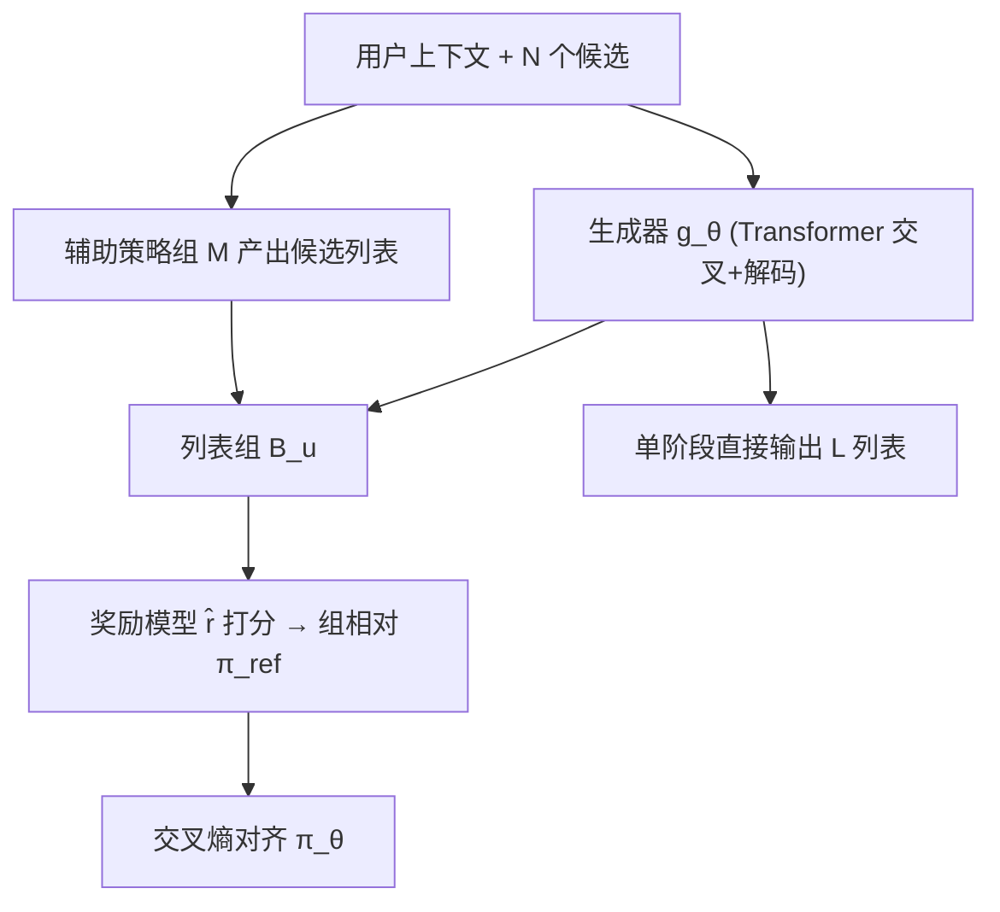

# GoalRank: Group-Relative Optimization for a Large Ranking Model (面向大排序模型的组相对优化)

- **会议/期刊**: ICLR 2026
- **作者与机构**: Kaike Zhang, Xiaobei Wang, Shuchang Liu 等（快手科技 & 中国科学院大学）
- **推荐链路定位**: 重排（N→L 列表生成）
- **研究方向**: 多任务学习与列表级重排 / 生成式推荐
- **论文原文**: [https://arxiv.org/abs/2509.22046v2](https://arxiv.org/abs/2509.22046v2)
- **开源代码**: 暂未开源（论文承诺匿名仓库 `anonymous.4open.science/r/GoalRank`）

## TL;DR (1分钟核心速览)

重排本质是从 $P(N,L)$组合爆炸空间中选列表，主流「生成器–评估器（G–E）」范式靠堆生成器数量扩候选集，但收益迅速饱和。本文从理论上证明：对任意有限多生成器–评估器族，总存在一个更大的**纯生成器**模型，其对最优排序策略$\pi^*$的 KL 近似误差严格更小且随宽度增大趋于 0；据此推导证据上界，提出用奖励模型构造**组相对参考策略**$\pi_{\text{ref}}$ 做交叉熵对齐，得到 GoalRank。在 ML-1M/Industry/Book 上 H@6 相对最优基线提升 +4.1%~+25.4%，线上全量替换生产 MG-E，App 停留时长 +0.149%。

## Background & Motivation (背景与核心矛盾)

- **主流范式**: 工业重排普遍采用两阶段 G–E：生成器产出多条候选列表，评估器按列表级价值选最优；后续工作以多生成器（MG-E）扩候选集多样性。
- **前人局限**: ① 单生成器贪心打分只建模候选集（N）内依赖，忽略输出列表（L）内依赖，易陷局部最优；② 候选空间组合爆炸，单纯增加生成器数量收益快速饱和（图 1(d) 在 Amazon 上明显平台化），且多阶段存在跨阶段不一致。
- **核心洞察 (Key Insight)**: 大推荐模型的端到端单阶段成功暗示「一个足够大的模型可吞并多阶段流水线」；作者从策略空间覆盖角度发现，k 个小生成器的混合策略空间 Hausdorff 维数仅 $kd_m+(k-1)$，远小于列表单纯形维数，故对几乎处处$\pi^*$ 存在正的下界误差。
- **本文切入点**: 放弃评估器，用「更大单生成器 + 组相对参考策略对齐」直接逼近 $\pi^*$。

## Method (核心方法设计)

### 1. 整体框架 (Overall Architecture)

GoalRank 是纯生成器单阶段排序器：输入用户上下文 $X_u$与前序召回的$N$个候选，生成器$g_\theta$经 softmax 定义排序策略$\pi_\theta=\text{softmax}\circ g_\theta$，自回归逐位在掩码候选集上打分生成长度$L$的列表。训练时不依赖评估器，而是先用真实反馈训练奖励模型$\hat r$，对每个用户构造由主生成器与一组辅助策略（启发式/轻量神经模型）产出的列表组$\mathcal{B}_u$，在组内做归一化得到参考策略$\pi_{\text{ref}}$，再以交叉熵对齐$\pi_\theta$。推理时单次前向直接输出最终列表，无候选枚举与评估打分。

### 2. 关键设计拆解 (Key Designs)

1. **单生成器严格优于 k-混合 G–E（定理 1）**：定义 $(\alpha,\beta)$-有界生成器类与 k-混合策略空间$\mathcal{C}^k_m(\alpha,\beta)=\{\sum_{i=1}^k\omega_i\pi_i\}$，证明存在宽度$\ge k\alpha+n$的大生成器类$\mathcal{F}^M$使$\mathcal{E}(\mathcal{F}^M)<\mathcal{E}(\mathcal{C}^k_m)$且$\lim_{n\to\infty}\mathcal{E}(\mathcal{F}^M)=0$。直觉：k 个小生成器混合的策略流形维数受限，无法覆盖高维列表单纯形；而单网络宽度增长可借通用逼近定理把 KL 误差压到任意小，这正是缩放定律的理论来源。

2. **组相对参考策略构造**：理想奖励 $r^*$不可得，仅有带偏$\hat r(l)=r^*(l)+b(l)$。当组内奖励差足够大（$\max_{l_i,l_j\in\mathcal{B}}|\hat r(l_i)-\hat r(l_j)|>\sigma^*$）时，偏置不改变组内偏序，于是用组均值/标准差归一化构造
$$\pi_{\text{ref}}(l\mid\mathcal{B})=\frac{\exp((\hat r(l)-\bar r_{\mathcal{B}})/\sigma_{\mathcal{B}})}{\sum_{l'\in\mathcal{B}}\exp((\hat r(l')-\bar r_{\mathcal{B}})/\sigma_{\mathcal{B}})}.$$
该式等价于对 Boltzmann 最优策略 $\pi^*\propto\exp(r^*/\tau)$ 的组内代理，把不可得的全局配分函数换成组内配分，天然抵消奖励模型的常数级偏置。

3. **训练目标与组构造**：总损失为对参考策略的交叉熵
$$\mathcal{L}(\pi_\theta)=-\mathbb{E}_{\mathcal{B}\sim\mathcal{D}}\Big[\sum_{l\in\mathcal{B}}\pi_{\text{ref}}(l\mid\mathcal{B})\log\pi_\theta(l)\Big],$$
等价于最小化 $\mathrm{KL}(\pi_\theta\|\pi^*)$的可 tractable 上界。组$\mathcal{B}_u=\{l^\theta_u\}\cup\{l^i_u\}$由主生成器与辅助策略集$\mathcal{M}$（自回归采样、树状并行生成、softmax 随机采样、马尔可夫近似、随机选择、启发式替换、多样性生成）共同产出，必要时按奖励排序后均匀采样子集以拉大组内奖励差。训练无需负采样，辅助组构造可完全并行，额外开销可忽略。

## Experimental Setup & Evaluation Protocol (实验设置与评估协议)

- **数据集与预处理**（20-core 过滤，MF 召回 top-50 候选，$N=50$，$L=6$）：

| 数据集 | #Users | #Items | #Interactions | 说明 |
| :--- | :---: | :---: | :---: | :--- |
| ML-1M | 6,020 | 3,043 | 995,154 | 电影评分公开集 |
| Amazon-Book | 35,732 | 38,121 | 1,960,674 | 图书评论公开集 |
| Industry | 89,310 | 10,395 | 3,270,132 | 短视频，长观看(>85%)为正 |
| Industry-0.1B | 1,146,032 | 312,573 | 100,269,812 | 大规模短视频，用于缩放实验 |

- **数据划分与防穿越**: 按时间排序后 **8:2 时间切分**；每用户历史最后 6 次交互作为重排后曝光列表的 ground truth，前序交互构造候选，严格避免未来信息泄漏。
- **排名评测协议**: 列表级 **Full-List 生成评测**（在 $N=50$候选上生成$L=6$ 列表，与真实 6 元组比对），报告 H@6 / N@6 / M@6 / F1@6 / AUC，5 次独立运行取均值。
- **对比基线与超参**: 三类基线——G-only（DNN、DLCM、PRS、PRM、MIR、RankMixer）、G–E（EGRank、PIER、NAR4Rec）、MG-E（生成器数 3/20/100）；所有基线共享同一评估器（奖励模型）以保证公平；默认隐维 $d=128$、深度一致；提升均通过 Student t-test$p<0.05$ 显著性检验。

## Key Experimental Results (实验关键数据)

### 1. 主实验对比 (Main Results)

| 方法 | ML-1M H@6 | ML-1M N@6 | Industry H@6 | Industry M@6 | Book H@6 | Book F1@6 |
| :--- | :---: | :---: | :---: | :---: | :---: | :---: |
| DNN (G-only) | 56.86 | 70.30 | 37.32 | 42.38 | 60.28 | 62.45 |
| DLCM (G-only) | 62.31 | 73.87 | 39.69 | 48.90 | 66.80 | 69.28 |
| RankMixer (G-only) | 60.88 | 72.65 | 49.72 | 58.73 | 68.03 | 71.26 |
| PIER (G–E) | 62.74 | 75.99 | 45.35 | 52.55 | 71.14 | 73.74 |
| NAR4Rec (G–E) | 62.81 | 75.01 | 44.31 | 51.45 | 70.08 | 72.66 |
| G-100 (MG-E) | 60.64 | 70.97 | 55.77 | 60.95 | 77.21 | 80.09 |
| **GoalRank** | **73.56** | **83.43** | **69.93** | **79.01** | **80.35** | **83.44** |
| Improv. | +17.12% | +9.79% | +25.39% | +29.63% | +4.07% | +4.18% |

### 2. 消融实验 (Ablation Study)

| 配置 | H@6 | N@6 | M@6 | F1@6 | AUC |
| :--- | :---: | :---: | :---: | :---: | :---: |
| 组大小 $\|\mathcal{B}\|=3$ | 62.88 | 81.76 | 72.50 | 74.00 | 97.50 |
| $\|\mathcal{B}\|=5$ | 64.52 | 83.42 | 74.44 | 75.94 | 97.79 |
| $\|\mathcal{B}\|=8$ | 69.95 | 86.82 | 78.86 | 82.25 | 98.05 |
| $\|\mathcal{B}\|=10$（最优） | 69.94 | **87.17** | **79.34** | **82.28** | **98.15** |
| $\|\mathcal{B}\|=20$ | 69.93 | 86.93 | 79.01 | 82.29 | 98.07 |
| $\|\mathcal{B}\|=100$ | 63.50 | 82.94 | 73.92 | 74.76 | 97.77 |
| 奖励偏置 $\lambda=0.0$ | 69.93 | 86.93 | 79.01 | 82.29 | 98.07 |
| $\lambda=0.2$ | 65.32 | 83.21 | 74.33 | 76.89 | 97.90 |
| $\lambda=0.5$ | 63.77 | 82.75 | 73.79 | 75.05 | 97.73 |

### 3. 关键实验发现 (Key Findings)

1. **单生成器规模化的收益远超堆生成器**：MG-E 生成器数从 3 增至 100，Industry H@6 仅从 49.42 升到 55.77 即饱和；而 GoalRank 单模型即达 69.93，且在 Industry-0.1B 上从 1M 到 0.1B 参数持续提升（10M→0.1B 段增益最陡），实证了定理 1 的缩放律。
2. **组大小存在「甜点区」**：$|\mathcal{B}|=8\sim20$ 最优，过小（3–5）样本不足致参考策略不可靠，过大（50–100）削弱组内奖励差、放大奖励模型偏置，H@6 从 69.94 跌至 63.50，验证了式 (3) 的偏序保持条件。
3. **对奖励偏置鲁棒**：即便注入 $\lambda=0.5$ 的强噪声，GoalRank 仍达 H@6=63.77，高于最强基线 G-100 的 55.77，说明组相对归一化确实抵消了常数级偏置；线上全量替换 MG-E 后 App 停留时长 +0.149%、有效观看 +0.227%，且延迟从 34.235ms 降至 18.611ms、MFU 从 2.03% 升至 12.65%。

## Highlights & Limitations (亮点、对比与审稿批判)

- **与代表作对比 (vs. Prior Work)**: 相比 PIER/NAR4Rec 等 G–E 方法，GoalRank 去掉评估器与候选枚举，用单模型直接生成列表，避免跨阶段不一致；相比 MG-E（Yang et al., 2025）靠扩生成器数量，本文从策略空间维数角度给出「为何堆数量无效」的理论解释，并以宽度缩放替代数量缩放。
- **可迁移亮点**: ① 组相对归一化构造参考策略的思路可直接迁移到任何「有奖励模型但无精确最优策略」的列表级/序列级对齐任务；② 辅助策略集 $\mathcal{M}$ 的多样化组构造（树状并行、softmax 采样、启发式替换）是低成本提升组内奖励差、稳定训练的通用技巧。
- **审稿级局限批判**: ① 纯生成器框架对多业务目标（如频繁变更的业务约束）的适配灵活性弱于 G–E，作者自认需引入业务上下文信号；② 理论依赖「奖励差足够大」的假设，实际中 $\sigma^*$ 阈值难以先验标定，且组构造依赖辅助策略集的设计，超参（组大小、辅助策略组合）敏感度在论文中仅做了单数据集消融。

## Rating (四维评分)

- **方法创新性 (Novelty)**: ⭐⭐⭐⭐⭐ （从策略空间 Hausdorff 维数证明单生成器严格优于 k-混合 G–E，并给出缩放律，理论支撑扎实且反直觉）
- **评估协议与实验扎实度 (Protocol & Experiments)**: ⭐⭐⭐⭐ （四个数据集 + 5 次运行 + t-test + 两周线上 A/B，但组构造超参消融仅限 Industry 单集）
- **写作与数学规范度 (Clarity & Rigor)**: ⭐⭐⭐⭐ （定理 1 证明链完整、附录含 UAT 与 KL 界推导，但主文公式密度高、组相对条件的实践标定略简）
- **工业落地与复现价值 (Industrial & Practical Value)**: ⭐⭐⭐⭐⭐ （线上全量部署、延迟降 45%、MFU 提升 6 倍，单阶段架构工程价值极高；代码暂未公开为唯一扣分项）
