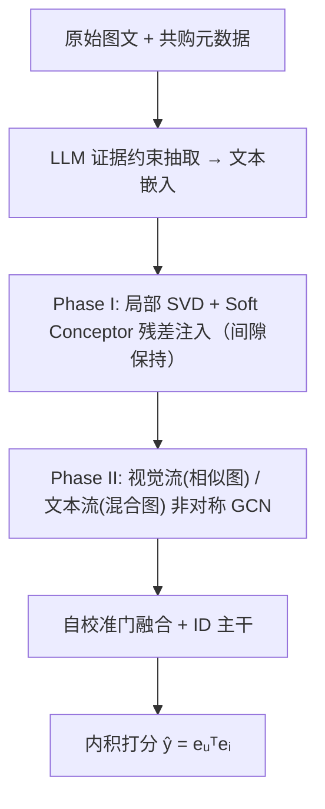
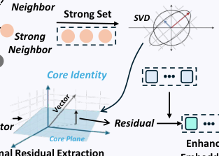

# Can Complementary Signals Bridge Similarity Islands? Manifold-Augmented Graph Embedding for Multimodal Recommendation (互补信号能否桥接相似性孤岛？面向多模态推荐的流形增强图嵌入)

- **会议/期刊**: NeurIPS 2026
- **作者与机构**: Zhenye Yang, Jinpeng Chen, Wenbo Fu, Jun Ma, Huan Li, Qimin Zhou, Tao Wang, Li Sun, Senzhang Wang（北京邮电大学、浙江大学、中南大学）
- **推荐链路定位**: 召回（用户-物品个性化排序）
- **研究方向**: 多模态推荐 / 图神经网络推荐
- **论文原文**: [https://arxiv.org/abs/2610.37409v1](https://arxiv.org/abs/2610.37409v1)
- **开源代码**: [https://github.com/Alex-bupt/mage](https://github.com/Alex-bupt/mage)

## TL;DR (1分钟核心速览)

多模态推荐中，相似度驱动的图构建与低通传播天然偏向“语义相似的替代品”，而行为上共购、语义上遥远的“互补品”在原始特征空间中被几何隔离，形成“相似性孤岛”，直接加边传播又会引发语义漂移。MAGE 将互补建模解耦为**离线几何形变**（Soft Conceptor 提取互补残差 + 局部间隙保持约束注入文本模态）与**在线非对称双流传播**（视觉作稳定锚、增强文本作柔性探针，自校准门融合）。在四个 Amazon 数据集 Full-Ranking 协议下，Recall@20 相对最强基线提升 2.77%–6.53%，硬互补子集上平均提升 9.87%。

## Background & Motivation (背景与核心矛盾)

- **主流范式**: MMRS 以多模态特征缓解稀疏性，GNN 通过相似度构图 + 低通传播（MMGCN / LGMRec / MENTOR / GUME）成为主流，隐含“相连物品应相似”的同质性假设。
- **前人局限**: ① 相似度构图偏好替代品（如两款相似手机），互补品（如手机与充电插头）在视觉与文本上均差异巨大，形成异质边；② 直接在异质边上做均匀平滑会污染种子物品的核心表征，引发语义漂移。
- **核心洞察 (Key Insight)**: 作者统计发现替代品对文本余弦相似度约 0.73–0.88，互补品对仅 0.26–0.62，t-SNE 显示互补品散落在远离种子的独立区域——即“相似性孤岛”。问题不在拓扑缺边，而在**特征几何本身按语义相似性组织**。
- **本文切入点**: 在拓扑传播之前先做**几何变换**，把互补残差方向注入文本流形，同时用间隙保持约束防止替代品/互补品的局部边界塌缩。

## Method (核心方法设计)

### 1. 整体框架 (Overall Architecture)

MAGE 分两阶段闭环：先用 LLM（Qwen3-32B-AWQ）对商品原文做一次性证据约束抽取并冻结为 512 维文本特征（训练/推理不再调用 LLM）；Phase I 离线对每个种子物品做局部 SVD + Soft Conceptor 投影，从弱邻居（互补代理）中提取互补残差方向，在局部间隙保持约束下自适应注入文本嵌入；Phase II 将原始视觉特征与增强文本特征分别送入非对称双流 GCN——视觉流在视觉∩文本 kNN 共识相似图上保守平滑，文本流在相似边 + 共购边混合图上传播，最后经自校准门解耦-融合，与协同 ID 主干相加后内积打分。

<figure class="paper-figure" markdown="span">
  <figcaption>图1：MAGE框架的架构。</figcaption>
</figure>

### 2. 关键设计拆解 (Key Designs)

1. **Soft Conceptor 互补残差提取（Phase I 核心）**：硬截断 SVD 会误删有用语义方向，故用软权重刻画替代品主导子空间：$w_{i,k}=\sigma_k^2/(\sigma_k^2+\gamma^{-2})$，投影算子$P_i=V_i\,\mathrm{diag}(w_i)V_i^\top$。对弱邻居集$\mathcal{W}_i$滤除替代品分量后聚合共识方向并与种子正交化：$r_i=\bar{r}_i-(\bar{r}_i^\top x_{i,t})x_{i,t}$。直觉：偏离“替代品子空间”的分量才是候选互补信号，软权重让强语义方向被更强抑制。

2. **间隙保持自适应注入（防语义漂移）**：固定注入系数易压塌局部替代-互补边界。定义 $\Delta_i=\mu_{S_i}-\mu_{W_i}$、$g_i=x_{i,t}^\top\Delta_i$、$d_i=r_i^\top\Delta_i$，要求注入后$z_i(\alpha)^\top\Delta_i\ge\rho g_i$，得
$$\alpha_i=\min\!\left(\alpha_{\max},\ \frac{(1-\rho)g_i}{-d_i+\varepsilon}\right)\ (d_i<0),\quad \alpha_i=\alpha_{\max}\ (d_i\ge0)$$
再 L2 归一化并回溯校验归一化间隙。直觉：残差若会缩小替代/互补间距，就按比例收紧注入量，$\alpha_{\max}=0.35$ 兜底。

3. **非对称双流 + 自校准门（Phase II）**：视觉流走 $G_{\mathrm{sim}}$（视觉 kNN ∩ 文本 kNN）保守平滑，文本流走混合图$A_{\mathrm{aug}}$（相似边权重 1、共购边权重$\omega_{co}=0.4$且截断至 top-$k$）。融合时先注意力求共享原型$h_{i,c}$，用 ID 表征调制残差$r_{i,m}=\sigma(\mathrm{beh}(e_{i,id}))\odot(h_{i,m}-h_{i,c})$，双向门细化后$e_i=e_{i,id}+\frac{1}{3}(h_{i,c}+\tilde{r}_{i,v}+\tilde{r}_{i,t})$。总损失$\mathcal{L}=\mathcal{L}_{\mathrm{BPR}}+\lambda_{\mathrm{align}}\mathcal{L}_{\mathrm{align}}+\lambda_{\mathrm{bm}}\mathcal{L}_{\mathrm{BM}}+\lambda_{\mathrm{info}}\mathcal{L}_{\mathrm{UM}}+\lambda_{\mathrm{reg}}\|\Theta\|_2^2$，负采样为标准 BPR 均匀负采样，无额外难负样本挖掘；Phase I 为一次性预处理（Baby/Sports/Clothing 仅 1.89/4.39/4.36 秒，峰值内存 <0.4 GB），推理无 LLM 开销。

## Experimental Setup & Evaluation Protocol (实验设置与评估协议)

- **数据集与预处理**: 四个 Amazon 基准，文本经 LLM 抽取后编码为 512 维，视觉为 4096 维预训练嵌入；共购图来自物品元数据（also_bought / bought_together），与评测标签严格隔离。

| 数据集 | #Users | #Items | #Interactions | 稀疏度 | 平均共购邻居 |
| :--- | :---: | :---: | :---: | :---: | :---: |
| Baby | 19,445 | 7,050 | 160,792 | 99.88% | 23.9 |
| Sports | 35,598 | 18,357 | 296,337 | 99.95% | 14.0 |
| Clothing | 39,387 | 23,033 | 278,677 | 99.97% | 13.7 |
| Electronics | 192,403 | 63,001 | 1,689,188 | 99.99% | 25.6 |

- **数据划分与防穿越**: 沿用 MMRec 框架的标准划分，测试阶段为 **Full-Test 全库排序**（非采样排序）；共购图仅由元数据构建，不使用留出用户-物品标签。
- **排名评测协议**: 无偏 Full-Ranking，报告 Recall@{10,20} 与 NDCG@{10,20}；另设**硬互补子集**诊断（测试正样本与历史锚点共购、且图文相似度均落入底部 30%）。
- **对比基线与超参**: 基线含 MF-BPR、LightGCN、VBPR、SLMRec、BM3、MGCN、LGMRec、MENTOR、GUME；嵌入维度 $d=64$，Adam 学习率$10^{-3}$，GCN 深度 3（用户-物品）/1（物品-物品），$k=10$，$\gamma=12$，$\rho\in\{0.4,0.6\}$；五随机种子配对 t 检验$p<0.01$。

## Key Experimental Results (实验关键数据)

### 1. 主实验对比 (Main Results)

| 数据集 | 指标 | GUME | MENTOR | MGCN | LGMRec | MAGE | Improv.% |
| :--- | :---: | :---: | :---: | :---: | :---: | :---: | :---: |
| Baby | R@20 | 0.1042 | 0.1048 | 0.0964 | 0.0989 | **0.1077** | +2.77% |
| Baby | N@20 | 0.0460 | 0.0450 | 0.0427 | 0.0430 | **0.0475** | +3.26% |
| Sports | R@20 | 0.1165 | 0.1139 | 0.1106 | 0.1068 | **0.1221** | +4.81% |
| Sports | N@20 | 0.0527 | 0.0511 | 0.0496 | 0.0477 | **0.0544** | +3.23% |
| Clothing | R@20 | 0.1024 | 0.0989 | 0.0945 | 0.0828 | **0.1088** | +6.25% |
| Clothing | N@20 | 0.0466 | 0.0441 | 0.0428 | 0.0371 | **0.0484** | +3.86% |
| Electronics | R@20 | 0.0551 | 0.0540 | 0.0520 | 0.0517 | **0.0587** | +6.53% |
| Electronics | N@20 | 0.0232 | 0.0232 | 0.0227 | 0.0228 | **0.0252** | +8.62% |

硬互补子集上，相对 GUME/MENTOR 中较强者，16 个数据集-指标组合全部提升，平均相对增益 **9.87%**（Baby 6.08%、Sports 14.00%、Clothing 11.71%、Electronics 7.69%）。

### 2. 消融实验 (Ablation Study)

| 变体 | Baby R@20 | Sports R@20 | Clothing R@20 | Elec R@20 | Elec N@20 |
| :--- | :---: | :---: | :---: | :---: | :---: |
| MAGE 完整 | **0.1077** | **0.1221** | **0.1088** | **0.0587** | **0.0252** |
| w/o Phase I | 0.1045 | 0.1198 | 0.1046 | 0.0570 | 0.0246 |
| w/o 非对称传播 | 0.1070 | 0.1210 | 0.1073 | 0.0580 | 0.0245 |
| w/o 互补拓扑 | 0.1061 | 0.1210 | 0.1049 | 0.0552 | 0.0223 |
| w/o 自校准门 | 0.1050 | 0.1211 | 0.1060 | 0.0566 | 0.0231 |

Phase-I 细粒度控制（Sports R@20）：完整 0.1221 > 去正交化 0.1218 > 去回溯 0.1209 > 均值残差 0.1211 > 硬 SVD 0.1206 > 去间隙约束 0.1204，间隙约束贡献最大。

### 3. 关键实验发现 (Key Findings)

1. **几何增强与互补拓扑缺一不可**：单独保留 Phase-I 特征或单独保留共购边均下降，Electronics 上去互补拓扑掉幅最大（R@20 0.0587→0.0552，−5.96%），说明特征形变必须与异质传播协同才生效。
2. **增益并非来自 LLM 文本精修**：仅替换 LLM 文本嵌入在 MGCN/MENTOR 上多为持平或负增益；而将离线增强嵌入注入三个骨干（不改架构）在 Sports/Clothing 全部 24 个指标上均提升，证明核心收益来自几何重塑而非文本质量。
3. **互补图需稀疏传播**：$k$从 5 增至 20 时性能先升后降，$k=10$ 最稳；30% 共购边丢弃/重连扰动下指标变化 ≤1.96%，说明方法对不完美共购证据具备一定鲁棒性。

## Highlights & Limitations (亮点、对比与审稿批判)

- **与代表作对比 (vs. Prior Work)**: 相比 GUME/MENTOR 仅做多模态图融合与自监督对齐，MAGE 首次在传播前显式重塑特征几何；相比 SComGNN 用低/中通谱滤波器处理互补性，MAGE 面向个性化用户-物品排序，且将几何变换与模态非对称传播耦合，而非单一谱域修正。
- **可迁移亮点**: ① Soft Conceptor 软子空间抑制 + 间隙保持自适应注入，可直接迁移到任何“需引入异质边但怕语义漂移”的图推荐场景；② 视觉锚/文本探针的非对称双流设计，为多模态融合提供了“稳定性-可塑性”分工范式。
- **审稿级局限批判**: ① 硬互补子集是按动机关系构造的诊断集，非分布无关基准，且 Baby 上离线增强迁移出现持平或负增益，泛化性存疑；② 各 safeguard 的增益幅度较小且未单独做显著性检验，方法本质是已有算子的组合；③ 共购信号可能反映流行度与商业曝光偏差，离线精度不能证明用户收益或曝光公平。

## Rating (四维评分)

- **方法创新性 (Novelty)**: ⭐⭐⭐⭐ （“相似性孤岛”洞察扎实，几何形变先于拓扑传播的思路新颖，但 Soft Conceptor/SVD 等算子均为已有工具的组合）
- **评估协议与实验扎实度 (Protocol & Experiments)**: ⭐⭐⭐⭐ （四数据集 Full-Ranking + 硬互补子集 + 细粒度消融 + 图扰动鲁棒性齐全，但硬子集为定向诊断、部分 safeguard 缺显著性检验）
- **写作与数学规范度 (Clarity & Rigor)**: ⭐⭐⭐⭐ （间隙约束推导完整、附录详尽，作者对结论边界（不证明语义正确性）表述克制严谨）
- **工业落地与复现价值 (Industrial & Practical Value)**: ⭐⭐⭐⭐ （Phase I 为一次性预处理、秒级耗时、推理零 LLM 开销，代码已开源，工程可落地性强）
