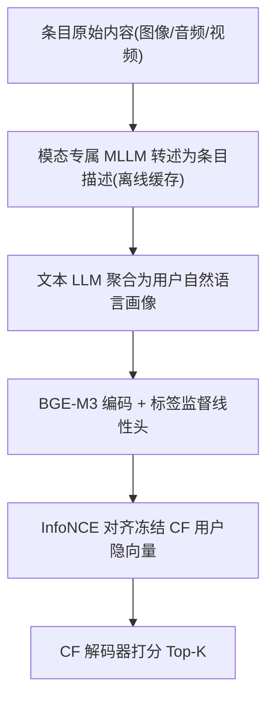
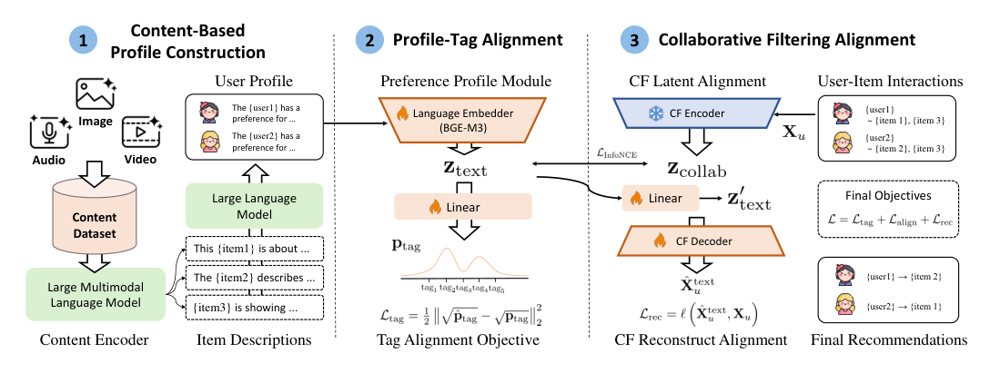

# Controllable and Content-Based Recommendations (基于内容与可控的推荐)

- **会议/期刊**: NeurIPS 2026
- **作者与机构**: Fırat Öncel, Jihoon Jeong, Emiliano Penaloza, Mirco Ravanelli, Laurent Charlin, Cem Subakan（Concordia / Mila / Laval / HEC Montréal）
- **推荐链路定位**: 召回（用户表征 + 全库打分）
- **研究方向**: 多模态推荐 / 大语言模型推荐
- **论文原文**: [https://arxiv.org/abs/2607.20938v2](https://arxiv.org/abs/2607.20938v2)
- **开源代码**: [https://github.com/firatoncel/CCBRNeurIPS2026](https://github.com/firatoncel/CCBRNeurIPS2026)

## TL;DR (1分钟核心速览)

传统 CF 用稠密隐向量表征用户，不可读、不可控。CCBR 用多模态 LLM 把用户历史条目（图像/音频/视频）转述为条目描述，再由纯文本 LLM 聚合成自然语言用户画像，经标签监督预训练与 InfoNCE 对齐冻结 CF 骨干的用户隐向量，使文本画像成为可编辑的"文本瓶颈"。在 H&M、MSD、ML-20M 三模态、七种 CF 骨干上，CCBR 保持与骨干接近的精度（如 ML-20M 上 Multi-VAE 的 NDCG@100 从 0.5148 降至 0.4964），同时显著优于可控基线 TEARS，并通过 LOO/AOI 编辑、未见条目注入与否定偏好三类干预验证了因果可控性。

## Background & Motivation (背景与核心矛盾)

- **主流范式**: 以 EASE、EDLAE、Multi-VAE、MacridVAE 为代表的 CF 模型将用户偏好编码为 ID 基稠密隐向量，精度高但完全不可解释、不可干预。
- **前人局限**: ① 概念瓶颈类可控推荐（如 TEARS）仅依赖条目标题、描述等**文本元数据**，无法捕捉商品视觉风格、音乐声学特征、视频美学等非文本信号；② 多模态 LLM 推荐（Rec-GPT4V、MLLM-MSR）虽引入内容理解，但用户偏好仍隐于隐状态，用户无法直接操控。
- **核心洞察 (Key Insight)**: 若把用户表征本身做成"由内容派生、可读可改的自然语言画像"，则编辑文本即等价于在语义轴上移动用户向量——可控性不必作为竞争目标，而可作为低带宽瓶颈"附加"到现有 CF 上。
- **本文切入点**: 用"多模态转述 → 文本聚合 → 标签监督 → CF 对齐"的级联，把原始多模态内容直接路由进可编辑文本瓶颈，且全程屏蔽条目 ID 以防预训练知识泄漏。

## Method (核心方法设计)

### 1. 整体框架 (Overall Architecture)

CCBR 分三阶段闭环：**① 画像构建**——每个条目经模态专属 MLLM（H&M 用 Qwen3-VL-32B、ML-20M 用 VideoLLaMA 3、MSD 用 MusicFlamingo）离线转述为一句自然语言描述并缓存；用户历史内所有条目描述交由指令微调文本 LLM（Qwen3-30B-A3B）聚合为一段用户偏好画像。**② 标签监督预训练**——画像经 BGE-M3 编码为 $\mathbf{z}_{\text{text}}\in\mathbb{R}^{1024}$，线性头预测数据集原生标签分布（电影类型/服装品类与颜色/音乐标签）。**③ CF 对齐与打分**——文本表征与冻结 CF 骨干的用户隐向量做 InfoNCE 对齐，CF 解码器复制并微调至文本分支，最终由该解码器对候选条目打分。

<figure class="paper-figure" markdown="span">
  <figcaption>图1：CCBR 流程概览。1）条目级内容（图像、音频或视频）首先由多模态语言模型转化为自然语言描述，然后由语言模型将每个用户交互过的条目聚合为文本偏好画像。2）该画像通过可训练文本编码器和线性投影头映射为稠密表示。3）该文本侧表示与冻结的协同过滤骨干产生的用户表示对齐，其解码器被复用于对候选条目打分。</figcaption>
</figure>

### 2. 关键设计拆解 (Key Designs)

1. **标签监督的文本编码预训练（把通用文本空间拉进推荐语义）**：通用文本编码器下"读起来像"的画像可能对应完全不同的口味。作者用用户历史标签聚合出目标分布 $\mathbf{p}_{\text{tag}}$，以平方 Hellinger 距离监督预测分布$\hat{\mathbf{p}}_{\text{tag}}=\text{softmax}(\mathbf{W}\mathbf{z}_{\text{text}}+\mathbf{b})$：
$$\mathcal{L}_{\text{tag}}=\tfrac{1}{2}\big\|\sqrt{\hat{\mathbf{p}}_{\text{tag}}}-\sqrt{\mathbf{p}_{\text{tag}}}\big\|_2^2$$
Hellinger 距离对分布尾部差异更敏感，使编码器几何预先贴合条目内容结构，为后续对齐提供更好起点，也让"改词"能沿可解释标签轴产生位移。

2. **随机嵌入替换的双模推理（一套标签头兼容协同信号与纯内容）**：每步以等概率将标签头输入在文本 [CLS] 与预训练冻结 MF 的用户条目均值嵌入之间切换。于是同一标签头支持两种推理：有交互历史时用 MF 嵌入以吃满协同信号；冷启动、画像被编辑或无历史时直接用文本 [CLS]，实现完全内容驱动、无需任何用户参数的推理。

3. **训练目标、负采样与推理效率**：总损失为 $\mathcal{L}=\mathcal{L}_{\text{align}}+\mathcal{L}_{\text{rec}}$，其中$\mathcal{L}_{\text{align}}$为 InfoNCE，正样本为同一用户的$(\mathbf{z}'_{\text{text}},\mathbf{z}_{\text{collab}})$，**批内其他用户隐向量作负样本**（In-batch Negative，无需额外采样器）。在线开销极低：画像嵌入约 20 ms、全库打分 <1 ms 且与目录规模无关；主要成本是每用户一次性画像生成（约 10–13 s）与离线条目转述（视频约 14.7 GPU-hours/万级目录），均不落在每次推荐路径上。

## Experimental Setup & Evaluation Protocol (实验设置与评估协议)

- **数据集与预处理**:

| 数据集 | #Users | #Items | 模态 | 标签体系 | 说明 |
| :--- | :---: | :---: | :---: | :---: | :--- |
| H&M | 70,201 | 1,943 | 图像 | 16 色 + 51 品类 | 服装商品图 |
| ML-20M | 135,269 | 11,355 | 视频 | 18 类型 | 电影预告片 |
| MSD | 166,188 | 31,046 | 音频 | 80 标签 | 百万歌曲片段 |

- **数据划分与防穿越**: 采用 **Strong Generalization 划分**——用户不相交地切分为训练/验证/测试（H&M 各留 1,000，ML-20M 与 MSD 各留 5,000），测试用户训练期完全未见，比 weak generalization 更严格，也契合 CCBR"新用户画像从零构建"的设计。
- **排名评测协议**: 全库排序，报告 NDCG@100、Recall@50、Recall@20；可控性以 top-$K$（$K=20$）内目标属性占比的编辑前后差值$\Delta r_c^{(K)}$ 度量。
- **对比基线与超参**: 七种 CF 骨干（EASE、EDLAE-FR/LR、Linear-DAE、Multi-DAE、Multi-VAE、MacridVAE），可控基线 TEARS 仅在 VAE 骨干上对比（原文仅提供该配置），TEARS 取 $\alpha=0.5$ 合并模型。

## Key Experimental Results (实验关键数据)

### 1. 主实验对比 (Main Results)

| 骨干 | H&M NDCG@100 | H&M R@20 | MSD NDCG@100 | MSD R@20 | ML-20M NDCG@100 | ML-20M R@20 |
| :--- | :---: | :---: | :---: | :---: | :---: | :---: |
| EASE | **0.2621** | **0.1638** | **0.4519** | **0.4290** | **0.4909** | **0.4226** |
| + CCBR | 0.2212 | 0.1359 | 0.3271 | 0.2979 | 0.4629 | 0.4008 |
| EDLAE (LR) | **0.2695** | **0.1661** | **0.4619** | **0.4373** | **0.5032** | **0.4338** |
| + CCBR | 0.2215 | 0.1360 | 0.3233 | 0.2946 | 0.4802 | 0.4119 |
| Multi-VAE | **0.2244** | **0.1360** | **0.3843** | **0.3523** | **0.5148** | **0.4383** |
| + TEARS | 0.2006 | 0.1161 | 0.2946 | 0.2602 | 0.4836 | 0.4105 |
| + CCBR | 0.2106 | 0.1252 | 0.3376 | 0.3065 | 0.4964 | 0.4263 |
| MacridVAE | **0.2285** | **0.1413** | **0.3873** | **0.3542** | **0.4957** | **0.4111** |
| + TEARS | 0.1906 | 0.1081 | 0.2731 | 0.2358 | 0.4582 | 0.3872 |
| + CCBR | 0.2016 | 0.1188 | 0.3247 | 0.2942 | 0.4829 | 0.4111 |

相对 TEARS，CCBR 在 MSD 上 NDCG@100 提升 **+14.6%**（0.3376 vs 0.2946），ML-20M 上 **+2.6%**，H&M 上 **+5.0%**；相对各自骨干的精度损失在 MSD 最大（约 −12%~−16%），ML-20M 最小（约 −3%~−6%）。

### 2. 消融与干预实验 (Ablation & Intervention)

| 配置 | 关键观测 | 结论 |
| :--- | :--- | :--- |
| 仅文本瓶颈（无 CF 对齐） | 精度低于骨干 | 文本低带宽本身不足以恢复细粒度偏好 |
| + InfoNCE 对齐 | 精度回升至接近骨干 | 对齐是精度保持的关键 |
| LOO 移除（ML-20M） | $\Delta r$ 显著为负，幅度大于 TEARS | 文本瓶颈因果生效 |
| AOI 添加（ML-20M） | $\Delta r$ 为正，但类型间差异大 | 受类型频率与多标签共现制约 |
| 未见条目注入（图 3） | 可控幅度与纯文本编辑相当 | 多模态通道可端到端路由新内容 |
| 否定偏好（图 4） | 仅 Negated 模型产生一致负向位移 | 文本瓶颈可承载带符号偏好 |

### 3. 关键实验发现 (Key Findings)

1. **可控性来自对齐而非文本本身**：去掉 InfoNCE 后精度明显下滑，说明文本瓶颈必须锚定到 CF 隐空间才能既保精度又保可控；对齐后 ML-20M 上 Multi-VAE 仅损失 0.0184 NDCG。
2. **编辑效果受标签频率与共现结构支配**：Drama（11,355 条目中 5,723 次、约 1,200 部与 Romance 共现）最难移除/插入，Documentary（775 条、干预集仅 4 用户）几乎无响应，揭示可控性存在稀疏性下限。
3. **多模态注入等价于文本编辑**：用训练期未见条目经模态编码器注入画像，获得的 $\Delta r$ 与直接改词相当，证明系统在真实冷启动上新条目可经内容通道被"看见"。

## Highlights & Limitations (亮点、对比与审稿批判)

- **与代表作对比 (vs. Prior Work)**: 相比 TEARS，CCBR 的画像源自原始多模态内容而非文本元数据，且在三模态、七骨干上统一验证；相比 Rec-GPT4V/MLLM-MSR，CCBR 把用户表征本身做成可编辑文本而非隐状态，可控性是一等公民；相比 CTRL-Rec/Mender，CCBR 不依赖请求条件或推理时字符串，而是持久化可审计画像。
- **可迁移亮点**: ① "随机嵌入替换"让单一标签头同时服务协同与纯内容两路推理，可直接迁移到冷启动双通道打分；② 用 Hellinger 距离做标签分布监督，比 KL 更稳健，适合长尾标签体系。
- **审稿级局限批判**: ① 精度确有下降（MSD 上 NDCG 掉约 12%–16%），"competitive" 表述偏宽松，且未报告显著性检验；② 画像生成依赖多个大模型级联，离线成本高、可复现性受 LLM 版本漂移影响；③ 可控性评估仅用 LLM 改写与 LLM-as-judge，缺乏真实用户研究，编辑局部性 98% 的结论也由 LLM 判定。

## Rating (四维评分)

- **方法创新性 (Novelty)**: ⭐⭐⭐⭐ （把文本瓶颈从"元数据摘要"推进到"多模态内容派生 + 双模标签头"，思路清晰但组件多为已有模块的组合）
- **评估协议与实验扎实度 (Protocol & Experiments)**: ⭐⭐⭐⭐ （三模态七骨干 + Strong Generalization + 四类干预设计完整，但缺显著性检验与真实用户验证）
- **写作与数学规范度 (Clarity & Rigor)**: ⭐⭐⭐⭐ （流程与公式简洁，$\mathcal{L}_{\text{align}}$、$\mathcal{L}_{\text{rec}}$ 细节下放附录，主文略欠自足）
- **工业落地与复现价值 (Industrial & Practical Value)**: ⭐⭐⭐⭐ （打分延迟 <1 ms、代码开源，但画像生成 10–13 s/用户与多 LLM 依赖抬高部署门槛）

