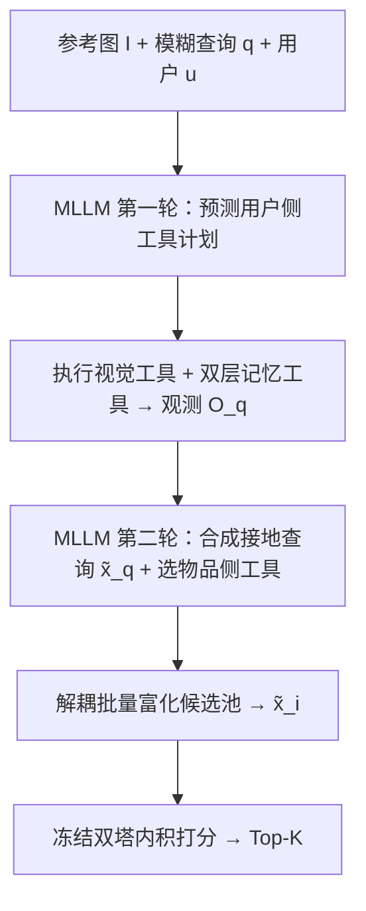
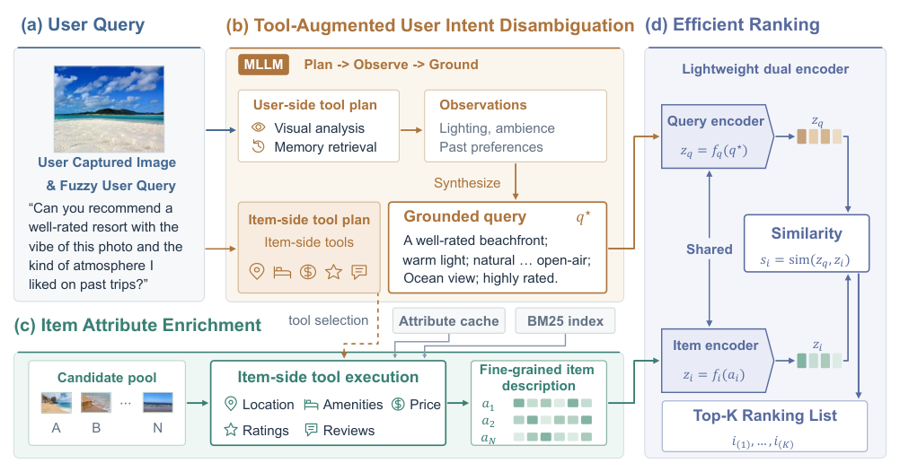

# IntentLens: Grounding Underspecified Multimodal Queries for Recommendation via Tool-Augmented Reasoning (基于工具增强推理的欠指定多模态查询意图接地推荐)

- **会议/期刊**: NeurIPS 2026
- **作者与机构**: Xiao Chen, Dong Fang, Haitao Li, Qing Li（香港理工大学 & LightSpeed）
- **推荐链路定位**: 召回（ground-then-rank 两阶段检索排序）
- **研究方向**: 多模态推荐 / 大语言模型推荐
- **论文原文**: [论文原文链接](https://arxiv.org/abs/2611.11346v1)
- **开源代码**: 暂未开源

## TL;DR (1分钟核心速览)

针对"用户只给一张参考图 + 一句模糊自然语言"的欠指定多模态查询场景，现有推荐要么被动融合多模态物品特征、要么假设查询已完全表述，均无法恢复隐式意图。本文提出 IntentLens：先用共享 MLLM 编排视觉工具、双层用户记忆工具与物品属性工具，把模糊查询接地为结构化意图并富化候选物品，再用轻量双塔排序。配套提出反事实排序奖励 + 观测掩码 GRPO 的排序对齐强化微调。在自建 GoogleReview-MMTool / Yelp-MMTool 全库排序协议下，7B 版本 MRR 达 40.2 / 46.7，较 BGE 检索提升 14.5 / 14.5 个点。

## Background & Motivation (背景与核心矛盾)

- **主流范式**: 多模态推荐以历史交互 + 多模态物品特征做表征学习（MMGCN、LGMRec、VIP5、UniMP），或假设用户查询文本已完整表述约束。
- **前人局限**: ① 被动匹配范式把多模态特征仅用于富化物品侧，无法从查询图像中读出"氛围/色调"等难以言说的偏好；② 完全表述假设在真实场景失效——用户只说"像这张图那种感觉、便宜点、附近快午餐"，视觉风格、个人预算、物品属性三类证据全部隐式。
- **核心洞察 (Key Insight)**: 欠指定查询的缺失意图可分解为三元组 $z_u=(z_u^{vis}, z_u^{hist}, z_u^{attr})$，分别对应查询图像感知线索、历史交互偏好、物品事实约束；这三类证据恰好可由三类外部工具主动采集，而非靠单次前向的 VLM 嵌入隐式推断。
- **本文切入点**: 把"意图消歧"从表征学习问题重构为**工具增强的证据接地问题**，先接地再排序，将昂贵的 MLLM 推理限制在查询侧、与候选池规模解耦。

## Method (核心方法设计)

### 1. 整体框架 (Overall Architecture)

IntentLens 采用 ground-then-rank 两阶段。Stage 1 中，MLLM 策略 $\pi_\theta$先做两轮推理：第一轮输出有序工具计划$A_{user}\sim\pi_\theta(\cdot|I,q,u;\mathcal{T}_{user})$，环境执行视觉/记忆工具返回观测$O_q$；第二轮将观测拼入上下文，合成接地查询$\tilde{x}_q$并预测物品侧工具集$\mathcal{T}_{item}$。物品侧工具为确定性抽取器，在解耦的一轮中对整个候选池批量执行，得到富化表示$\tilde{x}_i=\text{Render}_{item}(c_i,\mathcal{T}_{item},O_q)$。Stage 2 用冻结的轻量双塔对$(\tilde{x}_q,\tilde{x}_i)$ 打分排序，不再调用 MLLM。该解耦使在线 MLLM 调用固定为 2 次，物品富化随候选池线性扩展。

<figure class="paper-figure" markdown="span">
  <figcaption>图 2：INTENTLENS 的推理流程。MLLM 首先执行工具增强推理，生成澄清后的查询表示并选择相关的物品侧工具。随后，所选工具在解耦的一轮处理中应用于候选池，生成细粒度的物品表示。最后，轻量级双编码器排序器根据接地后的查询对候选进行打分，以实现高效推荐。</figcaption>
</figure>

### 2. 关键设计拆解 (Key Designs)

1. **三类工具与双层记忆（证据源对齐意图三元组）**：视觉工具含主色 k-means、色温 CCT、颜色直方图、裁剪、放大——因为"更亮一点""更中性色调"这类相对查询需要**分布级量化比较**，而非整体 VLM 嵌入；记忆工具遵循 A-Mem 建两级索引，episodic 记忆存单次交互上下文、semantic 记忆存长期偏好摘要（偏好品类、预算、氛围、距离容忍度），通过 `GetUserProfileSummary / RetrieveUserMemory / GetMemoryNoteDetails` 三个接口分离全局先验与局部证据；物品工具（评分、价格、营业时间、评论洞察等）为缓存确定性抽取，不进 MLLM 上下文。

2. **反事实排序奖励（让"工具是否有用"显式可学）**：预训练 MLLM 会调工具，但不保证采到的证据对推荐有益。定义排序效用 $U(\tau)=1/\min_{c\in G}\text{rank}_\tau(c)$，并与两个基线对比——同一接地查询去掉工具证据得$U_\emptyset$、原始请求无证据得$U_{req}$，证据信用为
$$\Delta_{cf}(\tau)=\min\{U(\tau)-U_\emptyset(\tau),[U(\tau)-U_{req}(\tau)]_+\}$$
排序奖励 $r_{rank}=U(\tau)+\beta\,\text{clip}(\Delta_{cf},-\delta,\delta)$（$\beta=0.2,\delta=0.1$）。直觉：只有**同时**优于"有查询无证据"和"原始查询"才拿正信用，杜绝工具调用带来的虚假增益。另加两侧工具选择的$F_1$奖励并惩罚冗余调用（$\gamma=0.3$）。

3. **观测掩码 GRPO 与训练目标**：总奖励 $r_{main}=r_{rank}+\lambda_q r_q+\lambda_i r_i+w_{fmt}r_{fmt}$（$\lambda=0.05$）。轨迹$\tau_i=(y_i^{(1)},O_i,y_i^{(2)})$中工具返回的观测 token 保留在上下文但**从策略损失与 KL 损失中掩码剔除**，只在策略生成的 token 位置$P_i$ 上计算：
$$J_{MGRPO}=\frac{\sum_{i\in\mathcal{B}}\sum_{l\in P_i}\ell(\rho_{i,l},\hat{A}_i)}{\sum_{i\in\mathcal{B}}|P_i|}-\mu\,\widehat{D}_{KL}[\pi_\theta\|\pi_{ref}]$$
否则模型会把环境输出当作自身生成而去"模仿"工具文本，破坏规划能力。排序器 $g_\phi$用 BGE-M3 共享编码 + CLS 池化 + L2 归一化，InfoNCE 训练（$t=0.05$，每查询 7 个同品类硬负例），预训练后冻结作为 RFT 的静态奖励源。

## Experimental Setup & Evaluation Protocol (实验设置与评估协议)

- **数据集与预处理**: 由 Google Local Review 与 Yelp 2019 构建，查询按所需工具数分 T1–T4 四级难度（图 3 显示 T1 视觉类占 43.2%/38.6%，T4 全工具类仅 9.7%/12.7%）：

| 数据集 | #Users | #Items | #Interactions | #Queries | 平均正例/候选 |
| :--- | :---: | :---: | :---: | :---: | :---: |
| GR-MMTool | 3,000 | 1,556 类 | 104,025 | 773 | 3.2 / 40 |
| Yelp-MMTool | 2,315 | 497 类 | 94,184 | 1,727 | 2.0 / 63 |

- **数据划分与防穿越**: 按用户历史时序构建记忆（排除目标交互），查询由三阶段前向合成（种子构建 → LLM 显式意图改写为模糊查询 → 泄漏检测 + 人工校验）；奖励排序器仅在训练划分上训练并在 RFT 前冻结。
- **排名评测协议**: 无偏 **Full-Ranking**——每个查询对**同一完整候选池**排序，候选池含正例、三类硬负例（视觉相似 / 记忆冲突 / 上下文冲突）与随机干扰项；指标 Hit@1/3/10 与 MRR，5 次运行取均值，$p\ll0.05$。
- **对比基线与超参**: 五类基线（随机/评分/热度、CLIP 与 BGE 检索、UniMP/VIP5/Qwen2.5-VL 零样本、GPT-5.4/GPT-4o 排序、Oracle Ranker）；骨干 Qwen2.5-VL-3B/7B，工具集 5 视觉 + 3 记忆 + 6 物品，GRPO 组大小 $G=4$，学习率$5\times10^{-7}$。

## Key Experimental Results (实验关键数据)

### 1. 主实验对比 (Main Results)

| 方法 | 模态/规模 | GR Hit@1 | GR Hit@10 | GR MRR | Yelp Hit@1 | Yelp Hit@10 | Yelp MRR |
| :--- | :---: | :---: | :---: | :---: | :---: | :---: | :---: |
| BGE Retrieval | T/335M | 13.8 | 37.9 | 25.7 | 19.7 | 57.8 | 32.2 |
| CLIP Retrieval | T+I/428M | 3.5 | 24.1 | 12.8 | 14.1 | 47.9 | 24.6 |
| UniMP | T+I/3B | 24.1 | 61.4 | 33.9 | 28.2 | 67.6 | 43.7 |
| Qwen2.5-VL (0-shot) | T+I/7B | 13.8 | 58.6 | 28.0 | 12.7 | 56.3 | 25.4 |
| GPT-5.4 (w/ evidence) | T | 31.0 | 55.2 | 41.6 | 31.0 | 67.6 | 41.5 |
| GPT-4o | T+I | 30.9 | 40.4 | 36.8 | 31.0 | 66.2 | 41.4 |
| **IntentLens (7B)** | T+I/7B | **31.0** | **62.1** | 40.2 | **33.8** | **70.4** | **46.7** |
| Oracle Ranker | T+I | 37.9 | 65.5 | 44.4 | 43.7 | 76.1 | 53.7 |

相对 BGE 检索，MRR 提升 **+14.5 / +14.5** 点；相对最强非 oracle 基线 GPT-5.4(w/ evidence)，Yelp MRR 提升 **+5.2** 点。

### 2. 消融实验 (Ablation Study)

| 变体 | Hit@1 | Hit@3 | Hit@10 | MRR |
| :--- | :---: | :---: | :---: | :---: |
| IntentLens (7B) | **31.0** | **44.8** | **62.1** | **40.2** |
| w/o visual tools | 24.1 | 37.9 | 58.6 | 35.7 |
| w/o memory tools | 26.3 | 37.9 | 59.6 | 38.1 |
| w/o item tools | 27.6 | 41.4 | 58.4 | 38.0 |
| w/o query grounding | 21.9 | 36.8 | 51.7 | 33.5 |
| w/o RFT | 24.1 | 33.3 | 58.6 | 33.1 |
| w/o counterfactual | 24.1 | 36.1 | 58.6 | 35.0 |
| w/o tool reward | 24.1 | 37.9 | 62.1 | 35.5 |
| w/o obs. masking | 28.9 | 38.6 | 60.5 | 35.1 |

### 3. 关键实验发现 (Key Findings)

1. **查询接地是最大单点增益**：去掉整个查询侧工具管线使 MRR 从 40.2 跌至 33.5（-6.7），超过任何单一工具类别；在固定排序器与候选证据的受控实验中，原始 / 预测接地 / oracle 接地查询的 MRR 分别为 33.6 / 40.2 / 44.4，干净地隔离出"接地"本身的贡献。
2. **RFT 与反事实基线缺一不可**：去掉 RFT 使 MRR 跌至 33.1（-7.1，为训练类变体最大跌幅），去掉反事实基线跌至 35.0；观测掩码去掉后 MRR 降至 35.1，验证"工具输出不应被当作策略生成 token 去拟合"。
3. **工具增益依赖模型容量且可迁移**：3B→7B 使 Yelp MRR 从 33.5 跃至 46.7，说明工具使用需足够容量才生效；换用未参与训练的 all-MiniLM-L6-v2 排序器，RFT 规划器仍带来 +4.6 MRR，且 78 条真人撰写查询上零重训仍超 BGE 7.3 点，排除对合成查询模式的过拟合。

## Highlights & Limitations (亮点、对比与审稿批判)

- **与代表作对比 (vs. Prior Work)**: 相较 UniMP/VIP5 等"多模态特征富化物品表征"的被动匹配路线，本文把多模态推理前移到**查询侧证据采集**；相较 GPT-4o/GPT-5.4 直接列表排序，本文用轻量双塔承接打分，把 MLLM 调用压到固定 2 次；相较 RecToolBench 等通用工具编排基准，本文首次把"模糊偏好 + 模糊物品约束 + 双层用户记忆"纳入同一评测。
- **可迁移亮点**: ① 反事实奖励设计——用"有证据 vs 无证据"的排序效用差作为信用，可直接迁移到任何"检索增强 + 排序"的 RL 训练；② 观测掩码 GRPO，凡轨迹中混入环境返回文本的 agentic 训练均适用。
- **审稿级局限批判**: ① 端到端延迟约 4 s（Stage 1 占 3.59 s），对延迟敏感的在线推荐仍偏重，且未验证大目录未缓存场景；② 基准完全由合成管线构建，查询、工具链与标签共享同一生成过程，存在语言/偏好/模型偏置，真人查询仅验证了"条件式风格迁移"而非真实流量；③ 单轮设定，证据不足时不主动追问，与对话推荐路线正交未融合。

## Rating (四维评分)

- **方法创新性 (Novelty)**: ⭐⭐⭐⭐ （把欠指定多模态推荐重构为工具增强证据接地，反事实排序奖励 + 观测掩码 GRPO 组合新颖且动机清晰）
- **评估协议与实验扎实度 (Protocol & Experiments)**: ⭐⭐⭐⭐ （Full-Ranking 全库排序、5 次运行、消融与泛化/效率/人工评测齐全，但基准为自建合成数据，外部效度受限）
- **写作与数学规范度 (Clarity & Rigor)**: ⭐⭐⭐⭐ （两阶段流程与奖励公式定义清楚，工具集与合成细节下沉附录，理论分析偏弱）
- **工业落地与复现价值 (Industrial & Practical Value)**: ⭐⭐⭐ （两阶段解耦使物品富化可离线缓存、在线仅 2 次 MLLM 调用，工程友好；但 4 s 延迟、未开源、隐私与记忆访问合规成本构成落地门槛）

