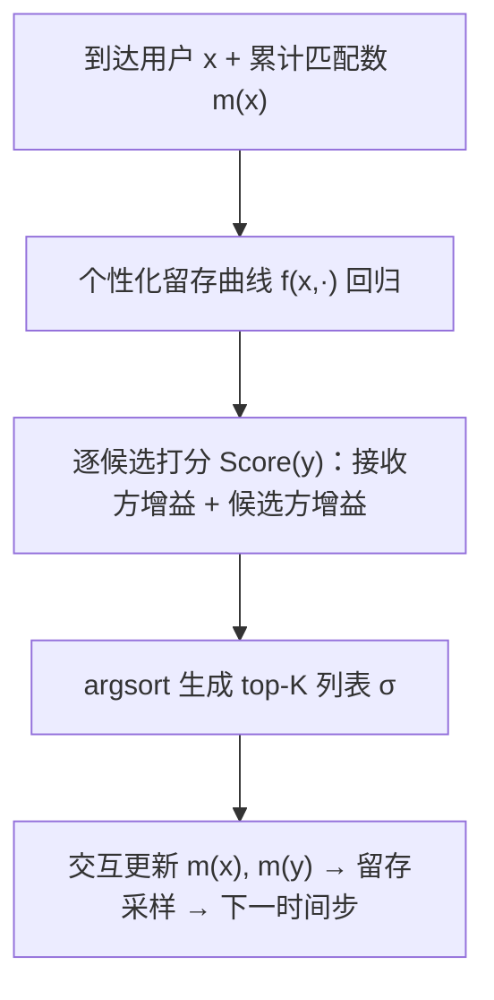

# Beyond Match Maximization and Fairness: Retention-Optimized Two-Sided Matching (超越匹配最大化与公平性：留存最优的双边匹配)

- **会议/期刊**: ICLR 2026
- **作者与机构**: Ren Kishimoto, Rikiya Takehi, Koichi Tanaka, Masahiro Nomura, Riku Togashi, Yoji Tomita, Yuta Saito（Institute of Science Tokyo / Waseda / Keio / CyberAgent / Hanjuku-kaso）
- **推荐链路定位**: 重排（动态 Learning-to-Rank，逐次到达用户的列表生成）
- **研究方向**: 强化学习与动态探索推荐 / 去偏公平与工业架构
- **论文原文**: [https://arxiv.org/abs/2602.15752v3](https://arxiv.org/abs/2602.15752v3)
- **开源代码**: [https://github.com/kishi6/ICLR2026](https://github.com/kishi6/ICLR2026)

## TL;DR (1分钟核心速览)

双边匹配平台（约会、招聘）长期以「匹配总量最大化」为目标，导致热门用户被过度曝光、长尾用户零匹配后流失；而 FairCo 等公平性方法只是把曝光按效用比例摊平，并不等价于留存。本文首次把**双边留存最大化**形式化为动态 LTR 问题，提出 MRet：为每个用户学习个性化留存曲线 $f(x,m)$，在每一步同时计入「接收方留存增益」与「被推荐方留存增益」，并借助留存函数凹性给出的 Jensen 型下界，把 NP-hard 的列表优化松弛为逐候选打分 + argsort（$O(N\log N)$）。在合成数据与某日本大型约会平台真实数据上，MRet 仅用约 70% 的匹配量即取得全部基线中最高的留存率。

## Background & Motivation (背景与核心矛盾)

- **主流范式**: 双边匹配推荐（Reciprocal Recommendation）主流做法是按互选概率 $r(x,y)$排序，最大化期望匹配数$\sum_k \alpha_k r(x,\sigma_{\tau,k})$；出现失衡后，学界转向 FairCo 等动态公平 LTR，用曝光-效用比偏差项$\lambda\,\mathrm{err}_\tau(y)$ 做修正。
- **前人局限**: (i) 匹配最大化把曝光集中到少数热门用户，长尾用户长期零匹配而流失，平台订阅收入直接受损；(ii) 公平性只是**启发式代理**——只有当「热门用户恰好需要高曝光才留存、冷门用户低曝光也留存」时公平才等价于留存，而真实留存曲线因人而异，这一对齐毫无保证。
- **核心洞察 (Key Insight)**: 论文在真实约会平台数据上观察到留存-匹配曲线呈**边际递减的凹形**（图 1）：前几次匹配对留存的边际贡献远大于第 10 次匹配，且存在一个「满意匹配数」$b$，超过后留存几乎不再上升。这意味着留存优化本质是**把稀缺匹配配额分配给边际增益最大的人**，而非平均分配。
- **本文切入点**: 放弃「匹配数」与「公理化公平」两个目标，直接把留存写成可优化的目标函数，并利用凹性把组合优化转成可分解的打分排序。

## Method (核心方法设计)

### 1. 整体框架 (Overall Architecture)

系统按时间步 $\tau$逐个到达用户：接收方$x$到达后，平台从对侧存活用户池中生成 top-$K$列表$\sigma_\tau$。MRet 先用 XGBoost 在「用户特征 + 累计匹配数$m_{1:\tau}$+ 留存标签」上回归出个性化留存函数$\hat{f}$；再对每个候选$y$计算一个融合「接收方增益 + 候选方增益」的分数$\mathrm{Score}(y)$，按分数降序填充带曝光权重$\alpha_k$ 的位置；交互后更新双方累计匹配数，并按各自留存概率采样是否流失，进入下一时间步。

### 2. 关键设计拆解 (Key Designs)

1. **双边留存目标（Eq. 9）**：原始目标是同时最大化接收方与被推荐方的留存概率增量：
$\sigma^*_\tau=\arg\max_{\sigma_\tau}\Big[f\big(x,m_{1:\tau}(x)+\textstyle\sum_k\alpha_k r(x,\sigma_{\tau,k})\big)-f\big(x,m_{1:\tau}(x)\big)+\sum_k\big[f\big(\sigma_{\tau,k},m_{1:\tau}(\sigma_{\tau,k})+\alpha_k r(\sigma_{\tau,k},x)\big)-f\big(\sigma_{\tau,k},m_{1:\tau}(\sigma_{\tau,k})\big)\big]\Big]$
直觉：一次匹配是**双向事件**，候选方也因这次匹配获得留存收益，忽略它就会系统性低估长尾候选的价值。但该式是集合级组合优化，NP-hard。

2. **凹性下界与可分解打分（Lemma 1 & 2 → Eq. 13）**：在留存函数凹（Assumption 1）下，接收方项由 Jensen 不等式给出下界，候选方项由凹性给出线性下界，于是目标松弛为 $\max_{\sigma_\tau}\sum_k \alpha_k\,\mathrm{Score}(\sigma_{\tau,k})$，其中
$\mathrm{Score}(y)=\frac{1}{A}f\big(x,m_{1:\tau}(x)+A\,r(x,y)\big)+\frac{1}{\alpha_{\max}}\big[f\big(y,m_{1:\tau}(y)+\alpha_{\max}r(x,y)\big)-f\big(y,m_{1:\tau}(y)\big)\big]$其中$A=\sum_j\alpha_j$。由 rearrangement inequality，按分数降序对齐递减的$\alpha_k$即最优。物理直觉：第一项衡量「把$y$给$x$能让$x$的留存涨多少」，第二项衡量「$y$自己因这次匹配能多留存多少」，两项都是**边际增益**而非绝对概率，因此天然把配额导向「离满意匹配数$b$ 还差得远」的用户。

3. **训练与推理开销**：留存函数 $\hat{f}$用 XGBoost 做逐用户/逐簇回归（真实数据中按性别 k-means 分 5 簇后取簇内均值曲线），无需负采样、无需 pairwise 损失；推理仅需对候选池逐项算分并排序，复杂度$O(N\log N)$，远优于 FairCo 类方法在动态设定下需构造双随机矩阵的指数级开销。

## Experimental Setup & Evaluation Protocol (实验设置与评估协议)

- **数据集与预处理**:

| 数据集 | #Users | #Items | #Interactions | 稀疏度/密度 | 特征/场景说明 |
| :--- | :---: | :---: | :---: | :---: | :--- |
| Synthetic | 1000 (X) + 1000 (Y) | 同左（互为候选） | 模拟 $T=2000$步 | 稠密（$r$已知） | 10 维正态特征，$r=(1-\kappa)r_{\text{base}}+\kappa r_{\text{pop}}$，$\kappa=0.5$ |
| Real-world (日本约会平台) | 1000 男 + 1000 女 | 同左 | $1000\times1000$ 匹配矩阵 | 极稀疏（多数元素为 0） | 未观测对用 ALS 补全；留存标签来自 6 万条独立记录 |

- **数据划分与防穿越 (Splitting Strategy)**: 非传统训练/测试切分，而是**时间步仿真**：每步随机选一侧、从存活用户中均匀采样到达者，推荐后按留存概率做流失采样（每步 0.2% 用户参与流失判定），重复至 $T$。真实数据留存定义为「2 月登录者是否 3 月再登录」。
- **排名评测协议 (Ranking Protocol)**: 不使用离线 Full-Ranking / Sampled Ranking，而是**在线仿真指标**：累计人均匹配数 $\frac{\sum_x m_{1:T}(x)+\sum_y m_{1:T}(y)}{|X|+|Y|}$与留存率$\frac{|X^T_{\text{ret}}|+|Y^T_{\text{ret}}|}{|X|+|Y|}$，10 个随机种子取均值。
- **对比基线与超参设置**: Max Match（按 $r$排序）、Uniform（随机）、FairCo（$\lambda=100$，附录做敏感性分析）、MRet (best)（已知真值$f$的 oracle 上界）。默认$K=5$、$\alpha_k=1/k$、$\rho=0.5$。

## Key Experimental Results (实验关键数据)

### 1. 主实验对比 (Main Results)

合成数据（$T=2000$，$\kappa=0.5$，10 seed 均值，数值为图示趋势的定性归纳）：

| 方法 | 累计人均匹配数 | 留存率（相对 Uniform 归一化） | 说明 |
| :--- | :---: | :---: | :--- |
| Uniform | 最低 | 1.00（基准） | 随机排序 |
| Max Match | **最高（显著领先）** | ≈1.00 | 匹配最多但留存与随机持平 |
| FairCo ($\lambda=100$) | 中等 | 略高于 1.00 | 公平≠留存 |
| **MRet** | 约为 Max Match 的 **70%** | **最高（非 oracle 中）** | 以更少匹配换更高留存 |
| MRet (best, oracle) | 中等 | 上界 | 已知真值 $f$ |

真实数据（图 6，极稀疏匹配矩阵）：FairCo 与 Uniform 因匹配极稀疏几乎无法有效分配，留存显著偏低；Max Match 反而优于公平类基线；**MRet 取得最高留存**，且在留存函数**非凹**的真实数据上依然稳健。

### 2. 消融实验 (Ablation Study)

| 变体 / 分析维度 | 关键观察 |
| :--- | :--- |
| MRet vs. MRet (best) | 学到的 $\hat{f}$与真值$f$ 存在差距，但留存仍显著优于全部基线，说明对回归误差不敏感 |
| 移除候选方增益项（仅接收方） | 退化为单边留存贪心，长尾候选被系统性低估，留存下降（对应图 5b 中 $m_{1:T}-b$ 分布右移不足） |
| 不同 $\kappa$（0→1 流行度偏斜） | Max Match 匹配数随$\kappa$上升但留存骤降；FairCo 在强偏斜下退化到接近 Uniform；MRet 在各$\kappa$ 下留存最稳 |
| 不同 $\lambda$（FairCo 超参） | 调参不改变「公平类方法留存不及 MRet」的结论 |
| 不同噪声 $\delta$、用户规模、流行度漂移 | MRet 均保持领先（附录 D） |

### 3. 关键实验发现 (Key Findings)

1. **匹配数与留存解耦**：Max Match 的累计匹配数远超其他方法，但留存率与 Uniform 几乎相同——证明「多匹配」不等于「少流失」，直接证伪了匹配最大化作为留存代理的合理性。
2. **公平的失效机制被定量定位**：图 5b 显示 FairCo 的 $m_{1:T}-b$近似正态分布（大量用户匹配数低于满意阈值$b$），而 MRet 的差值大多非负，说明 MRet 真正把匹配**按需分配**到了各自阈值附近，这正是留存领先的根因。
3. **以量换质的效率优势**：MRet 仅用 Max Match 约 70% 的匹配量就取得最高留存，意味着平台可在不增加甚至减少总交互量的前提下降低流失，对订阅制平台的单位成本收益更优。

## Highlights & Limitations (亮点、对比与审稿批判)

- **与代表作对比 (vs. Prior Work)**: 相比 Max Match（Mine et al. 2013 等）只优化即时互选概率，MRet 优化的是留存的**边际增益**；相比 FairCo（Morik et al. 2020）用曝光-效用比偏差做启发式修正，MRet 用数据驱动的个性化留存曲线替代公理化公平；相比 Tomita & Yokoyama (2024) 等基于双随机矩阵的双边匹配，MRet 在动态 LTR 设定下把指数级优化降为 $O(N\log N)$，可扩展到百万级用户。
- **可迁移亮点**: (i) 「凹性 + Jensen 下界 → 集合级目标分解为逐项打分」这一套路可直接迁移到任何带边际递减收益的列表优化（如曝光预算分配、通知频控）；(ii) 双边增益同时计入的打分范式可迁移到创作者-消费者双边平台（短视频、直播、电商达人匹配）。
- **审稿级局限批判**: (i) 留存函数 $f$的估计质量是命门，真实数据中被迫用 k-means 分簇 + 簇内均值近似个性化曲线，个体级精度存疑，且凹性假设在真实数据上并不成立（虽实验显示稳健，但缺乏理论保证）；(ii) 实验规模仅$1000\times1000$用户、$T=2000$步，且匹配概率$r$视为已知或 ALS 补全，未处理$r$ 估计误差与延迟反馈的耦合，离真正线上 A/B 尚有距离。

## Rating (四维评分)

- **方法创新性 (Novelty)**: ⭐⭐⭐⭐ （首次把双边留存最大化形式化，凹性下界把 NP-hard 列表优化优雅地降为 argsort，理论干净且动机扎实）
- **评估协议与实验扎实度 (Protocol & Experiments)**: ⭐⭐⭐⭐ （合成 + 真实平台双验证、含 oracle 上界与 $\kappa/\lambda/\delta$/规模/漂移多维敏感性分析，但缺线上 A/B 与大规模验证）
- **写作与数学规范度 (Clarity & Rigor)**: ⭐⭐⭐⭐ （Lemma 1/2 证明完整、Toy example 直观，但留存函数估计与凹性假设的张力讨论略薄）
- **工业落地与复现价值 (Industrial & Practical Value)**: ⭐⭐⭐⭐ （$O(N\log N)$ 推理、代码开源、直接对接订阅制平台留存 KPI，落地路径清晰）

