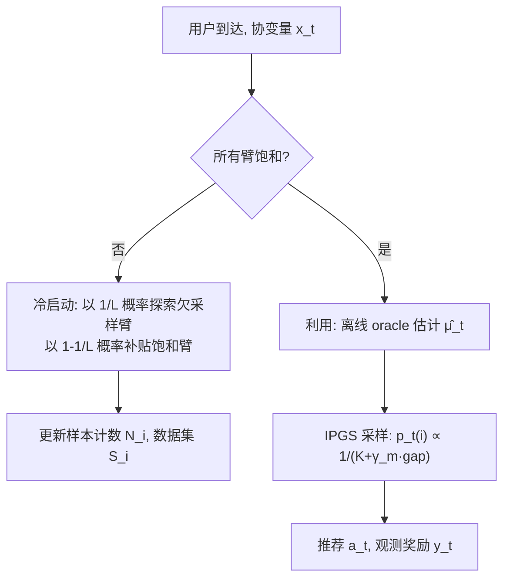
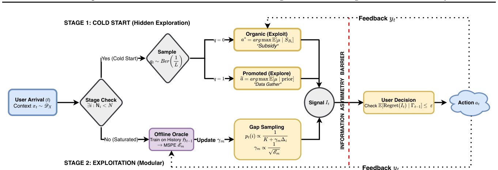

# Incentivized Exploration with Stochastic Covariates: A Two-Stage Mechanism Design for Recommender System (随机协变量下的激励探索：推荐系统的两阶段机制设计)

- **会议/期刊**: ICML 2026
- **作者与机构**: Yuantong Li (Meta Platforms), Guang Cheng, Xiaowu Dai (UCLA 统计与数据科学系)
- **推荐链路定位**: 召回（探索式召回 / 冷启动内容分发）
- **研究方向**: 强化学习与动态探索推荐 / 去偏公平与机制设计
- **论文原文**: [https://arxiv.org/abs/2406.04374v2](https://arxiv.org/abs/2406.04374v2)
- **开源代码**: 暂未开源

## TL;DR (1分钟核心速览)

推荐平台需要探索冷启动商品，但自利用户会拒绝偏离其即时最优的推荐，形成"探索—激励"矛盾。本文首次将激励相容探索（BIC）从**固定设计线性 Bandit** 推广到**在线随机用户协变量**场景，形式化为 ε-DBIC 问题，提出两阶段 RCB 算法：第一阶段用"补贴式"隐藏探索收集每臂 $N(\epsilon)$个样本，第二阶段用**逆比例间隙采样 (IPGS)** 配合任意离线学习 oracle。理论上证明$\tilde{O}(\sqrt{KdT})$遗憾并量化"激励代价"$N(\epsilon)\propto 1/\epsilon^2$；在华法林给药真实数据上，紧预算$\epsilon=0.025$ 时加权风险分 0.291 显著优于医生基线 0.20。

## Background & Motivation (背景与核心矛盾)

- **主流范式**: 激励探索由 Kremer et al. (2014)、Mansour et al. (2020) 建立，用"隐藏探索 + 贪心"在 MAB 上实现 BIC；Sellke (2023) 将其扩展到线性上下文，但假设**固定设计**（特征静态、由商品拥有）。
- **前人局限**: (1) 固定设计假设下最优臂全局唯一，无法刻画"每个用户的最优臂随协变量变化"的个性化推荐；(2) 通用黑盒归约（Mansour et al.）忽略线性奖励结构，无法给出 $\sqrt{T}$ 级遗憾保证。
- **核心洞察 (Key Insight)**: 平台掌握完整历史而用户只看到推荐与先验，这种**信息不对称**可被用作"补贴"——用高确定性的饱和臂收益去掩盖探索臂的期望损失，只要损失被控制在激励预算 $\epsilon$ 内，理性短视用户就会服从。
- **本文切入点**: 把激励约束与学习速率**解耦**：ε 只进入冷启动样本量 $N(\epsilon)$，一旦进入第二阶段，探索半径仅由离线 oracle 的预测误差驱动，从而兼得 DBIC 与次线性遗憾。

## Method (核心方法设计)

### 1. 整体框架 (Overall Architecture)

平台每轮观察随机协变量 $x_t$，先判断是否所有臂都已"饱和"（各收集$N(\epsilon)$样本）。未饱和则进入冷启动阶段：以$1/L$概率推荐欠采样臂（探索），以$1-1/L$概率推荐饱和臂（补贴），后者不计入样本计数以避免高估置信度。饱和后进入利用阶段：按倍增 epoch 训练任意离线 oracle，用 IPGS 分布采样推荐臂，采样集中度由 spread 参数$\gamma_m$ 随预测误差收缩而自动收紧。

<figure class="paper-figure" markdown="span">
  <figcaption>图1. RCB算法</figcaption>
</figure>

### 2. 关键设计拆解 (Key Designs)

1. **ε-DBIC 约束与冷启动补贴机制**：痛点在于短视用户会拒绝探索臂。定义 ε-DBIC 为推荐臂 $i$相对任意替代臂$j$的后验期望损失不超过预算：$\mathbb{E}[\mu(x_t,i)-\mu(x_t,j)\mid I_t=i,\Gamma_{t-1}]\ge-\epsilon$。冷启动阶段用概率$1/L$的探索混合，使探索损失被饱和臂收益补贴；推导出所需探索概率下界$L\ge 1+\frac{1-\epsilon}{\tau_{P_0}\rho_{P_0}+\epsilon}$，其中$\tau_{P_0}\rho_{P_0}$ 刻画先验-后验间隙的非退化程度。直觉：只要"安全臂"足够好，少量探索的期望损失可被摊薄到预算内。

2. **逆比例间隙采样 (IPGS)**：痛点在于 Thompson Sampling 依赖特定后验形式（高斯/Beta），无法插入任意离线学习器。RCB 改为对预测最优臂 $\hat{b}_t$ 与其余臂按间隙反比分配概率：
$$p_t(i)=\frac{1}{K+\gamma_m(\hat{\mu}_t(x_t,\hat{b}_t)-\hat{\mu}_t(x_t,i))},\quad i\ne\hat{b}_t$$
其中 $\gamma_m=4\sqrt{K/E_{\mathcal{F},\delta}(|T_{m-1}|)}$与离线 oracle 的均方预测误差 (MSPE) 成反比。直觉：预测越准，$\gamma_m$ 越大，采样越集中于最优臂，探索损失自动收缩到 ε 以内——这正是激励与学习解耦的数学来源。

3. **训练目标、样本复杂度与推理开销**：总遗憾分解为 $\mathcal{R}(T)\le T_{\text{cold}}(\epsilon)+\tilde{O}(\sqrt{Kd(T-T_{\text{cold}})})$，第一项是"激励代价"，第二项是标准上下文 Bandit 学习遗憾。冷启动每臂样本量$N(\epsilon)\ge\frac{(\sigma^2d+1)K^3}{\phi_0(\tau_{P^*}+\epsilon)^2}$，对臂数呈**三次方**、对维度线性、对激励预算**平方反比**。推理侧每轮仅需一次 oracle 前向 +$O(K)$ 概率归一化，冷启动阶段仅需先验均值排序，开销可忽略。

## Experimental Setup & Evaluation Protocol (实验设置与评估协议)

- **数据集与预处理**: 采用 PharmGKB 华法林给药数据集（5,528 名患者），按临床阈值将剂量离散为 3 臂（Low <3mg 占 27%、Medium 3–7mg 占 60%、High >7mg 占 13%），奖励为"推荐剂量是否命中真实最优臂"的二值指示。

| 数据集 | #Users | #Items(Arms) | #Interactions | 稀疏度/密度 | 特征/场景说明 |
| :--- | :---: | :---: | :---: | :---: | :--- |
| PharmGKB (warfarin) | 5,528 | 3 | 5,528 | 全量单轮 | 临床/基因协变量，剂量分桶 |

- **数据划分与防穿越 (Splitting Strategy)**: 在线流式模拟，患者到达顺序做 10 次随机置换取平均，$T=5528$，无训练/测试切分（在线决策范式）。
- **排名评测协议 (Ranking Protocol)**: 非传统 Top-N 排序，采用**累积遗憾**（错误给药次数）、**ε-DBIC 增益**（推荐臂与最优替代臂的期望奖励差）、**错误决策比例**、**加权风险分**（按剂量类别患病率加权，正确 +1 错误 −1）四项指标。
- **对比基线与超参设置**: 基线为"医生固定 Medium 剂量"标准疗法与 Lasso Bandit (Bastani & Bayati, 2020)；激励预算 $\epsilon\in\{0.025,0.035,0.045\}$，先验方差$\Sigma\in\{0.4,0.6,0.8\}I_d$，最小间隙$\tau_{P_0}=0.005$，噪声$\hat\sigma=0.054$。

## Key Experimental Results (实验关键数据)

### 1. 主实验对比 (Main Results)

按真实剂量分层的纠正率与加权风险分（RCB 取 $\epsilon=0.025$）：

| 方法 | Low 纠正率 | Medium 纠正率 | High 纠正率 | 加权风险分 ↑ |
| :--- | :---: | :---: | :---: | :---: |
| Physician (Always Medium) | 0% | **100%** | 0% | 0.200 |
| Lasso Bandit (错误率基线) | — | — | — | ~0.35 错误率 |
| **RCB ($\epsilon=0.025$)** | **50%** | 84% | **5%** | **0.291** |
| RCB ($\epsilon=0.035$) | — | — | — | 0.265 |

### 2. 消融实验 (Ablation Study)

原文以激励预算与先验强度作为敏感性分析维度（非模块消融）：

| 配置 | 错误决策比例 | 加权风险分 | 说明 |
| :--- | :---: | :---: | :--- |
| RCB, $\epsilon=0.025$ | ~0.35 | **0.291** | 紧预算最优，追平 Lasso Bandit |
| RCB, $\epsilon=0.035$ | 中等 | 0.265 | 先验变弱时略降 |
| RCB, $\epsilon=0.045$ | >0.40 | 更低 | 松预算探索过度 |
| 先验方差 $\Sigma=0.4/0.6/0.8$| 随$\Sigma$ 增大而升 | — | 先验越弱越难激励 |

### 3. 关键实验发现 (Key Findings)

1. **紧预算反而更优**：$\epsilon=0.025$ 时错误率约 0.35，追平无需 DBIC 约束的 Lasso Bandit，说明严格激励约束并未牺牲决策质量，反而抑制了过度探索。
2. **尾部人群显著受益**：医生基线在 Low/High 尾部纠正率为 0，RCB 分别提升至 50% 与 5%，同时将"极端错误"（如给 Low 患者开 High）压到 2%，加权风险分从 0.20 升至 0.291（+45.5%）。
3. **激励代价可量化**：$N(\epsilon)\propto 1/\epsilon^2$ 的理论预测在实验中体现为——预算从 0.025 放宽到 0.045，冷启动缩短但错误率突破 0.40，验证了"预算—遗憾"的精确权衡曲线。

## Highlights & Limitations (亮点、对比与审稿批判)

- **与代表作对比 (vs. Prior Work)**: 相比 Sellke (2023) 的固定设计线性 Bandit，本文处理**在线随机协变量**使最优臂逐轮变化；相比 Mansour et al. (2020) 的黑盒归约，本文利用线性结构给出 $\sqrt{T}$ 遗憾；相比 Thompson Sampling 类方法，IPGS 是**模块化**的，可插入任意离线回归器（含神经网络）。
- **可迁移亮点**: (1) "激励约束只进入初始化阈值、不进入学习速率"的解耦思想，可直接迁移到冷启动商品扶持与创作者激励分配；(2) 用饱和臂收益"补贴"探索损失的混合概率设计，是工业界 ε-greedy 探索的严格化版本。
- **审稿级局限批判**: (1) 冷启动样本复杂度对臂数呈 $O(K^3)$，$K$上千时不可行，文中仅给出聚类/渐进探索等工程缓解而未理论分析；(2) 实验仅限$K=3$ 的华法林单数据集，缺乏大规模合成仿真与多臂场景验证，且线性奖励假设在真实推荐中易失配。

## Rating (四维评分)

- **方法创新性 (Novelty)**: ⭐⭐⭐⭐ （首次将 BIC 探索推广到随机协变量，IPGS 解耦激励与学习，理论刻画"激励代价"）
- **评估协议与实验扎实度 (Protocol & Experiments)**: ⭐⭐⭐ （真实临床数据有说服力，但仅单数据集、$K=3$，缺大规模仿真与显著性检验）
- **写作与数学规范度 (Clarity & Rigor)**: ⭐⭐⭐⭐ （DBIC 定义清晰、定理证明完整，附录含完整遗憾分解与 Ridge 预测误差界）
- **工业落地与复现价值 (Industrial & Practical Value)**: ⭐⭐⭐ （模块化设计易接入现有 oracle，但 $K^3$ 复杂度与未开源限制大规模部署）

