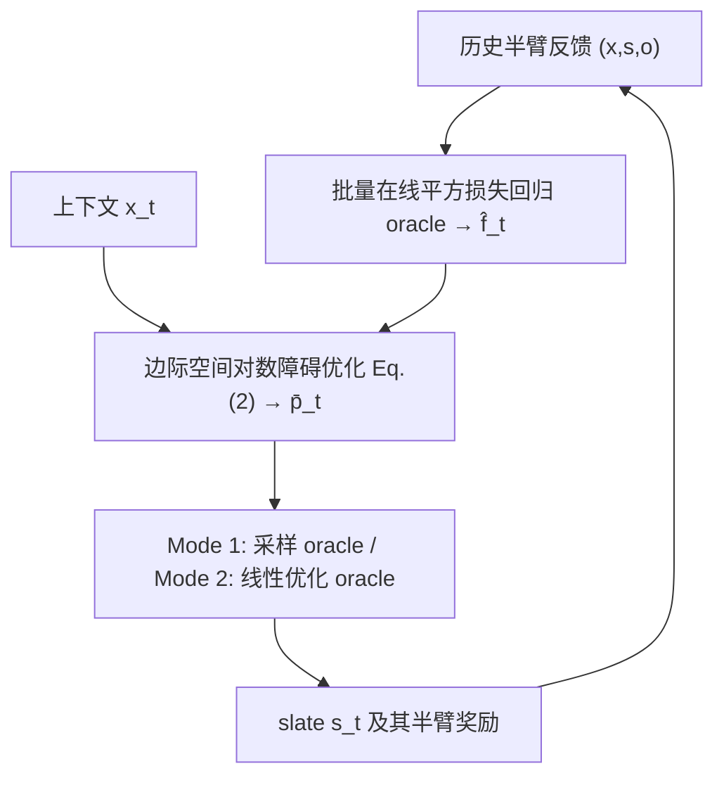

# Optimal and Efficient Contextual Combinatorial Semi-bandits with General Function Approximation (通用函数逼近下最优且高效的上下文组合半臂老虎机)

- **会议/期刊**: NeurIPS 2026
- **作者与机构**: Hao Qin, Chicheng Zhang (The University of Arizona)
- **推荐链路定位**: 重排 / 在线列表级探索（slate 选择）
- **研究方向**: 强化学习与动态探索推荐 / 多任务学习与列表级重排
- **论文原文**: [https://arxiv.org/abs/2607.13686v2](https://arxiv.org/abs/2607.13686v2)
- **开源代码**: [https://github.com/MjolnirT/Contextual-Combinatorial-Semi-Bandit](https://github.com/MjolnirT/Contextual-Combinatorial-Semi-Bandit)

## TL;DR (1分钟核心速览)

上下文组合半臂老虎机（CCSB）此前只有线性奖励下的高效算法，非线性奖励下要么依赖策略类枚举（不可算），要么把 slate 反馈聚合成 bandit 反馈而损失 $\sqrt{m}$的样本效率。本文提出 SquareCB.Comb：用批量在线平方损失回归 oracle 估计逐臂奖励，再在对数障碍正则化的**边际概率向量**空间求解探索分布，配合采样 oracle（Mode 1）或线性优化 oracle（Mode 2）落地。理论上给出$\tilde{O}(\sqrt{mAT\log|\mathcal{F}|})$ 的 regret 并证明匹配下界（首个非线性 CCSB 的极小极大最优结果）；在 MSLR-WEB30k 与 Yahoo! LTR Set 1 的 m-set 推荐任务上，gb5 oracle 下的 SquareCB.Comb 取得所有在线学习器中最高的最终平均奖励。

## Background & Motivation (背景与核心矛盾)

- **主流范式**: CCSB 每轮观测上下文、选一个臂子集（slate/路径），只观测被选臂的奖励（semi-bandit）。已有高效算法几乎都假设逐臂期望奖励是上下文的线性函数（C2UCB、Takemura 等）。
- **前人局限一**: 线性假设在真实点击场景失效（点击对上下文特征高度非线性）；而通用函数逼近下的两条路线各有硬伤——策略类搜索（Kale 等）需枚举 $|\Pi|$个策略，计算不可行；把 CCSB 归约为上下文 bandit（SquareCB.Lin）则把 slate 总奖励当作单条反馈，回归 oracle 数据效率下降，regret 退化为$\tilde{O}(m\sqrt{AT\log|\mathcal{F}|})$，多出$\sqrt{m}$。
- **前人局限二**: 通用 E2D/DEC 框架无法直接套用，因为半臂反馈下学习者并不知道 $\{r_t(a):s_t(a)=1\}$在给定模型与$(x_t,s_t)$ 下的精确条件分布，Hellinger 型 DEC 无从计算。
- **核心洞察 (Key Insight)**: 若把 DEC 中的散度换成**平方损失**、并把期望误差按被选臂求和，得到的组合平方损失 DEC（CS-DEC）可以在**边际概率向量空间** $\bar{\mathcal{S}}=\mathrm{Conv}(\mathcal{S})\subset\mathbb{R}^A$上等价重写——维度从指数级的$|\mathcal{S}|$降到$A$，从而可用一个$A$ 维凸优化求解。
- **本文切入点**: 用对数障碍正则化在 $\bar{\mathcal{S}}$ 上求边际概率，再用结构化采样/线性优化 oracle 把边际还原成真实 slate 分布，从而同时拿到最优 regret 与可计算性。

## Method (核心方法设计)

### 1. 整体框架 (Overall Architecture)

每轮 $t$：批量回归 oracle 基于历史$\{(x_\tau,s_\tau,o_\tau)\}_{\tau<t}$输出逐臂奖励估计$\hat{f}_t$；观测$x_t$后，在边际概率单纯形上求解对数障碍正则化的贪心-探索目标得到$\bar{p}_t\in\bar{\mathcal{S}}$；随后通过 Mode 1 的采样 oracle 或 Mode 2 的 Frank-Wolfe 式线性优化过程，得到边际恰为$\bar{p}_t$的 slate 分布$p_t\in\Delta(\mathcal{S})$并采样$s_t$；观测半臂反馈后回灌 oracle。整个流程只依赖"回归 oracle + 一个组合结构 oracle"，与具体函数类无关。

### 2. 关键设计拆解 (Key Designs)

1. **组合平方损失 DEC (CS-DEC) 与边际空间等价重写**：痛点是标准 DEC 需要观测分布的精确似然，半臂反馈下不可得。作者改为以平方损失度量估计误差、并按被选臂求和：
$\mathrm{dec}_\gamma(\hat{g},\mathcal{G})=\min_{p\in\Delta(\mathcal{S})}\max_{q\in\Delta(\mathcal{S}),g^\star\in\mathcal{G}}\mathbb{E}_{s\sim q}\langle g^\star,s\rangle-\mathbb{E}_{s\sim p}\langle g^\star,s\rangle-\gamma\mathbb{E}_{s\sim p}\big[\sum_{a}s(a)(\hat{g}(a)-g^\star(a))^2\big]$。
关键观察是该量可等价写成 $\bar{p},\bar{q}\in\bar{\mathcal{S}}$上的形式且$\bar{F}(p)=\bar{F}(\bar{p})$，于是$|\mathcal{S}|$维 minimax 塌缩为$A$ 维——这是全文可计算性的根基。

2. **对数障碍边际优化 + 覆盖度代理目标**：直接最小化 CS-DEC 仍难，作者构造代理目标 $\inf_{\bar{p}}\max_{\bar{q}}\langle\hat{f}_t,\bar{q}-\bar{p}\rangle+\frac{1}{\gamma}\mathrm{Coverage}(\bar{p},\bar{q})$，其中$\mathrm{Coverage}(\bar{p},\bar{q})=\sum_a \bar{q}(a)^2/\bar{p}(a)$精确刻画"用$\bar{p}$采数据去估计$\bar{q}$ 的奖励"时的方差。Mode 1 只需求解
$\bar{p}_t=\arg\max_{\bar{p}\in\bar{\mathcal{S}}}\langle\bar{p},\hat{f}_t(x_t,\cdot)\rangle+\frac{1}{\gamma}\sum_{a\in\mathcal{A}}\log\bar{p}(a)$，
一阶最优性条件即证明其代理目标值 $\le A/\gamma$，再由 OPE 引理 + AM-GM 推出 CS-DEC$\lesssim A/\gamma$。直觉：对数障碍把质量摊开到所有臂上，摊开的程度由$\gamma$ 控制，恰好抵消估计误差。

3. **Mode 2：仅需线性优化 oracle 的 Frank-Wolfe 式分布构造**：当 $\mathcal{S}$只有$\arg\min_{s}\langle\ell,s\rangle$可用（最短路、最大权匹配）时，用带"逆边际奖励"$\frac{1}{\gamma(\bar{p}(a)+\varepsilon/A)}$的线性目标反复取贪心臂集，按自适应步长$\Delta_j=\frac{1}{4}\big(\sum_{a:s_j(a)=1}\frac{1}{\bar{p}_{j-1}(a)+\varepsilon/A}\big)^{-1}$加质量，直至增益低于阈值，剩余质量给贪心解$\hat{s}$。势函数论证给出终止性：至多$\tilde{O}(A)$次 oracle 调用，输出支撑不超过$\tilde{O}(A)$ 个 slate 的稀疏分布。

4. **训练目标、负采样与推理效率**：无显式损失函数，学习完全外包给回归 oracle（EWA 在有限类上达 $\mathrm{Reg}_{\mathrm{batch}}(T)\lesssim B\log|\mathcal{G}|$）。总 regret 分解为$\mathbb{E}[\mathrm{Regret}(T)]\lesssim AT/\gamma+\gamma\,\mathrm{Reg}_{\mathrm{batch}}(T)$，取$\gamma=\sqrt{AT/\mathrm{Reg}_{\mathrm{batch}}(T)}$得$\tilde{O}(\sqrt{AT\,\mathrm{Reg}_{\mathrm{batch}}(T)})$，代入即$\tilde{O}(\sqrt{mAT\log|\mathcal{F}|})$。支持 anytime 调度$\gamma_t=\sqrt{At/(m\log|\mathcal{F}|)}$而无需预知$T$；Mode 2 总开销$\tilde{O}(T\mathcal{T}_{\mathrm{reg}}+TA(\mathcal{T}_{\mathrm{lin}}+A))$，对 m-set 与 DAG 最短路$\mathcal{T}_{\mathrm{lin}}=O(A)$。

## Experimental Setup & Evaluation Protocol (实验设置与评估协议)

- **数据集与预处理**: 两个 LTR 基准按标准 supervised-to-bandit 归约转为 CCSB，相关性标签 $\{0,1,2,3,4\}$直接作为半臂奖励；过滤候选文档数少于$A$ 的 query。

| 数据集 | #Queries (T) | 候选池 A | Slate 大小 m | 奖励来源 | 场景说明 |
| :--- | :---: | :---: | :---: | :---: | :--- |
| MSLR-WEB30k | 30,846 | 10 | 3 | 相关性标签 0–4 | 网页搜索排序 |
| Yahoo! LTR Set 1 | 27,630 | 6 | 2 | 相关性标签 0–4 | 网页搜索排序 |
| 合成 m-set | 30,000 轮 | 10 | 1–10 | Bernoulli 固定均值 | 非上下文消融 |
| 合成 grid-path | 30,000 轮 | 40 条边 | 8 | 上下文相关 Bernoulli | $5\times5$ 网格、70 条可行路径 |

- **数据划分与防穿越 (Splitting Strategy)**: 按 query 流式在线推进（每轮一个 query），无离线训练/测试切分；超参在 10 个 tuning seed 上按"平均累计奖励最大"选取，再在 10 个不相交 evaluation seed 上评估。
- **排名评测协议 (Ranking Protocol)**: 在线 **cumulative reward / per-round average reward** 曲线，非 Full-Ranking 离线指标；每轮仅观测被选 $m$ 个文档的标签（semi-bandit），无负采样。
- **对比基线与超参设置**: SquareCB.Lin（slate 聚合反馈 + 对数行列式分布优化）、VCEE（策略类 + 代价敏感分类 oracle）、LinUCB（线性 UCB 的半臂适配）、$\varepsilon$-greedy（$\varepsilon_t=\max\{t^{-1/2},\varepsilon\}$）；另设 Uniform-random（下界）与 Supervised Skyline（全量拟合后贪心，上界）。回归 oracle 取 lin / gb2 / gb5（梯度提升树深度 2/5），探索参数按$\gamma_t=\gamma_0\sqrt{At/m}$调$\gamma_0$。

## Key Experimental Results (实验关键数据)

### 1. 主实验对比 (Main Results)

原文主结果为图 1 的 per-round average reward 曲线（gb5 oracle，10 seed 均值 ±1 标准差），下表为最终平均奖励的定性归纳（原文未给逐点数值表，故以趋势与相对位次呈现）：

| 算法 (oracle) | MSLR-WEB30k 最终平均奖励 | Yahoo! LTR Set 1 最终平均奖励 | 说明 |
| :--- | :---: | :---: | :--- |
| **SquareCB.Comb (gb5)** | **最高（在线学习器中最优）** | **最高（在线学习器中最优）** | 本文，semi-bandit 逐臂回归 |
| SquareCB.Lin | 低于其余在线学习器 | 低于其余在线学习器 | slate 聚合反馈，样本效率受损 |
| VCEE | 次优梯队 | 次优梯队 | 策略类方法，依赖分类 oracle |
| $\varepsilon$-greedy | 明显落后 | 明显落后 | 重要性加权，方差大 |
| LinUCB | 线性假设受限 | 线性假设受限 | 仅线性 oracle |
| Supervised Skyline (gb5) | 上界参考线 | 上界参考线 | 全量标签拟合后贪心 |
| Uniform-random | 下界参考线 | 下界参考线 | 无学习 |

### 2. 消融实验 (Ablation Study)

| 配置 | 关键观察 |
| :--- | :--- |
| SquareCB.Comb + lin oracle | 仍优于 SquareCB.Lin，说明增益来自 semi-bandit 逐臂回归而非模型容量 |
| SquareCB.Comb + gb2 oracle | 介于 lin 与 gb5 之间，随 oracle 表达力单调提升 |
| SquareCB.Comb + gb5 oracle | 最优，验证非线性奖励建模的必要性 |
| 非上下文 m-set（$m=1\ldots9$） |$m$增大时相对优势扩大，与$\sqrt{m}$ 的样本效率差一致 |
| grid-path（lin/gb2/gb5 三列） | 三种 oracle 下均领先，Mode 2 线性优化路径可行 |

### 3. 关键实验发现 (Key Findings)

1. **$\sqrt{m}$的样本效率差在曲线上可见**：SquareCB.Lin 在两个 LTR 数据集上最终平均奖励均低于其余在线学习器，正是其 regret 多出$\sqrt{m}$ 因子的经验映射；而 SquareCB.Comb 复用每条半臂反馈，收敛更快。
2. **收益随 oracle 表达力单调增长**：lin → gb2 → gb5 的最终奖励递增，且 gb5 下 SquareCB.Comb 逼近 Supervised Skyline 上界，说明算法把"建模能力"与"探索效率"解耦，可直接吃现成回归器的进步。
3. **$m$越大优势越明显**：非上下文 m-set 实验中随$m$从 1 增至 9，SquareCB.Comb 相对$\varepsilon$-greedy 与 SquareCB.Lin 的差距扩大，与理论中$m$只以$\sqrt{m}$ 进入 regret 的结论吻合。

## Highlights & Limitations (亮点、对比与审稿批判)

- **与代表作对比 (vs. Prior Work)**: 相比 Kale 等的策略类方法，本文把 $|\Pi|$换成$|\mathcal{F}|$且无需枚举策略，计算可行；相比 SquareCB.Lin 的 slate 聚合归约，本文保留逐臂反馈，regret 从$\tilde{O}(m\sqrt{AT\log|\mathcal{F}|})$降到$\tilde{O}(\sqrt{mAT\log|\mathcal{F}|})$；相比 Levy 等的 CMDP 归约（最短路下$\tilde{O}(\sqrt{N^7T\log|\mathcal{F}|})$），本文给出$\tilde{O}(\sqrt{NMT\log|\mathcal{F}|})$，在稀疏图上优势显著。
- **可迁移亮点**: (i) "把指数级组合单纯形上的 minimax 优化塌缩到 $A$ 维边际空间"这一技巧可直接迁移到 slate 重排、多样性约束下的在线探索；(ii) 用 Coverage 项替代 Hellinger 散度来构造可计算的 DEC，为半臂/部分观测反馈下的 E2D 设计提供模板。
- **审稿级局限批判**: (i) 实验规模偏小（$A=10,m=3$），且仅报告曲线未给逐点数值与显著性检验，与理论的最优性主张之间存在证据落差；(ii) Mode 1 依赖问题相关的采样 oracle（如 dependent rounding、流分解），Mode 2 每轮需$\tilde{O}(A)$次线性 oracle 调用，在$A$ 达万级的真实推荐场景下开销与工程复杂度仍是落地瓶颈；(iii) 下界构造依赖各臂奖励相关，独立奖励假设下界是否可改进仍为开放问题。

## Rating (四维评分)

- **方法创新性 (Novelty)**: ⭐⭐⭐⭐⭐ （CS-DEC 把半臂反馈下的 DEC 变为可计算量，并借边际空间等价性把指数维优化降到 $A$ 维，是理论层面的实质性推进）
- **评估协议与实验扎实度 (Protocol & Experiments)**: ⭐⭐⭐ （覆盖合成与两个真实 LTR 基准、10+10 seed 调参/评估规范，但规模小、缺数值表与显著性检验）
- **写作与数学规范度 (Clarity & Rigor)**: ⭐⭐⭐⭐⭐ （上下界匹配、Mode 1/2 双路径证明完整，势函数终止性论证与 anytime 扩展齐备，44 页附录自洽）
- **工业落地与复现价值 (Industrial & Practical Value)**: ⭐⭐⭐ （代码已开源、仅需回归器与线性优化 oracle 即可接入，但每轮凸优化与 $\tilde{O}(A)$ 次 oracle 调用在大候选池下需进一步近似）

