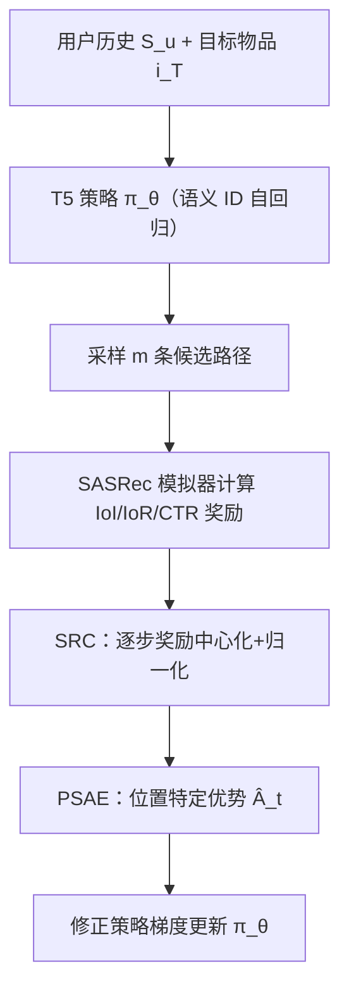

# ProRL: Effective Reinforcement Learning for Proactive Recommendation via Rectified Policy Gradient Estimation (通过修正策略梯度估计实现主动推荐的高效强化学习)

- **会议/期刊**: ICML 2026
- **作者与机构**: Hongru Hou, Tiehua Mei, Denghui Geng, Jinhui Huang, Ao Xu, Hengrui Chen, Jiaqing Liang, Deqing Yang（复旦大学数据科学学院）
- **推荐链路定位**: 端到端生成式（序列到序列路径生成）
- **研究方向**: 强化学习与动态探索推荐 / 生成式推荐
- **论文原文**: [https://arxiv.org/abs/2605.28293v2](https://arxiv.org/abs/2605.28293v2)
- **开源代码**: [https://github.com/hongruhou89/ProRL](https://github.com/hongruhou89/ProRL)

## TL;DR (1分钟核心速览)

主动推荐系统（PRS）需生成中间物品路径将用户偏好引向目标物品，但直接套用策略梯度会因路径奖励分解出正均值步级奖励，导致梯度被"路径长度"主导（长度捷径）且方差极高。ProRL 提出逐步奖励中心化（SRC）使路径延长期望增益归零，并用位置特定优势估计（PSAE）替代 GRPO 的路径级基线以降低方差。在 MovieLens-1M/Steam/Amazon-Book 上以 SASRec 为用户模拟器评估，IoI 相对最强基线 T-PRA 提升约 14.6%–72.7%，IoR 提升约 105%–190%，且跨评估器（GRU4Rec）泛化验证无奖励黑客。

## Background & Motivation (背景与核心矛盾)

- **主流范式**: PRS 用轻量 Transformer（T5）在历史交互路径上监督预训练，再以 RL 微调；路径质量由用户模拟器（SASRec）估计的 IoI/IoR（引导有效性）与 CTR（路径可行性）加权奖励 $R_{\text{path}}=\alpha\cdot\text{IoI}+\beta\cdot\text{IoR}+\gamma\cdot\text{CTR}$ 度量。
- **前人局限**: 监督方法（IRN）只能模仿历史路径，无法探索分布外更优路径；启发式方法（IPG/ITMPRec）逐步贪心陷入局部最优；LLM 方法（LLM-IPP/T-PRA）部署成本过高。
- **核心洞察 (Key Insight)**: 任何路径奖励都可分解为步级增量 $R=\sum_{t=1}^{L}r_t$，而实测三个奖励分量的步级期望$\mathbb{E}_\pi[r_t]$**恒为正**（图2下排），于是期望回报与路径长度直接耦合——标准策略梯度在数百步内即把路径长度推向$L_{\max}$、多样性塌缩至近零（图2上排）。
- **本文切入点**: 理论上证明停止概率以 $O(1/s)$ 速率单调衰减（定理2.1），说明长度塌缩是结构性后果而非调参问题；据此提出"路径延长应产生零期望增益"的修正原则。

## Method (核心方法设计)

### 1. 整体框架 (Overall Architecture)

模型以 T5 序列到序列架构为策略 $\pi_\theta$，物品经 RQ-VAE 语义 ID（$K=4$个码字）离散化，自回归生成$K\cdot L+1$个 token 解码为长度$L\le L_{\max}=10$的推荐路径。两阶段训练：先在"平滑引导"挖掘的高质量专家路径上监督预训练得到$\pi_0$，再以修正后的策略梯度做 RL 微调，目标为$J(\theta)=\mathbb{E}_{L_u\sim\pi_\theta}[R_{\text{path}}]-\lambda D_{\mathrm{KL}}(\pi_\theta\|\pi_0)$。RL 阶段仅替换梯度估计器，奖励与权重保持一致。

### 2. 关键设计拆解 (Key Designs)

1. **逐步奖励中心化 SRC（消除长度捷径）**：痛点在于 $\mathbb{E}_\pi[r_t]>0$使长路径天然高回报。做法是对每个步级奖励减去全局期望步奖励$\bar{r}=\mathbb{E}_\pi[r_*]$，得$\tilde{r}_t=r_t-\bar{r}$，构造上$\mathbb{E}_\pi[\tilde{r}_t]=0$，故$\mathbb{E}[\sum_t\tilde{r}_t]$与$L$无关，延长路径不再带来期望增益，梯度只能来自路径质量。多目标场景进一步做分量归一化：$\tilde{r}_t=\sum_{i=1}^{K}w_i\cdot\frac{r_t^{(i)}-\mu^{(i)}}{\sigma^{(i)}}$，$\mu^{(i)},\sigma^{(i)}$ 由首个 warm-up epoch 的 rollout 估计后冻结，避免与策略共演化漂移。

2. **位置特定优势估计 PSAE（降低梯度方差）**：标准估计用整条路径奖励 $R$加权每一步，但第$t$步只影响$t$之后的奖励。先改用 reward-to-go$G_t=\sum_{\ell=t}^{L}r_\ell$剔除无关历史噪声；再借鉴 GRPO 的免 critic 组基线思想，但 GRPO 的路径级基线$\bar{R}_i$对所有步共享，忽略期望回报随位置变化。PSAE 改为按位置计算基线$\bar{G}_{i,t}=\frac{\sum_{j:L^{(i,j)}\ge t}G_t^{(i,j)}}{\sum_{j=1}^{m}\mathbb{I}[L^{(i,j)}\ge t]}$，优势$\hat{A}_t^{(i,j)}=G_t^{(i,j)}-\bar{G}_{i,t}$，得到修正梯度$\hat{g}_{\text{rect}}=\frac{1}{nm}\sum_{i,j}\sum_{t}\nabla_\theta\log\pi_\theta^{(i,j,t)}\cdot\hat{A}_t^{(i,j)}$。两项均为经典无偏降方差手段，且无需训练 critic，规避了 A2C 中 critic 跟不上演化策略导致的方差漂移。

3. **训练目标、负采样与推理效率**：总损失为奖励项加 KL 正则（KL 项可解析计算），无显式负采样（生成式策略，靠组内 rollout 比较）；每输入采样 $m$ 条路径做组内基线估计。推理时贪心/采样解码语义 ID 序列，模型为轻量 T5，远低于 LLM 方法的部署开销。

## Experimental Setup & Evaluation Protocol (实验设置与评估协议)

- **数据集与预处理**: 采用 k-core 过滤（MovieLens-1M 用户 20-core/物品 20-core；Steam 40-core；Amazon-Book 用户 100-core/物品 40-core），并用可行性 Oracle（KG 属性共享或 LLM 判定）挖掘"平滑引导"专家路径：

| 数据集 | #Users | #Items | #Interactions | 平均交互数 | 场景说明 |
| :--- | :---: | :---: | :---: | :---: | :--- |
| MovieLens-1M | 6,040 | 3,040 | 1,000,209 | 165.59 | 电影，genre 为桥接属性 |
| Steam | 2,567,538 | 15,474 | 7,793,069 | 3.03 | 游戏，类目/发行商/开发商 |
| Amazon-Book | 10,297,355 | 4,493,336 | 29,475,453 | 2.86 | 图书，类目为桥接属性 |

- **数据划分与防穿越 (Splitting Strategy)**: 按**用户**随机划分 8:1:1（用户级划分，测试用户完全未见，防信息泄漏）；测试集每条子序列随机采样一个用户未交互物品作为目标 $i_T$。
- **排名评测协议 (Ranking Protocol)**: 以 SASRec 为用户模拟器计算 IoI（目标物品对数概率增量）、IoR（目标物品排名提升）、CTR（路径各步接受概率均值，即 HitRate）与 Coherence（相邻物品属性一致性）；另用 GRU4Rec/LightSANs/BERT4Rec 做**跨评估器**验证。
- **对比基线与超参设置**: 基线含序列推荐（GRU4Rec/BERT4Rec/LightSANs/FEARec）、监督主动推荐（IRN）、启发式（IPG/ITMPRec）、LLM 方法（LLM-IPP/T-PRA，Llama-3.1-8B）；语义 ID 用 qwen3-embedding-8B + RQ-VAE（5 级码本、码本大小 128、$K=4$）；显著性$p<0.05$。

## Key Experimental Results (实验关键数据)

### 1. 主实验对比 (Main Results)

以 SASRec 为评估器（节选核心指标，加粗为最优）：

| 数据集 | 模型 | CTR | Coherence | IoI | IoR |
| :--- | :--- | :---: | :---: | :---: | :---: |
| MovieLens-1M | IRN | 0.8398 | 0.4706 | 1.7277 | 443.29 |
| | IPG | 0.4463 | 0.3725 | 2.2537 | 169.28 |
| | LLM-IPP | 0.6141 | 0.6288 | 2.4680 | 662.52 |
| | T-PRA | 0.4889 | 0.3415 | 2.4867 | 355.16 |
| | **ProRL** | **0.8543** | **0.8422** | **2.8504** | **728.18** |
| Steam | T-PRA | 0.2713 | 0.7399 | 0.3339 | 62.04 |
| | **ProRL** | **0.5625** | **0.8707** | **1.1188** | **340.18** |
| Amazon-Book | LLM-IPP | 0.5714 | 0.5132 | 1.6651 | 429.32 |
| | T-PRA | 0.5521 | 0.4418 | 1.7261 | 476.93 |
| | **ProRL** | **0.8568** | **0.6775** | **2.9812** | **1383.41** |

相对最强基线 T-PRA：IoI 提升 14.6%（ML-1M）/235%（Steam）/72.7%（Books），IoR 提升 105%/448%/190%，CTR 提升 1.7%–107%，全部 $p<0.05$ 显著。跨评估器（GRU4Rec）下 ProRL 仍全面领先（如 Books IoR 1001.27 vs. T-PRA 207.89）。

### 2. 消融实验 (Ablation Study)

| 数据集 | 模型 | CTR | IoI | IoR |
| :--- | :--- | :---: | :---: | :---: |
| MovieLens-1M | w/o SRC | 0.9731 | 1.2373 | 649.96 |
| | w/o PSAE | 0.7456 | 2.5556 | 695.86 |
| | **ProRL** | 0.8543 | **2.8504** | **728.18** |
| Steam | w/o SRC | 0.9432 | 0.3217 | 198.30 |
| | w/o PSAE | 0.6311 | 0.7280 | 244.78 |
| | **ProRL** | 0.5625 | **1.1188** | **340.18** |
| Amazon-Book | w/o SRC | 0.8361 | 1.8825 | 1002.46 |
| | w/o PSAE | 0.8404 | 2.5036 | 1223.78 |
| | **ProRL** | **0.8568** | **2.9812** | **1383.41** |

梯度估计器对比（ML-1M，表5）：ProRL 优势方差仅为 REINFORCE 的约 5%，路径长度稳定收敛于 3–4 步；GRPO 长度饱和至 $L_{\max}=10$，A2C 方差随训练上升（0.09×→0.17×）。

### 3. 关键实验发现 (Key Findings)

1. **SRC 是"防塌缩"而非"提 CTR"**：去掉 SRC 后 CTR 反而虚高（ML-1M 0.9731 vs. 0.8543），但 IoI 从 2.8504 暴跌至 1.2373——模型被稠密正点击奖励主导，过度优化短期点击而丧失引导能力，印证长度捷径的存在。
2. **PSAE 的收益来自位置自适应基线**：去掉 PSAE 后 IoI/IoR 双降（Steam IoI 0.7280 vs. 1.1188），且 ProRL 优势方差最低（约 5% RF），说明按位置计算基线比 GRPO 路径级基线更紧致。
3. **RL 是"概率整流器"而非"能力注入器"**：Rollout@10 探测显示预训练模型潜能在 Books 上 Max-IoI 达 3.0780（接近 RL 最终 2.9812），RL 实质是把低概率尾部的高质量路径概率质量重新分配；且 Coherence 未入奖励却大幅领先（0.8422 vs. 0.6288），跨评估器一致增益排除奖励黑客。

## Highlights & Limitations (亮点、对比与审稿批判)

- **与代表作对比 (vs. Prior Work)**: 相比 IRN 的纯模仿，ProRL 用 RL 探索分布外路径；相比 IPG/ITMPRec 的逐步贪心，ProRL 直接优化整条路径累积奖励；相比 LLM-IPP/T-PRA 依赖 8B LLM，ProRL 用轻量 T5 实现更低部署成本且效果更优。
- **可迁移亮点**: ①"步级奖励正均值→长度捷径"的诊断与中心化修正可迁移到任何序列生成式 RL（如多轮对话、长程规划）；②位置特定基线（免 critic 的按位置组基线）可替代 GRPO 路径级基线用于 LLM 对齐类任务。
- **审稿级局限批判**: ①奖励与评估均依赖 SASRec 模拟器，模拟器偏差可能被策略利用（虽跨评估器部分缓解，但未做真实线上 A/B）；②SRC 的全局 $\bar{r}$假设步级期望跨位置稳定，对期望随位置强漂移的奖励（如 IoR 缓慢下降）可能欠精确；③路径长度上限$L_{\max}=10$与语义 ID 的$K=4$组合使动作空间仍较大，推理采样$m$ 条路径的组基线估计带来额外 rollout 开销。

## Rating (四维评分)

- **方法创新性 (Novelty)**: ⭐⭐⭐⭐ （从奖励分解结构出发诊断长度捷径并给出 $O(1/s)$ 塌缩定理，SRC+PSAE 两项修正针对性强、理论直觉清晰）
- **评估协议与实验扎实度 (Protocol & Experiments)**: ⭐⭐⭐⭐ （三数据集、用户级划分防泄漏、跨评估器验证与多梯度估计器对比完整，但缺真实线上反馈）
- **写作与数学规范度 (Clarity & Rigor)**: ⭐⭐⭐⭐ （定理证明完整、公式推导严谨，语义 ID 与物品级框架的兼容性论证到位）
- **工业落地与复现价值 (Industrial & Practical Value)**: ⭐⭐⭐⭐ （轻量 T5 替代 LLM、代码开源、免 critic 设计降低工程复杂度，但依赖模拟器与语义 ID 管线增加落地门槛）
