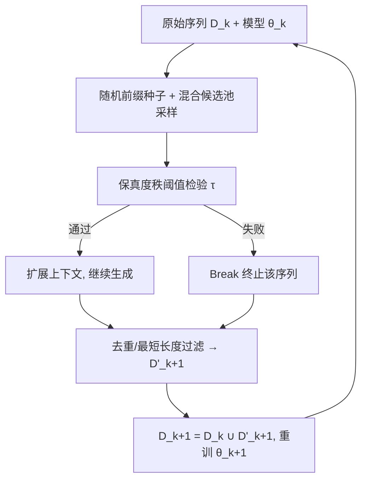
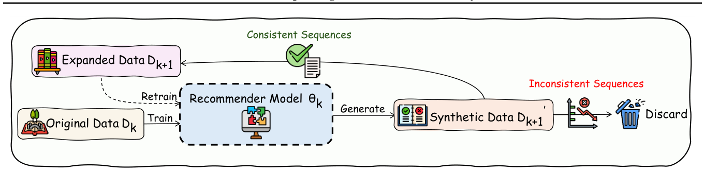

# Can Recommender Systems Teach Themselves? A Recursive Self-Improving Framework with Fidelity Control (推荐系统能否自我教学？带保真度控制的递归自我改进框架)

- **会议/期刊**: ICML 2026
- **作者与机构**: Luankang Zhang, Hao Wang, Zhongzhou Liu, Mingjia Yin, Yonghao Huang, Jiaqi Li, Wei Guo, Yong Liu, Huifeng Guo, Defu Lian, Enhong Chen（中国科学技术大学 & 认知智能全国重点实验室；华为）
- **推荐链路定位**: 端到端生成式（序列推荐训练数据自生成）
- **研究方向**: 自监督对比学习与交互去噪 / 序列与会话推荐
- **论文原文**: [https://arxiv.org/abs/2602.15659v2](https://arxiv.org/abs/2602.15659v2)
- **开源代码**: [https://github.com/USTC-StarTeam/RSIR](https://github.com/USTC-StarTeam/RSIR)

## TL;DR (1分钟核心速览)

针对序列推荐极端稀疏导致优化地形崎岖、泛化差的痛点，本文提出 RSIR：当前模型自回归生成合成交互序列，经"混合候选池有界探索 + 保真度秩阈值质检"过滤后并入训练集，再训练后继模型，形成闭环。理论证明该过程等价于沿用户偏好流形切向的隐式正则（平滑损失地形）。在 4 个 Amazon/Yelp 数据集、3 种骨干（SASRec/CL4SRec/HSTU）的 Leave-One-Out Full-Ranking 协议下，单轮即带来 1.5%–11% 的 NDCG@10 相对提升，三轮累计 Recall@10 提升达 13.92%。

## Background & Motivation (背景与核心矛盾)

- **主流范式**: 缓解稀疏的两条路线——模型侧（Transformer/生成式序列建模）与数据侧（启发式增广如 Reordering/Insertion、可学习生成如 ASReP/DiffuASR/DR4SR，或引入 LLM 等外部教师）。
- **前人局限**: ① 启发式增广（掩码、裁剪、重排）只是既有数据的"另一种视图"，无法生成新的高保真交互序列来稠密化用户轨迹；② 外部教师/精选元数据成本高、领域绑定，且与真实用户行为存在分布错配。
- **核心洞察 (Key Insight)**: 即便在稀疏数据上训练的模型，也已蕴含对用户偏好的"雏形理解"；若能用它自生成数据并严格约束保真度，就能实现"更强模型→更好数据→更强模型"的正向循环，而无需任何外部依赖。
- **本文切入点**: 用"有界探索 + 保真度质检"把无约束自生成（会因误差放大而崩溃）改造为可控的递归正则化过程。

## Method (核心方法设计)

### 1. 整体框架 (Overall Architecture)

RSIR 在 $K$轮迭代中维护模型轨迹$\theta_0,\dots,\theta_K$与数据集轨迹$\mathcal{D}_0,\dots,\mathcal{D}_K$。第$k$轮：先在$\mathcal{D}_k$上训练$f_{\theta_k}$（标准 next-item 极大似然）；再以$f_{\theta_k}$为生成器，对每条真实序列用随机前缀$S_{\text{ctx}}$做自回归扩展，每步从混合候选池采样并经保真度检验，失败即 Break 终止；通过检验的序列去重、过滤最短长度后并入$\mathcal{D}_{k+1}=\mathcal{D}_k\cup\mathcal{D}'_{k+1}$；最后从随机初始化重训（RSIR）或微调（RSIR-FT）得到$\theta_{k+1}$。生成阶段与训练解耦，可离线执行。

<figure class="paper-figure" markdown="span">
  <figcaption>图1. 递归自我改进推荐（RSIR）框架概览。</figcaption>
</figure>

### 2. 关键设计拆解 (Key Designs)

1. **混合候选池的有界探索 (Bounded Exploration)**：纯贪心生成会退化为对已交互物品的复读，纯全局采样又会漂移到无关区域。本文在每步构造候选池 $C_t\sim p\,\text{Sample}(s_u)+(1-p)\,\text{Sample}(\mathcal{I})$，仅在$C_t$内取 top-$k$后采样下一物品。$p$控制"利用"（重组历史物品、挖掘高阶序列模式）与"探索"（向全局物品集谨慎外推）的平衡，实验最优$p\approx 0.5$。

2. **保真度质量控制 (Fidelity-Based Quality Control)**：这是防止闭环误差放大的核心闸门。生成候选 $i_{\text{gen},t}$后临时更新上下文$S'_{\text{ctx}}$，令$S_{\text{tgt}}=s_u\setminus S'_{\text{ctx}}$ 为真实序列中尚未被覆盖的剩余物品，仅当
$$\exists\, i_j\in S_{\text{tgt}},\ \text{Rank}_{f_{\theta_k}}(i_j\mid S'_{\text{ctx}})\le\tau$$
才接受该步，否则立即终止整条序列。直觉：若模型在加入合成步后仍能把真实后续物品排进 top-$\tau$，说明该步未偏离用户偏好流形；反之说明已开始"幻觉"，必须截断。$\tau$过小（如 1）会扼杀多样性，过大（$\to\infty$）则放行噪声，实验最优$\tau\in[5,20]$。

3. **训练目标、负采样与推理效率**：总目标为复合损失 $\theta_{k+1}=\arg\min_\theta\left[\mathcal{L}_k(\theta)+\lambda\mathcal{L}_{\text{gen}}(\theta)\right]$，其中$\mathcal{L}_{\text{gen}}$ 为合成集上的平均损失。理论分析（附录 E.1）表明其等价于流形切向梯度惩罚
$$\Omega(\theta)\propto\|\nabla_{\mathcal{M}}f_\theta\|^2=\|\mathbf{P}_{\mathcal{M}}\nabla_s f_\theta\|^2,$$
即只沿有效偏好轨迹方向平滑，而非盲目压制所有参数更新。误差界（式 7）给出 $E(\theta_{k+1})\le(1-\lambda)E_0+\lambda[(1-\tilde{p}_k)\rho E(\theta_k)+\tilde{p}_k E_{\max}]$，存在保真泄漏率$\tilde{p}_k$ 的"崩溃点"与不可约噪声地板，解释了后期性能饱和。训练沿用各骨干原生负采样（如 SASRec 的逐样本负采样），无额外负采样设计；推理阶段与基座模型完全一致，无任何额外开销。

## Experimental Setup & Evaluation Protocol (实验设置与评估协议)

- **数据集与预处理**: 四个公开基准，均经 `5-core` 过滤：

| 数据集 | #Users | #Items | #Interactions | 稀疏度 | 特征/场景说明 |
| :--- | :---: | :---: | :---: | :---: | :--- |
| amazon-toys | 19,412 | 11,876 | 106,254 | 0.999539 | 平均长度 5.47 |
| amazon-beauty | 22,363 | 12,066 | 127,598 | 0.999527 | 平均长度 5.71 |
| amazon-sport | 35,598 | 18,281 | 187,694 | 0.999712 | 平均长度 5.27 |
| yelp | 30,431 | 20,014 | 216,733 | 0.999644 | 平均长度 7.12 |

- **数据划分与防穿越 (Splitting Strategy)**: `Leave-One-Out`——最后一项作测试、倒数第二项作验证，其余为训练。
- **排名评测协议 (Ranking Protocol)**: 无偏 `Full-Ranking`（对全库未交互物品排序），报告 NDCG@{10,20} 与 Recall@{10,20}，显著性 $p<0.05$。
- **对比基线与超参设置**: 骨干为 SASRec、CL4SRec、HSTU；对比 2 种启发式增广（Reordering、Insertion）与 3 种可学习生成（ASReP、DiffuASR、DR4SR）。网格搜索 $\tau\in\{1,3,5,10,20,50,100\}$、$m\in\{5,10,20\}$、$p\in\{0,0.2,\dots,1.0\}$；最多 1000 epoch、早停 patience 20；基于 RecStudio 实现，单卡训练。

## Key Experimental Results (实验关键数据)

### 1. 主实验对比 (Main Results)

单轮 RSIR 在三个骨干上的 NDCG@10 / Recall@10（节选，加粗为最优）：

| 骨干 / 方法 | toys N@10 | toys R@10 | beauty N@10 | beauty R@10 | sport N@10 | sport R@10 | yelp N@10 | yelp R@10 |
| :--- | :---: | :---: | :---: | :---: | :---: | :---: | :---: | :---: |
| SASRec Base | 0.0477 | 0.0795 | 0.0290 | 0.0548 | 0.0271 | 0.0474 | 0.0183 | 0.0371 |
| +DR4SR（最强基线） | 0.0499 | 0.0830 | 0.0300 | 0.0557 | 0.0286 | 0.0495 | 0.0191 | 0.0378 |
| +RSIR-FT | 0.0507 | 0.0860 | **0.0322** | **0.0594** | 0.0290 | 0.0500 | **0.0200** | 0.0393 |
| +RSIR | **0.0508** | **0.0872** | 0.0303 | 0.0578 | **0.0293** | **0.0512** | **0.0200** | **0.0399** |
| Improv. | 1.80% | 4.56% | 7.33% | 6.64% | 2.45% | 3.43% | 4.71% | 5.28% |
| CL4SRec Base | 0.0519 | 0.0870 | 0.0307 | 0.0579 | 0.0284 | 0.0491 | 0.0205 | 0.0392 |
| +DR4SR | 0.0535 | 0.0887 | 0.0310 | 0.0590 | 0.0289 | 0.0500 | 0.0213 | 0.0416 |
| +RSIR | **0.0543** | **0.0927** | **0.0318** | **0.0596** | **0.0297** | **0.0517** | **0.0224** | **0.0441** |
| Improv. | 1.50% | 4.51% | 10.97% | 10.00% | 4.15% | 4.60% | 5.16% | 6.01% |
| HSTU Base | 0.0512 | 0.0869 | 0.0302 | 0.0568 | 0.0285 | 0.0492 | 0.0192 | 0.0373 |
| +DR4SR | 0.0507 | 0.0867 | 0.0304 | 0.0567 | 0.0294 | 0.0515 | 0.0196 | 0.0384 |
| +RSIR | **0.0544** | **0.0924** | **0.0324** | **0.0596** | **0.0305** | **0.0531** | **0.0209** | **0.0411** |
| Improv. | 6.25% | 6.08% | 4.52% | 3.63% | 3.74% | 3.11% | 5.56% | 6.48% |

### 2. 消融实验 (Ablation Study)

Amazon-Sport 上移除保真度质检（`w/o`，即全部接受生成项）随迭代的性能变化：

| 设置 | NDCG@10 | Recall@10 |
| :--- | :---: | :---: |
| SASRec Base | 0.0271 | 0.0474 |
| RSIR-1th w/o | 0.0273 | 0.0472 |
| RSIR-1th w/ | **0.0293** | **0.0512** |
| RSIR-2th w/o | 0.0209 | 0.0384 |
| RSIR-2th w/ | **0.0294** | **0.0517** |
| RSIR-3th w/o | 0.0119 | 0.0210 |
| RSIR-3th w/ | **0.0298** | **0.0528** |

### 3. 关键实验发现 (Key Findings)

1. **质检是"生死线"而非"锦上添花"**：无质检时第 1 轮仅 +0.7% NDCG，第 2 轮即跌至 0.0209（低于 Base），第 3 轮崩到 0.0119（较 Base 腰斩）；有质检则三轮单调升至 0.0298。这直接验证了理论中"保真泄漏率超过崩溃点即误差放大"的论断。
2. **增益可累积但会饱和**：HSTU 在 Sport 上 Recall@10 从单轮 +8.02% 扩至三轮 +13.92%；但第 4–8 轮出现 ±1%–4% 的波动回落，与式 (7) 的"不可约噪声地板"预测一致——后期收缩收益递减而噪声惩罚持续存在。
3. **弱模型可教强模型，且与外部知识正交**：热力图显示最弱教师仍能给强学生带来 +1.95% 提升，说明收益主要来自递归正则化过程本身而非教师容量；在 Semantic ID 模型上叠加 RSIR 仍再涨 Recall@20 4.89%，证明其与内容侧知识增强互补而非冗余。

## Highlights & Limitations (亮点、对比与审稿批判)

- **与代表作对比 (vs. Prior Work)**: 相比 DR4SR/ASReP/DiffuASR 等"另训一个生成器"的数据再生方法，RSIR 直接用推荐模型自身作生成器，生成耗时 3m46s vs DR4SR 的 68m49s（约 18× 加速）；相比 STaR/REST 等 LLM 自改进范式，本文首次将其引入推荐并给出流形切向正则的几何解释与误差收敛界。
- **可迁移亮点**: ① "秩阈值保真检验 + 失败即 Break"是一个极轻量的在线数据质检算子，可直接移植到任何自生成/蒸馏式数据增广流水线；② 用弱模型离线生成课程、训练大模型的两阶段范式，对工业降本有直接参考价值。
- **审稿级局限批判**: ① 保真检验每步需对全库打分，虽给出 ANN/聚类近似方案（RSIR-Cluster 在 Sport 上 NDCG 从 0.0293 降至 0.0283），但近似带来的精度损失与大规模部署的稳定性尚未充分验证；② 迭代 4 轮后性能饱和甚至回落，缺乏自适应停止或动态调节 $\tau,p$的策略，超参$\tau$ 在数据集间敏感（最优值在 5–20 间漂移）。

## Rating (四维评分)

- **方法创新性 (Novelty)**: ⭐⭐⭐⭐ （首次将递归自改进引入推荐，并给出流形切向梯度惩罚的几何刻画与误差收缩界，理论支撑扎实）
- **评估协议与实验扎实度 (Protocol & Experiments)**: ⭐⭐⭐⭐ （4 数据集 × 3 骨干 × 5 基线，Full-Ranking + $p<0.05$，消融与 8 轮迭代曲线完整；略欠线上 A/B 与更大规模验证）
- **写作与数学规范度 (Clarity & Rigor)**: ⭐⭐⭐⭐ （生成算法伪代码、复杂度推导与误差界推导齐备，符号统一；部分附录推导依赖较强假设）
- **工业落地与复现价值 (Industrial & Practical Value)**: ⭐⭐⭐⭐ （代码开源，生成阶段可离线且比 DR4SR 快约 18×，重训耗时与基座持平；全库质检的打分开销仍是规模化瓶颈）
