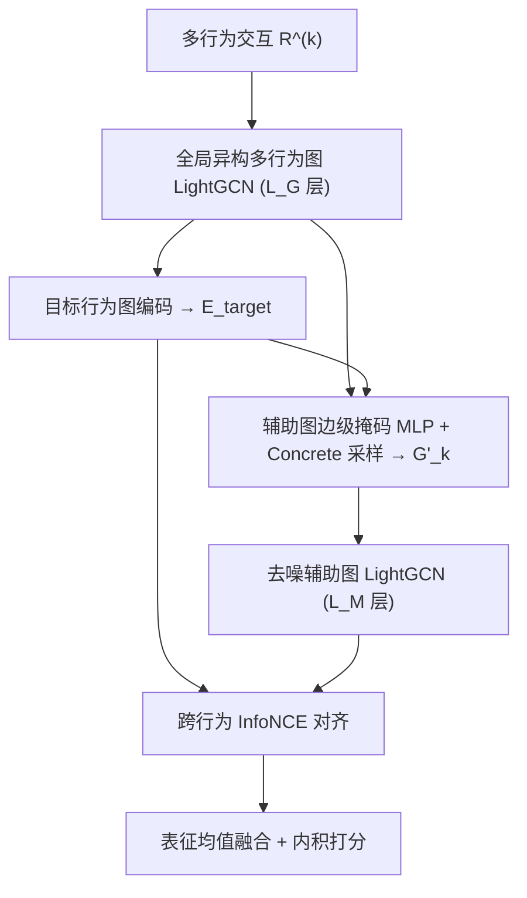
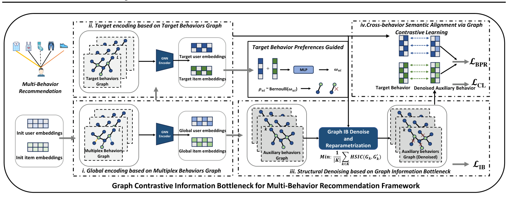

# GCIB: Graph Contrastive Information Bottleneck for Multi-Behavior Recommendation (图对比信息瓶颈多行为推荐)

- **会议/期刊**: ICML 2026 (PMLR 306)
- **作者与机构**: Likang Wu, Zihao Chen, Jianxin Zhang, Sangqi Zhu, Yuanyuan Ge, Haipeng Yang, Lei Zhang（天津大学、安徽大学）
- **推荐链路定位**: 召回（多行为图协同过滤表征学习）
- **研究方向**: 自监督对比学习与交互去噪 / 图神经网络推荐
- **论文原文**: [https://arxiv.org/abs/2605.25690v1](https://arxiv.org/abs/2605.25690v1)
- **开源代码**: [https://github.com/akajinchen/GCIB](https://github.com/akajinchen/GCIB)

## TL;DR (1分钟核心速览)

多行为推荐中辅助行为图（点击、加购、收藏）含大量与目标行为（购买）无关的噪声边，且目标行为监督极稀疏。GCIB 提出"结构+特征"双层去噪：结构层用图信息瓶颈（GIB）目标 $\max I(R;G'_k)-\beta I(G'_k;G_k)$，以目标行为偏好引导边级伯努利保留掩码、用 HSIC 替代难估的互信息压缩项；特征层把去噪辅助表征与目标表征作为互补视图做跨行为 InfoNCE 对齐。在 Tmall/Taobao/Yelp/ML-10M 四个数据集、Leave-One-Out 全库排序协议下，NDCG@10 相对最优基线提升 9.4%–37.2%，Yelp 稀疏场景 HR@10 提升达 40.5%。

## Background & Motivation (背景与核心矛盾)

- **主流范式**: 为不同行为建独立二部图，用 GNN（LightGCN 类）逐行为传播后加权/注意力融合，代表作为 MBGCN、CRGCN、MB-CGCN、S-MBRec、BCIPM。
- **前人局限一（噪声无差别传播）**: 现有方法把全部辅助行为不加区分地送入消息传递，任务无关边在表征学习前就已污染嵌入；已有 IB 类方法（GBSR、IBMRec、HGIB）多在**表征层**压缩冗余，而非在**图传播前**决定哪些辅助边该保留。
- **前人局限二（监督信号稀缺）**: 目标行为交互极少，仅靠 BPR 难以学到鲁棒表征；级联式模型（CRGCN/MB-CGCN）还易出现负迁移。
- **核心洞察 (Key Insight)**: 作者在 Tmall 上做三组对照（图 1）：仅辅助图 `-a` 最差、仅目标图 `-t` 中等、全图 `-m` 最好但增益边际——说明辅助图确有噪声、目标图确有稀疏瓶颈，"如何有效去噪并利用辅助行为"才是关键。
- **本文切入点**: 把信息瓶颈直接作用在**辅助图结构**上（边级掩码），再叠加跨行为对比学习补足语义，形成结构-语义协同去噪。

## Method (核心方法设计)

### 1. 整体框架 (Overall Architecture)

输入为 $K$类行为交互矩阵$\{R^{(k)}\}$。先构建全局异构多行为图$G_{global}=\bigcup_k E_k$，用 LightGCN 得到共享初始化$E^{global}$（全局编码层$L_G$）；再在目标行为图上传播得到目标表征$E^{target}$，并以其用户/物品向量作为"目标偏好信号"去监督辅助图$G_k$的边级保留概率，经 Concrete 松弛采样得到去噪图$G'_k$；去噪图与目标图分别经 LightGCN（$L_M$ 层）编码，两侧表征做跨行为 InfoNCE 对齐；最终将目标域与去噪辅助域表征取均值融合，内积打分。训练为 BPR + HSIC 瓶颈正则 + InfoNCE 的多任务联合优化。

<figure class="paper-figure" markdown="span">
  <figcaption>图3. 所提出的GCIB模型的整体结构</figcaption>
</figure>

### 2. 关键设计拆解 (Key Designs)

1. **目标偏好引导的图信息瓶颈结构去噪**：痛点是无标签指导"哪些辅助边该删"。作者把去噪建模为边丢弃 $G'_k=\{V,\{e_{\langle u_a,i_b\rangle}\odot\rho_{ab}\}\}$，保留概率由目标域表征经单层 MLP 给出$w_{ab}=f([e_a;e_b])$，$\rho_{ab}\sim\mathrm{Bernoulli}(w_{ab})$，并用 Concrete 松弛$\mathrm{sigmoid}((\log\frac{\delta}{1-\delta}+w_{ab})/t)$ 使离散采样可微。直觉：与目标购买偏好一致的辅助边（如"加购后购买"）被保留，纯浏览噪声被剪掉，且剪枝发生在消息传递**之前**。

2. **HSIC 替代互信息压缩项**：$I(G'_k;G_k)$的上界估计依赖强先验假设，作者改用核方法 HSIC 作为可微代理，在批采样节点上计算$\hat{\mathrm{HSIC}}(E'^B_k,E^B_k)=(n-1)^{-2}\mathrm{Tr}(K_{G'}HK_GH)$（RBF 核，$\sigma=0.25$），得到$\mathcal{L}_{IB}=\frac{1}{|K|}\sum_k\hat{\mathrm{HSIC}}(E'^B_k,E^B_k)$。直觉：迫使去噪图与原图在核空间中统计独立，即"只保留最小充分子结构"，避免退化为恒等映射。

3. **跨行为对比对齐与总损失**：去噪辅助表征 $z^{aux}_u$与目标表征$z^{tgt}_u$构成同一用户的正视图对，$\mathcal{L}^u_{CL}=-\log\frac{\exp(s(z^{tgt}_u,z^{aux}_u)/\tau)}{\sum_{u'\in\mathcal{N}^-_u\cup u}\exp(s(z^{tgt}_u,z^{aux}_{u'})/\tau)}$，物品侧对称，$\mathcal{L}_{CL}=\frac{1}{2}(\mathcal{L}^u_{CL}+\mathcal{L}^i_{CL})$。总目标$\mathcal{L}=\mathcal{L}_{BPR}+\beta\mathcal{L}_{IB}+\lambda\mathcal{L}_{CL}+\gamma\|\Theta\|_2^2$。负采样为 batch 内负样本（InfoNCE 标准做法），BPR 用均匀负采样；推理仅需前向传播，单 epoch 训练 27.8–37.9s，远低于 BCIPM 的 407–913s。

## Experimental Setup & Evaluation Protocol (实验设置与评估协议)

- **数据集与预处理**:

| 数据集 | #Users | #Items | #Interactions | 行为类型 | 场景说明 |
| :--- | :---: | :---: | :---: | :---: | :--- |
| Tmall | 41,738 | 11,953 | 2.3×10⁶ | click/collect/cart/purchase | 电商，purchase 为目标 |
| Taobao | 48,749 | 39,493 | 2.0×10⁶ | click/cart/purchase | 电商，purchase 为目标 |
| Yelp | 19,800 | 22,734 | 1.4×10⁶ | tips/dislike/neutral/like | 点评，like 为目标 |
| ML-10M | 67,788 | 8,704 | 9.9×10⁶ | dislike/neutral/like | 电影评分，like 为目标 |

- **数据划分与防穿越**: 全部采用 `Leave-One-Out` 协议（每个用户最后一次目标行为作测试、倒数第二次作验证）。
- **排名评测协议**: 无偏 `Full-Ranking`（全库未交互物品排序），指标 HR@10/20、NDCG@10/20。
- **对比基线与超参**: 单行为 MF-BPR、LightGCN；多行为 R-GCN、NMTR、MBGCN、S-MBRec、CRGCN、MB-CGCN、PKEF、BCIPM、NSED、MBLFE。嵌入维度 $d=64$，Adam 学习率 0.001，batch 1024（ML-10M 为 4096），$L_G,L_M\in\{1,2,3,4\}$，$\beta\in[1,100]$，$\lambda\in[0.01,0.5]$，InfoNCE 温度 0.05/0.15/0.2（Tmall/Taobao/Yelp、ML-10M）。

## Key Experimental Results (实验关键数据)

### 1. 主实验对比 (Main Results)

| Model | Tmall HR@10 | Tmall NDCG@10 | Taobao HR@10 | Taobao NDCG@10 | Yelp HR@10 | Yelp NDCG@10 | ML-10M HR@10 | ML-10M NDCG@10 |
| :--- | :---: | :---: | :---: | :---: | :---: | :---: | :---: | :---: |
| LightGCN | 0.0383 | 0.0206 | 0.0261 | 0.0141 | 0.0393 | 0.0200 | 0.0669 | 0.0321 |
| MBGCN | 0.0540 | 0.0277 | 0.0438 | 0.0266 | 0.0349 | 0.0185 | 0.0482 | 0.0233 |
| S-MBRec | 0.0708 | 0.0371 | 0.0572 | 0.0331 | 0.0351 | 0.0173 | 0.0331 | 0.0163 |
| CRGCN | 0.0837 | 0.0432 | 0.1126 | 0.0620 | 0.0370 | 0.0179 | 0.0504 | 0.0243 |
| PKEF | 0.1100 | 0.0644 | 0.1086 | 0.0610 | 0.0426 | 0.0213 | 0.0583 | 0.0265 |
| BCIPM | 0.1445 | 0.0831 | 0.1428 | 0.0817 | 0.0502 | 0.0244 | 0.0810 | 0.0392 |
| NSED | 0.1502 | 0.0810 | 0.1416 | 0.1004 | 0.0355 | 0.0146 | 0.0377 | 0.0162 |
| MBLFE | 0.1291 | 0.0696 | 0.1577 | 0.0907 | 0.0531 | 0.0261 | 0.0659 | 0.0310 |
| **GCIB (Ours)** | **0.1617** | **0.0944** | **0.1815** | **0.1199** | **0.0746** | **0.0358** | **0.0916** | **0.0429** |
| **Improv.%** | +7.66% | +13.60% | +15.09% | +19.42% | +40.49% | +37.16% | +13.09% | +9.44% |

HR@20/NDCG@20 趋势一致：GCIB 在 Yelp 上 HR@20 达 0.1180（+31.70%）、NDCG@20 达 0.0468（+24.14%），Taobao NDCG@20 提升 23.55%。

### 2. 消融实验 (Ablation Study)

| 变体 | Tmall HR@10 | Tmall NDCG@10 | Taobao HR@10 | Taobao NDCG@10 | Yelp HR@10 | Yelp NDCG@10 |
| :--- | :---: | :---: | :---: | :---: | :---: | :---: |
| -Global（去全局编码） | 0.1101 | 0.0669 | 0.1666 | 0.1118 | 0.0698 | 0.0351 |
| -IB（去结构去噪） | 0.1089 | 0.0618 | 0.1724 | 0.1138 | 0.0700 | 0.0348 |
| -InfoNCE（去对比对齐） | 0.1523 | 0.0906 | 0.1661 | 0.1080 | 0.0641 | 0.0317 |
| -Both（两者皆去） | 0.0356 | 0.0190 | 0.0352 | 0.0202 | 0.0522 | 0.0262 |
| **GCIB** | **0.1617** | **0.0944** | **0.1815** | **0.1199** | **0.0746** | **0.0358** |

### 3. 关键实验发现 (Key Findings)

1. **结构去噪与语义对齐缺一不可且强互补**：单独去掉 IB 或 InfoNCE 仅损失 2%–14%，但两者同时去掉（-Both）在 Tmall 上 HR@10 从 0.1617 崩至 0.0356（-78%），说明"先剪枝再对齐"的串联设计是性能支柱，而非两个可独立生效的增益项。
2. **去噪是行为感知的选择性剪枝而非均匀稀疏化**：Tmall 上 cart 视图保留 70.94% 边、click 视图仅保留 60.42%，越稠密/越泛化的辅助行为被剪得越狠；Yelp 注入 20% 合成假交互后 GCIB 的 HR@10 仅变化 -3.62%（NDCG@10 反升 +3.91%），而 MBLFE 与 HGIB 分别下降 19.21% 与 11.36%，直接证明掩码确实在过滤任务无关边。
3. **稀疏场景收益最大、稠密场景收益收敛**：Yelp（最稀疏、辅助行为语义最弱）提升 40.5%，而 ML-10M（9.9×10⁶ 交互、最稠密）仅提升 9.4%——瓶颈机制的价值与目标监督稀缺度正相关；同时 GCIB 单 epoch 训练 27.8–37.9s，比 BCIPM 快一个数量级，GPU 显存 2.3–5.2GB 处于可用区间。

## Highlights & Limitations (亮点、对比与审稿批判)

- **与代表作对比 (vs. Prior Work)**: 相比 BCIPM（行为上下文建模 + 预训练去噪）与 MBLFE（门控专家 + 自监督因子解耦），GCIB 的关键差异是把 IB 从**表征层压缩**前移到**图结构层边掩码**，噪声在传播前即被拦截；相比同期的 HGIB（分层 GIB 处理分布差异与负迁移），GCIB 额外引入跨行为 InfoNCE 显式补足目标侧稀疏监督，二者在 Yelp 噪声注入实验中的鲁棒性差距（-3.62% vs -11.36%）即为佐证。
- **可迁移亮点**: (1) 用目标域表征经轻量 MLP 生成辅助图边保留概率、再以 Concrete 松弛端到端训练，可零成本迁移到社交推荐/跨域推荐的噪声边过滤；(2) 用 HSIC 替代难估的互信息上界作为压缩正则，是任何"图结构可学习掩码"场景的即插即用替代方案。
- **审稿级局限批判**: (1) 超参 $\beta$的数据集依赖性极强（Tmall 最优 80、Taobao 40、Yelp 仅 1，跨两个数量级），缺乏自适应设定机制，实际部署需逐场景网格搜索；(2) 去噪掩码依赖目标行为表征引导，在**目标行为极端冷启动**（几乎无购买记录）的用户上，$w_{ab}$ 的监督信号本身不可靠，论文未做该分桶实验；(3) 仅在四个公开数据集上以 Leave-One-Out 单正样本协议评测，缺少采样排序协议与线上 A/B 验证。

## Rating (四维评分)

- **方法创新性 (Novelty)**: ⭐⭐⭐⭐ （把 GIB 从表征压缩推进到传播前的边级结构掩码，并以 HSIC 绕开互信息上界估计，思路清晰且有信息论支撑）
- **评估协议与实验扎实度 (Protocol & Experiments)**: ⭐⭐⭐⭐ （四数据集 + 10 个基线 + 完整消融 + 噪声注入鲁棒性 + 层级/超参分析，但仅 Leave-One-Out 单一协议、缺冷启动分桶）
- **写作与数学规范度 (Clarity & Rigor)**: ⭐⭐⭐⭐ （IB 目标、Concrete 松弛、HSIC 估计链条完整，复杂度分析到位；但 $\beta$ 跨数据集差两个数量级未给解释性分析）
- **工业落地与复现价值 (Industrial & Practical Value)**: ⭐⭐⭐⭐ （代码已开源，训练比 BCIPM 快约 15 倍、显存可控，边掩码模块为稀疏矩阵线性开销，工程友好）

