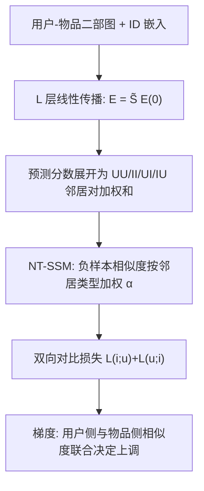

# Rethinking Contrastive Learning for Graph Collaborative Filtering: Limitations and a Simple Remedy (重思图协同过滤中的对比学习：局限与一个简单补救)

- **会议/期刊**: ICML 2026
- **作者与机构**: Geon Lee, Sunwoo Kim, Kyungho Kim, Kijung Shin (KAIST)
- **推荐链路定位**: 召回（GCF 表征学习与训练目标）
- **研究方向**: 自监督对比学习与交互去噪 / 图神经网络推荐
- **论文原文**: [https://arxiv.org/abs/2605.24015v1](https://arxiv.org/abs/2605.24015v1)
- **开源代码**: [https://github.com/geon0325/NT-SSM](https://github.com/geon0325/NT-SSM)

## TL;DR (1分钟核心速览)

本文针对图协同过滤（GCF）中对比学习目标 SSM 与预测机制脱节的问题：作者将 LightGCN 的预测分数展开为多跳邻居对的可学习权重聚合，发现有效推荐只需**选择性地上调与目标用户/物品结构相似的那一小撮邻居对**，且不同邻居对类型（UU/II/UI/IU）的最优上调强度各异。据此指出 SSM 的两大缺陷（只看物品侧相似度、对所有类型一视同仁），提出类型感知的 NT-SSM。在 4 个数据集、3 个 GCF 骨干上，NDCG@20 相对 SSM 最高提升 21.45%（MovieLens/LightGCN），且不引入额外可学习参数。

## Background & Motivation (背景与核心矛盾)

- **主流范式**: LightGCN 类 GCF 以线性消息传递学习 ID 表征，近年普遍用 SSM（Sampled Softmax，InfoNCE 的多样本负例推广）替代 BPR 作为主训练目标。
- **前人局限**: 既有分析多停留在表征几何层面（alignment / uniformity），无法解释 CL 如何与 GCF 的**预测机制**交互；而 GCF 的预测分数实际由海量多跳邻居对的内积加权求和得到（图 1 显示 Amazon-Book 三跳邻居对达十亿量级），绝大多数邻居对是无关噪声。
- **核心洞察 (Key Insight)**: 作者用启发式共现分数（式 4）做探针实验，发现仅保留 0.01% 用户邻居 + 0.1% 物品邻居即可在 MovieLens 上带来 35.17% NDCG@20 提升（图 2）；且 UU/II/UI/IU 四类邻居对的最优保留率与性能曲线截然不同（图 3），说明"选择性 + 类型感知"上调才是理想学习动力学。
- **本文切入点**: 把 CL 目标重新理解为"邻居对权重的更新动力学"，据此诊断 SSM 并做最小化修补。

## Method (核心方法设计)

### 1. 整体框架 (Overall Architecture)

模型不改动 GCF 骨干的前向传播与推理，只替换训练损失。首先将 LightGCN 的 $L$层传播写成$\mathbf{E}=\tilde{\mathbf{S}}\mathbf{E}^{(0)}$，其中$\tilde{\mathbf{S}}=\frac{1}{L+1}\sum_{\ell}\tilde{\mathbf{A}}^{\ell}$为无参数结构相似度矩阵；由此把预测分数展开为四类邻居对贡献之和，再在负样本相似度上按邻居类型施加系数$\alpha$，构造双向对比损失。训练时对正样本走原始相似度、对负样本走类型加权相似度，梯度分析证明该设计恰好实现"用户侧+物品侧联合、类型自适应"的邻居对上调。

### 2. 关键设计拆解 (Key Designs)

1. **预测机制展开与四类分解**：痛点是把 GCF 当黑盒、只谈表征几何。作者代入 $\mathbf{E}=\tilde{\mathbf{S}}\mathbf{E}^{(0)}$ 得
$\hat{r}_{ui}=\sum_{v\in\tilde{\mathcal{N}}_u}\sum_{v'\in\tilde{\mathcal{N}}_i}\tilde{S}_{uv}\tilde{S}_{iv'}(\mathbf{e}_v^{(0)\top}\mathbf{e}_{v'}^{(0)})$，
并按邻居类型拆成 $\hat{r}_{ui}=\hat{r}^{(U,U)}_{ui}+\hat{r}^{(I,I)}_{ui}+\hat{r}^{(U,I)}_{ui}+\hat{r}^{(I,U)}_{ui}$。直觉：GCF 的学习本质是决定哪些邻居对权重被上调，而非直接比较$u$与$i$ 的嵌入。

2. **SSM 梯度诊断**：对邻居对权重求导得
$\frac{\partial\mathcal{L}(i;u)}{\partial(\mathbf{e}_v^{(0)\top}\mathbf{e}_{v'}^{(0)})}=\frac{\tilde{S}_{uv}}{\tau}\big(\mathbb{E}_{x\sim\pi_u}[\tilde{S}_{xv'}]-\tilde{S}_{iv'}\big)$。
符号只由物品侧邻居 $v'$与$i$ 的结构相似度决定——这解释了 SSM 为何"部分正确"（确实在上调物品侧相似邻居对），但也暴露两大局限：**用户侧相似度完全缺席**；**四类邻居对共用同一判据**。

3. **NT-SSM 与训练目标**：将负样本相似度按类型重加权 $\tilde{s}(u,j)=\alpha_I^{(U)}s_I^{(U)}(u,j)+\alpha_I^{(I)}s_I^{(I)}(u,j)$，并做双向对称损失$\mathcal{L}(u,i)=\tilde{\mathcal{L}}(i;u)+\tilde{\mathcal{L}}(u;i)$。其梯度为
$\frac{\partial\mathcal{L}}{\partial(\mathbf{e}_v^{(0)\top}\mathbf{e}_{v'}^{(0)})}=\frac{\Pi_u\tilde{S}_{uv}}{\tau}\big(\alpha_I^{(t_{v'})}\mathbb{E}_{j\sim\hat{\pi}_u}[\tilde{S}_{jv'}]-\tilde{S}_{iv'}\big)+\frac{\Pi_i\tilde{S}_{iv'}}{\tau}\big(\alpha_U^{(t_v)}\mathbb{E}_{k\sim\hat{\pi}_i}[\tilde{S}_{kv}]-\tilde{S}_{uv}\big)$。
$\alpha<1$放宽判据、纳入潜在有用噪声对；$\alpha>1$收紧判据、只保留高相似对。负采样沿用 SSM 的采样负例（非全库），无额外可学习参数，推理零开销；训练每 epoch 复杂度$O(|\mathcal{E}|(|B_u|+|B_i|)d)$，与 SSM 同阶仅常数变大。BPR 亦可同法推广为 NT-BPR。

## Experimental Setup & Evaluation Protocol (实验设置与评估协议)

- **数据集与预处理**: 4 个公开数据集，统计如下（原文 Table 4）：

| 数据集 | #Users | #Items | #Interactions | 密度 | 场景说明 |
| :--- | :---: | :---: | :---: | :---: | :--- |
| LastFM | 1,885 | 17,388 | 91,779 | 0.002800 | 社交音乐收听 |
| MovieLens-1M | 6,039 | 3,628 | 836,478 | 0.038178 | 电影评分 |
| Yelp | 31,668 | 38,048 | 1,561,406 | 0.001295 | 本地商户 |
| Amazon-Book | 52,643 | 91,599 | 2,984,108 | 0.000619 | 图书电商 |

- **数据划分与防穿越**: 按 **7:1:2 比例划分**训练/验证/测试（非 Leave-One-Out，非全局时间戳切分）。
- **排名评测协议**: 采用 **Full-Ranking 全库未交互物品排序**，报告 Recall@20 与 NDCG@20（附录补充 @10/@40），5 次运行取均值与标准差。
- **对比基线与超参设置**: 骨干为 LightGCN、SimGCL、NCL；损失对比 BPR vs NT-BPR、SSM vs NT-SSM。相似度用 cosine（附录 D 给出余弦版梯度），温度 $\tau$沿用 SSM 标准设置，四个类型系数$\alpha_U^{(U)},\alpha_U^{(I)},\alpha_I^{(U)},\alpha_I^{(I)}$在$[0.5,1.5]$ 内用 Optuna 调优（每数据集 100 trials）。

## Key Experimental Results (实验关键数据)

### 1. 主实验对比 (Main Results)

LightGCN 骨干下 NDCG@20（原文 Table 1，加粗为最优）：

| 损失 | LastFM | MovieLens | Yelp | Amazon-Book |
| :--- | :---: | :---: | :---: | :---: |
| BPR | 0.2530 | 0.2953 | 0.0449 | 0.0273 |
| NT-BPR | 0.2654 | 0.3154 | 0.0480 | 0.0301 |
| NT-BPR Improv. | +4.90% | +6.81% | +6.90% | +10.26% |
| SSM | 0.2404 | 0.2648 | 0.0530 | 0.0414 |
| **NT-SSM** | **0.2709** | **0.3216** | **0.0565** | **0.0421** |
| **NT-SSM Improv.** | **+12.69%** | **+21.45%** | **+6.60%** | **+1.69%** |

跨骨干一致性：SimGCL 上 NT-SSM 相对 SSM 提升 +6.40%/+12.38%/+0.36%/+7.58%（LastFM/ML/Yelp/Amazon，NDCG@20）；NCL 上提升 +5.25%/+19.82%/+1.68%/+28.57%。值得注意的是 SSM 在 LightGCN 上甚至弱于 BPR（如 ML：0.2648 vs 0.2953），而 NT-SSM 全面反超 BPR。

### 2. 消融实验 (Ablation Study)

NDCG@20（原文 Table 2，LightGCN 骨干）：

| 变体 | LastFM | MovieLens | Yelp | Amazon |
| :--- | :---: | :---: | :---: | :---: |
| SSM | 0.2404 | 0.2648 | 0.0530 | 0.0414 |
| w/o $\tilde{\mathcal{L}}(i;u)$ | 0.2696 | 0.2885 | 0.0551 | 0.0410 |
| w/o $\tilde{\mathcal{L}}(u;i)$ | 0.2494 | 0.2729 | 0.0559 | 0.0420 |
| w/o $\alpha$（全置 1） | 0.2406 | 0.2677 | 0.0534 | 0.0411 |
| **NT-SSM** | **0.2709** | **0.3216** | **0.0565** | **0.0421** |

### 3. 关键实验发现 (Key Findings)

1. **双向项是主增益来源，且物品→用户方向不可省**：去掉 $\tilde{\mathcal{L}}(u;i)$在 ML 上从 0.3216 掉到 0.2729（−15.1%），远大于去掉$\tilde{\mathcal{L}}(i;u)$的 0.2885，印证"用户侧相似度缺席"是 SSM 的首要瓶颈；有趣的是单留$\tilde{\mathcal{L}}(i;u)$ 在 LastFM 上反而略高于完整模型，说明两方向存在数据集相关的权衡。
2. **类型系数 $\alpha$的收益高度依赖数据分布**：固定$\alpha=1$ 时 ML 仅 0.2677（较完整模型 −16.8%），但在 LastFM 上几乎无差（0.2406 vs 0.2404），与图 5 中"稠密/偏斜数据集更依赖类型自适应、稀疏大数据集偏好统一强过滤"的观察一致。
3. **增益与骨干已有对比信号呈互补而非冗余**：SimGCL/NCL 本身已含图增广对比项，NT-SSM 在其上增益（+0.36%~+12.38%）小于 LightGCN（+1.69%~+21.45%），但在 NCL+Amazon 上仍达 +28.57%，说明邻居对重加权与表征级对比是正交的两个作用面。

## Highlights & Limitations (亮点、对比与审稿批判)

- **与代表作对比 (vs. Prior Work)**: 与 SGL/SimGCL/NCL 等"加增广视图、做表征对齐"的路线不同，本文不碰前向传播、不加视图，只改负样本相似度的加权方式；与 SSM 原论文（Wu et al., TOIS 2024）相比，本文首次给出 SSM 在 GCF 中的闭式梯度并指出其物品侧偏置，NT-SSM 可视为 SSM 的严格推广（$\alpha=1$ 且单向时退化为 SSM）。
- **可迁移亮点**: ①"把预测函数展开成邻居对加权和、再对损失求导看权重更新符号"这套诊断范式，可直接用于分析任意线性传播 GNN 上的其他损失（如 BPR、RankNet）；②类型系数 $\alpha$ 的"放宽/收紧判据"机制可迁移到异构图或多行为图的边类型加权。
- **审稿级局限批判**: ①理论展开依赖 LightGCN 的线性聚合与内积打分，对 MLP scorer 或非线性 GCF 不严格成立（作者自认）；②训练时间开销明显（Amazon-Book 39.91→50.05 s/epoch，+25%），且四个 $\alpha$ 需逐数据集 Optuna 搜索，超参敏感度在表 5 中体现为跨数据集取值差异极大（0.6~1.5），工程调参成本不可忽视；③仅在 4 个中小规模公开集验证，缺少工业级亿级图与线上 A/B 证据。

## Rating (四维评分)

- **方法创新性 (Novelty)**: ⭐⭐⭐⭐ （从预测机制展开反推 CL 梯度动力学的视角新颖，理论推导干净，但本质是对 SSM 的轻量重加权，属"诊断深刻、修补简单"型工作）
- **评估协议与实验扎实度 (Protocol & Experiments)**: ⭐⭐⭐⭐ （4 数据集 × 3 骨干 × 2 损失族的全交叉矩阵 + 5 次运行方差 + 三档 cutoff，Full-Ranking 协议规范；扣分在于无冷启动/长尾分桶与线上验证）
- **写作与数学规范度 (Clarity & Rigor)**: ⭐⭐⭐⭐⭐ （式 1–6 的展开与附录 A/B 的梯度推导完整闭环，符号统一，复杂度分析明确，余弦相似度扩展也给出）
- **工业落地与复现价值 (Industrial & Practical Value)**: ⭐⭐⭐⭐ （推理零开销、无新增参数、代码已开源，仅训练侧 +25% 时间与超参搜索成本；对已用 SSM 的 GCF 系统是低风险替换）

