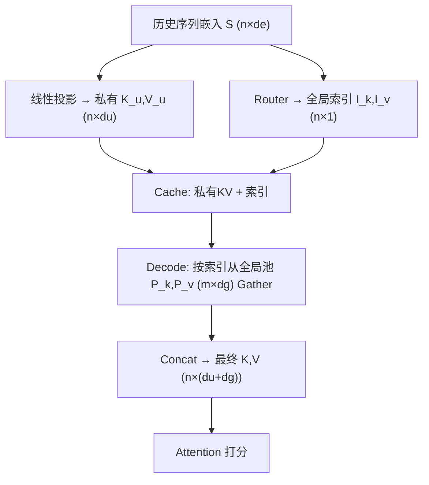
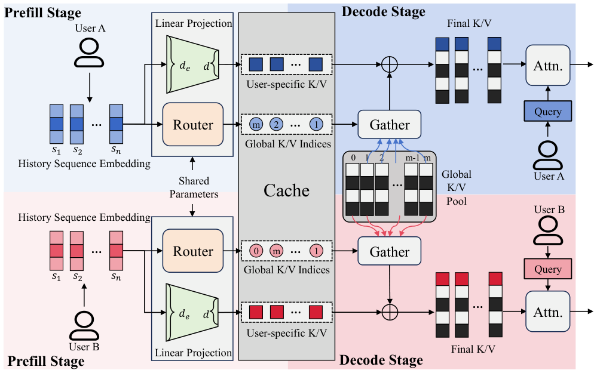

# CollectiveKV: Decoupling and Sharing Collaborative Information in Sequential Recommendation (解耦并共享序列推荐中的协同信息)

- **会议/期刊**: ICLR 2026
- **作者与机构**: Jingyu Li, Zhaocheng Du, Qianhui Zhu, Kaiyuan Li, Zhicheng Zhang, Song-Li Wu, Chaolang Li, Pengwen Dai（中山大学深圳校区、华为诺亚方舟实验室、清华深圳国际研究生院）
- **推荐链路定位**: 精排（长序列 CTR 预估的推理加速）
- **研究方向**: 序列与会话推荐 / 协同过滤
- **论文原文**: [https://arxiv.org/abs/2601.19178v2](https://arxiv.org/abs/2601.19178v2)
- **开源代码**: [https://github.com/reczoo/LongCTR](https://github.com/reczoo/LongCTR)

## TL;DR (1分钟核心速览)

长序列推荐引入 KV cache 降低在线延迟，但按用户存储的 KV 在亿级用户下存储与搬运开销爆炸。本文观察到不同用户的 K/V 存在显著余弦相似性，且 SVD 分析表明主成分 K/V 跨用户高度相关、残差 K/V 近似独立。据此提出 CollectiveKV：用可学习全局 K/V 池 + 路由网络为每个行为项检索高维共享 K/V，再与低维用户私有 K/V 拼接。在 5 个模型 × 3 个数据集上，KV cache 压缩至 **0.8%–4.3%**，AUC/GAUC 普遍不降反升，batch=512 时解码延迟从 32.99ms 降至 0.695ms。

## Background & Motivation (背景与核心矛盾)

- **主流范式**: SIM/SDIM/ETA/TWIN 等 target-attention 与 HSTU 等 self-attention 模型均把历史序列投影为 K/V 并预计算缓存（prefill），在线仅算 Q 与缓存 K/V 的注意力，以规避 $O(s)$ 的重复投影开销。
- **前人局限**: ① LLM 侧的 KV 压缩（Loki/Quest 的 token 剪枝、MLA 的低秩投影）针对**单条序列单次会话**设计，而推荐系统需**按用户常驻**缓存，亿级用户 × 长历史使总量超出 GPU 显存，被迫 offload 到 CPU/外存，搬运延迟成为新瓶颈；② 剪枝类方法丢弃 token 信息，直接迁移到推荐会造成精度损失。
- **核心洞察 (Key Insight)**: 用户行为并非独立，K/V 中天然嵌有协同信号。作者对 1000 个用户的均值 K/V 做余弦相似度 KDE（图 1），分布明显右偏；进一步 SVD 分解为 top-$k$主成分子空间与残差子空间（图 2），主成分 K/V 的跨用户相似度铺满$(-1,1)$，残差 K/V 则紧贴 0——**大部分信息可跨用户共享，仅小部分为用户私有**。
- **本文切入点**: 把 KV 显式解耦为「高维共享 collective KV + 低维私有 user-specific KV」，用 MoE 式全局池承载协同信息，从而把每用户缓存维度从 $d_a$压到$d_u + \log m$ 量级。

## Method (核心方法设计)

### 1. 整体框架 (Overall Architecture)

沿用 prefill/decode 两阶段。Prefill 阶段：历史序列嵌入 $\mathbf{S}\in\mathbb{R}^{n\times d_e}$一路经线性投影得到低维私有$\mathbf{K}_u,\mathbf{V}_u\in\mathbb{R}^{n\times d_u}$，另一路经路由网络输出 item 级全局索引$\mathbf{I}_k,\mathbf{I}_v\in\mathbb{N}^{n\times1}$；缓存中只存私有 K/V 与索引（索引可用$m$的二进制位表示，体积极小）。Decode 阶段：按索引从常驻 GPU 的全局池$\mathbf{P}_k,\mathbf{P}_v\in\mathbb{R}^{m\times d_g}$gather 出高维 collective K/V，与私有 K/V 沿特征维拼接成$\mathbb{R}^{n\times(d_u+d_g)}$ 的最终 K/V 参与注意力。所有模块（路由、投影、池）跨用户共享同一套参数。

<figure class="paper-figure" markdown="span">
  <figcaption>图 3：CollectiveKV 的整体框架。所有网络模块（包括路由网络、线性投影层和全局 K/V 池）在不同用户间共享相同参数。预填充阶段计算并缓存用户特定的 K/V 与全局 K/V 索引。</figcaption>
</figure>

### 2. 关键设计拆解 (Key Designs)

1. **跨用户 KV 解耦与拼接（CollectiveKV 本体）**：痛点是每用户 KV 维度 $d_a$全量存储不可扩展。做法是把最终 K/V 写成两段拼接$\mathbf{K}=\mathrm{concat}(\mathbf{K}_u,\mathbf{K}_c)$，其中$\mathbf{K}_c[i]=\mathbf{P}_k[\mathbf{I}_k[i]]$。直觉上，SVD 分析已证明主成分承载 ≥90% 信息且跨用户相关，把它挪进共享池后，私有分支只需保留 <10% 的个性化残差，$d_u$ 可压到注意力头维度的 4% 以内，压缩率随之降到 1% 量级。

2. **可微路由与双正则（Router + Peak/Balance Loss）**：痛点是 $\arg\max$选索引不可导，梯度无法回传到路由网络。训练时对 gather 结果乘路由置信度$\sigma(\mathbf{M}[i,\mathbf{I}_k[i]])$，即
$$\mathbf{K}_c[i]=\sigma\big(\mathbf{M}[i,\mathbf{I}_k[i]]\big)\cdot\mathbf{P}_k[\mathbf{I}_k[i]],\quad \mathbf{M}=\mathbf{S}\mathbf{W}_r+\mathbf{b}_r$$
推理时去掉门控直接 gather。为保证训练/推理一致（门控应趋近 1）并防止池坍缩，引入峰值损失与负载均衡损失：
$$\mathcal{L}_{peak}=-\frac{1}{n}\sum_{i=1}^{n}\log\sigma\big(\mathbf{M}[i,\mathbf{I}_k[i]]\big),\qquad \mathcal{L}_{balance}=\sum_{j=1}^{m}\bar{p}_j\log\frac{\bar{p}_j}{1/m}$$
其中 $\bar{p}_j$为第$j$个池槽在序列上的平均被选概率。$\mathcal{L}_{balance}$ 是平均选择分布与均匀分布的 KL 散度，等价于 MoE 的负载均衡，避免少数池槽垄断、其余槽学不到有效共享表征。

3. **训练目标与推理开销**：总损失 $\mathcal{L}=\mathcal{L}_{CTR}+\lambda_1\mathcal{L}_{peak}+\lambda_2\mathcal{L}_{balance}$，CTR 部分沿用各基线的 BCE，无需负采样改造（CTR 范式天然全样本）。推理延迟由「搬运」变为「搬运 + 显存索引」：$T_{load}(s d_u+s)+T_{index}(s d_c)$，因$d_u\ll d_a$且索引仅$s$ 个整数，搬运量骤降；gather 在 GPU 内完成，代价远低于 PCIe 传输。

## Experimental Setup & Evaluation Protocol (实验设置与评估协议)

- **数据集与预处理**: 三个长序列 CTR 数据集，划分与配置沿用 LAIN 协议。

| 数据集 | 场景 | 特点 | 用途 |
| :--- | :--- | :--- | :--- |
| MicroVideo | 短视频推荐 | 经典长行为序列基准 | 主实验 + 超参分析 |
| KuaiVideo | 快手短视频（ChinaMM 2018） | 序列更长、任务更难 | 主实验 + 延迟测试 |
| EBNeRD-Small | 丹麦新闻推荐 | 新闻域迁移验证 | 主实验（HSTU 未适配） |

- **数据划分与防穿越 (Splitting Strategy)**: 遵循 LAIN 的 CTR 划分协议（按样本级训练/验证/测试切分，标签为点击与否），非 Leave-One-Out 的 next-item 设定。
- **排名评测协议 (Ranking Protocol)**: 采用 CTR 预估范式的 **AUC / GAUC / Logloss**，非全库 ranking；额外定义压缩率 $\mathrm{CR}=$ 压缩后 KV 体积 / 原始 KV 体积（含私有 KV 与全局索引两部分）。
- **对比基线与超参设置**: 4 个 target-attention 模型（SIM、SDIM、ETA、TWIN）+ 1 个 self-attention 模型（HSTU），实现复用 FuxiCTR；注意力头维 $d=256$，SVD 分析取$k=10$；延迟测试在 A100 上以 batch 1→512 扫描。

## Key Experimental Results (实验关键数据)

### 1. 主实验对比 (Main Results)

| 模型 | MicroVideo GAUC↑ | AUC↑ | Logloss↓ | CR↓ | KuaiVideo GAUC↑ | AUC↑ | CR↓ | Ebnerd GAUC↑ | AUC↑ | CR↓ |
| :--- | :---: | :---: | :---: | :---: | :---: | :---: | :---: | :---: | :---: | :---: |
| SIM | 0.6954 | 0.6933 | 0.4282 | / | 0.6577 | 0.6798 | / | 0.6975 | 0.7024 | / |
| **SIM+ours** | **0.6973** | **0.7057** | **0.4203** | **0.016** | **0.6604** | **0.6900** | **0.012** | **0.7003** | **0.7088** | **0.027** |
| SDIM | 0.6857 | 0.6749 | 0.4389 | / | 0.6506 | 0.6766 | / | 0.6890 | 0.6948 | / |
| **SDIM+ours** | **0.6883** | **0.6871** | **0.4323** | **0.012** | **0.6545** | **0.6786** | **0.016** | **0.6941** | **0.6956** | **0.008** |
| ETA | 0.6960 | 0.6911 | 0.4325 | / | 0.6699 | 0.6886 | / | 0.6931 | 0.6990 | / |
| **ETA+ours** | **0.6984** | **0.7015** | **0.4295** | **0.012** | 0.6677 | **0.6889** | **0.020** | **0.7020** | **0.7032** | **0.027** |
| TWIN | 0.6984 | 0.7064 | 0.4233 | / | 0.6483 | 0.6756 | / | 0.6969 | 0.7028 | / |
| **TWIN+ours** | **0.6990** | **0.7074** | **0.4226** | **0.016** | **0.6558** | **0.6786** | **0.020** | **0.7051** | **0.7081** | **0.016** |
| HSTU | 0.6859 | 0.7381 | 0.4101 | / | 0.6663 | 0.7454 | / | - | - | - |
| **HSTU+ours** | **0.6862** | **0.7385** | **0.4100** | **0.043** | **0.6668** | **0.7475** | **0.012** | - | - | - |

延迟对比（A100，SIM + KuaiVideo，单位 ms）：batch 从 1 增至 512 时，原始 KV cache 由 0.099 → 32.991，CollectiveKV 仅由 0.084 → 0.695，**大 batch 下延迟降低约 47×**。

### 2. 消融实验 (Ablation Study)

| 配置 | MicroVideo GAUC | AUC | KuaiVideo GAUC | AUC | Ebnerd GAUC | AUC |
| :--- | :---: | :---: | :---: | :---: | :---: | :---: |
| Baseline | 0.6954 | 0.6933 | 0.6577 | 0.6798 | 0.6975 | 0.7024 |
| CollectiveKV（无正则） | 0.6971 | 0.7105 | 0.6604 | 0.6900 | 0.6976 | 0.7011 |
| + peak loss | 0.6964 | 0.7058 | 0.6599 | 0.6892 | 0.6964 | 0.7017 |
| + balance loss | 0.6941 | 0.7038 | 0.6588 | 0.6856 | 0.6967 | 0.6995 |
| + all losses | **0.6973** | 0.7057 | 0.6585 | 0.6890 | **0.7003** | **0.7088** |
| 仅共享 K (CollectiveK) | **0.6977** | 0.6936 | 0.6627 | 0.6878 | 0.6947 | 0.6991 |
| 仅共享 V (CollectiveV) | 0.6965 | **0.7073** | 0.6591 | 0.6872 | 0.6974 | 0.6998 |
| 共享 K+V | 0.6973 | 0.7057 | **0.6604** | **0.6900** | **0.7003** | **0.7088** |

### 3. 关键实验发现 (Key Findings)

1. **压缩几乎无损、甚至增益**：CR 低至 0.008（SDIM/Ebnerd）时 AUC 仍从 0.6948 升至 0.6956；SIM 在 MicroVideo 上 AUC 提升 1.24pt（0.6933→0.7057）。说明共享池起到了跨用户协同正则的作用，缓解了长序列中的噪声过拟合。
2. **私有维度存在 U 形最优**：图 4 显示随 $d_u$增大性能先降后升——$d_u$过小则私有信号不足，过大则共享维度被挤占、模型退化为原始 KV；经验最优$d_u$ 仅为头维的 4% 左右，与 SVD 的「残差 <10%」结论互相印证。
3. **池容量与共享粒度需匹配**：图 5 中池大小增至约 7000 时 GAUC/AUC 达峰，继续扩大反而下降，作者归因于表征空间冗余导致路由精度下降；表 4 则显示 KuaiVideo/Ebnerd 上 K+V 同享最优，而 MicroVideo 上仅共享 K 的 GAUC 最高，说明 K 与 V 的共享收益存在数据集相关的权衡。

## Highlights & Limitations (亮点、对比与审稿批判)

- **与代表作对比 (vs. Prior Work)**: 与 Loki/Quest/InfiniGen 等 token 剪枝路线相比，本文不丢弃任何 token，而是换维度承载信息，避免信息损失；与 MLA 的低秩压缩相比，本文的低秩部分不是对单序列做 SVD，而是**跨用户共享的可学习码本**，额外开销仅一次显存 gather；与 HSTU/MARM 的原始 KV cache 相比，存储从 $O(U\cdot s\cdot d_a)$降到$O(U\cdot s\cdot d_u + U\cdot s\cdot\log m)$。
- **可迁移亮点**: ① 「主成分共享 + 残差私有」的解耦思路可直接迁移到双塔召回的用户/物品 embedding 存储压缩；② 用 sigmoid 门控 + 峰值损失把不可导的 $\arg\max$ 路由变成可端到端训练，是 MoE/向量量化场景的通用技巧。
- **审稿级局限批判**: ① 私有维度 $d_u$与池大小$m$ 均靠人工经验网格搜索确定，缺少自适应方案，跨数据集迁移时调参成本高；② 评测限于 CTR 的 AUC/GAUC，未在 next-item 全库 ranking 或线上 A/B 中验证，且延迟测试仅覆盖单机 A100 的 CPU→GPU 搬运，未考虑分布式参数服务器下全局池同步与一致性的工程代价。

## Rating (四维评分)

- **方法创新性 (Novelty)**: ⭐⭐⭐⭐ （首次把「跨用户协同」引入 KV cache 压缩，SVD 谱分析给出清晰的信息可共享性依据，范式新颖）
- **评估协议与实验扎实度 (Protocol & Experiments)**: ⭐⭐⭐⭐ （5 模型 × 3 数据集覆盖两类注意力范式，含延迟实测与两组消融，但缺 ranking 协议与线上验证）
- **写作与数学规范度 (Clarity & Rigor)**: ⭐⭐⭐⭐ （解耦动机—公式—损失链条完整，路由可微化与负载均衡推导清晰，延迟模型略简化）
- **工业落地与复现价值 (Industrial & Practical Value)**: ⭐⭐⭐⭐⭐ （0.8% 压缩率 + 大 batch 47× 延迟收益直击线上痛点，代码基于 FuxiCTR 开源，落地门槛低）
