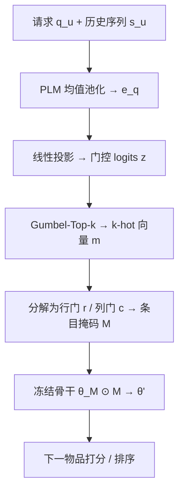
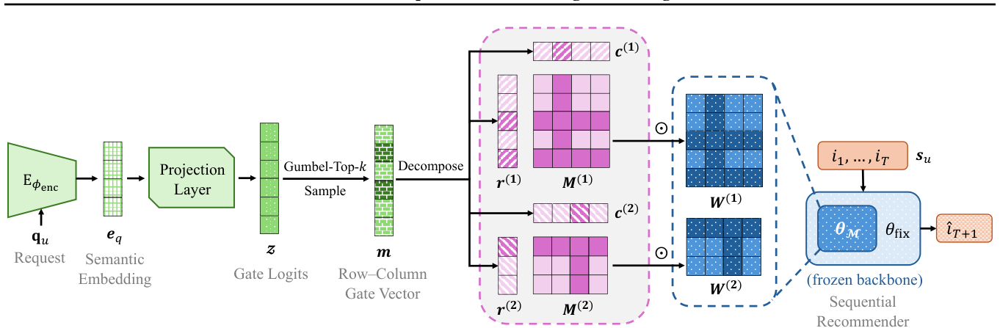

# CRAMER: Control via Request-Aware Masking for Editing Recommenders (通过请求感知掩码编辑推荐模型的控制框架)

- **会议/期刊**: ICML 2026
- **作者与机构**: Zhiyuan Julian Su, Naihe Feng, Zhen Luther Qin, Ga Wu（中国人民大学高瓴人工智能学院 / Dalhousie University）
- **推荐链路定位**: 精排（冻结骨干之上的请求条件化行为编辑）
- **研究方向**: 序列与会话推荐 / 大语言模型推荐
- **论文原文**: [https://arxiv.org/abs/2608.25370v2](https://arxiv.org/abs/2608.25370v2)
- **开源代码**: [https://github.com/zhiyuansu0326/CRAMER-ICML2026](https://github.com/zhiyuansu0326/CRAMER-ICML2026)

## TL;DR (1分钟核心速览)

序列推荐骨干无法响应用户在推荐列表之后发出的即时自然语言请求（如"我想玩更刺激的游戏"）。现有方案要么重训/全量微调骨干，要么调用 LLM 做重排推理，开销均不可接受。CRAMER 把请求视为控制信号，用轻量 PLM 编码请求后经 Gumbel-Top-k 生成 $k$-hot 行列门控向量，对冻结 Transformer 骨干的 FFN 与$W_O$ 施加条目级掩码，实现免重训的实例级后验控制。在 ReDial/KuaiSAR/Beauty/CDs&Vinyl 四数据集、SASRec 与 BERT4Rec 双骨干、100 负例采样排序协议下，HR@10 相对最强基线 REARANK 最高提升约 5.3%（ReDial+SASRec 0.549→0.578），而单请求推理仅增加 0.018s。

## Background & Motivation (背景与核心矛盾)

- **主流范式**: 请求感知推荐分三支——请求增强（Query-SeqRec 拼接查询向量）、语言-物品对齐（BLaIR 共享语义空间）、LLM 增强/重排（LLM-ESR 缓存语义嵌入、REARANK 列表级推理重排）。
- **前人局限**: 其一，输入级方法只做浅层条件化，无法表达否定、约束等细粒度语义；其二，语言-物品对齐需领域预训练，LLM 重排则带来数量级推理延迟（REARANK 单请求 +9.256s）。
- **核心洞察 (Key Insight)**: 上述方法都把推荐骨干当作静态黑箱，缺少**后验控制 (posterior control)** 能力——即在部署后直接干预模型内部机制以施加训练时未见的约束。而 Transformer 中 FFN 充当键值记忆、注意力头存在冗余，$W_O$ 是聚合头输出的高杠杆旋钮，二者天然适合作为干预点。
- **本文切入点**: 借鉴模型控制理论，用稀疏二值掩码作为"预算受限的行为编辑"算子，只激活/关闭冻结骨干中已有的计算通路，从而以线性于层宽的控制维度实现请求条件化转向。

## Method (核心方法设计)

### 1. 整体框架 (Overall Architecture)

给定历史序列 $s_u$与请求$q_u$，轻量 PLM 编码器对请求 token 做均值池化得到语义嵌入$e_q$，经线性投影得到门控 logits$z\in\mathbb{R}^d$（$d=\sum_l(\alpha_l+\beta_l)$为所有可掩码矩阵的行列维度总和）。Gumbel-Top-k 采样出恰好$k=\lceil(1-\rho)d\rceil$个激活位的二值向量$m$，分解为逐矩阵的行门$r^{(l)}$与列门$c^{(l)}$，外积成条目级掩码$M^{(l)}$作用于冻结骨干的$\theta_M$，得到编辑后参数$\theta'$并输出下一物品打分。训练仅更新投影层与请求编码器子集$\phi_t$，骨干全程冻结。

<figure class="paper-figure" markdown="span">
  <figcaption>图1. 所提出的CRAMER框架概览。该图展示了CRAMER将自然语言转换为……的完整过程。</figcaption>
</figure>

### 2. 关键设计拆解 (Key Designs)

1. **变分启发的稀疏控制目标**：直接对控制信号边缘化不可解，作者引入因子化 Bernoulli 先验 $p(m)$（均值$\pi_0=k/d$与硬预算对齐）与均值场后验$Q_\phi(m|q_u)$，得到 ELBO 下界，并落地为可解代理目标$\mathcal{L}(\phi)=\frac{1}{|\mathcal{U}|}\sum_u[\ell(\hat{i}_{T+1},i^\star_{T+1})+\lambda_{KL}\cdot\frac{1}{d}\mathrm{KL}(Q\|p)]$。KL 项按维度$d$归一化防止随骨干变宽而主导损失，其闭式解为$\sum_i[\pi_i\log\frac{\pi_i}{\pi_0}+(1-\pi_i)\log\frac{1-\pi_i}{1-\pi_0}]$，$\pi_i=\sigma(z_i)$。直觉上它等价于一个与硬预算对齐的稀疏正则，抑制退化稠密掩码。

2. **行列结构化门控掩码**：若对每个参数独立门控，控制变量数为 $\alpha_l\beta_l$，随层宽平方增长；CRAMER 改为行门与列门外积$M^{(l)}_{ij}=r^{(l)}_i\cdot c^{(l)}_j$，控制维度降为$\alpha_l+\beta_l$，线性于层宽。这一"预算受限编辑"而非"特征抑制"的视角，使掩码能选择性开关预训练记忆通路，把长期偏好表征导向当前请求，同时保持训练期控制器与部署期低开销机制一致。

3. **直通估计与推理效率**：前向用 Gumbel-Top-k 硬 $k$-hot 采样（训练时加 Gumbel 噪声、推理时取确定性 Top-k），反向经温度退火 softmax 代理$v_i=\exp(z_i/\tau)/\sum_j\exp(z_j/\tau)$传播梯度（$\tau$ 从 0.7 余弦退火至 0.3）。负采样沿用骨干原设定（每正例配 100 个未交互负例），推理仅需一次轻量前向 + 掩码乘法，无额外候选生成或 LLM 调用。

## Experimental Setup & Evaluation Protocol (实验设置与评估协议)

- **数据集与预处理**: 统一构造 RecBole 风格原子文件；ReDial/KuaiSAR 仅保留正交互，Beauty/CDs&Vinyl 保留评分 $\geq 4.0$；请求文本由当前时间戳前三次交互的标题、内容、类目、搜索词拼接而成；三个大数据集因算力预算做随机下采样。

| 数据集 | #Items | #Interactions | 请求平均字符数 | 场景说明 |
| :--- | :---: | :---: | :---: | :--- |
| ReDial | 5,207 | 36,460 | 112.84 | 对话式电影推荐 |
| KuaiSAR | 174,895 | 260,243 | 124.63 | 快手短视频搜推一体 |
| Beauty | 44,977 | 122,485 | 226.85 | Amazon 美妆评论 |
| CDs&Vinyl | 76,368 | 141,213 | 973.21 | Amazon 唱片，长文本请求 |

- **数据划分与防穿越 (Splitting Strategy)**: 按用户交互时间戳排序构造序列，请求文本严格取自当前交互之前的历史，属时间序切分；具体训练/验证/测试比例沿用 RecBole 默认配置。
- **排名评测协议 (Ranking Protocol)**: `Sampled Ranking`——每个测试正例随机采样 100 个用户未交互物品作为候选，报告 HR@{10,20}、NDCG@{10,20}、MRR@{10,20}，五次运行取均值。
- **对比基线与超参设置**: 基线为 Query-SeqRec、BLaIR、LLM-ESR、REARANK 四类请求感知方法，分别叠加在 SASRec 与 BERT4Rec 冻结骨干上；骨干超参用 RecBole v1.2.1 默认值；请求编码器在 BERT/RoBERTa/MiniLM/ModernBERT 中按验证 NDCG@10 选择；显著性用 Benjamini–Hochberg 程序控制 FDR=0.05，覆盖全部 48 组配对 t 检验。

## Key Experimental Results (实验关键数据)

### 1. 主实验对比 (Main Results)

| 骨干 / 数据集 | 方法 | HR@10 | HR@20 | NDCG@10 | NDCG@20 | MRR@10 |
| :--- | :--- | :---: | :---: | :---: | :---: | :---: |
| SASRec / ReDial | REARANK（最强基线） | 0.549 | 0.684 | 0.414 | 0.449 | 0.408 |
| SASRec / ReDial | **CRAMER** | **0.578** | **0.694** | **0.428** | **0.456** | **0.413** |
| SASRec / KuaiSAR | REARANK | 0.538 | 0.645 | 0.409 | 0.437 | 0.366 |
| SASRec / KuaiSAR | **CRAMER** | **0.556** | **0.748** | **0.436** | **0.484** | **0.391** |
| SASRec / Beauty | REARANK | 0.548 | 0.681 | 0.474 | 0.509 | 0.335 |
| SASRec / Beauty | **CRAMER** | **0.574** | **0.735** | **0.489** | **0.531** | **0.385** |
| SASRec / CDs&Vinyl | REARANK | 0.612 | 0.719 | 0.454 | 0.481 | 0.378 |
| SASRec / CDs&Vinyl | **CRAMER** | **0.619** | **0.726** | **0.472** | **0.498** | **0.397** |
| BERT4Rec / ReDial | REARANK | 0.536 | 0.680 | 0.388 | 0.424 | 0.355 |
| BERT4Rec / ReDial | **CRAMER** | **0.580** | **0.753** | **0.451** | **0.497** | **0.376** |
| BERT4Rec / Beauty | REARANK | 0.509 | 0.693 | 0.379 | 0.426 | 0.331 |
| BERT4Rec / Beauty | **CRAMER** | **0.539** | **0.734** | **0.396** | **0.447** | **0.345** |
| BERT4Rec / CDs&Vinyl | REARANK | 0.571 | 0.684 | 0.423 | 0.452 | 0.367 |
| BERT4Rec / CDs&Vinyl | **CRAMER** | **0.583** | **0.695** | **0.487** | **0.516** | **0.433** |

48 组配对 t 检验中 41 组（85.42%）在 BH 校正后显著优于最强基线。效率方面（SASRec 骨干）：CRAMER 单请求仅增 0.018s / 1355.6 MiB，与 LLM-ESR（+0.016s）相当，远低于 REARANK（+9.256s / 9824.7 MiB）。

### 2. 消融与敏感性实验 (Ablation & Sensitivity)

| 配置 | 变化 | 关键结论 |
| :--- | :--- | :--- |
| 丢弃比例 $\rho$| 0.05 / 0.10 / 0.15 / 0.20 / 0.25 | 约 0.10 最优；小数据集偏好更大$\rho$（强正则），大数据集偏好更小$\rho$ |
| 掩码范围 $\theta_M$| FFNs /$W_O$/ FFNs+$W_O$ | 大数据集联合掩码最优；小数据集单一范围更稳（防过拟合） |
| 编码器微调 $\phi_t$ | none / last / all | last 为稳健默认；all 仅在数据充足时占优 |
| KL 权重 $\lambda_{KL}$ | 0.1–0.5 | ReDial 最优 0.3–0.4，KuaiSAR/CDs&Vinyl 最优 0.1–0.2 |
| 批次共享门控 | shared=1 vs 0 | 非共享全面且显著更优，共享削弱请求-掩码对齐 |
| 温度退火 | linear / exponential / cosine | cosine 最优，exponential 早期降温过快最差 |
| 骨干深度（BERT4Rec, KuaiSAR） | 4→10 层 | NDCG@10 从 0.366→0.434 提升至 0.385→0.462，相对开销从 55.3% 降至 41.5% |

### 3. 关键实验发现 (Key Findings)

1. **掩码确实产生语义对齐的方向性偏移**：ReDial 上 100 用户实验显示，明确正向请求"我想看浪漫喜剧"使 top-10 中浪漫类电影占比从无请求的 0.286 升至 0.432，明确否定请求"请避开浪漫电影"则降至 0.135；模糊请求与罕见措辞（如"amour-driven plots"）仍能产生正确方向的小幅偏移，方差虽升但可控，证明掩码不是随机扰动而是可解释的意图转向。
2. **控制维度线性化是效率优势的根源**：BERT4Rec 从 4 层加深到 10 层时，CRAMER 的运行时相对开销从 55.3% 降至 41.5%、显存相对开销从 66.4% 降至 43.7%，同时 NDCG@10 增益从 +0.068 扩大到 +0.077——骨干越大，行列门控的"线性于层宽而非平方于参数量"设计越划算。
3. **请求编码器容量单调决定上限**：Tiny < Mini < Medium < Base 四个 BERT 变体在全部四个数据集上呈现严格一致的单调排序，说明 CRAMER 能无损吸收更强语言模型的能力，而非对编码器选择敏感脆弱；这与 $\rho$、$\lambda_{KL}$ 的宽平台稳健性共同构成其工程可用性证据。

## Highlights & Limitations (亮点、对比与审稿批判)

- **与代表作对比 (vs. Prior Work)**: Query-SeqRec 只在输入侧拼接查询向量，控制粒度停留在表征层；BLaIR 需领域预训练对齐语言与物品空间；LLM-ESR 依赖缓存 LLM 语义嵌入做适配；REARANK 用 LLM 做列表级推理重排，精度尚可但延迟高两个数量级。CRAMER 的本质差异是把控制点从"输入/输出"移到"骨干内部参数"，以 $O(\alpha+\beta)$ 的门控预算换取实例级后验编辑能力。
- **可迁移亮点**: 其一，行列外积门控可迁移到任何需要实例级条件化的冻结大模型适配场景（如跨域推荐、多场景融合），控制维度与层宽线性相关；其二，变分启发的 KL 稀疏正则 + 硬 $k$-hot 前向 + STE 反向的组合，是离散控制变量端到端训练的通用配方。
- **审稿级局限批判**: 其一，评估采用 100 负例采样排序而非全库 Full-Ranking，且三个大数据集均被下采样，绝对数值的可比性与工业规模下的排序保真度存疑；其二，请求文本由历史交互元数据拼接合成而非真实用户即时输入，与论文强调的"post-recommendation feedback"场景存在分布差距，真实否定/约束语句的鲁棒性尚未验证；其三，KL 项与硬 $k$-hot 前向并不构成严格 ELBO，理论保证仅为启发式，且$\rho$、$\lambda_{KL}$、$\theta_M$、$\phi_t$ 需按数据集逐一调参，跨场景迁移的调参成本未量化。

## Rating (四维评分)

- **方法创新性 (Novelty)**: ⭐⭐⭐⭐ （把模型控制理论的掩码编辑引入请求感知推荐，行列结构化门控 + 变分稀疏正则的组合在序列推荐中属首次，但掩码/STE 本身在 NLP 已有先例）
- **评估协议与实验扎实度 (Protocol & Experiments)**: ⭐⭐⭐ （四数据集双骨干 + BH 校正 48 组检验较规范，但 100 负例采样排序与数据集下采样削弱了结论强度，缺少全库排序与真实请求验证）
- **写作与数学规范度 (Clarity & Rigor)**: ⭐⭐⭐⭐ （ELBO 推导完整、明确声明代理目标非严格 ELBO，符号一致；但主表指标列过密、部分最优值未加粗，可读性略打折）
- **工业落地与复现价值 (Industrial & Practical Value)**: ⭐⭐⭐⭐⭐ （代码已开源，单请求仅 +0.018s、显存增量可控，骨干加深时相对开销反降，是少数可直接嵌入现有精排服务的请求感知方案）

