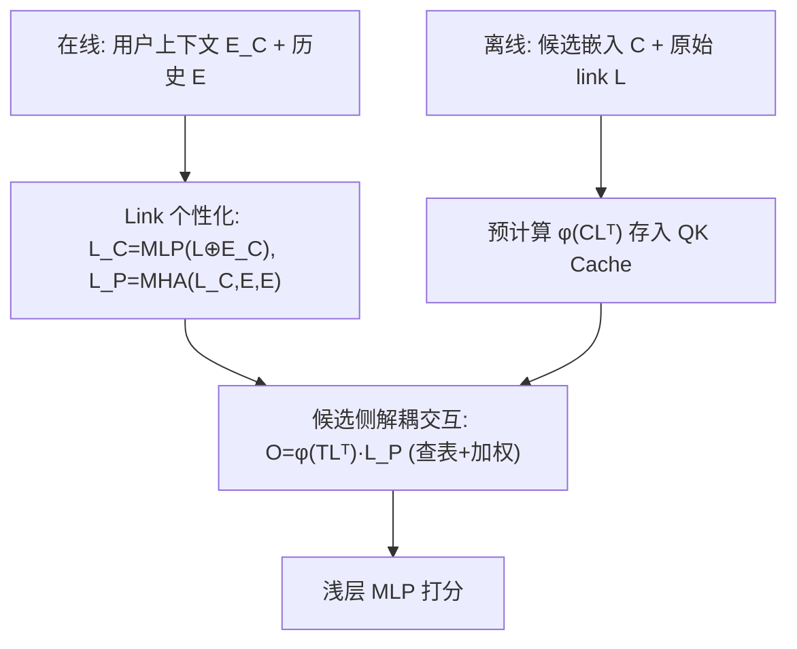

# LIME: Link-based User-item Interaction Modeling with Decoupled XOR Attention for Efficient Test Time Scaling (基于链接嵌入与解耦 XOR 注意力的高效用户-物品交互建模)

- **会议/期刊**: NeurIPS 2026
- **作者与机构**: Yang Liu, Yunjiang Jiang, Ayush Agarwal, Yihan Wu, Haoran Liu, Bi Xue (Meta AI)
- **推荐链路定位**: 精排 / 粗排（pre-ranking，大候选集低延迟场景）
- **研究方向**: 序列与会话推荐 / CTR 预估与特征交叉
- **论文原文**: [https://arxiv.org/abs/2510.18239v5](https://arxiv.org/abs/2510.18239v5)
- **开源代码**: 暂未开源

## TL;DR (1分钟核心速览)

现代精排模型面临"表达力 vs 延迟"的两难：双塔（TTSN）快但交互浅，HSTU 类 Transformer 表达强但推理代价随候选数 $M$线性、随历史长度$N$二次增长。LIME 引入一组可学习的低秩 **link embedding** 作为用户历史与候选之间的"桥梁"，把候选侧 QK 权重$\phi(TL^\top)$变为与用户无关、可离线预计算缓存；再用 **XOR 注意力掩码** 把历史自注意力从$O(N^2)$降到$O(\ell N)$。在 KuaiRand-1K 上 LIME-XOR 的 AUC 达 0.7448（超 HSTU Skyline 0.7444），工业数据集 VC NE 相对 TTSN 改善 1.04%，在线 A/B 带来 +37.9% VC / +28.6% WT 提升，同时大候选集下推理延迟近乎恒定。

## Background & Motivation (背景与核心矛盾)

- **主流范式**: 精排侧存在两条对立路线——双塔模型（TTSN）以用户/物品独立编码换取 ANN 检索级效率，但交互仅停留在末层点积；HSTU/BST 类 Transformer 用全自注意力 + 候选交叉注意力获得强表达力，却把计算全部压到在线阶段。
- **前人局限**: ① Transformer 的复杂度为 $O(N^2 + NM)$，候选集或历史一扩大就不可服务；② 混合方案（如 SIM/TWIN 两阶段检索）只做增量改进，且 GSU 检索本身仍是$O(MN)$，同时牺牲了历史自注意力表达。
- **核心洞察 (Key Insight)**: 作者对训练好的 HSTU 做 SVD 分析发现，自注意力与交叉注意力矩阵均呈长尾谱分布——**前 32 个奇异值即覆盖 90% 以上信息**（图 5 左）。这意味着用户-候选交互空间本质是低秩的，可用少量"锚点"近似。
- **本文切入点**: 用固定大小 $\ell \ll N$ 的 link embedding 作为低秩基，把"候选 × 历史"的交叉注意力分解为"候选 × link"与"link × 历史"两步，前者与用户无关可离线缓存，后者在用户侧一次算完。

## Method (核心方法设计)

### 1. 整体框架 (Overall Architecture)

LIME 把一次请求拆成三段流水线：**离线物品侧**对全库候选 $C$与原始 link$L$预计算注意力权重$\phi(CL^\top)$并存入 KV Cache（如 FAISS）；**在线用户侧**用用户上下文$E_C$与历史$E$将 link 个性化得到$L_P$，该步与候选检索并行、延迟被掩盖；**在线交互侧**对每个候选仅做一次查表 + 对$L_P$ 的加权求和，再送入浅层 MLP 打分。核心是把交叉注意力的昂贵 QK 乘积从在线路径彻底移出。

### 2. 关键设计拆解 (Key Designs)

1. **Link 嵌入与解耦注意力（Decoupled Attention）**：痛点在于标准交叉注意力中 QK 权重依赖用户，无法预计算。LIME 改用**非对称结构**——key 取用户无关的原始 link $L$，value 取个性化 link$L_P$：
$$O=\mathrm{MHA}(T,L,L_P;J;\theta)=\phi(TL^\top)L_P$$
由于 $\phi(TL^\top)\in\mathbb{R}^{M\times\ell}$只依赖物品侧，可离线缓存，在线每候选成本降为$O(1)$查表 +$O(\ell d)$加权。直觉上这是把交叉注意力做了一次低秩分解$\mathrm{MHA}(T,E)\approx\mathrm{MHA}(T,L)\cdot\mathrm{MHA}(L,E)$。

2. **XOR 注意力掩码（LIME-XOR）**：为加深用户侧表达，需堆叠多层 HSTU 块，但因果自注意力的 $E\leftrightarrow E$交互是$O(N^2)$瓶颈。作者定义 XOR 掩码$M_{\text{xor}}[i,j]:=\mathbb{1}_{i\in[0,|E|)}\wedge\mathbb{1}_{j\in[0,|E|)}$，**结构性删除历史-历史注意力**，只保留双向的 link↔历史块：
$$\mathrm{XORA}(X,X,X)=\mathrm{MHA}(E,L_C,L_C;J)\oplus\mathrm{MHA}(L_C,E,E;J)$$
复杂度从 $O(N^2+NM)$降至$O(\ell N+\ell M)$。直觉：link 作为全局上下文从第一层就调制历史表示，既省算力又增强表达；`+Window` 变体再叠加滑动窗口捕获局部交互。

3. **训练目标与推理效率**：采用标准交叉熵多任务损失（VC/WT 等），无特殊负采样（精排为全候选打分而非对比学习）。推理侧 QK Cache 每 5 分钟随模型发布重建，实测 miss rate < 0.1%，陈旧性测试对在线 NE 影响 < 0.1%；100M 物品、32 link、4 头、int8 缓存约 12.8 GB。

## Experimental Setup & Evaluation Protocol (实验设置与评估协议)

- **数据集与预处理**:

| 数据集 | #Interactions | 最大序列长度 | 稀疏度/密度 | 特征/场景说明 |
| :--- | :---: | :---: | :---: | :--- |
| Taobao-Ad | 25M | 50 | 短序列 | 电商广告点击，FuxiCTR 预处理 |
| KuaiRand-1K | 12M | 256 | 中长序列 | 短视频，前 14 天训练/后 2 天测试，过滤交互 <30 的物品 |
| Industrial | 100B | 1024 | 超长序列 | Meta 内部平台，3 天训练 / 6 小时评估 |

- **数据划分与防穿越 (Splitting Strategy)**: KuaiRand 采用**全局时间戳切分**（前 14 天训练、后 2 天测试）；工业数据按时间切 3 天/6 小时；Taobao-Ad 沿用 FuxiCTR 官方划分。
- **排名评测协议 (Ranking Protocol)**: 精排场景，对候选集做**全候选打分**（非采样排序），指标为 AUC、gAUC、Log Loss 与归一化熵 NE（越低越好，0.1% NE 下降通常对应线上指标提升）。
- **对比基线与超参设置**: 基线含 TTSN（sum-pooling 双塔）、DIN、SASRec、Truncated MHA、LREA(Linformer)、VISTA；Skyline 为 MHA Skyline（单层目标注意力）与 HSTU Skyline（3 层因果自注意力+交叉注意力）。嵌入维度公开集 32 / 工业 256，link 数 8–32，4 头；Taobao-Ad 上做 5 seed 均值±标准差并报告显著性。

## Key Experimental Results (实验关键数据)

### 1. 主实验对比 (Main Results)

工业离线 + 在线 A/B（相对 TTSN 的变化，NE 越低越好）：

| 模型 | VC NE | WT AUC | 在线 VC | 在线 WT |
| :--- | :---: | :---: | :---: | :---: |
| TTSN | 基线 | 基线 | – | – |
| LIME-MHA | -0.72% | +0.46% | +28.6% | +22.1% |
| MHA Skyline | -0.73% | +0.53% | N/A | N/A |
| **LIME-XOR** | **-1.04%** | **+0.76%** | **+37.9%** | **+28.6%** |
| LIME-XOR+Window | **-1.11%** | **+0.80%** | N/A | N/A |
| HSTU Skyline | -1.06% | +0.77% | N/A | N/A |

公开数据集 AUC（相对 TTSN 提升）：

| 模型 | KuaiRand-1K | Taobao-Ad |
| :--- | :---: | :---: |
| TTSN | 0.7389 | 0.6452 |
| DIN | 0.7404 (+0.20%) | 0.6468 (+0.25%) |
| SASRec | 0.7419 (+0.41%) | 0.6462 (+0.15%) |
| LREA (Linformer) | 0.7408 (+0.26%) | 0.6447 (-0.08%) |
| LIME-MHA | 0.7433 (+0.60%) | 0.6465 (+0.20%) |
| MHA Skyline | 0.7428 (+0.53%) | 0.6464 (+0.19%) |
| **LIME-XOR** | **0.7448 (+0.80%)** | 0.6467 (+0.23%) |
| LIME-XOR+Window | **0.7453 (+0.87%)** | **0.6468 (+0.25%)** |
| HSTU Skyline | 0.7444 (+0.74%) | **0.6475 (+0.36%)** |

### 2. 消融实验 (Ablation Study)

KuaiRand-1K 上的组件消融（AUC）：

| 变体 | AUC | 说明 |
| :--- | :---: | :--- |
| LIME-XOR | **0.7448** | 完整模型 |
| w/ Link Pooling | 0.7400 | 候选侧改为对 $L_P$ 求和池化 |
| w/ Dot Product | 0.7404 | 候选侧改为点积 |
| LIME-MLP | 0.7407 | 用户侧用 MLP 替代注意力 |
| LIME-XOR–MLP Hybrid | 0.7442 | 仅替换物品侧缓存权重为 MLP |

候选侧基（key）选择消融（Taobao-Ad，32 link，5 seed）：

| 候选侧基 | gAUC | AUC | Log Loss | QK 可缓存 |
| :--- | :---: | :---: | :---: | :---: |
| 可学习全局 link | 0.570567 | **0.646799** | **0.192545** | 是 |
| 冻结随机 link | 0.570323 | 0.644434 | 0.192834 | 是 |
| 固定物品质心 | **0.571714** | 0.644832 | 0.192608 | 是 |
| 个性化 link 作 key | 0.569040 | 0.643578 | 0.192915 | 否 |

### 3. 关键实验发现 (Key Findings)

1. **解耦注意力是性能命门**：把候选侧换成池化/点积/MLP 后 AUC 掉 0.4–0.5 个点（0.7448→0.7400/0.7404/0.7407），说明"查表权重 + 加权聚合"这一非对称结构不可被简单替代；而仅替换物品侧为 MLP 只掉 0.06 点，证明用户侧 XOR 注意力贡献更大。
2. **低秩假设被谱分析直接验证**：32 个 link 时 LIME-MHA 与真实 MHA 注意力分布的 JS 散度仅 0.055、余弦相似度 0.915（均匀注意力 JS 为 0.693），且 link 数从 1→128 时散度单调下降，说明 $\ell=32$ 已足够逼近全注意力。
3. **规模律成立且长序列收益更大**：工业数据上序列从 1k→4k、link 从 32→256 时 VC NE 最多改善 0.55%；层数 3→12 带来 NE -0.38% / AUC +0.19%；KuaiRand（序列 256）提升幅度（+0.80%）明显大于 Taobao-Ad（序列 50，+0.23%），印证长历史场景才是 LIME 的主场。

## Highlights & Limitations (亮点、对比与审稿批判)

- **与代表作对比 (vs. Prior Work)**: 相比 TTSN，LIME 恢复了深层目标感知交互；相比 HSTU，LIME 把在线复杂度从 $O(N^2+NM)$降到$O(\ell N+\ell M)$且精度持平；相比 SIM/TWIN 两阶段检索，LIME 无需 GSU 的$O(MN)$ 粗筛且保留历史自注意力表达；相比 Longformer/Linformer 等通用线性注意力，LIME-XOR 是任务定制掩码，在同等低秩预算下 AUC 更高（0.7448 vs 0.7443/0.7408）。
- **可迁移亮点**: ① "用户无关 key + 用户相关 value"的非对称解耦可直接迁移到任何需要大候选集打分的粗排/召回模型；② XOR 掩码的"删除同侧注意力、只保留跨侧双向注意力"思路可复用到多模态对齐、跨域桥接等需要压缩中间表示的场景。
- **审稿级局限批判**: ① 低秩假设在兴趣高度碎片化的领域可能失效，且 QK Cache 需随物品目录周期性重建，作者自承更适合**早期排序阶段**而非最终精排；② 公开集实验规模偏小（Taobao-Ad 序列仅 50），LIME-XOR 在该集上并未超过 HSTU Skyline，且 link 数、层数等超参对效果敏感，缺少系统的超参敏感性分析。

## Rating (四维评分)

- **方法创新性 (Novelty)**: ⭐⭐⭐⭐⭐ （用 SVD 谱分析驱动低秩 link 设计，解耦注意力 + XOR 掩码双创新均有理论直觉支撑）
- **评估协议与实验扎实度 (Protocol & Experiments)**: ⭐⭐⭐⭐ （公开集+百亿级工业集+在线 A/B 三层验证完整，5 seed 显著性检验到位，但公开集规模偏小）
- **写作与数学规范度 (Clarity & Rigor)**: ⭐⭐⭐⭐ （MHA/XORA 公式与 Triton 伪代码清晰，附录含前反向推导；部分符号如 $\oplus$ 兼作拼接与逐元素加需读者自行辨析）
- **工业落地与复现价值 (Industrial & Practical Value)**: ⭐⭐⭐⭐⭐ （已在 Meta 级平台部署，10× 加速与 +37.9% VC 在线收益，缓存显存与 miss rate 均有实测，工程参考价值极高）
