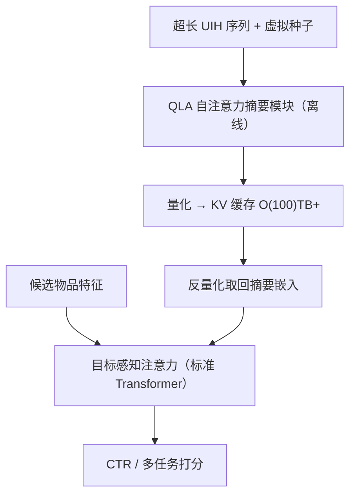
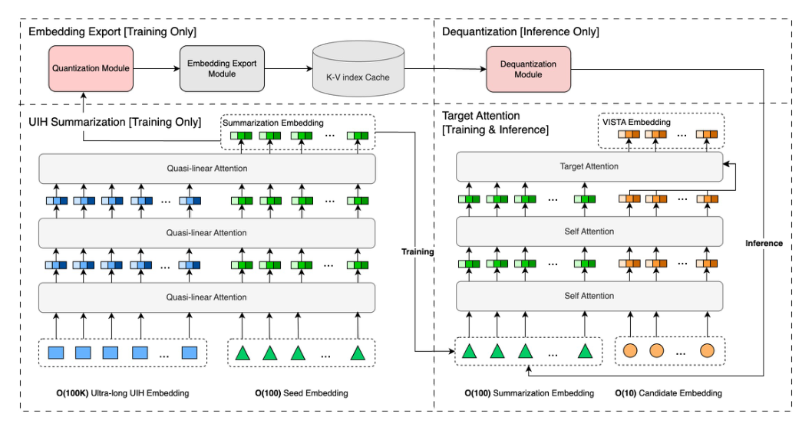

# Massive Memorization with Hundreds of Trillions of Parameters for Sequential Transducer Generative Recommenders (面向序列转导生成式推荐器的百万亿参数级大规模记忆)

- **会议/期刊**: ICLR 2026
- **作者与机构**: Zhimin Chen, Chenyu Zhao, Ka Chun Mo, Yunjiang Jiang, Jane H. Lee, Khushhall Chandra Mahajan, Ning Jiang, Kai Ren, Jinhui Li, Wen-Yun Yang (Meta, Yale University)
- **推荐链路定位**: 精排（序列特征侧，可下沉至召回/粗排复用缓存嵌入）
- **研究方向**: 序列与会话推荐 / 生成式推荐
- **论文原文**: [https://arxiv.org/abs/2510.22049v3](https://arxiv.org/abs/2510.22049v3)
- **开源代码**: [https://github.com/reczoo/Datasets](https://github.com/reczoo/Datasets)（仅数据集与 FuxiCTR 框架，模型未开源）

## TL;DR (1分钟核心速览)

工业推荐把用户历史拉到 10k–100k 后，HSTU 类全序列建模的算力/延迟不可承受，SIM 类目标采样又让推理成本随候选数线性膨胀。VISTA 把「候选→历史」的目标注意力拆成两阶段：离线用虚拟种子 + 准线性注意力把百万级历史压成数百 token 并缓存，下游只算「候选→摘要」注意力。在 Amazon-Electronics 上 AUC 0.886 超 HSTU 0.884，工业离线 Eval NE 相对降 0.82%，线上 C-Task +0.5%、推理 GPU 资源降 94%。

## Background & Motivation (背景与核心矛盾)

- **主流范式**: 序列转导（HSTU）做全历史自注意力；目标采样（SIM/TWIN/TWIN V2）先用 GSU 检索相关子序列再 ESU 精算。
- **前人局限**: ① 全序列建模复杂度随历史长度平方增长，而工业需日训 $10^{10}$–$10^{11}$ 样本且推理有硬延迟上限；② SIM 类为每个候选独立构造子序列，推理成本随候选数线性增长，且子序列与全历史之间存在信息鸿沟。
- **核心洞察 (Key Insight)**: 用户历史本质是「特征」而非「待预测标签」，其时间因果性并非硬约束；因此可把最贵的部分一次性离线算完并物化，GPU 算力成本比存储贵数个数量级，用存储换算力是划算交易。
- **本文切入点**: 用少量可学习的虚拟种子嵌入作为「压缩瓶颈」，把超长历史蒸馏为固定长度摘要并缓存，使下游训练/推理成本与历史长度解耦。

## Method (核心方法设计)

### 1. 整体框架 (Overall Architecture)

训练期：源模型以虚拟种子 $s_1,\dots,s_k$与历史物品嵌入拼接，经 QLA 自注意力 + 生成式重建损失，产出$k$ 个摘要嵌入，量化后写入 O(100)TB–O(1)PB 的 KV 缓存；推理期完全跳过该模块，仅从缓存取出并反量化，再由标准 Transformer 目标注意力模块计算候选与摘要的交互并输出 CTR 打分。摘要嵌入以 2 小时节奏经 Kafka/Hive 双通道更新，并在地理复制的内存 KV 中服务。

<figure class="paper-figure" markdown="span">
  <figcaption>图 2：VISTA 架构概览。</figcaption>
</figure>

### 2. 关键设计拆解 (Key Designs)

1. **准线性注意力 QLA（把 $O(N^2)$压到$O(N)$且保住表达力）**：纯线性注意力因去掉 softmax 导致表达力不足。本文在$\phi(Q)\phi(\phi(K)^\top V)$的矩阵结合律形式上，对$Q,K,V$ 施加 SiLU 非线性（QLU 模块）并叠加 SGLU 门控，同时**移除 RowNormalize**。关键约束是候选之间严禁互相注意（日志候选只是推理候选的子集，互注意会造成标签泄漏），故候选自注意项单独写成对角形式：
$$\boldsymbol{O}^{[T]}=\phi(\boldsymbol{Q}^{[T]})\phi\big(\phi(\boldsymbol{K}^{[S]})^{\top}\boldsymbol{V}^{[S]}\big)+\Delta\big(\phi(\boldsymbol{Q}^{[T]}),\phi(\boldsymbol{K}^{[T]})\big)\boldsymbol{V}^{[T]}$$
其中 $\Delta(\boldsymbol{X},\boldsymbol{Y})_{ij}=\sum_k X_{ik}Y_{ik}\delta_{ij}$只保留行内点积的对角项。直觉：非线性前置让$K^\top V$ 的「全局统计量」仍可增量维护，同时恢复了对 query-key 交互的非线性刻画。

2. **生成式序列重建损失（逼种子真正记住历史）**：仅靠下游 CTR 梯度，摘要嵌入容易退化为粗粒度兴趣向量。本文加一个无 softmax 的因果解码器，用种子与历史前缀重建下一位置物品嵌入，形成 off-by-one MSE：
$$\mathcal{L}_{\text{reconstruct}}=\sum_{i=1}^{M-1}\big\|\boldsymbol{v}_i-\boldsymbol{u}_{i+1}\big\|_2^2$$
因果掩码保证 $\boldsymbol{v}_i$只依赖$\boldsymbol{u}_1,\dots,\boldsymbol{u}_i$，无信息泄漏，从而强迫种子嵌入最大化保留历史信息量（VAE 思想在推荐序列上的首次显式落地）。

3. **训练目标、负采样与推理效率**：总损失为下游 CTR/多任务损失与 $\lambda\mathcal{L}_{\text{reconstruct}}$ 的加权和；沿用工业 CTR 范式（pointwise 交叉熵，无显式负采样）。推理侧最贵的摘要模块被彻底旁路，成本与历史长度无关；QLA 在 16,000 序列、5 层配置下 QPS 反升 5%，同时 NE 再降 0.1%/0.13%。

## Experimental Setup & Evaluation Protocol (实验设置与评估协议)

- **数据集与预处理**: 公开集 + 生产简化集 + 工业全量集，均基于 FuxiCTR 统一实现：

| 数据集 | 平均序列长 | 最大序列长 | 说明 |
| :--- | :---: | :---: | :--- |
| Amazon-Electronics | 8.93 | 429 | 公开电商，CTR 任务 |
| KuaiRand-1K | 225.20 | 256 | 公开短视频 |
| Simplified Prod | 1,528.18 | 2,000 | 生产数据最小特征版 |
| Industrial-Scale | 7,000 | 16,000 | 日训 $10^{10}$ 级样本，线上部署用 12,000 |

- **数据划分与防穿越 (Splitting Strategy)**: 工业离线实验采用**全局时间戳切分**——前 3 天训练、紧接 1 天评估；公开集沿用 FuxiCTR 默认划分。
- **排名评测协议 (Ranking Protocol)**: 采用 CTR 预估协议，报告 **AUC** 与 **NE（归一化熵，越低越好）**，未使用全库排序指标；显著性用配对 t 检验与 ANOVA，均达 $p<0.001$。
- **对比基线与超参设置**: DIN、TTSN、MHA、SASRec、HSTU 五类基线共享同一特征嵌入层与 MLP，嵌入维度、层数、注意力头数对齐；VISTA 默认 128 seeds、$d=256$、3 层自注意力 + 3 层目标注意力。

## Key Experimental Results (实验关键数据)

### 1. 主实验对比 (Main Results)

| 模型 | Amazon AUC↑ | Amazon NE↓ | KuaiRand AUC↑ | KuaiRand NE↓ | MinProd AUC↑ | MinProd NE↓ |
| :--- | :---: | :---: | :---: | :---: | :---: | :---: |
| DIN | 0.873 | 0.656 | 0.744 | 0.864 | 0.632 | 1.048 |
| TTSN | 0.877 | 0.644 | 0.740 | 0.869 | 0.648 | 1.139 |
| MHA | 0.881 | 0.634 | 0.743 | 0.863 | 0.630 | 1.049 |
| SASRec | 0.884 | 0.627 | 0.742 | 0.868 | 0.605 | 1.129 |
| HSTU | 0.884 | 0.628 | 0.743 | 0.863 | **0.668** | 1.099 |
| VISTA-w/o-QLA | **0.886** | **0.621** | **0.744** | 0.863 | 0.627 | **1.038** |
| VISTA-w/-QLA | 0.884 | 0.623 | 0.743 | **0.864** | 0.632 | 1.062 |

工业离线（相对 HSTU 的 NE 降幅，负值即更优）：

| 模型 | Train NE | Eval NE | C-Task | E1-Task | E2-Task | E3-Task |
| :--- | :---: | :---: | :---: | :---: | :---: | :---: |
| VISTA | **-0.47%** | **-0.82%** | **-2.30%** | **-1.72%** | -0.40% | -1.19% |
| VISTA-128D | -0.32% | -0.50% | -1.86% | -1.43% | -0.29% | -1.07% |
| VISTA-64Seed | -0.36% | -0.68% | -1.70% | -1.45% | -0.37% | -1.11% |
| VISTA-w/o-Recon | -0.42% | -0.72% | -2.32% | -1.69% | -0.29% | -1.29% |

### 2. 消融实验 (Ablation Study)

| 配置 | 关键变化 | 结果 |
| :--- | :--- | :--- |
| w/o QLA | 标准 softmax 自注意力 | 6,000 序列 3 层即无法扩展；QLA 版 16,000 序列 5 层 QPS +5%、NE -0.1%/-0.13% |
| 128D 嵌入 | 维度 256→128 | Eval NE 降幅从 0.82% 收窄至 0.50%，C-Task 从 -2.98% 收窄至 -2.51% |
| 64 Seeds | 种子数 128→64 | Eval NE 降幅 0.82%→0.68%，存储减半 |
| w/o Recon | 去掉重建损失 | Eval NE 降幅 0.82%→0.72%，E2-Task 从 -0.40% 退至 -0.29% |

### 3. 关键实验发现 (Key Findings)

1. **收益主要来自「两阶段解耦 + 种子记忆」而非 QLA 本身**：Amazon 上 w/o-QLA 反而 AUC 最高（0.886 vs 0.884），说明 QLA 是效率工具；但工业集上 QLA 让序列从 6,000 扩到 16,000、层数 3→5 的同时 QPS 还涨 5%，是「规模换精度」的关键使能器。
2. **重建损失是稳定的正贡献但非决定性**：去掉后 Eval NE 降幅从 0.82% 缩到 0.72%，C-Task 线上指标几乎不变（-2.98% vs -3.00%），说明种子嵌入已通过下游梯度学到大部分信息，重建主要起正则与加速收敛作用。
3. **容量-成本呈清晰单调权衡**：种子数 128→64、维度 256→128 均使指标平滑下降，作者据此把「种子数 × 维度」作为可调的性能/存储旋钮；线上 15 天 5% 流量 A/B 中 C-Task +0.5%、O1 +0.2%、O2 +0.04%，同时推理 GPU 资源降 94%。

## Highlights & Limitations (亮点、对比与审稿批判)

- **与代表作对比 (vs. Prior Work)**: 相比 HSTU 的全序列自注意力，VISTA 把最贵计算离线化并物化，推理成本与历史长度解耦；相比 SIM/TWIN 的「每候选检索子序列」，VISTA 的摘要对所有候选共享，推理成本与候选数解耦，且不存在 GSU 检索的召回鸿沟；相比纯线性注意力（Lightning Attention），QLA 显式处理了「候选间禁止互注意」这一推荐特有约束。
- **可迁移亮点**: ① 「离线物化 + 缓存交付」范式可直接迁移到任何超长行为序列场景（搜索、广告、短视频）；② 虚拟种子 + 因果重建损失的压缩瓶颈设计，可复用到用户表征预训练与跨域用户画像。
- **审稿级局限批判**: ① 公开集上相对 HSTU 的提升极小（AUC +0.002，KuaiRand 基本持平），核心说服力几乎全部来自不可复现的工业数据与线上 A/B；② 摘要嵌入 2 小时更新一次，对实时兴趣漂移（如突发热点）存在滞后，论文仅称「与在线直算性能相近」但未给出滞后敏感度的定量曲线；③ 存储成本 O(100)TB–PB 级，中小平台难以承担，且量化误差对长尾用户的影响未做分桶分析。

## Rating (四维评分)

- **方法创新性 (Novelty)**: ⭐⭐⭐⭐ （两阶段解耦 + 候选禁互注意的 QLA 约束 + 推荐场景首次显式重建损失，工程与算法协同设计新颖，但单点算子多为已有组件的巧妙重组）
- **评估协议与实验扎实度 (Protocol & Experiments)**: ⭐⭐⭐ （公开集提升微弱且仅用 AUC/NE 而非排序指标，工业离线+15 天线上 A/B 与完整消融是加分项，但缺乏统计显著性与长尾分桶）
- **写作与数学规范度 (Clarity & Rigor)**: ⭐⭐⭐⭐ （QLA 公式与梯度推导完整、系统架构描述清晰，但主实验表格排版混乱、部分基线数值缺失）
- **工业落地与复现价值 (Industrial & Practical Value)**: ⭐⭐⭐⭐⭐ （已在十亿级用户平台全量部署，推理 GPU 降 94%、QPS 反升，是罕见的端到端系统级落地；可惜模型代码未开源）
