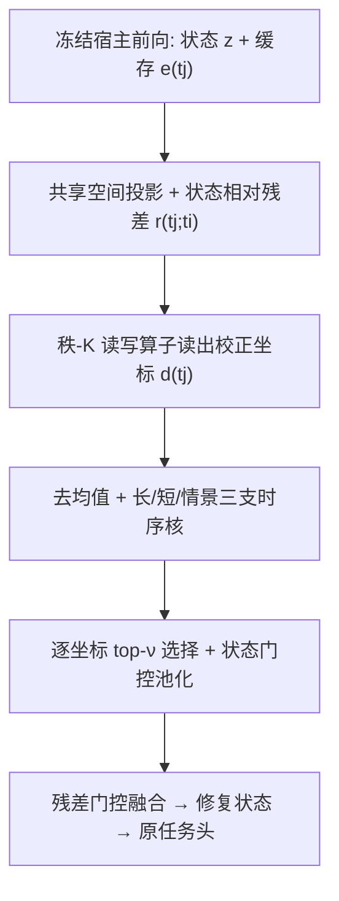
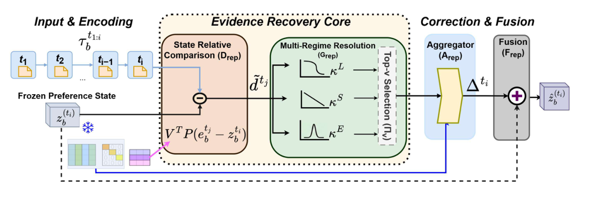

# Not All Is Lost: Repairing Lossy User Preference States of Personalization Encoders (并非全盘皆失：修复个性化编码器中有损的用户偏好状态)

- **会议/期刊**: NeurIPS 2026
- **作者与机构**: Parthiv Chatterjee, Dhiraj Golhar, Ummesalma Diwan, Sourish Dasgupta, Manjunath Joshi, Tanmoy Chakraborty（Dhirubhai Ambani University KDM Lab / IIT Delhi LCS2 Lab）
- **推荐链路定位**: 精排（编码器与任务头之间的状态修复层）
- **研究方向**: 序列与会话推荐 / 大语言模型推荐
- **论文原文**: [论文原文链接](https://arxiv.org/abs/2610.01270v1)
- **开源代码**: 暂未开源

## TL;DR (1分钟核心速览)

个性化编码器把交互历史压缩成单一偏好状态 $z_b^{(t_i)}$交给任务头，但压缩过程丢弃了仍留在缓存逐步表征$\{e_b^{(t_j)}\}$中的任务相关证据，作者称之为**可恢复性缺口 (recoverability gap)**。REPAIR 在冻结编码器与任务头的前提下，用低秩坐标读取状态-逐步残差、经长/短/情景三支时序核解析、逐坐标 top-$\nu$ 选择后残差融合回状态。在 MovieLens/MIND/PENS/Amazon 四个数据集、12 个推荐宿主上，仅训练 REPAIR 即让 MRR/nDCG@10 全部提升（平均 +1.96~+2.66 MRR），显著超过 head-only 微调（如 Mamba4Rec +3.96 vs +0.19 MRR）。

## Background & Motivation (背景与核心矛盾)

- **主流范式**: GRU4Rec/SASRec/Mamba4Rec/NRMS/LSTUR 等编码器将历史压缩为任务面向状态，下游任务头只读该状态；改进路线集中在改编码器内部表征（ReFT、激活引导）或序列去噪。
- **前人局限**: ① 任务头仅见压缩状态，无法访问编码器前向计算中已算出的逐步表征，证据"欠表达"；② 现有干预手段要么重训/改编码器参数，要么在输出端事后修正，均未回答"同一冻结前向的缓存能否选择性修复已成形状态"。
- **核心洞察 (Key Insight)**: 信息并未彻底丢失——缓存 $\{e_b^{(t_j)}\}$与状态$z_b^{(t_i)}$ 的差异可被低秩、宿主相关的紧凑校正结构捕获；且校正所需的最优时序证据**不等于**输入历史中证据出现的位置（copy-through 仅在 6/12 探针成立）。
- **本文切入点**: 在编码器与任务头之间插入可训练的 REPAIR，只读缓存、不重编码历史，把校正作为残差加回原状态。

## Method (核心方法设计)

### 1. 整体框架 (Overall Architecture)

宿主一次前向已产出状态 $z_b^{(t_i)}$与缓存逐步表征$\{e_b^{(t_j)}\}_{j=1}^{i}$（缓存开销$O(Ld_e)$）。REPAIR 先将二者投影到共享$m$维空间求状态相对残差，用秩-$K$读写算子读出$K$个校正坐标；去均值后经长/短/情景三支时序核解析，逐坐标自适应保留 top-$\nu$激活；再由状态门控与加权池化聚合成校正$\Delta_b^{(t_i)}$，经残差门控融合得$\tilde{z}_b^{(t_i)}$ 送入原任务头。LLM 宿主则把修复状态映射为连续 soft prefix 注入冻结解码器。

<figure class="paper-figure" markdown="span">
  <figcaption>图1：REPAIR 概览。给定冻结的偏好状态和来自宿主计算的按时间步缓存表示，REPAIR 构建状态相关的校正证据，通过长时、短时和情景支持分支对其进行解析，选择性保留时间步坐标校正分量，并在下游接口使用修复后状态之前将聚合校正与冻结状态融合。</figcaption>
</figure>

### 2. 关键设计拆解 (Key Designs)

1. **状态相对校正证据与低秩读写算子**：逐步表征与状态空间不一致，直接相减无意义。先投影 $\bar{e}=P_e e$、$\bar{z}=P_z z$，取$r^{(t_j;t_i)}=\bar{e}_b^{(t_j)}-\bar{z}_b^{(t_i)}$，再用学习式（非 SVD）分解$J_{\text{rep}}=\hat{U}_{\text{rep}}\Lambda_{\text{rep}}\hat{V}_{\text{rep}}^\top$（$\text{rank}\le K$）读出$d^{(t_j)}=\hat{V}_{\text{rep}}^\top r^{(t_j;t_i)}$。直觉：把"缺失证据"压到$K$个共享校正模式上，既降噪又强制紧凑；去均值$\tilde{d}^{(t_j)}=d^{(t_j)}-\frac{1}{i}\sum_q d^{(t_q)}$ 消去前缀共享偏移，只留时序变化量。

2. **三支时序解析 + 逐坐标 top-$\nu$选择**：共享$\Lambda_{\text{rep}}$无法区分"何时"有用。以 lag$\ell_j=i-j$定义三支核：$\kappa^L_k=\exp(-\beta_k\ell_j)$、$\kappa^S_k=\max(1-\ell_j/i,0)$、$\kappa^E_k=\exp(\ell_j\log\xi_k-\xi_k-\log\Gamma(\ell_j+1))$（Poisson 型局部爆发），混合得$\eta^{(t_j)}=\sum_{\rho}W_\rho(\kappa_\rho\odot\tilde{d}^{(t_j)})$。随后逐坐标按$|\eta_k|$排序，用 MLP 预测保留比例$f_k$，硬前向掩码 + straight-through 代理（$\tau_{\text{sel}}=0.05$）训练。直觉：同一交互可在某坐标贡献、在另一坐标被抑制，选择粒度细于"整条交互保留/丢弃"。

3. **训练目标、负采样与推理效率**：$\mathcal{L}_{\text{repair}}=0.5\mathcal{L}_{\text{task}}+0.2\mathcal{L}_{\text{pos}}+0.3\mathcal{L}_{\text{coh}}$，其中$\mathcal{L}_{\text{pos}}$做相对位置分类保时序来源、$\mathcal{L}_{\text{coh}}$ 用分类+对比监督绑定校正激活与源交互；系数跨全部宿主固定，不做逐宿主调参。推荐训练采用 1 正 vs 499 采样负例。推理不重编码历史，但需保留缓存并跑修复模块：参数内存开销 31–36%、延迟开销 38–44%。

## Experimental Setup & Evaluation Protocol (实验设置与评估协议)

- **数据集与预处理**: 按 UIG 轨迹组织历史，用户不相交划分；测试用户未见但提供其观测前缀。

| 数据集 | 任务 | 宿主覆盖 | 测试实例 | 说明 |
| :--- | :--- | :---: | :---: | :--- |
| MovieLens | 电影推荐 | 9 个序列宿主 | 15K | GRU4Rec/SASRec/Mamba4Rec/TiSASRec/SIGMA 等 |
| MIND | 新闻推荐 | 7 个历史编码器 | 20K | NRMS/LSTUR/NAML/EBNR/SCAPE-GRU 等 |
| PENS | 新闻推荐+标题生成 | 编码器与 LLM | 20K | 含 Walk2Pers/IMPerSumm/DeepSeek-32B/Qwen2.5-32B |
| Amazon Reviews 2023 | 多模态商品推荐 | 3 个多模态宿主 | 2K | SigLIP2/OpenCLIP/DINOv2-E5 |

- **数据划分与防穿越 (Splitting Strategy)**: 用户不相交 (user-disjoint) 训练/测试划分；每个前缀 $\tau_{t_1:i}$配下一监督目标$r^\star(t_{i+1})$，生成任务额外给任务侧 query。
- **排名评测协议 (Ranking Protocol)**: **Sampled Ranking**——1 个真值目标 vs **499 个采样负例**，报告 MRR、nDCG@5/10、Hit@10（0–100 尺度）；配对条件共享同一批留出用户、前缀、目标与候选集。
- **对比基线与超参设置**: 四类对照——Original Host、Head-only FT（仅训任务头 5 epoch）、REPAIR（编码器+头全冻结）、REPAIR+Head Alignment（再联合对齐 2 epoch，编码器仍冻结）；校正秩默认 $K=128$；统计上用 10,000 次用户聚类 bootstrap 给 95% CI（OpenCLIP/SigLIP2/EBNR 为三 seed 均值）。

## Key Experimental Results (实验关键数据)

### 1. 主实验对比 (Main Results)

下表摘取 6 个代表性宿主（S/M/W 分别代表原宿主最强/中/最弱），指标为 MRR / nDCG@10：

| 数据集 | 宿主 | Original Host | Head-only FT | REPAIR (Frozen Head) | REPAIR+Align |
| :--- | :--- | :---: | :---: | :---: | :---: |
| MovieLens | TiSASRec | 35.51 / 41.14 | 35.57 / 41.19 | 36.38 / 42.07 | **36.78 / 42.91** |
| MovieLens | Mamba4Rec | 29.29 / 38.50 | 29.48 / 38.89 | 33.25 / 39.20 | **34.26 / 40.17** |
| PENS | LSTUR | 10.44 / 12.15 | 10.98 / 12.32 | 11.98 / 12.71 | **12.85 / 15.88** |
| MIND | LSTUR | 51.43 / 59.63 | 52.37 / 59.96 | 54.17 / 62.27 | **55.84 / 66.92** |
| Amazon | OpenCLIP | 1.59 / 1.05 | 2.21 / 2.17 | 4.43 / 4.66 | **19.49 / 22.08** |
| Amazon | SigLIP2 | 2.40 / 2.18 | 2.67 / 2.72 | 4.16 / 4.05 | **17.72 / 20.35** |

四数据集上 REPAIR（冻结头）平均 MRR/nDCG@10 增益分别为 +2.66/+2.63、+2.29/+2.16、+1.96/+3.08、+2.19/+2.55；head-only FT 平均 MRR 仅 +0.29/+0.76/+0.72/+0.68，12/12 设置均被 REPAIR 反超。

### 2. 消融实验 (Ablation Study)

| 配置 | 关键结果 | 说明 |
| :--- | :--- | :--- |
| 校正秩 $K$=32/64/**128**/192 | 128 在 5/5 设置最优；192 全部下降 | 如 OpenCLIP：9.31→11.17→**19.49**→11.63 MRR |
| 单视图 L / S / E | 全视图 L+S+E 在 11/12 设置胜出 | 时序分辨率不可省 |
| 去时序分辨率 | Mamba4Rec 降至 28.43 MRR | 低于未改动宿主 29.29，负迁移 |
| 仅 $\mathcal{L}_{\text{task}}$→ +$\mathcal{L}_{\text{pos}}$→ +$\mathcal{L}_{\text{coh}}$ | 逐级提升，完整目标最强 | 来源一致性贡献最大 |
| 头前修复 vs SERAC-Corr / Rec-Denoiser-Corr | 8/8 设置 MRR、nDCG@10 双优 | 如 OpenCLIP 19.49 vs 5.32 / 6.37 |

### 3. 关键实验发现 (Key Findings)

1. **增益来自状态修复而非头部容量**：Mamba4Rec 上 REPAIR 冻结头 +3.96 MRR，而 head-only FT 仅 +0.19；12/12 设置同序，说明瓶颈在压缩状态本身而非任务头表达力。
2. **校正结构紧凑且宿主相关**：$K=128$时读出坐标能量占比达 96.46%，$K$ 增至 192 反而全面掉点；copy-through 探针仅 6/12 成立（Mamba4Rec 三种输入时序均输出 S/S/S），证明最优校正时序由宿主压缩方式决定，而非输入证据位置。
3. **个性化收益与通用生成质量解耦**：IMPerSumm 的 PSE-W-JSD/PSE-W-RG-L 提升 +20.76%/+25.23%（PSE-P-RG-L +39.29%），但 ROUGE-L 反降 2.69%；DeepSeek-32B 则 RG-L +53.21% 而 PSE-W-RG-L 仅 +5.05%，两类指标不可互相替代。

## Highlights & Limitations (亮点、对比与审稿批判)

- **与代表作对比 (vs. Prior Work)**: 相比 ReFT/激活引导类表征微调，REPAIR 完全冻结宿主、不重编码历史；相比 SERAC/MEND 类模型编辑与序列去噪，它把干预点明确放在"压缩后、任务头前"，并在同协议下 8/8 胜过两个输出端校正器；相比多时间尺度建模（LSTUR 等），时序核在此只解析校正证据、不构造历史状态。
- **可迁移亮点**: ① "缓存残差 + 低秩读写 + 三支时序核"可作为任意已部署序列模型的免重训补丁；② 用 PerSEval 类个性化敏感指标与 ROUGE 分离评估，可迁移到 LLM 个性化生成评测。
- **审稿级局限批判**: ① 延迟开销 38–44%、内存 31–36%，对高 QPS 在线精排偏重，且缓存受宿主窗口限制，窗口外证据不可恢复；② 评测为 499 负例采样排序而非全库 Full-Ranking，Amazon 仅 2K 实例且部分行为点估计无重复种子；③ TG-ReDial 压力测试中混合 TextCNN 响应限制了"跨推断交互接口一致受益"的结论。

## Rating (四维评分)

- **方法创新性 (Novelty)**: ⭐⭐⭐⭐ （"可恢复性缺口"视角新颖，低秩读写+三支时序核有定理支撑，但本质仍是冻结宿主上的适配器式残差校正）
- **评估协议与实验扎实度 (Protocol & Experiments)**: ⭐⭐⭐⭐ （4 数据集 12 宿主 + 冻结头/头微调/输出端校正三重对照与 bootstrap CI 很扎实，扣分在采样排序与部分点估计）
- **写作与数学规范度 (Clarity & Rigor)**: ⭐⭐⭐⭐ （算子分解与附录推导完整、定理与可实现条件交代清楚，但正文符号密度高、附录长达 59 页，阅读门槛偏高）
- **工业落地与复现价值 (Industrial & Practical Value)**: ⭐⭐⭐⭐ （免重训即可给已部署模型涨点、系数全局固定易复现；但 38–44% 延迟开销与未开源代码削弱即插即用性）
