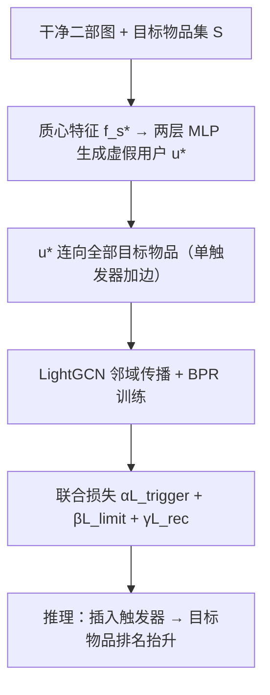
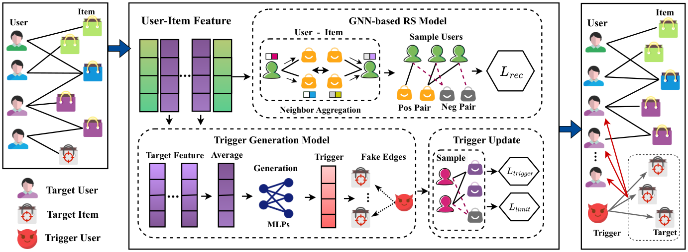

# Single-Node Trigger Backdoor Attacks in Graph-Based Recommendation Systems (图推荐系统中的单节点触发器后门攻击)

- **会议/期刊**: IJCAI 2025
- **作者与机构**: Runze Li, Di Jin, Xiaobao Wang, Dongxiao He, Bingdao Feng, Zhen Wang（天津大学智能与计算学部、深圳人工智能与数字经济广东省实验室、西北工业大学网络空间安全学院）
- **推荐链路定位**: 召回（图协同过滤召回阶段的训练期数据投毒）
- **研究方向**: 去偏公平、可信隐私与工业架构 / 图神经网络与知识图谱推荐
- **论文原文**: [https://arxiv.org/abs/2506.08401v1](https://arxiv.org/abs/2506.08401v1)
- **开源代码**: 暂未开源

## TL;DR (1分钟核心速览)

现有图推荐投毒攻击（GOAT/AutoAttack）靠注入大量虚假用户与边来抬升目标物品，代价是隐蔽性差、对原系统破坏大。本文首次把"后门攻击"引入图推荐：设计**单节点触发器生成器**，仅注入 1 个虚假用户节点并连向全部目标物品，配合目标/无关节点间的**约束损失**稳住原特征分布。在 Yelp/Gowalla/Amazon/MovieLens 四个数据集上，目标用户 ACC 达 99%–100%、Top-10 覆盖率 CVR 超 80%，而 HR@20 相对下降不超过约 5%（Amazon 最差 7.89%）。

## Background & Motivation (背景与核心矛盾)

- **主流范式**: 图推荐（LightGCN 类）通过二部图邻域传播学习用户/物品嵌入；针对它的攻击主流是 shilling attack——注入大量虚假用户节点与交互边，抬高目标物品度数或伪造相似邻居。
- **前人局限**: 其一，Random/Popular/Vote/GSP/AutoAttack 均需注入 5%–20% 量级的虚假用户才能起效，节点与边数量异常极易被图审计发现（低隐蔽性）；其二，大量假边污染消息传播路径，无关用户/物品的推荐质量被显著拖累（高破坏性），图 1 显示注入比例上升时 HR@20 与 ACC 同步恶化。
- **核心洞察 (Key Insight)**: 图后门攻击的"休眠—触发"机制天然契合隐蔽性诉求——无触发器时模型行为与干净模型无异；但传统图后门只针对**单实体分类**（单节点或单图触发器，图 2(a)），而推荐打分是用户—物品**成对相似度**，触发器必须同时作用于目标用户与目标物品两侧（图 2(b)），这是直接迁移失效的根因。
- **本文切入点**: 用"一个虚假用户连向全部目标物品"的**单触发器**同时覆盖多目标物品，把注入量压到 1 个节点，再用约束损失把假信息的影响锁死在目标子图内。

## Method (核心方法设计)

### 1. 整体框架 (Overall Architecture)

SNT-BA 由触发器生成模块与推荐系统训练模块联合端到端优化。输入干净二部图，先对全部目标物品 $s\in S$的表示取均值得到质心特征$f_{s^*}$，经两层 MLP 生成唯一虚假用户$u^*$的特征并把它连向所有目标物品（隐式加边）；随后用 LightGCN 在受污染图上做邻域传播与 BPR 训练，同时用$\mathcal{L}_{trigger}$拉近目标用户—目标物品、用$\mathcal{L}_{limit}$维持目标用户对非候选物品的相对偏好、用$\mathcal{L}_{rec}$ 保住整体推荐精度，三者加权联合优化。推理阶段只需把触发器用户插入目标物品，即可在目标用户候选表中抬升目标物品排名。

<figure class="paper-figure" markdown="span">
  <figcaption>图3：SNT-BA的框架由两个模块组成：触发器生成器和推荐系统训练模块。通过设计触发器，目标物品在插入触发器后其排名可显著提升。同时，约束损失函数的优化确保了无关用户和物品推荐性能的稳定性。</figcaption>
</figure>

### 2. 关键设计拆解 (Key Designs)

1. **单节点触发器生成器（Single-Node Trigger Generator）**：痛点是多目标物品若各配触发器则注入量爆炸、假信息外溢。本文改为对目标物品集取质心 $f_{s^*}=\frac{1}{|S|}\sum_{s\in S} f_s$，再用两层 MLP 生成唯一假用户特征$f_{u^*}=\sigma(f_{s^*}\mathbf{W}_1+\mathbf{b}_1)\mathbf{W}_2+\mathbf{b}_2$，并令其与所有目标物品建边。直觉上，质心使触发器落在目标物品簇中心，一次加边即可对整簇物品产生同向相似度增益，注入成本从$O(|S|)$降到$O(1)$。

2. **触发器损失与节点约束损失（Trigger Loss + Constraint Loss）**：痛点是仅优化攻击目标会让同簇候选物品被推离目标用户、目标用户与非候选物品的交互被削弱，导致攻击前后行为不一致而暴露。触发器损失 $\mathcal{L}_{trigger}=\sum_{t\in T,s\in S,p\in P}-\ln\sigma(\hat{r}_{ts}-\hat{r}_{tp})+\lambda_\Theta\|\Theta\|^2$保证目标物品压过等量负采样候选；约束损失$\mathcal{L}_{limit}=\sum_{(t,p,n)}-\ln\sigma(\hat{r}_{tp}-\hat{r}_{tn})+\lambda_\Theta\|\Theta\|^2$则要求目标用户对候选物品$p$的偏好仍高于随机采样的非候选物品$n$，从而把特征分布"钉"回原簇结构（图 4 显示无约束时物品表示离散化、加约束后回归类别分布）。

3. **训练目标、负采样与推理效率**：总损失 $\mathcal{L}=\alpha\mathcal{L}_{trigger}+\beta\mathcal{L}_{limit}+\gamma\mathcal{L}_{rec}$，其中$\mathcal{L}_{rec}$为标准 BPR。负采样全部为**均匀随机采样**（候选负样本$p$与目标物品等量、约束负样本$n$ 与候选等量），无需难负样本挖掘；代理模型为 3 层 LightGCN，嵌入维度 64，学习率 0.001，训练 1000 epoch。推理开销极低——线上仅需一次加边操作，不改变原模型结构与打分流程。

## Experimental Setup & Evaluation Protocol (实验设置与评估协议)

- **数据集与预处理**: 以"评分高于该用户平均分"判定为正交互建边，未报告 k-core 过滤：

| 数据集 | #Users | #Items | #Interactions | 稀疏度/密度 | 特征/场景说明 |
| :--- | :---: | :---: | :---: | :---: | :--- |
| Gowalla | 29,858 | 40,981 | 1,027,370 | 密度约 8.4e-4 | 签到位置与社交关系 |
| Amazon | 52,643 | 91,599 | 2,984,108 | 密度约 6.2e-4 | 图书评论与评分 |
| Yelp | 31,831 | 40,841 | 1,666,869 | 密度约 1.28e-3 | 本地商户点评 |
| MovieLens | 20,982 | 16,482 | 454,011 | 密度约 1.31e-3 | 电影评分与元数据 |

- **数据划分与防穿越 (Splitting Strategy)**: 采用 `比例划分`，每数据集 80% 训练 / 20% 测试；目标物品数固定为 20。
- **排名评测协议 (Ranking Protocol)**: 采用 `Sampled Ranking` 风格的 Top-K 列表评估——ACC 统计目标物品进入目标用户 Top-10 的用户比例，CVR 统计 Top-10 中目标物品占比（$K=10$），HR@20 统计 Top-20 命中真实交互比例（$N=20$）；未报告全库 Full-Ranking 与显著性检验。
- **对比基线与超参设置**: 基线含 Random（注入 20% 假用户）、Popular（每类 5%）、Vote（目标类 10%）、GSPAttack（GAN 生成假用户）、AutoAttack（10% 假用户）；嵌入维度 $d=64$，LightGCN 3 层，学习率 0.001，epoch 1000。

## Key Experimental Results (实验关键数据)

### 1. 主实验对比 (Main Results)

| 攻击方法 | Yelp ACC | Yelp CVR | Yelp HR@20 | Gowalla ACC | Gowalla CVR | Gowalla HR@20 | Amazon ACC | Amazon CVR | Amazon HR@20 | ML ACC | ML CVR | ML HR@20 |
| :--- | :---: | :---: | :---: | :---: | :---: | :---: | :---: | :---: | :---: | :---: | :---: | :---: |
| Random | 0.22 | 0.15 | 0.2238 | 0.27 | 0.21 | 0.3587 | 0.24 | 0.17 | 0.1248 | 0.19 | 0.14 | 0.4715 |
| Popular | 0.30 | 0.25 | 0.2137 | 0.35 | 0.30 | 0.3373 | 0.32 | 0.28 | 0.1065 | 0.26 | 0.22 | 0.4454 |
| Vote | 0.37 | 0.32 | 0.2251 | 0.42 | 0.53 | 0.3497 | 0.49 | 0.45 | 0.1249 | 0.43 | 0.38 | 0.4787 |
| GSPAttack | 0.68 | 0.53 | 0.2354 | 0.75 | 0.62 | 0.3412 | 0.63 | 0.55 | 0.1218 | 0.68 | 0.51 | 0.4962 |
| AutoAttack | 0.81 | 0.56 | 0.2525 | 0.87 | 0.77 | 0.3715 | 0.82 | 0.64 | 0.1384 | 0.85 | 0.65 | 0.5223 |
| **SNT-BA (Ours)** | **1.00** | **0.71** | **0.3245** | **0.99** | **0.92** | **0.4997** | **0.99** | **0.87** | **0.1709** | **1.00** | **0.89** | **0.7324** |
| Improv. (ACC vs AutoAttack) | +23.5% | +26.8% | +28.5% | +13.8% | +19.5% | +34.5% | +20.7% | +35.9% | +23.5% | +17.6% | +36.9% | +40.2% |

### 2. 消融实验 (Ablation Study)

| 配置 | Yelp | Gowalla | Amazon | MovieLens | 说明 |
| :--- | :---: | :---: | :---: | :---: | :--- |
| Raw（干净图） | 0.1179 | 0.0769 | 0.0425 | 0.1487 | 无攻击时目标物品自然曝光 |
| w/o $\mathcal{L}_{limit}$ | 0.0625 | 0.0469 | 0.0217 | 0.1162 | 去掉约束损失 |
| **Ours（完整）** | **0.0995** | **0.0715** | **0.0403** | **0.1369** | 加约束后接近 Raw |

| 数据集 | Raw HR | Attacked HR | Decline Rate |
| :--- | :---: | :---: | :---: |
| Yelp | 0.3412 | 0.3372 | 3.94% |
| Gowalla | 0.5322 | 0.5157 | 1.65% |
| Amazon | 0.2013 | 0.1854 | 7.89% |
| MovieLens | 0.7605 | 0.7484 | 1.21% |

### 3. 关键实验发现 (Key Findings)

1. **单触发器即可实现近饱和攻击**：ACC 在四个数据集上达 0.99–1.00，较最强基线 AutoAttack（0.81–0.87）提升 13.8%–23.5%，而注入节点数从 AutoAttack 的 10% 假用户降到 **1 个节点**，攻击成本与可检测面同步骤降。
2. **约束损失是隐蔽性的命门**：去掉 $\mathcal{L}_{limit}$ 后，攻击前目标物品自然曝光从 Yelp 0.1179 跌至 0.0625（近乎腰斩），说明无约束时同簇候选物品被推离目标用户、行为异常易被审计；加约束后恢复至 0.0995，与 Raw 差距仅约 15%，且图 4 显示物品表示从离散回归类别簇分布。
3. **触发器规模收益递减、破坏性递增**：图 5 中把触发器从 0 扩到 5/11/15/20 个假物品，CVR 提升可忽略，但假信息经 3 层传播污染无关节点，HR 明显下滑；这反向印证"单触发器统一连向全部目标物品"在效果—破坏性权衡上优于"每物品一触发器"。

## Highlights & Limitations (亮点、对比与审稿批判)

- **与代表作对比 (vs. Prior Work)**: 与 AutoAttack/GSPAttack 的本质差异在于攻击范式——后者是"训练期注入大量假节点改变图结构"的 shilling attack，本文是"训练期植入休眠触发器、推理期一次加边激活"的后门攻击；与图后门代表作（单节点/单图触发器用于节点分类）相比，本文首次把触发器设计成同时作用于用户侧与物品侧的成对结构，解决了推荐打分是相似度函数而非单实体标签的结构性障碍。
- **可迁移亮点**: ①"质心特征 + 轻量 MLP 生成单触发器"可迁移到多目标投毒/多物品冷启动扶持场景，把 $O(|S|)$注入压到$O(1)$；②$\mathcal{L}_{limit}$ 这种"用非候选物品做相对偏好锚定"的约束思路，可直接用于任何需要"局部扰动但保持全局分布稳定"的图增广或去噪训练。
- **审稿级局限批判**: ①评估协议偏弱——仅报告 HR@20 与自定义 ACC/CVR，未做全库 Full-Ranking、未报告 NDCG/Recall、未给显著性检验，且"影响控制在 5%"的表述与 Amazon 实测 7.89% 的下降存在口径出入；②防御侧完全缺位——未评估任何后门检测（如触发器逆向、嵌入异常检测）或鲁棒训练下的攻击存活率，也未讨论真实平台对"单节点高度数异常"的审计可行性，攻击的现实威胁度论证不足。

## Rating (四维评分)

- **方法创新性 (Novelty)**: ⭐⭐⭐⭐ （首次将后门攻击引入图推荐，单节点触发器 + 成对约束的设计切中推荐打分与单实体分类的结构差异，思路干净）
- **评估协议与实验扎实度 (Protocol & Experiments)**: ⭐⭐⭐ （四数据集 + 五基线 + 消融与触发器规模分析较完整，但缺 Full-Ranking、NDCG 与显著性检验，指标为自定义）
- **写作与数学规范度 (Clarity & Rigor)**: ⭐⭐⭐⭐ （公式与符号定义清晰、损失设计动机交代到位，但部分记号如 $f_t$与$f_{s^*}$ 维度表述略含混）
- **工业落地与复现价值 (Industrial & Practical Value)**: ⭐⭐⭐ （攻击成本极低、推理仅一次加边，对平台风控有直接警示价值；但未开源、缺防御实验，落地需自行补检测基线）

