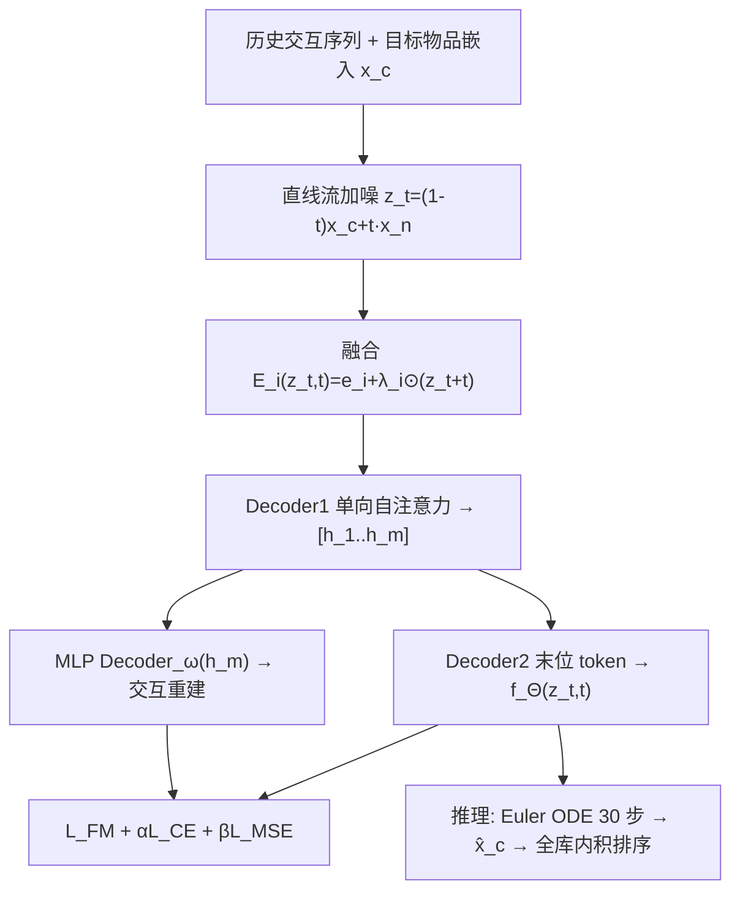
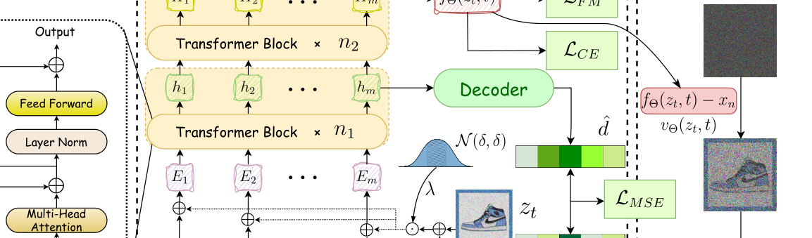

# Flow Matching based Sequential Recommender Model (基于流匹配的序列推荐模型)

- **会议/期刊**: IJCAI 2025
- **作者与机构**: Feng Liu, Lixin Zou, Chenliang Li 等（武汉大学国家网络安全学院、香港城市大学、Monash University 等）
- **推荐链路定位**: 端到端生成式（Next-Item 生成召回）
- **研究方向**: 生成式推荐与离散语义ID / 序列与会话推荐
- **论文原文**: [https://arxiv.org/abs/2505.16298v1](https://arxiv.org/abs/2505.16298v1)
- **开源代码**: [https://github.com/FengLiu-1/FMRec](https://github.com/FengLiu-1/FMRec)

## TL;DR (1分钟核心速览)

扩散式序列推荐（DiffuRec/DreamRec）存在两大痛点：前向加噪的**弯曲噪声轨迹**导致误差累积、反向 **SDE 随机采样**引入与"精准预测下一物品"目标相悖的随机扰动。本文提出 FMRec，将 Flow Matching 引入序列推荐：采用直线流轨迹 $z_t=(1-t)x_c+tx_n$并推导出**无噪等价学习目标**$\|f_\Theta(z_t,t)-x_c\|_2^2$，辅以交叉熵与交互重建双正则，推理端用 Euler 法 ODE 确定性采样。在 Beauty/Steam/Movielens-100k/Yelp 四数据集 Full-Ranking 协议下，HR/NDCG 平均相对 SOTA 提升 6.53%（HR@5 最高 +8.86%）。

## Background & Motivation (背景与核心矛盾)

- **主流范式**: 以 DiffuRec、DreamRec、DimeRec 为代表，将扩散模型迁移到序列推荐：前向对目标物品嵌入逐步加噪，反向以历史交互为条件、用 SDE 随机采样器去噪生成下一物品。
- **前人局限一（偏好建模失真）**: 前向过程采用弯曲噪声调度路径（如 Cosine），长曲轨迹导致反向拟合时误差累积，需更多扩散步数补偿；现有工作只能靠"把噪声强度调到极小"来缓解，治标不治本。
- **前人局限二（生成随机性）**: SDE 随机反向采样在采样阶段额外注入方差扰动，图像生成中这是多样性优势，但在 Next-Item 预测中会把"手表"漂移成"牛奶"，直接损害推荐相关性。
- **核心洞察 (Key Insight)**: Flow Matching 作为简化扩散模型，其直线轨迹在理论上具有更小的传输代价与误差累积；且其 ODE 形式天然支持确定性推理。
- **本文切入点**: 用直线流轨迹 + 面向推荐任务改造的无噪学习目标 + 确定性 Euler 采样器，从"前向"与"反向"两端同时消除噪声扰动。

## Method (核心方法设计)

### 1. 整体框架 (Overall Architecture)

FMRec 以目标物品嵌入 $e_{m+1}$为数据分布$p(x_c|e_{m+1})=\mathcal{N}(x_c;e_{m+1},0)$（注意$e_{m+1}$可训练，区别于标准 Flow Matching 的固定数据）。训练时：历史序列嵌入与加噪中间态$z_t$按可学习比例融合，经 Decoder1（2 层单向自注意力）得到隐状态$[h_1,\dots,h_m]$，再由 Decoder2 取末位 token 输出$f_\Theta(z_t,t)$预测干净数据$x_c$；同时$h_m$经 MLP 解码重建用户历史交互向量。推理时从纯噪声出发，用 Euler 法沿 ODE 迭代$q=30$步得到去噪嵌入$\hat{x}_c$，与物品嵌入做内积全库排序。

<figure class="paper-figure" markdown="span">
  <figcaption>图 2：FMREC 的框架。在训练过程中，我们的设计包括直线流轨迹的构建、学习目标 LF M 的修改、基于解码器的模型设计，以及正则化损失函数 LCE 和 LMSE 的实现。在推理过程中，我们提出了一种确定性反向采样器来生成推荐。</figcaption>
</figure>

### 2. 关键设计拆解 (Key Designs)

1. **直线轨迹 + 无噪等价学习目标（Modified Flow Matching Loss）**：标准 FM 需回归向量场 $u_t(z_t|x_n)=-\phi_t^{-1}(z_t|x_n)+x_n$，即"真实数据与噪声的复杂组合"，对推荐任务而言难以学习且易生成"多样但无关"的物品。作者取$a_t=1-t,\ b_t=t$，将学习目标替换为$v_\Theta=-f_\Theta+x_n$，代入后损失化简为：
$$\mathcal{L}_{FM}=\mathbb{E}_{t,p_t(z|x_c),p(x_c)}\|f_\Theta(z_t,t)-x_c\|_2^2$$
即网络直接预测干净物品嵌入。物理直觉：直线轨迹下 $x_c$与$x_n$ 的线性插值使条件向量场恒定，误差不随步数累积，少量 Euler 步即可收敛。

2. **双正则损失（防坍缩 + 抗噪）**：由于 $x_c$可训练，仅用上式会导致不同物品嵌入坍缩到同一点。故引入交叉熵$\mathcal{L}_{CE}=-\log\hat{y}_{m+1}$，其中$\hat{y}_{m+1}=\frac{\exp(f_\Theta(z_t,t)\cdot e_{m+1})}{\sum_{i\in\mathcal{I}}\exp(f_\Theta(z_t,t)\cdot e_i)}$，拉开物品间区分度；再引入重建损失$\mathcal{L}_{MSE}=\|\hat{d}-r\|^2$（$\hat{d}=\text{Decoder}_\omega(h_m)$，$r$ 为 0/1 交互向量），迫使末位隐状态保留完整历史偏好，从而在前向加噪中"守住"用户兴趣。

3. **确定性反向采样与训练目标**：总损失 $\mathcal{L}=\mathcal{L}_{FM}+\alpha\mathcal{L}_{CE}+\beta\mathcal{L}_{MSE}$（$\alpha=0.2,\beta=0.4$）。反向过程求解$\mathrm{d}z_t=(f_\Theta(z_t,t)-x_n)\mathrm{d}t$，用 Euler 迭代$z_{t+\Delta t}=z_t+(f_\Theta(z_t,t)-x_n)\Delta t$，$\Delta t=1/q$。**无负采样**（全库 softmax 即隐式负样本），推理仅需 30 步前向、无随机数生成，开销低于 SDE 多步采样。

## Experimental Setup & Evaluation Protocol (实验设置与评估协议)

- **数据集与预处理**: 四个公开基准，均按序列推荐惯例过滤（短于 3 的序列剔除）：

| 数据集 | #Users | #Items | #Interactions | 稀疏度 | 场景说明 |
| :--- | :---: | :---: | :---: | :---: | :--- |
| Beauty | 22,361 | 12,101 | 198,502 | 99.93% | 亚马逊美妆购买/评论 |
| Steam | 281,428 | 13,044 | 3,485,022 | 99.90% | PC 游戏平台 |
| Movielens-100k | 943 | 1,682 | 100,000 | 93.70% | 电影评分（稠密小规模） |
| Yelp | 28,298 | 59,951 | 1,764,589 | 99.90% | 本地商户评论 |

- **数据划分与防穿越**: `Leave-One-Out` 逐用户切分——前 $m-2$个交互为训练集，$i_{m-1}$为验证集，$i_m$ 为测试集。
- **排名评测协议**: 无偏 `Full-Ranking`（全部物品作为候选，未交互即负样本），指标 HR@{5,10,20} 与 NDCG@{5,10,20}。
- **对比基线与超参**: 8 个基线覆盖 RNN（GRU4Rec）、CNN（Caser）、Transformer（SASRec/BERT4Rec/STOSA）、自编码器（AutoSeqRec）与扩散生成（DreamRec/DiffuRec）。嵌入维度 $d=128$，Decoder1/2 各 2 层、4 头注意力，batch 512，学习率 0.001，最大序列长 50，Euler 步数 30，时间步采样缩放$s=1.0$。

## Key Experimental Results (实验关键数据)

### 1. 主实验对比 (Main Results)

| 数据集 | 指标 | SASRec | BERT4Rec | STOSA | AutoSeqRec | DreamRec | DiffuRec | **FMRec** | Improv.% |
| :--- | :--- | :---: | :---: | :---: | :---: | :---: | :---: | :---: | :---: |
| Beauty | HR@5 | 3.2688 | 2.1326 | 3.8814 | 4.9628 | 4.9833 | 5.3943 | **5.8373** | +8.21% |
| Beauty | NDCG@10 | 3.2305 | 1.8291 | 3.2053 | 4.0157 | 3.9769 | 4.6971 | **4.9461** | +5.30% |
| Steam | HR@5 | 4.7428 | 4.7391 | 4.8546 | 5.0021 | 5.1267 | 6.0073 | **6.5254** | +8.62% |
| Steam | NDCG@10 | 4.0489 | 4.0002 | 4.1191 | 4.4729 | 4.6416 | 5.0429 | **5.4925** | +8.91% |
| Movielens-100k | HR@5 | 6.5748 | 5.0901 | 8.0148 | 8.7320 | 7.3692 | 7.5209 | **9.3338** | +6.89% |
| Movielens-100k | NDCG@20 | 8.6340 | 6.3442 | 8.3302 | 9.4584 | 7.8234 | 8.0459 | **9.8158** | +3.78% |
| Yelp | HR@5 | 2.8389 | 2.2465 | 1.9360 | OOM | 1.7486 | 3.0390 | **3.3084** | +8.86% |
| Yelp | NDCG@10 | 2.5466 | 1.9732 | 1.6728 | OOM | 1.5268 | 2.6352 | **2.7855** | +5.71% |

（数值为百分比；AutoSeqRec 在 Yelp 上 OOM 未计入。）

### 2. 消融实验 (Ablation Study)

| 变体 | Beauty HR@5 | Beauty NDCG@10 | ML-100k HR@5 | ML-100k NDCG@10 |
| :--- | :---: | :---: | :---: | :---: |
| v-prediction（朴素 FM 损失） | 0.5753 | 0.5104 | 0.8251 | 0.7524 |
| Cosine 轨迹（替代直线） | 显著下降（图 3） | — | 显著下降（图 3） | — |
| **FMRec（完整）** | **5.8373** | **4.9461** | **9.3338** | **7.6571** |

### 3. 关键实验发现 (Key Findings)

1. **无噪目标改写是性能命门**：朴素 v-prediction 损失下 Beauty HR@5 仅 0.5753，完整模型为 5.8373，相差约 10 倍——直接回归"数据+噪声"混合向量场会让模型彻底学不到用户偏好，验证了式 (13) 改造的必要性。
2. **直线轨迹优于 Cosine 轨迹**：图 3 显示 Cosine 轨迹在 Beauty 与 Movielens-100k 上均明显掉点，说明弯曲路径的误差累积在推荐任务中确实存在，直线轨迹以更少迭代步数获得更优收敛。
3. **正则项与噪声强度均需精细平衡**：$\alpha=0.2,\beta=0.4$为最优组合，$\alpha$过低或过高均掉点；融合噪声参数$\delta=0.001$最佳，$\delta=0.1$ 时反向向量场计算偏离、生成质量下降——说明"适度加噪有益、过度加噪有害"。

## Highlights & Limitations (亮点、对比与审稿批判)

- **与代表作对比 (vs. Prior Work)**: 相比 DiffuRec/DreamRec 的 SDE 随机采样 + 弯曲噪声调度，FMRec 从"轨迹形状"与"采样随机性"两个维度同时纠偏，且把学习目标从向量场改为干净嵌入，本质是把生成式推荐的优化目标对齐到"精准命中下一物品"；相比 SASRec/BERT4Rec 等判别式模型，其生成范式在四个数据集上 HR@5 领先 13.7%–34.98%。
- **可迁移亮点**: (1) "可训练数据分布 + 无噪等价目标 + 交叉熵防坍缩"三件套可直接迁移到其他以可学习嵌入为生成目标的连续生成式推荐；(2) 用重建损失约束末位隐状态保留历史偏好，是缓解生成模型"遗忘输入"的通用正则手段。
- **审稿级局限批判**: (1) 推理需 30 步 Euler 迭代，相比 SASRec 单次前向的延迟开销未做量化对比，工业级在线召回的时延可行性存疑；(2) 仅在 4 个中小规模公开数据集验证，缺乏大规模工业数据与线上 A/B，且未与 TIGER 类语义 ID 生成式检索、LLM4Rec 等新范式对比。

## Rating (四维评分)

- **方法创新性 (Novelty)**: ⭐⭐⭐⭐ （首次将 Flow Matching 系统迁移到序列推荐，直线轨迹+无噪目标+确定性采样的组合有清晰的理论动机）
- **评估协议与实验扎实度 (Protocol & Experiments)**: ⭐⭐⭐⭐ （四数据集 Full-Ranking + 8 基线 + 多组超参分析完整，但缺显著性检验与效率对比）
- **写作与数学规范度 (Clarity & Rigor)**: ⭐⭐⭐⭐ （式 (11)–(13) 的推导链条清晰，符号统一；附录承载理论分析略影响正文自洽性）
- **工业落地与复现价值 (Industrial & Practical Value)**: ⭐⭐⭐⭐ （代码已开源，无负采样训练简洁，但 30 步 ODE 推理的时延需进一步优化）

