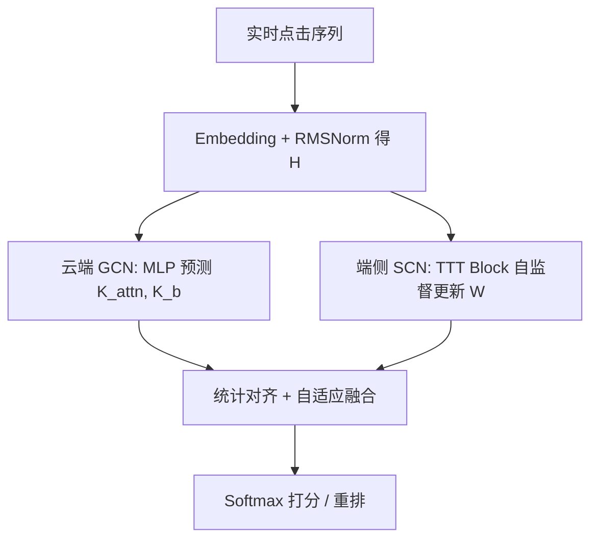
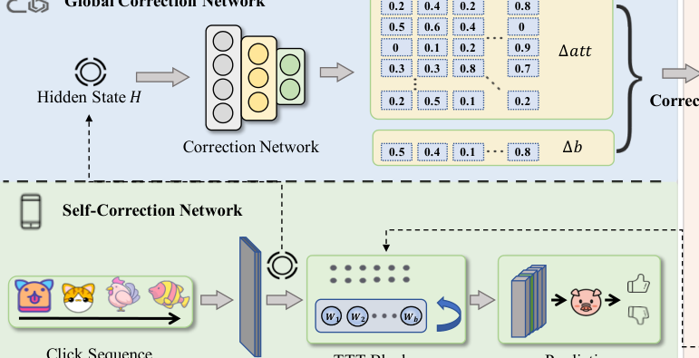

# Device-Cloud Collaborative Correction for On-Device Recommendation (端云协同校正的端侧推荐)

- **会议/期刊**: IJCAI 2025
- **作者与机构**: Tianyu Zhan, Shengyu Zhang, Zheqi Lv, Jieming Zhu, Jiwei Li, Fan Wu, Fei Wu（浙江大学 / 华为诺亚方舟实验室 / 上海交通大学）
- **推荐链路定位**: 重排（端侧实时重排）
- **研究方向**: 序列与会话推荐 / 去偏公平、可信隐私与工业架构
- **论文原文**: [https://arxiv.org/abs/2506.12687v1](https://arxiv.org/abs/2506.12687v1)
- **开源代码**: [https://github.com/Yuzt-zju/CoCorrRec](https://github.com/Yuzt-zju/CoCorrRec)

## TL;DR (1分钟核心速览)

端侧推荐需在有限算力下兼顾实时性与长序列建模能力：Transformer 精度高但复杂度 $O(N^2d)$、内存随序列线性增长，RNN 高效却存在长程遗忘。本文提出 CoCorrRec，用 TTT（Test-Time Training）思想把 RNN 的隐状态"升级"为一个在线自监督学习的线性模型，推理时按 token 动态更新参数（SCN），再由云端 GCN 基于全局隐状态给出参数校正以抑制端侧过拟合。在 Beauty/Electronic/Yelp 三数据集上，UAUC 相对最优基线最高提升 4.56%，且端侧 FLOPs 增量仅 17.0M/token，远低于 BERT4Rec 的 101.0M。

## Background & Motivation (背景与核心矛盾)

- **主流范式**: 端侧推荐模型以序列模型为主，分 Transformer 系（SASRec/BERT4Rec/Mamba4Rec）与 RNN 系（GRU4Rec）两派，负责对云端候选列表做实时重排。
- **前人局限**: Transformer 保留早期行为能力强，但时间/空间复杂度为 $O(N^2d)$与$O(Nd)$，长序列下设备内存与算力吃紧；RNN 复杂度仅$O(Nd)$与$O(d)$，却随序列增长逐步遗忘早期行为，精度落后。
- **核心洞察 (Key Insight)**: 作者指出 TTT 层把"隐状态"重新定义为一个可在线自监督更新的小模型，等价于用固定内存开销换取长程记忆；但端侧数据只是全局分布的偏置子集，且 mini-batch 并行会压缩参数搜索空间（图 1），导致泛化受损。
- **本文切入点**: 端侧用 SCN 做个性化快速校正，云端用 GCN 从全局视角补一个"泛化校正量"，二者并行、互不阻塞。

## Method (核心方法设计)

### 1. 整体框架 (Overall Architecture)

输入为用户实时点击序列，经 Embedding + RMSNorm 得到隐状态 $H$；$H$同时送入两条支路：端侧 SCN 的 TTT Block 做自监督参数更新并输出打分，云端 GCN（三层 MLP）以$H$为输入预测校正量$K_{attn}, K_b$ 并回传。端侧将校正量做统计对齐后自适应融合进 TTT 的注意力与偏置项，完成一次前向即得重排分数。训练全部在云端用全局历史数据端到端完成，推理时 SCN 与 GCN 并行执行，通信延迟被隐藏在端侧计算窗口内。

<figure class="paper-figure" markdown="span">
  <figcaption>图2：CoCorrRec 概览。(a) 描述 CoCorrRec 推理流程，端侧 SCN 将 H 上传至云端 GCN，随后下载其生成的校正。(b) 描述设备端校正的细节。(c) 描述云端利用从海量设备收集的全局数据进行预训练的过程。</figcaption>
</figure>

### 2. 关键设计拆解 (Key Designs)

1. **TTT Block 自校正（把 RNN 隐状态换成在线学习的线性模型）**：痛点是不更新参数则长程遗忘、更新则怕算不动。TTT 用三个低秩投影 $\theta_K,\theta_V,\theta_Q$构造自监督重构损失$l(W;x_t)=\|f(\theta_K x_t;W)-\theta_V x_t\|^2$，每步做一次梯度下降$W_t=W_{t-1}-\eta\nabla l(W_{t-1};x_t)$，输出$z_t=f(\theta_Q x_t;W_t)$。直觉上，模型"边读边记"，把历史压缩进权重而非隐向量，从而以$O(d)$ 内存保留长程信息。
2. **Mini-batch 加速与对偶形式（把串行更新变成 GPU 友好的矩阵运算）**：朴素 TTT 的 $W_t$依赖$W_{t-1}$无法并行。作者令批内$b$步共享起点$W_{t'}$，得$W_t=W_{t'}-\eta\sum_{s=t'+1}^{t}\nabla l(W_{t'};x_s)$；在线性$f$、$\theta=I$下进一步化为闭式$W_b=W_0-2\eta(W_0X-X)X^{\top}$、$Z=W_0X-2\eta\,\text{mask}(X^{\top}X)(W_0X-X)$，一次矩阵乘完成整批更新。
3. **云端 GCN 全局校正与训练目标**：端侧偏置数据 + mini-batch 搜索空间收缩是两大泛化隐患。GCN 输出 $K_i=C_i(H;\theta_i)$，先做均值方差对齐$K_i=\frac{K_i-\text{mean}(K_i)}{\text{std}(K_i)}\text{std}(i)+\text{mean}(i)$，再以可学习标量$P,Q$融合$\text{attn}\leftarrow\text{attn}+P\cdot K_{attn}$、$b\leftarrow b+Q\cdot K_b$。总损失为全局交叉熵$\min_{\theta_M,\theta_C}\sum_{i}\mathcal{D}_{ce}(y^{(i)},M(x^{(i)};\theta_M,C(H_{x^{(i)}};\theta_C)))$；负采样为训练 1:4、测试 1:100 的均匀采样，无需 hard negative。

## Experimental Setup & Evaluation Protocol (实验设置与评估协议)

- **数据集与预处理**: 按时间戳排序，过滤交互数 $\le 10$ 的用户与物品（近似 10-core）：

| 数据集 | #Users | #Items | #Interactions | 平均序列长 | 场景说明 |
| :--- | :---: | :---: | :---: | :---: | :--- |
| Beauty | 4,255 | 22,301 | 96,053 | 22.6 | 亚马逊美妆 |
| Electronic | 27,224 | 75,749 | 599,276 | 22.0 | 亚马逊电子 |
| Yelp | 18,046 | 46,118 | 1,358,413 | 75.3 | 本地商户评论 |

- **数据划分与防穿越**: 按时间戳全局排序后切分训练/测试（序列推荐标准时序切分），无未来交互泄漏。
- **排名评测协议**: `Sampled Ranking`，测试阶段按 1:100 采样负样本，指标为 UAUC、HitRate@{5,10,20}、NDCG@{5,10,20}。
- **对比基线与超参设置**: 基线含 RNN 系（GRU4Rec、DIN）与 Transformer/SSM 系（SASRec、BERT4Rec、Mamba4Rec）；Embedding 维度 64、4 头、序列长 10、batch 1024、学习率在 $\{1e^{-3},2e^{-3},5e^{-3},1e^{-2}\}$ 中搜索，单卡 RTX-4090。

## Key Experimental Results (实验关键数据)

### 1. 主实验对比 (Main Results)

| 数据集 | 模型 | UAUC | NDCG@10 | NDCG@20 | HR@10 | HR@20 |
| :--- | :--- | :---: | :---: | :---: | :---: | :---: |
| Beauty | SASRec | 0.7314 | 0.2920 | 0.3180 | 0.4852 | 0.5876 |
| Beauty | BERT4Rec | 0.7178 | 0.2829 | 0.3109 | 0.4296 | 0.5403 |
| Beauty | Mamba4Rec | 0.7220 | 0.3300 | 0.3543 | 0.4639 | 0.5603 |
| Beauty | CoCorrRec (w/o GCN) | 0.7331 | 0.3256 | 0.3517 | 0.4858 | 0.5874 |
| Beauty | **CoCorrRec** | **0.7342** | **0.3371** | **0.3626** | **0.4867** | **0.5888** |
| Electronic | GRU4Rec | 0.8257 | 0.3933 | 0.4237 | 0.6016 | 0.7218 |
| Electronic | SASRec | 0.8161 | 0.3820 | 0.4131 | 0.5881 | 0.7107 |
| Electronic | Mamba4Rec | 0.8198 | 0.3787 | 0.4115 | 0.5861 | 0.7157 |
| Electronic | CoCorrRec (w/o GCN) | 0.8258 | 0.3950 | 0.4258 | 0.5989 | 0.7210 |
| Electronic | **CoCorrRec** | **0.8315** | **0.4021** | **0.4327** | **0.6074** | **0.7282** |
| Yelp | BERT4Rec | 0.9524 | 0.5830 | 0.6000 | 0.8841 | 0.9514 |
| Yelp | Mamba4Rec | 0.9514 | 0.5776 | 0.5954 | 0.8832 | 0.9528 |
| Yelp | **CoCorrRec** | **0.9533** | **0.5865** | **0.6036** | **0.8858** | **0.9531** |

相对最优基线：Beauty NDCG@10 提升 2.15%（0.3300→0.3371），Electronic UAUC 提升 0.70%、NDCG@10 提升 2.24%，Yelp UAUC 提升 0.09%；论文报告整体提升区间 0.06%–4.56%。

### 2. 消融与资源开销 (Ablation & Cost)

| 配置 | #Params | ΔFLOPs/token | ΔMemory/token | 说明 |
| :--- | :---: | :---: | :---: | :--- |
| GRU4Rec | 1.97M | 30.2M | 8.78M | RNN 基线 |
| SASRec | 3.91M | 38.3M | 6.01M | 自注意力 |
| BERT4Rec | 2.02M | 101.0M | 35.6M | 双向 Transformer |
| Mamba4Rec | 2.06M | 68.4M | 21.6M | SSM |
| CoCorrRec (w/o GCN) | 1.95M | 17.0M | 14.2M | 纯端侧 |
| CoCorrRec | 2.08M | 82.7M | 23.2M | 含云端 GCN |

### 3. 关键实验发现 (Key Findings)

1. **GCN 是稳定的正增益项**：三数据集上 CoCorrRec 全面优于 w/o GCN（Beauty NDCG@10 +1.15pt、Electronic +0.71pt、Yelp +0.30pt），且 GCN 在云端并行执行，端侧时延零增加，验证了"全局泛化补个性化偏置"的设计假设。
2. **端侧效率优势明确**：纯端侧 SCN 每 token 仅增 17.0M FLOPs，约为 BERT4Rec 的 1/6、Mamba4Rec 的 1/4，参数量 1.95M 与 GRU4Rec 持平，说明精度提升并非靠堆参数换来。
3. **mini-batch 大小几乎不损精度但大幅降时延**：Beauty 上 $b=20$与$b=1$ 性能接近，而推理时间显著下降，说明批内共享起点的近似梯度在实践中足够可靠；通信侧 5G 100MB/s 下总往返约 1.25ms，远低于 4.21ms 的端侧容忍窗口。

## Highlights & Limitations (亮点、对比与审稿批判)

- **与代表作对比 (vs. Prior Work)**: 相比 SASRec/BERT4Rec 靠增大注意力窗口换精度，本文改的是"隐状态载体"本身（权重而非向量）；相比 DCCL/MetaController 等端云协同工作只做知识蒸馏或参数融合，本文把校正粒度下沉到 TTT 内部的 attn/bias 算子级；相比原始 TTT-Linear，本文新增了云端全局校正与统计对齐融合，解决了端侧单用户微调必然带来的泛化塌缩。
- **可迁移亮点**: ①"统计对齐 + 可学习标量融合"是一种极轻量的跨源参数注入方式，可迁移到任何端云/跨域参数融合场景；②把 TTT 的对偶形式写成 mask 矩阵乘，是把串行在线学习搬上 GPU 的通用工程技巧。
- **审稿级局限批判**: ①评测采用 1:100 采样排序而非 Full-Ranking，UAUC 与 HR 在采样协议下可能高估真实全库排序收益，且 Yelp 上提升仅 0.06%–0.09%，显著性存疑；②GCN 使 FLOPs 从 17.0M 暴涨至 82.7M，论文以"部署在云端"一笔带过，但未给出云端 QPS 与多设备并发下的排队延迟分析；③序列长度仅设为 10，而方法的核心卖点是长序列记忆，缺少 $N=50/100$ 的精度-开销曲线，说服力不足。

## Rating (四维评分)

- **方法创新性 (Novelty)**: ⭐⭐⭐⭐ （把 TTT 从语言模型迁移到端侧序列推荐，并以云端校正修补其泛化缺陷，组合新颖且有明确动机链）
- **评估协议与实验扎实度 (Protocol & Experiments)**: ⭐⭐⭐ （三数据集 + 资源/时延/批大小多维分析较完整，但采样排序协议与短序列设定削弱了结论强度）
- **写作与数学规范度 (Clarity & Rigor)**: ⭐⭐⭐⭐ （TTT 更新规则、对偶形式与融合公式推导清晰，算法伪代码完整，复杂度对比有据）
- **工业落地与复现价值 (Industrial & Practical Value)**: ⭐⭐⭐⭐ （代码已开源，端侧 1.95M 参数与 17.0M FLOPs/token 极具部署吸引力，通信开销实测可接受）

