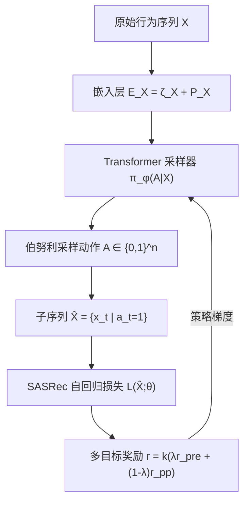
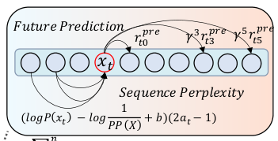

# Towards Automatic Sampling of User Behaviors for Sequential Recommender Systems (面向序列推荐系统的用户行为自动采样)

- **会议/期刊**: IJCAI 2025
- **作者与机构**: Hao Zhang, Mingyue Cheng, Zhiding Liu, Junzhe Jiang（中国科学技术大学 认知智能全国重点实验室）
- **推荐链路定位**: 召回（序列建模前的数据层预处理）
- **研究方向**: 序列与会话推荐 / 自监督与交互去噪
- **论文原文**: [https://arxiv.org/abs/2311.00388v4](https://arxiv.org/abs/2311.00388v4)
- **开源代码**: [https://github.com/zh-ustc/AutoSAM](https://github.com/zh-ustc/AutoSAM)

## TL;DR (1分钟核心速览)

现有序列推荐（SRS）把每条历史行为一律当作等权正样本，但购买与误点击对兴趣塑造的价值天差地别。本文提出 AutoSAM：在标准 SRS 前挂一个轻量 Transformer 采样器，对每条行为输出保留/丢弃的伯努利策略，并用强化学习策略梯度训练该采样器，奖励由「未来预测增益」与「序列困惑度一致性」两项构成。在 Tmall/Alipay/Yelp/Amazon 四个数据集、Leave-One-Out + Full-Ranking 协议下，以 SASRec 为骨干，NDCG@10 相对最强基线平均提升约 7.4%–8.0%，Amazon 上高达 14.1%。

## Background & Motivation (背景与核心矛盾)

- **主流范式**: 从 GRU4Rec、NextItNet 到 SASRec/BERT4Rec，SRS 的进步几乎全部来自模型架构（RNN/CNN/Self-Attention），数据侧默认「全序列 = 全正样本」。
- **前人局限**: ① 数据侧工作（SIM、UBR4CTR、SDIM）依赖**目标物品**做检索式采样，无法对百万级候选并行打分，只适合精排 CTR 场景；② 这些方法按二分类优化，无法兼容 SRS 中高效的**自回归生成损失**，且采样是静态的、不随训练动态调整。
- **核心洞察 (Key Insight)**: 随机丢弃部分行为（RanSAM）竟然稳定优于全量训练（FullSAM），说明采样本身兼具**数据增广**作用；但均匀随机又会误删高价值行为，因此关键在于「学出一个偏斜的、自适应的保留分布」。
- **本文切入点**: 把采样建模为不可微的离散决策序列，用 RL 策略梯度绕开不可微问题，并把「预测未来」与「贴合上下文」两个决策因素写进奖励。

## Method (核心方法设计)

### 1. 整体框架 (Overall Architecture)

输入序列 $X$先经嵌入层得到$E_X=\zeta_X+P_X$，送入带三角掩码的 Transformer Block 采样器，逐步输出保留概率$\pi_\phi(A|X)\in[0,1]^{n\times 2}$，按伯努利采样得到动作$A\in\{0,1\}^n$，据此构造子序列$\hat{X}=\{x_t\mid a_t=1\}$；子序列再喂给标准 SASRec 计算自回归损失$\mathcal{L}(\hat{X};\theta)$。采样器不接收 SRS 的反向梯度（图 1 虚线），而是由环境反馈的多目标奖励$r=k(\lambda r_{pre}+(1-\lambda)r_{pp})$ 通过策略梯度更新，二者交替端到端联合优化。

<figure class="paper-figure" markdown="span">
  <figcaption>图 1：(a) 为标准序列推荐系统（SRS）的架构。(b) 为我们提出的 AutoSAM，其在传统序列推荐架构上增加一个采样器层，以自适应地探索原始输入的偏斜分布。虚线表示梯度反向传播。</figcaption>
</figure>

### 2. 关键设计拆解 (Key Designs)

1. **局部+全局融合的轻量采样器**：仅用当前物品嵌入做决策会丢失上下文，仅用全局表示又忽略单条行为本身。采样器将 Transformer 全局隐状态 $H$与局部嵌入$E$拼接后过两层 MLP 得 logits，再经温度$\tau$的 Softmax 与伯努利采样：$S=\mathrm{ReLU}([H\|E]W_1+b_1)W_2+b_2,\ \pi=\mathrm{Softmax}(S/\tau)$。温度$\tau$ 直接控制采样分布的锐度，是调节「探索 vs. 确定性」的关键旋钮。

2. **未来预测奖励 $r_{pre}$（基于策略梯度的损失重写）**：把子序列损失展开为逐位置指示形式$\mathcal{L}(\hat{X};\theta)=\sum_{t=1}^{n-1}L_t(X,A;\theta)$，对$\phi$求梯度后自然浮现出 REINFORCE 结构，奖励即负损失增益，并加入原始序列基线$L^b$、折扣因子$\gamma=0.9$与概率阈值$\psi$ 过滤：
$r^{pre}_t=\sum_{t'=t}^{n-1}-\gamma^{t'-t}\mathbb{I}[\pi_\phi(a_{t'+1}|X)>\psi](L_{t'}(X,A;\theta)-L^b_{t'})$。
直觉：某条行为若让后续预测更准，就应被保留；基线项消除「序列本身就好预测」带来的方差。

3. **序列困惑度奖励 $r_{pp}$（上下文一致性约束）**：仅看未来预测会退化为「只留易预测项」，导致序列同质化。借鉴 NLP 困惑度，若$P(x_t|X_{<t})<1/PP(X)$ 说明该物品偏离上下文、缺乏代表性，应被丢弃：
$r^{pp}_t=\left(\log P(x_t|X_{<t})-\log\frac{1}{PP(X)}+b\right)(2a_t-1)$。
松弛因子 $b$ 越小采样越严格，可**间接控制全局采样率**，从而在线上按算力预算调节序列长度。

4. **训练目标与推理效率**：SRS 用标准交叉熵 $\nabla_\theta\mathcal{L}(\hat{X};\theta)$更新，采样器用$\phi\leftarrow\phi+\alpha_2\nabla_\phi\sum_t\log\pi_\phi(a_t|X)r_t$更新（$\alpha_1=10^{-3}$，$\alpha_2=10^{-1}$）。推理时采样器仅需$O(N^2)$，序列缩短后 SRS 复杂度从$O(LN^2)$降至$O(L(\mu^2N^2+N\sigma^2))$，整体节省约$O((L-\mu^2L-1)N^2)$，即**采样不仅提效还降本**。

## Experimental Setup & Evaluation Protocol (实验设置与评估协议)

- **数据集与预处理**（过滤不活跃用户/物品，Tmall/Alipay/Amazon 阈值 $c=10$，Yelp 因规模小取$c=5$）：

| 数据集 | #Users | #Items | #Interactions | 交互/物品 | 交互/用户 |
| :--- | :---: | :---: | :---: | :---: | :---: |
| Tmall | 424,170 | 969,426 | 22,010,938 | 22.71 | 51.89 |
| Alipay | 520,064 | 2,076,041 | 20,976,085 | 10.10 | 40.33 |
| Yelp | 221,397 | 147,376 | 3,523,285 | 23.91 | 15.91 |
| Amazon | 724,012 | 1,822,885 | 18,216,875 | 9.99 | 25.16 |

- **数据划分与防穿越**: `Leave-One-Out`（最后一条测试、倒数第二条验证，其余训练）。
- **排名评测协议**: 无偏 `Full-Ranking`（对全物品集排序），指标 Recall@{10,20} 与 NDCG@{10,20}。
- **对比基线与超参**: 数据侧基线 FullSAM/FMLP-Rec/RETR/SDIM/RanSAM/LastSAM/PopSAM，架构侧 PopRec/BPR-MF/FPMC/GRU4Rec/NextitNet/BERT4Rec/SR-GNN/CL4SRec/DuoRec；统一 SASRec 骨干、$d=128$、batch 128 + 每批 10,000 随机负样本；采样器超参$\tau\in[1,9]$、$b\in[-0.5,2]$、$k$、$\lambda=0.5$ 网格搜索。

## Key Experimental Results (实验关键数据)

### 1. 主实验对比 (Main Results)

| Method | Tmall N@10 | Tmall R@20 | Alipay N@10 | Alipay R@20 | Yelp N@10 | Yelp R@20 | Amazon N@10 | Amazon R@20 |
| :--- | :---: | :---: | :---: | :---: | :---: | :---: | :---: | :---: |
| BERT4Rec | 0.0496 | 0.1301 | 0.0485 | 0.1078 | 0.0235 | 0.0739 | 0.0386 | 0.0840 |
| CL4SRec | 0.0516 | 0.1322 | 0.0616 | 0.1351 | 0.0256 | 0.0766 | 0.0472 | 0.0950 |
| DuoRec | 0.0526 | 0.1350 | 0.0619 | 0.1365 | 0.0248 | 0.0752 | 0.0478 | 0.0954 |
| FullSAM | 0.0515 | 0.1320 | 0.0617 | 0.1346 | 0.0245 | 0.0746 | 0.0470 | 0.0932 |
| FMLP-Rec | 0.0558 | 0.1431 | 0.0630 | 0.1362 | 0.0263 | 0.0798 | 0.0480 | 0.0949 |
| RanSAM | 0.0532 | 0.1354 | 0.0633 | 0.1380 | 0.0246 | 0.0749 | 0.0443 | 0.0914 |
| SDIM | 0.0527 | 0.1333 | 0.0585 | 0.1332 | 0.0241 | 0.0734 | 0.0464 | 0.0898 |
| **AutoSAM** | **0.0604** | **0.1528** | **0.0672** | **0.1437** | **0.0272** | **0.0817** | **0.0549** | **0.1074** |
| Improv.% | +8.24% | +6.78% | +6.16% | +4.13% | +3.42% | +2.38% | +14.14% | +12.58% |

### 2. 消融实验 (Ablation Study)

Alipay 数据集，$\lambda=0.5$、$k=2\times10^{-3}$：

| 配置 | N@10 | R@10 | 说明 |
| :--- | :---: | :---: | :--- |
| AutoSAM (full) | **0.0672** | **0.1117** | 双奖励完整版 |
| w/o $r_{pre}$ | 0.0663 | 0.1109 | 仅困惑度奖励 |
| w/o $r_{pp}$ | 0.0603 | 0.1016 | 仅未来预测奖励 |
| w/o $r$（随机初始化采样器） | 0.0581 | 0.0984 | 退化为随机采样 |
| $\lambda=0$（纯$r_{pp}$） | 0.0663 | 0.1109 | — |
| $\lambda=1$（纯$r_{pre}$） | 0.0603 | 0.1016 | — |

### 3. 关键实验发现 (Key Findings)

1. **困惑度奖励比未来预测奖励更关键**：去掉 $r_{pp}$掉 0.0069 N@10（约 10.3%），而去掉$r_{pre}$ 仅掉 0.0009；说明「上下文一致性」对单条行为代表性判断更直接，纯预测奖励易退化为只保留易预测项。
2. **采样即增广，但需非均匀**：RanSAM 已优于 FullSAM（Tmall N@10 0.0532 vs 0.0515），验证随机丢弃的增广价值；AutoSAM 进一步拉开到 0.0604，说明「学出来的偏斜分布」才是增益来源。图 4 显示 AutoSAM 保留的购买行为占比最高，采样质量可解释。
3. **长序列收益更大、且可换效率**：序列长度 76–100 的用户组 Recall@20 提升 17.40%（Tmall）/14.63%（Yelp），远高于 0–25 组的 13.45%/5.97%；同时仅保留 50% 交互即可达到基线性能，采样率 80% 后性能反降（分布趋于均匀），说明存在最优压缩点。

## Highlights & Limitations (亮点、对比与审稿批判)

- **与代表作对比 (vs. Prior Work)**: 与 SIM/SDIM 的「依赖目标物品检索」不同，AutoSAM 的采样与候选无关，可并行全库打分；与 FMLP-Rec 的频域固定滤波不同，采样器是**随训练动态演化**的策略网络；与 RanSAM 的均匀随机不同，奖励驱动使保留分布偏向高信息行为。
- **可迁移亮点**: ① 用「负损失增益 + 原始序列基线」构造 REINFORCE 奖励，可迁移到任意不可微数据筛选（如样本去噪、课程学习）；② 用困惑度阈值 + 松弛因子 $b$ 显式控制采样率，是线上按算力预算调节序列长度的实用技巧。
- **审稿级局限批判**: ① 采样器本身是 Transformer，训练阶段需额外前向与策略梯度，端到端训练开销未给出 wall-clock 对比；② 奖励中的 $L^b$基线需每步额外计算原始序列损失，且$\tau,b,k,\lambda,\psi$ 五个超参需网格搜索，跨数据集迁移成本偏高；③ 仅在 SASRec 骨干上做完整主实验，GRU4Rec/NextitNet 只给了 NDCG@10 曲线，泛化证据略薄。

## Rating (四维评分)

- **方法创新性 (Novelty)**: ⭐⭐⭐⭐ （把数据采样形式化为 RL 策略，双奖励设计有清晰物理直觉，但 REINFORCE + 困惑度的组合属工程化创新而非理论突破）
- **评估协议与实验扎实度 (Protocol & Experiments)**: ⭐⭐⭐⭐ （四数据集 + Full-Ranking + 16 个基线 + 消融/长度分桶/采样质量分析齐全，但缺显著性检验与训练开销对比）
- **写作与数学规范度 (Clarity & Rigor)**: ⭐⭐⭐⭐ （策略梯度推导从 Eq.6 到 Eq.8 链条完整，复杂度分析到位；部分符号如 $L_t$与$L^b_t$ 的下标定义略紧凑）
- **工业落地与复现价值 (Industrial & Practical Value)**: ⭐⭐⭐⭐ （代码开源，采样率可调直接对应线上算力预算，序列缩短带来推理降本，但训练期额外开销需工程权衡）

