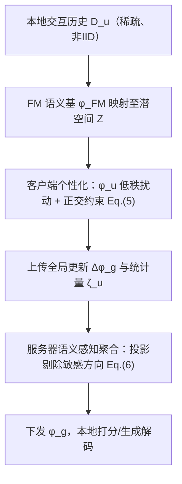
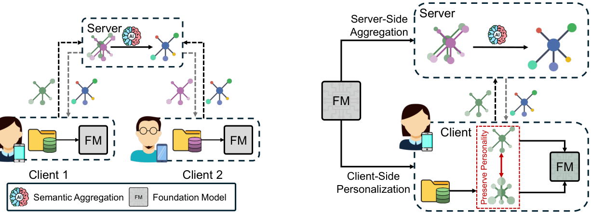

# A Survey of Personalized Federated Foundation Models for Privacy-Preserving Recommendation (面向隐私保护推荐的个性化联邦基础模型综述)

- **会议/期刊**: IJCAI-ECAI 2026 (Survey Track)
- **作者与机构**: Zhiwei Li, Guodong Long, Jing Jiang 等 (University of Technology Sydney; 吉林大学; 北京交通大学; 香港理工大学)
- **推荐链路定位**: 端到端生成式（联邦本地训练 + 服务器聚合）
- **研究方向**: 去偏公平、可信隐私与工业架构 / 大语言模型推荐
- **论文原文**: [https://arxiv.org/abs/2506.11563v2](https://arxiv.org/abs/2506.11563v2)
- **开源代码**: 暂未开源

## TL;DR (1分钟核心速览)

集中式推荐面临 GDPR 等数据主权压力，联邦推荐 (FRS) 虽保住数据本地性，却无法阻止模型更新泄露用户高层属性；而基础模型 (FM) 的强语义推断能力进一步放大了这一风险。本文作为首篇 PFFM 综述，提出从“被动数据保护”转向“主动语义保人格”：以 FM 为共享语义基，将用户人格建模为潜空间中的稳定低维流形 $\mathcal{M}$，通过客户端正交约束与服务器语义感知聚合在架构上解耦全局知识与个体人格。全文为立场/综述性工作，不含自建实验，其价值在于统一形式化框架、三类实例化分类法与五项开放问题的几何化刻画。

## Background & Motivation (背景与核心矛盾)

- **主流范式**: 现有联邦推荐综述多围绕协同过滤与神经网络，聚焦通信压缩与密码学协议，把隐私等同于“隐藏梯度”。
- **前人局限**: 其一，这些工作早于 FM 普及，未回答预训练语义先验如何改变分布式个性化格局；其二，仅靠结构隔离（数据不出端）无法阻止从梯度反推人格属性，Deep Leakage 类攻击已证明更新本身即泄露源。
- **核心洞察 (Key Insight)**: 作者将用户表征拆为两层——瞬态**偏好** $p_u$是潜空间$\mathcal{Z}$中由稳定**人格**流形$\mathcal{M}$支撑的方向向量；打分只需$p_u$的方向，无需$\mathcal{M}$的精确坐标，故可将$\mathcal{M}$的张成空间定义为敏感子空间$\mathcal{S}$ 并正交剔除。
- **本文切入点**: 借 FM 固定的语义参考系打破潜空间的旋转不变性，使 $\mathcal{S}$ 可被严格定义，从而把隐私边界从“架构启发式”升级为“可验证的几何约束”。

## Method (核心方法设计)

### 1. 整体框架 (Overall Architecture)

PFFM 以预训练 FM 参数 $\phi_{FM}$作为跨联邦网络分布的语义基，把离散交互历史$D_u$映射进连续潜空间$\mathcal{Z}$；全局可适配组件$\phi_g$由全体用户协同学习以对齐推荐域，用户私有组件$\phi_u$则作为对全局状态的低秩扰动，编码偏离共识的稳定人格。训练在客户端施加正交约束、在服务器执行语义过滤聚合，二者共同构成“主动保人格”闭环；推理时仅用本地$\phi_u$与共享$\phi_g$ 打分，原始数据与人格参数均不出端。

<figure class="paper-figure" markdown="span">
  <figcaption>图4：推荐中协同学习范式的演进。(a) 标准FFM方法将本地更新聚合为统一的全局模型，在无结构解耦的情况下吸收所有客户端学到的模式，没有专门用于逐用户个性化的参数。(b) 提出的PFFM框架引入主动语义防御，利用FM作为共享语义基础。约束本地优化和语义感知聚合等机制在架构上将共享知识与个体人格解耦，从而确保……</figcaption>
</figure>

### 2. 关键设计拆解 (Key Designs)

1. **偏好-人格几何二分与敏感子空间（把隐私变成硬约束）**：传统 FRS 从随机初始化训练 $\theta_u$，潜空间各向同性且旋转不变，$\mathcal{S}$的基未知且时变，梯度是耦合信号，投影无定义。本文以人格流形$\mathcal{M}$的张成定义$\mathcal{S}\subseteq\mathcal{Z}$，将个性化改写为带正交约束的优化：
$$\min_{\phi_g,\{\phi_u\}}\sum_{u\in\mathcal{U}}\frac{|D_u|}{|\mathcal{D}|}\sum_{(u,i,r_{ui})\in D_u}\mathcal{L}_u\big(r_{ui},\hat{r}_{ui}(\phi_{FM},\phi_g,\phi_u)\big),\ \text{s.t.}\ \Psi_{\perp}(\phi_u,\phi_g)\le\epsilon,\ \forall u\in\mathcal{U}$$
直觉是：打分只依赖 $p_u$相对物品嵌入的朝向，把联合表征在$\mathcal{S}$上的投影压到$\epsilon$ 以下，即可在不牺牲排序方向信息的前提下切断人格泄露通道。

2. **语义感知聚合（把平均改成过滤）**：服务器虽拿不到 $\phi_u$，但收到的$\Delta\phi_g^{(u)}$仍携带人格指纹。本文将聚合重定义为语义过滤而非代数平均，以固定$\phi_{FM}$ 作语义判别器审计梯度：
$$\phi_g^{t+1}\leftarrow\phi_g^{t}-\eta\cdot\mathcal{G}_{\perp}\big(\{\Delta\phi_g^{(u),t+1}\}_{u\in\mathcal{U}},\{\zeta_u^t\}_{u\in\mathcal{U}};\phi_{FM}\big)$$
其中 $\zeta_u^t$为辅助语义分析的分布统计量，算子$\mathcal{G}_{\perp}$ 识别与敏感属性簇高相关的方向并在聚合前投影剔除。其有效性来自 FM 先验提供的固定参考系，使“剔除”有明确几何指向，而非盲目的范数裁剪。

3. **训练目标、负采样与推理效率**：综述层面不设统一损失，客户端沿用各实例化方法的推荐损失（BPR/交叉熵/指令微调似然）叠加正交正则；隐私目标最终收敛为可验证条件 $\langle\Delta\phi_g,\zeta_u\rangle\to 0,\ \forall u\in\mathcal{U}$，即更新与人格语义方向内积趋零。推理侧仅需本地前向，但需将完整$\phi_{FM}$ 载入内存，即便采用 PEFT 亦构成显存与通信瓶颈。

## Experimental Setup & Evaluation Protocol (实验设置与评估协议)

作为 Survey/Position Paper，本文**不含自建实验与数据集统计表**，其“评估协议”贡献在于提出领域应遵循的评测规范：

- **数据集与预处理**: 未提供；作者呼吁构建可复现基准，需将标准推荐语料与人格标签配对（Big-Five 量表或 LLM 人格诱导生成），以刻画效用-泄露权衡前沿。
- **数据划分与防穿越**: 未涉及；强调需同时覆盖训练期梯度侧泄露与部署期输出侧推断两类场景。
- **排名评测协议**: 建议采用**双指标体系**——效用用标准排序指标（HR/NDCG），隐私用**人格推断攻击**量化，以攻击者准确率的倒数或互信息下降量作为隐私得分，稳健系统须在最大化效用同时最小化该量。
- **对比基线与超参设置**: 未设基线；分类学上按 $\phi_u/\phi_g$的架构实现划分三类——Adapter 解耦（冻结骨干 + 本地 LoRA，仅聚合共享 adapter 或统计原型）、Prompt 投影（FM 静态，连续软提示作几何变换$f:\mathcal{X}\to\mathcal{Z}$）、指令微调对齐（$\phi_u$与$\phi_g$ 共享物理参数，强依赖服务器过滤）。

## Key Experimental Results (实验关键数据)

### 1. 主实验对比 (Main Results)

本文为综述，**无主实验表格与数值对比**。其替代性“对比”体现在与既有综述的定位差异：

| 对比维度 | 既有 FRS 综述 | 既有 FM4Rec 综述 | 本文 PFFM 综述 |
| :--- | :---: | :---: | :---: |
| 技术底座 | CF / 神经网络 | 集中式 FM | FM + 联邦 + 个性化三者交叉 |
| 隐私观 | 密码学隐藏梯度 | 基本不讨论 | 主动语义保人格（几何边界） |
| 个性化载体 | $\theta_u$参数 | Prompt / 指令微调 |$\phi_u$ 低秩扰动 + 正交约束 |
| 核心矛盾 | 通信效率 | 效用最大化 | 全局泛化 vs 人格隔离 |

### 2. 消融实验 (Ablation Study)

无消融实验。作者以**理论矛盾分析**替代：若移除固定语义参考系（退化为标准 FRS），潜空间旋转不变导致 $\mathcal{S}$无定义，式 (7) 不可验证，结构隔离失效；若移除服务器过滤（仅保留客户端约束），指令微调类方法因$\phi_u$与$\phi_g$ 共享参数仍会经梯度泄露人格。

### 3. 关键实验发现 (Key Findings)

- **矛盾一（优化冲突）**：保人格要求 $\|\mathrm{Proj}_{\mathcal{S}}(\nabla\mathcal{L}_u)\|=0$，而效用最大化依赖$|\mathrm{Corr}(\nabla\mathcal{L}_u,p_u)|>0$，因$p_u\in\mathcal{S}$，二者在标准梯度下降下不可同时满足，构成效用-隐私悖论。
- **矛盾二（语义异质性）**：以 $\sigma^2=\mathrm{Var}_{u\in\mathcal{U}}\big(D_{KL}(P_u(z)\|P_{FM}(z))\big)$刻画用户与 FM 先验的对齐离散度，$\sigma^2$高时单一$\phi_g$ 必然稀释高 diverg 用户人格，过度本地偏离又引发灾难遗忘。
- **矛盾三（语义鸿沟）**：$D_u$稀疏含噪，且缺乏从$\mathcal{Z}$到心理空间$\mathcal{P}$的已验证映射$f$，最大化$P(D_u|\phi_u)$并不保证$\phi_u$编码真实人格$p_u$。

## Highlights & Limitations (亮点、对比与审稿批判)

- **与代表作对比 (vs. Prior Work)**: 相较 Sun et al. 2024 等 FRS 综述（停留在通信与密码学层面）与 Liu et al. 2023 等 FM4Rec 综述（默认数据集中），本文首次把“联邦-个性化-基础模型”三者交叉作为分析单元，并将隐私从传输层提升到表征几何层。
- **可迁移亮点**: ①“偏好为流形上的方向向量、人格为流形本身”的二分可直接迁移到任何需要解耦稳定属性与瞬态兴趣的表征学习任务；②以固定预训练先验打破旋转不变性、从而定义可验证敏感子空间的思路，可复用于差分隐私中的子空间投影与机器遗忘。
- **审稿级局限批判**: ①全文为立场性框架，式 (5)(6) 中的 $\Psi_\perp$、$\mathcal{G}_\perp$与阈值$\epsilon$均未给出可执行算法与复杂度分析，落地性存疑；②正交约束与效用目标的冲突已被作者自认为“不可避免”，却未量化该冲突造成的效用损失上界，也未讨论$\phi_{FM}$ 本身在预训练阶段已记忆用户信息这一前置泄露风险。

## Rating (四维评分)

- **方法创新性 (Novelty)**: ⭐⭐⭐⭐ （以流形几何重新定义联邦推荐隐私边界，视角新颖且有明确数学刻画，但属框架层而非算法层创新）
- **评估协议与实验扎实度 (Protocol & Experiments)**: ⭐⭐ （无任何自建实验与数值验证，仅提出双指标评测倡议，实证支撑薄弱）
- **写作与数学规范度 (Clarity & Rigor)**: ⭐⭐⭐⭐ （符号体系统一、五类开放问题均给出形式化表述，分类学清晰；部分算子停留于记号层面未展开）
- **工业落地与复现价值 (Industrial & Practical Value)**: ⭐⭐⭐ （无开源代码，FM 全量载入与通信开销被作者自认为硬约束，但语义过滤聚合对合规场景具直接参考价值）
