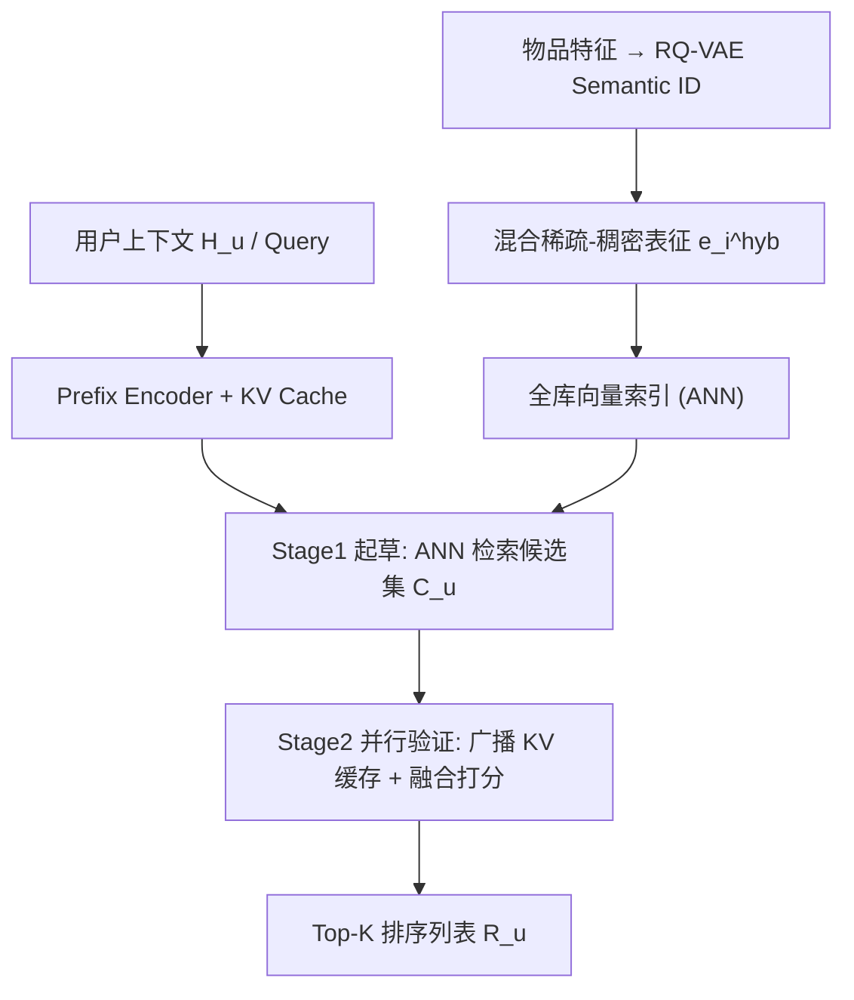
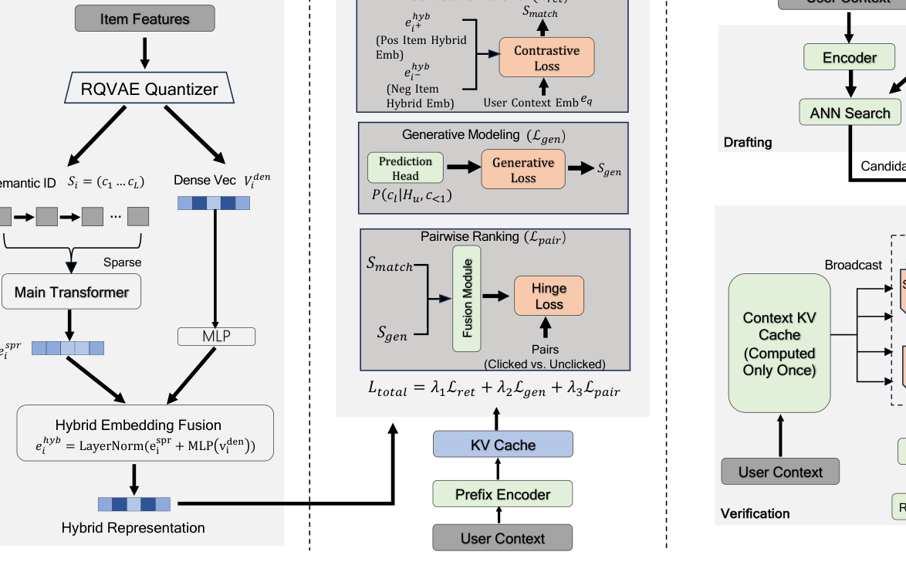

# DaV-Gen: End-to-End Generative Retrieval via Draft-and-Verify (基于起草-验证的端到端生成式检索)

- **会议/期刊**: IJCAI 2026
- **作者与机构**: Meng Zhao, Chunmei Liu, Qinyong Wang（虎鲸数字娱乐集团 / 阿里巴巴）
- **推荐链路定位**: 端到端生成式（召回+排序统一）
- **研究方向**: 生成式推荐与离散语义ID / 协同过滤与双塔召回
- **论文原文**: [论文原文链接](https://arxiv.org/abs/2607.08365v1)
- **开源代码**: 暂未开源

## TL;DR (1分钟核心速览)

针对多级级联架构（MCA）阶段目标不一致导致误差传播、以及生成式检索（GenIR）自回归解码延迟高达约3s的两大痛点，本文提出 DaV-Gen：将生成任务重构为单模型内的“起草-验证”双操作，用混合稀疏-稠密表征支撑 ANN 高速起草，用融合生成似然与向量相似度的打分做并行验证。在 Amazon 三数据集 Leave-One-Out 全库排序下 Recall@10 相对最强基线 OneRec 提升 2.48%–2.89%，工业 Ind-Search 上 Recall@50 从 44.7% 跃升至 77.4%，线上延迟由级联 130ms 降至约 70ms。

## Background & Motivation (背景与核心矛盾)

- **主流范式**: 工业检索系统普遍采用“召回-粗排-精排”多级级联（MCA），召回靠 MIPS 双塔保召回，精排靠复杂交互网络保精度。
- **前人局限**: 其一，各阶段优化目标割裂，召回阶段的漏召不可逆，误差逐级放大；其二，TIGER/LC-Rec 等 GenIR 模型虽以 Semantic ID 序列到序列统一了流程，但逐 token 自回归解码带来 $O(L)$ 串行延迟，且无法确定性地控制推荐列表长度。
- **核心洞察 (Key Insight)**: 生成式模型的瓶颈不在“生成能力”本身，而在“必须串行生成”这一解码形式；若把生成拆成“粗筛候选”与“精细打分”两步，且两步共享同一套参数与表征空间，就能同时拿到检索的速度与生成的精度。
- **本文切入点**: 借鉴推测解码（speculative decoding）思想，用向量 ANN 起草候选、用单次前向并行验证，把 $O(L)$串行解码替换为$O(1)$ 并行打分。

## Method (核心方法设计)

### 1. 整体框架 (Overall Architecture)

输入用户上下文 $H_u$（推荐为交互历史+画像，搜索为 query+历史），经 Prefix Encoder 编码为查询向量$e_q$并缓存其 KV 状态。物品侧由 RQ-VAE 量化器产出 Semantic ID$S_i=(c_1,\dots,c_L)$，其稠密编码器输出$v_i^{den}$与 Semantic ID 经主干 mean-pooling 得到的$e_i^{spr}$融合为混合锚向量$e_i^{hyb}$，全库预计算建向量索引。训练时单模型以对比损失、生成损失、成对排序损失联合优化；推理时先 ANN 起草$N$ 个候选，再广播上下文 KV 缓存、对全部候选单次前向并行验证并 Top-K 排序输出。

<figure class="paper-figure" markdown="span">
  <figcaption>图1：DaV-Gen 概览。(a) 混合稀疏-稠密表示：通过融合来自 RQ-VAE 编码器的细粒度稠密向量与上下文化稀疏 Semantic ID，构建鲁棒的物品嵌入。(b) 统一训练框架：模型使用复合损失（对比 + 生成 + 成对）联合优化，以在单一模型内对齐起草与验证目标。(c) 并行推理流水线：采用“起草-验证”范式，DaV-Gen 首先通过 ANN 搜索起草候选，然后在单次前向传播中执行并行验证，signi</figcaption>
</figure>

### 2. 关键设计拆解 (Key Designs)

1. **混合稀疏-稠密物品表征（Hybrid Sparse-Dense Representation）**：纯离散 token 丢失细粒度语义、纯稠密向量缺乏层级结构，二者单独使用都不足以支撑高召回起草。本文将 RQ-VAE 量化前的连续编码 $v_i^{den}$与 Semantic ID 的上下文化池化向量$e_i^{spr}$ 经投影融合为定长锚向量：
$$e_i^{hyb}=\mathrm{LayerNorm}\big(e_i^{spr}+\mathrm{MLP}(v_i^{den})\big)$$
关键在于它把多模态语义压缩成与 MIPS 兼容的单一向量——这正是 COBRA 式“稀疏-稠密交替序列”无法直接支持 ANN 起草、而本文能支持的原因。

2. **复合损失统一起草与验证（Composite Loss）**：级联的目标不一致本质是召回空间与排序偏好未对齐。总损失为
$$\mathcal{L}_{total}=\lambda_1\mathcal{L}_{ret}+\lambda_2\mathcal{L}_{gen}+\lambda_3\mathcal{L}_{pair}$$
其中 $\mathcal{L}_{ret}$为 batch 内负采样的 InfoNCE，把嵌入空间整理成适合 MIPS 的语义簇；$\mathcal{L}_{gen}$只对单个物品内部 token 保留自回归依赖（不跨物品），提供“该物品在此上下文下是否合理”的正交信号；$\mathcal{L}_{pair}$在融合打分$\sigma(i)=f_{fusion}(s_{match}(i),s_{gen}(i))$ 上做 hinge 排序，并同时构造同 session 点击/未点击的难负对与曝光/随机负对的校准对，前者优化参与度、后者保证全局打分标定。

3. **渐进知识注入与并行推理效率**：Semantic ID token 随机初始化直接全参微调会灾难性遗忘 PLM 语言能力，故先冻结主干仅训新 token 嵌入做对齐，再解冻全参做深层语义整合。推理端用 Broadcasted Prefix Caching 将上下文 KV 只算一次并广播给 $N$个候选，把上下文编码复杂度从$O(N\cdot|H_u|)$降到$O(|H_u|)$，实现$O(1)$ 并行打分与确定性的列表长度控制。

## Experimental Setup & Evaluation Protocol (实验设置与评估协议)

- **数据集与预处理**: 三个公开推荐基准 + 一个工业搜索集，均采用 leave-one-out 划分：

| 数据集 | #Users | #Items | #Interactions | 稀疏度/密度 | 特征/场景说明 |
| :--- | :---: | :---: | :---: | :---: | :--- |
| Amazon Beauty | 22.4k | 12.1k | 198.5k | 99.93% 稀疏 | 美妆评论序列推荐 |
| Amazon Sports | 35.6k | 18.4k | 296.3k | 99.95% 稀疏 | 运动户外序列推荐 |
| Yelp | 30.4k | 20.1k | 316.4k | 99.95% 稀疏 | 本地生活商户 |
| Ind-Search | — | >100M | >500M 日志 | 极稀疏 | 头部视频搜索引擎工业 query 日志 |

- **数据划分与防穿越 (Splitting Strategy)**: 全部数据集采用 `Leave-One-Out`（末次交互为测试、倒数第二次为验证），工业集按线上日志时序构造。
- **排名评测协议 (Ranking Protocol)**: 公开集采用无偏 `Full-Ranking`（全库未交互物品排序），报告 Recall@10 与 NDCG@10；工业集报告 Recall@50、NDCG@10、MRR@10。
- **对比基线与超参设置**: 判别式基线 SASRec、BERT4Rec、HGN 与线上 MoE；生成/检索基线 TIGER、LC-Rec、OneRec 及微调稠密检索器 gte-qwen-7b。所有模型嵌入维度 $d=64$，生成式模型统一 5 层层级量化码本，Adam 优化器 lr=$1\times10^{-5}$、batch=256；线上 A/B 以$p<0.05$ 为显著性标准。

## Key Experimental Results (实验关键数据)

### 1. 主实验对比 (Main Results)

| 方法 | Beauty R@10 | Beauty N@10 | Sports R@10 | Sports N@10 | Yelp R@10 | Yelp N@10 |
| :--- | :---: | :---: | :---: | :---: | :---: | :---: |
| SASRec | 0.0624 | 0.0385 | 0.0482 | 0.0295 | 0.0681 | 0.0412 |
| BERT4Rec | 0.0638 | 0.0392 | 0.0495 | 0.0301 | 0.0695 | 0.0425 |
| HGN | 0.0705 | 0.0441 | 0.0571 | 0.0358 | 0.0738 | 0.0462 |
| TIGER | 0.0698 | 0.0435 | 0.0552 | 0.0348 | 0.0725 | 0.0455 |
| LC-Rec | 0.0715 | 0.0452 | 0.0568 | 0.0355 | 0.0742 | 0.0468 |
| OneRec | 0.0732 | 0.0465 | 0.0588 | 0.0370 | 0.0765 | 0.0481 |
| **DaV-Gen** | **0.0752** | **0.0481** | **0.0605** | **0.0382** | **0.0784** | **0.0495** |
| Improv. | +2.73% | +3.44% | +2.89% | +3.24% | +2.48% | +2.91% |

工业 Ind-Search 上，DaV-Gen 的 Recall@50 达 **77.4%**（稠密检索器 44.7%，+32.7 个绝对点），NDCG@10 由 0.569 升至 **0.589**，MRR@10 由 0.895 升至 **0.942**。线上 A/B（百万级用户、一周）：人均时长 **+2.09%**、用户转化率 **+0.47%**、平均成功搜索 **+0.31%**，均 $p<0.05$；推理延迟约 **70ms**，对比级联 130ms（2.5×加速）与纯生成式约 3s。

### 2. 消融实验 (Ablation Study)

| 变体 | Beauty R@10 | Beauty N@10 | Sports R@10 | Sports N@10 |
| :--- | :---: | :---: | :---: | :---: |
| DaV-Gen (Full) | **0.0752** | **0.0481** | **0.0605** | **0.0382** |
| w/o Hybrid Rep. | 0.0710 | 0.0445 | 0.0569 | 0.0355 |
| w/o Prog. Inject. | 0.0722 | 0.0458 | 0.0580 | 0.0366 |
| w/o Gen. Loss | 0.0718 | 0.0454 | 0.0575 | 0.0362 |
| w/o Fusion Loss | 0.0728 | 0.0462 | 0.0588 | 0.0371 |

### 3. 关键实验发现 (Key Findings)

1. **稠密向量是起草召回的主力**：去掉混合表征后 Beauty Recall@10 从 0.0752 跌至 0.0710（-5.6%），是所有消融中最大跌幅，说明纯稀疏 Semantic ID 的语义粒度不足以支撑高召回 ANN 起草，稠密分量贡献了主要覆盖度。
2. **渐进对齐不可省，但收益小于表征融合**：跳过嵌入对齐阶段后 Beauty Recall@10 降至 0.0722（-4.0%），验证了 PLM 与随机初始化 ID token 之间存在语义鸿沟，需要先对齐再全参微调，否则收敛次优。
3. **生成损失与融合排序损失各司其职**：去掉 $\mathcal{L}_{gen}$使 Beauty NDCG@10 降至 0.0454（-5.6%），说明 token 级生成信号提供了对比学习无法捕获的物品内部组合语义；去掉$\mathcal{L}_{pair}$ 则 NDCG 一致下滑（0.0481→0.0462），证实融合排序损失负责把起草空间与验证偏好对齐，直接决定最终排序质量。

## Highlights & Limitations (亮点、对比与审稿批判)

- **与代表作对比 (vs. Prior Work)**: 相较 TIGER/LC-Rec 的逐 token 自回归解码，本文以 ANN 起草+并行验证把延迟从秒级压到 70ms 量级；相较 OneRec 的结构性统一，本文进一步用融合打分显式对齐召回与排序偏好；相较 COBRA 的稀疏-稠密交替序列，本文将其压成单一 MIPS 兼容向量，从而真正支持向量起草。
- **可迁移亮点**: ①“广播 KV 缓存 + 批量候选并行打分”可直接迁移到任何 LLM 重排/验证场景，把上下文编码开销摊薄到候选集；②难负对+随机负对的双源 hinge 构造，是一种低成本且有效的打分标定技巧，可复用于精排校准。
- **审稿级局限批判**: ①起草阶段仍依赖离线预计算的全库混合向量索引，物品更新需重建索引，冷启动物品的 $v_i^{den}$ 与 Semantic ID 质量直接决定上限；②公开集实验仅在三个 Amazon/Yelp 中小规模基准上做 Leave-One-Out，缺少采样排序协议与显著性检验的完整报告，且工业集指标提升（NDCG +0.02）幅度较小，泛化性证据偏弱。

## Rating (四维评分)

- **方法创新性 (Novelty)**: ⭐⭐⭐⭐ （将推测解码思想迁移到生成式检索，起草-验证单模型统一范式清晰，但各组件多为已有技术的巧妙重组）
- **评估协议与实验扎实度 (Protocol & Experiments)**: ⭐⭐⭐⭐ （Full-Ranking + 工业级 100M 物品集 + 线上 A/B 三重验证较扎实，公开集缺显著性检验与采样协议对比）
- **写作与数学规范度 (Clarity & Rigor)**: ⭐⭐⭐⭐ （三大设计问题驱动叙事、公式与损失定义完整，融合网络 $f_{fusion}$ 的具体结构未展开）
- **工业落地与复现价值 (Industrial & Practical Value)**: ⭐⭐⭐⭐⭐ （70ms 延迟、确定性列表长度控制与线上正向收益，工程价值突出；可惜暂未开源）
