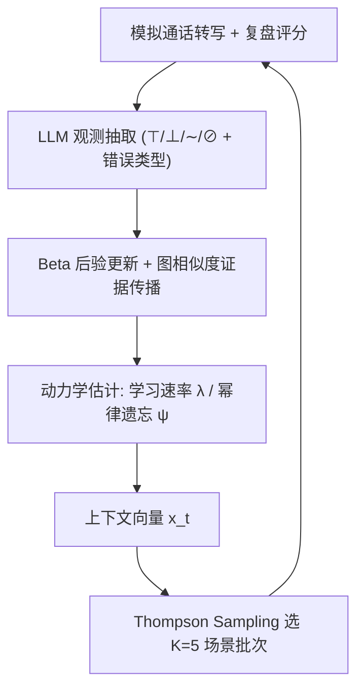
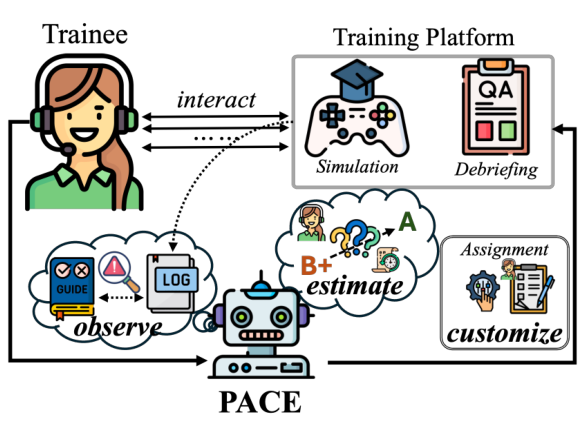
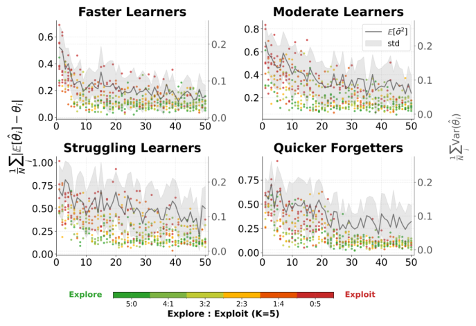

# PACE: A Personalized Adaptive Curriculum Engine for 9-1-1 Call-taker Training (面向 9-1-1 接警员培训的个性化自适应课程引擎)

- **会议/期刊**: IJCAI-ECAI 2026
- **作者与机构**: Zirong Chen, Hongchao Zhang, Meiyi Ma（Vanderbilt University, College of Connected Computing）
- **推荐链路定位**: 重排（每轮从 297 个候选场景中选 K=5 的批次，属列表级场景选择）
- **研究方向**: 强化学习与动态探索推荐 / 图神经网络与知识图谱推荐
- **论文原文**: [https://arxiv.org/abs/2603.05361v2](https://arxiv.org/abs/2603.05361v2)
- **开源代码**: [https://github.com/AICPS-Lab/PACE-911](https://github.com/AICPS-Lab/PACE-911)

## TL;DR (1分钟核心速览)

9-1-1 接警员培训涉及 1053 个相互依赖的技能节点，人工教练为每名学员定制课程不可扩展（单次模拟-复盘循环 11.58 分钟，一个班每日需 83 小时复盘）。PACE 将课程设计形式化为技能图上的序贯决策：用 Beta 后验 + 图相似度传播做归纳式知识追踪，用幂律遗忘模型估计个体学习速率 $\lambda$与遗忘率$\psi$，再用 Thompson Sampling 上下文老虎机在"新技能获取 vs. 旧技能保持"间选场景。在 4 类 LLM 角色扮演学员、50 轮会话协议下，Z2H 较 Agent4Edu 缩短 19.50%，终局覆盖率与随机抽考分数分别提升 10.95% 与 5.58 分；与 923 条真实教练决策的对齐率达 95.45%，复盘周转时间从 11.58 分钟降至 34 秒。

## Background & Motivation (背景与核心矛盾)

- **主流范式**: 教育推荐沿用电商/IR 目标（CTR、会话时长）或扁平技能空间上的间隔重复与 Bandit 选课；知识追踪（BKT/DKT/图知识追踪）只做诊断，不做"诊断-处方"闭环。
- **前人局限**: ① **参与度-学习目标错位**——学员偏好"做得顺"的场景，但能力增长发生在最近发展区边缘，CTR 目标会系统性回避高价值难题；② **技能独立性假设失效**——1053 个技能中直接观测每个节点在有限培训周期内不可行，且实测移除单个技能平均孤儿化 11.17% 下游检查点、导致 48.80% 完整通话评估失败；③ LLM 辅导 Agent 无法承载 6–8 周、200+ 次模拟的纵向历史（上下文溢出与 mid-context 检索退化），遗忘被静默累积。
- **核心洞察 (Key Insight)**: 技能依赖图既是**诊断加速器**（相似节点间可迁移证据，无需逐点观测），也是**课程约束**（前置未满足的场景不可选）；而"何时复习"必须用真实时钟时间的幂律遗忘而非会话计数来建模。
- **本文切入点**: 把课程选择建模为以"信念质量 + 学员状态 + 进度"为上下文的上下文老虎机，奖励定义为施加真实时间衰减后的掌握度增量，使探索/利用自动随信念方差切换。

## Method (核心方法设计)

### 1. 整体框架 (Overall Architecture)

PACE 作为课程层嵌入既有培训基础设施：LLM 从模拟通话转写中抽取结构化观测（合规/违规/部分合规/不适用 + 错误类型），Belief Tracker 将其转为每个技能节点的 Beta 后验并经相似度索引向未观测节点传播；Dynamics Estimator 从历史拟合个体学习速率 $\lambda$与遗忘率$\psi$；Contextual Bandit 以压缩上下文向量为输入，用 Thompson Sampling 逐条选出 K=5 的场景批次（每选一条即更新上下文以反映新覆盖技能）。前$N_0=15$ 轮为冷启动静默观测期，之后进入自适应阶段。

<figure class="paper-figure" markdown="span">
  <figcaption>图1：PACE参与9-1-1培训的概览。</figcaption>
</figure>

### 2. 关键设计拆解 (Key Designs)

1. **图上的归纳式信念追踪（Inductive Belief Tracking）**：痛点是要在 50 轮内覆盖 1053 个节点，逐点观测不可能。做法是先用句向量余弦相似度乘位置兼容项构造离线相似度索引 $\phi(v_i,v_j)=\cos(\mathbf{s}_i,\mathbf{s}_j)\cdot\exp(-\epsilon|d_i-d_j|)$（$d_v$为归一化协议深度，同阶段技能迁移性更强），观测到节点$v$后向相似节点传播$\hat{\theta}_{v'}^{\text{new}}\leftarrow\text{mean}(\hat{\theta}_{v'}^{\text{curr}},\ \phi(v,v')\cdot\hat{\theta}_v)$；Beta 后验用加权伪计数更新，且权重按错误类型调制（提示后成功$w^+=0.5$、概念性误解$w^-=1.5$、口误$w^-=0.5$）。直觉：把"猜对"与"掌握"区分开，并让一次观测在结构相关技能上产生折扣证据，从而指数级加速诊断覆盖。

2. **个体学习/遗忘动力学（Power-Law Forgetting over Real Time）**：痛点是把所有学员当同一遗忘率，导致高遗忘者被系统性欠复习。学习速率取历史平均边际增益 $\lambda=\frac{1}{|\mathcal{H}|}\sum_{(v,t)\in\mathcal{H}}\Delta\theta_v^{(t)}$；遗忘按真实时钟时间幂律衰减$\theta_v^{(\tau+\Delta\tau_v)}=\theta_v^{(\tau)}\cdot(1+\kappa\cdot\Delta\tau_v)^{-\psi}$，$\psi$ 由"变间隔重测"的保持结果拟合。幂律而非指数衰减的物理直觉是：刚习得技能衰减快、巩固后趋缓，与认知科学实证一致；用真实时间而非会话数则是因为培训日程存在 24 小时以上的自然间隔。

3. **上下文老虎机与奖励设计**：上下文 $x_t=[\bar{\sigma}^2, c \mid \hat{\lambda},\hat{\psi},\bar{w},d \mid t/N]$分别编码模型质量、覆盖率、学员状态（弱技能均值$\bar{w}$、临近遗忘阈值技能数$d$）与进度；奖励为施加时间衰减后的掌握增量$r_t=\sum_{v\in\mathcal{V}_{S_t}}(\hat{\theta}_v^{(t)}-\hat{\theta}_v^{(t-1)})$。关键设计是**把不确定性放进上下文而非奖励**，使 Bandit 能学到"降低不确定性的探索动作会带来更高下游收益"。期望奖励线性建模$E[r\mid x,S]=\mathbf{B}_S^\top x$，高斯先验下用贝叶斯线性回归闭式更新，Thompson Sampling 采样选动作，无需负采样、无梯度训练。

## Experimental Setup & Evaluation Protocol (实验设置与评估协议)

- **数据集与场景规模**: 与纳什维尔 MNDEC 共建，技能图 $|\mathcal{V}|=1053$、$|\mathcal{E}|=1283$、覆盖 63 类事件；候选场景 297 个（经前置条件、操作有效性、复杂度三重过滤）；真实教练日志 923 条用于对齐评估。

| 数据/资源 | 规模 | 说明 |
| :--- | :---: | :--- |
| 技能图节点/边 | 1053 / 1283 | 条件节点 + 提问节点 + 指令节点，63 类事件 |
| 候选场景池 | 297 | 每轮选 $K=5$，共 50 轮 |
| 真实培训日志 | 923 条 | 含转写、复盘、教练下一轮指派 |
| 专家问卷 | 21 人 | 12 名教官 + 9 名在职接警员，5 点 Likert |

- **数据划分与防穿越**: 无传统 train/test 划分；采用 **LLM 角色扮演学员仿真**（4 类 archetype × 10 个实例，参数 ±15% 扰动），真值 $(\Theta,\lambda,\psi)$ 对 PACE 完全隐藏，仅暴露对话观测；每 5 轮插入 24 小时真实间隔以触发遗忘。PACE 用 GPT-5，学员 Agent 用 Claude Sonnet 4.5 以规避同族偏差。
- **排名评测协议**: 非检索式排序，而是**课程级指标**：Coverage@t（$\theta_v\ge 0.85$ 的节点占比）、Z2H（首次达到场景级胜任的轮数，越低越好）、Random Exam（跨事件类型均匀抽题的留出考试分 0–100）。
- **对比基线与超参**: Round-Robin、Deficit-Driven 两个启发式；GraphRAG、GenMentor、Agent4Edu 三个 LLM/Agent 基线（均在同一 9-1-1 数据上重实现）；消融为 `w/o propagation` 与 `w/o dynamics`（后者用群体均值 $\bar{\lambda}=0.08,\bar{\psi}=0.30$）。冷启动$N_0=15$，批大小$K=5$，总轮数$N=50$，每 archetype 40 名仿真学员。

## Key Experimental Results (实验关键数据)

### 1. 主实验对比 (Main Results)

四类学员 archetype 下的核心结果（C@50 与 RE 为 %，Z2H 为轮数，⧸ 表示从未达成）：

| Archetype | 方法 | C@50 ↑ | Z2H ↓ | RE ↑ |
| :--- | :--- | :---: | :---: | :---: |
| Fast Learner | GenMentor | 84.15 | 29.40 | 86.87 |
| Fast Learner | Agent4Edu | 88.18 | 27.58 | 90.47 |
| Fast Learner | **PACE** | **95.27** | **22.19** | **96.05** |
| Moderate | Agent4Edu | 84.57 | 48.10 | 86.17 |
| Moderate | **PACE** | **91.51** | **34.10** | **90.11** |
| Struggling | Agent4Edu | 80.48 | 47.88 | 81.15 |
| Struggling | **PACE** | **86.91** | **44.14** | **88.18** |
| Quick Forgetter | GenMentor | 67.51 | ⧸ | 66.37 |
| Quick Forgetter | Agent4Edu | 86.74 | 32.55 | 85.78 |
| Quick Forgetter | **PACE** | **91.22** | **25.91** | **91.04** |

相对最强基线 Agent4Edu：Fast Learner 上 Z2H 缩短 **19.50%**（22.19 vs. 27.58），C@50 提升 **7.09 pt**；Quick Forgetter 上 Z2H 缩短 **20.4%**、RE 提升 **5.26 pt**；Struggling Learner 上 RE 提升 **7.03 pt**（88.18 vs. 81.15）。

### 2. 消融实验 (Ablation Study)

| 变体 | Fast C@50 | Fast Z2H | Fast RE | QF C@50 | QF Z2H | QF RE |
| :--- | :---: | :---: | :---: | :---: | :---: | :---: |
| w/o propagation | 84.73 | 46.13 | 86.95 | 84.67 | 49.50 | 86.13 |
| w/o dynamics | 92.00 | 34.55 | 91.13 | 82.09 | 48.13 | 80.16 |
| **full PACE** | **95.27** | **22.19** | **96.05** | **91.22** | **25.91** | **91.04** |

### 3. 关键实验发现 (Key Findings)

1. **证据传播是效率主引擎，动力学估计是鲁棒性主引擎**：去掉传播后 Fast Learner 的 Z2H 从 22.19 暴涨至 46.13（+108%），因为系统被迫逐点观测；而去掉动力学对 Quick Forgetter 的伤害最大（RE 91.04→80.16，$\Delta$10.88），因为群体均值$\bar{\psi}=0.30$严重低估真值$\psi=0.45$，复习排程不足——两者作用互补而非冗余。
2. **无时间建模的 LLM 辅导 Agent 在高遗忘场景会"负学习"**：GenMentor 在 Quick Forgetter 上 C@50 从第 10 轮的 71.66% 退化到第 50 轮的 67.51%，Agent4Edu 则因静态学员记忆在 86.74% 处平台化，说明纵向遗忘建模是刚需而非锦上添花。
3. **细粒度是硬约束而非设计偏好**：技能级追踪的 C@50 为 95.27/91.51/86.91/91.22，事件类型级骤降至 68.49/56.11/50.93/59.67，部门级最差；且信念近似间隙 $\delta$随轮次收敛（Fast 约 20 轮、Moderate 约 30 轮、Struggling 约 40 轮），探索比例随$\bar{\sigma}^2$ 下降而上升，验证了"不确定性驱动探索"的机制确实在起作用。

<figure class="paper-figure" markdown="span">
  <figcaption>图4：各会话中近似间隙δ（散点，左轴）与信念方差¯σ2（灰线±标准差，右轴）的收敛情况。点颜色表示每批（K=5）内的探索:利用比例：绿色表示探索为主的会话，红色表示利用为主的会话。</figcaption>
</figure>

## Highlights & Limitations (亮点、对比与审稿批判)

- **与代表作对比 (vs. Prior Work)**: 相较 GenMentor / Agent4Edu 等 LLM 辅导 Agent，PACE 用显式概率信念 + 图传播替代"把历史塞进上下文"，从而支撑 50 轮以上的纵向建模；相较图知识追踪（如 Cheng et al. 2024）只做诊断，PACE 补齐了"处方"环节；相较经典 Bandit 选课（Belfer et al. 2022；Su et al. 2023），它放弃了扁平技能空间与"优先复习已学项"的假设，改为在依赖图上做前置约束下的获取-保持权衡。
- **可迁移亮点**: ① "不确定性放上下文、增益放奖励"的奖励分解，可直接迁移到任何需要探索-利用切换的推荐场景（如冷启动内容推荐）；② 用错误类型调制伪计数权重（误解重罚、口误轻罚）是低成本高收益的噪声标签处理技巧，可迁移到隐式反馈去噪。
- **审稿级局限批判**: ① **评估主体是 LLM 仿真学员**，真值可控但生态效度仍依赖角色扮演保真度，作者仅以 923 条日志对齐率与 21 人问卷间接佐证，缺乏真人对照的 learning-gain 实验；② **Bandit 采用线性奖励假设** $E[r\mid x,S]=\mathbf{B}_S^\top x$，对场景间组合效应（同批次 5 个场景的互补/冗余）完全无建模，且 297 个动作各需一套回归系数，在冷启动 15 轮样本下参数估计方差偏大；③ 相似度索引依赖句向量 + 深度的启发式乘积，阈值与$\epsilon$ 的敏感性未做扫描。

## Rating (四维评分)

- **方法创新性 (Novelty)**: ⭐⭐⭐⭐ （将图传播知识追踪、幂律遗忘与上下文老虎机首次组合进高风险程序化培训闭环，"不确定性入上下文"的奖励分解有巧思，但各组件本身均为已有技术的工程化整合）
- **评估协议与实验扎实度 (Protocol & Experiments)**: ⭐⭐⭐ （4 类 archetype × 10 实例 × 50 轮 + 双消融 + 粒度分析 + 真实日志对齐 + 专家问卷相当完整，但核心指标全部建立在 LLM 仿真学员上，缺真人对照与显著性检验）
- **写作与数学规范度 (Clarity & Rigor)**: ⭐⭐⭐⭐ （问题形式化清晰区分显式/隐式目标，公式紧凑；但相似度传播的 `mean` 更新缺乏收敛性论证，Bandit 的线性假设与动作空间规模之间的矛盾未讨论）
- **工业落地与复现价值 (Industrial & Practical Value)**: ⭐⭐⭐⭐⭐ （已开源，与真实 9-1-1 中心共建，复盘周转从 11.58 分钟降至 34 秒、对齐率 95.45%，美国 6000+ 呼叫中心具备直接迁移路径，工程价值显著）
