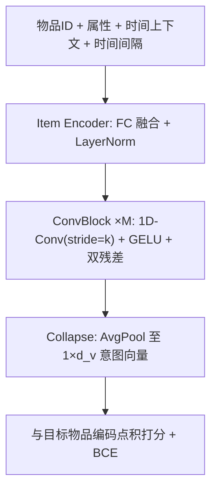
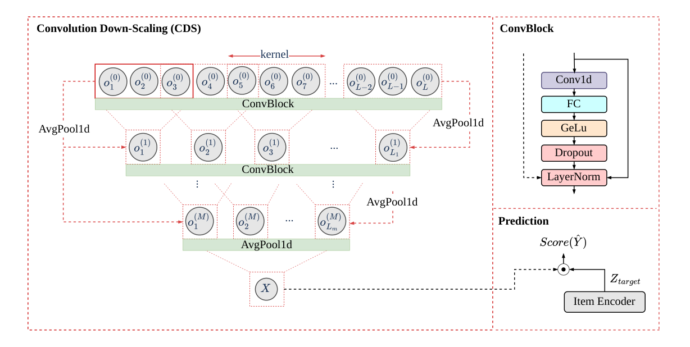

# Rethinking Convolutional Networks for Attribute-Aware Sequential Recommendation (重新审视卷积网络用于属性感知序列推荐)

- **会议/期刊**: IJCAI-ECAI 2026
- **作者与机构**: Shereen Elsayed, Ngoc Son Le, Ahmed Rashed, Lars Schmidt-Thieme (University of Hildesheim / VWFS DARC / Volkswagen Financial Services AG)
- **推荐链路定位**: 召回（Next-Item 序列编码器）
- **研究方向**: 序列与会话推荐 / 多模态推荐（视觉属性融合）
- **论文原文**: [https://arxiv.org/abs/2605.04723v2](https://arxiv.org/abs/2605.04723v2)
- **开源代码**: [https://github.com/ismll-research/ConvRec](https://github.com/ismll-research/ConvRec)

## TL;DR (1分钟核心速览)

属性感知序列推荐长期被自注意力范式垄断，但自注意力对序列长度呈二次复杂度，长历史用户被迫截断，且纯注意力未必是最优的局部模式提取器。本文提出 ConvRec：将物品 ID、属性与时间上下文编码为交互向量后，用金字塔式"降尺度卷积块"逐层把序列长度压缩至 1，得到全局意图向量，复杂度对序列长度线性。在四个 Amazon 数据集、Leave-One-Out + 100 负采样协议下，相对最强基线 ProxyRCA 的 HR@10 提升 0.65%–4.08%、NDCG@10 提升 2.00%–7.82%；全库排序协议下 Games 数据集 NDCG@10 提升 8.0%。

## Background & Motivation (背景与核心矛盾)

- **主流范式**: SASRec/BERT4Rec 确立自注意力为序列推荐主干，CARCA/ProxyRCA 进一步用交叉注意力把物品属性注入打分环节，成为属性感知方向的 SOTA。
- **前人局限**: 其一，自注意力的时间与显存开销随序列长度二次增长（ProxyRCA 在长度 500 时显存达 14,280 MB），迫使工业系统截断长历史，直接损失长期偏好；其二，早期卷积方案 Caser/CosRec 的感受野被固定窗口锁死，只能看最近若干物品，无法形成全局序列视角。
- **核心洞察 (Key Insight)**: 序列中相邻物品的相关性显著强于远距离物品，因此"逐级合并邻居"的层次化聚合足以蒸馏出全局意图，无需让每个位置与所有位置做注意力交互——这与时间序列/视觉中的金字塔、Patch 下采样思想同构。
- **本文切入点**: 用"步长等于核宽"的非重叠 1D 卷积逐层降采样，把 $L$ 长序列压成单向量，以线性代价换取全局感受野。

## Method (核心方法设计)

### 1. 整体框架 (Overall Architecture)

ConvRec 分三段：**物品编码器**将物品 ID、属性特征与时间上下文融合为逐位置交互向量，并拼接相邻交互的时间间隔；**卷积降尺度组件 (CDS)** 堆叠 $M$个 ConvBlock，每块以 1D 卷积沿序列维聚合邻居并把长度缩小$k$倍，配合双重残差与 LayerNorm 稳定训练，最终 Collapse 为$1\times d_v$的序列意图向量；**打分**用该向量与目标物品编码做点积，BCE 损失训练。训练时从完整用户序列中随机采样长度$L$的子序列（而非固定取最近$L$ 项），使模型见到行为的不同阶段。

<figure class="paper-figure" markdown="span">
  <figcaption>图3：ConvRec框架。</figcaption>
</figure>

### 2. 关键设计拆解 (Key Designs)

1. **属性-上下文-间隔三源融合编码**：痛点在于多数模型只把属性塞进输入层、把时间当作位置编码。本文先用 FC 分别投影属性 $a_i^u$与上下文$c_i^u$并拼接投影得$f_i^u$，再与高频物品 ID 嵌入拼接；关键是额外计算相邻交互的 (年,月,日) 差值$\Delta c^u$并拼入序列，经 LayerNorm 后投影：$Z^u=\sigma(Q^u W_Q+b_Q)$。时间间隔直接刻画"兴趣漂移速度"，消融显示去掉间隔在 Beauty 上 HR@10 从 0.629 掉到 0.625、Fashion 从 0.688 掉到 0.682，说明它对稀疏域尤为关键。
2. **降尺度卷积块与双重残差 (CDS)**：核心算子是把 $Z^u$转置为$d_v\times L$视作通道，做核宽=步长的非重叠 1D 卷积$K^{(j)}=$1D-Conv$(\text{Padding}(O^{(j-1)\top}),k,k)$，长度按$L^{(j)}=L^{(j-1)}/k$收缩；随后投影 + GELU + LayerNorm，并叠加两路残差：$O^{(j)}=\text{LN}\big(G^{(j)}+\alpha_1\text{AvgPool}(Z^u)+\alpha_2\text{ProgRes}^{(j-1)}\big)$。第一路锚定原始输入防梯度消失，第二路逐层递进平滑收敛，$\alpha_{1,2}$可学习初值 0.5。物理直觉：每层把"相邻$k$ 个行为"抽象为一个"行为段"，多层后即从"点击"抽象到"购物意图"。
3. **训练目标、负采样与推理效率**：损失为 BCE，每个正样本配 $N_{train}=100$个从候选池（排除用户已交互）采样的负样本：$\mathcal{L}=-\sum_{S}\big[\log\hat{Y}^{(+)}+\sum_{n}\log(1-\hat{Y}^{(-)}_n)\big]$。正样本采用随机子序列末项而非固定最近项，等价于对行为阶段做数据增广。推理时仅需一次前向得到意图向量，复杂度$O(L\cdot d_v\cdot k)$ 线性；实测长度 500 时显存 6,096 MB、每 batch 0.202 s，对比 ProxyRCA 的 14,280 MB / 0.382 s。

## Experimental Setup & Evaluation Protocol (实验设置与评估协议)

- **数据集与预处理**: 四个 Amazon 域，Fashion/Men 的属性为 ResNet-50 视觉特征，Games/Beauty 为类别与品牌：

| 数据集 | #Users | #Items | #Interactions | 平均/最大序列长 | 属性维度 |
| :--- | :---: | :---: | :---: | :---: | :---: |
| Beauty | 52,204 | 57,289 | 394,908 | 7 / 293 | 6,507 |
| Games | 31,013 | 23,715 | 287,107 | 9 / 860 | 506 |
| Fashion | 45,184 | 166,270 | 358,003 | 8 / 192 | 2,048 |
| Men | 34,244 | 110,636 | 254,870 | 7 / 308 | 2,048 |

- **数据划分与防穿越 (Splitting Strategy)**: `Leave-One-Out`——每用户最后一项测试、倒数第二项验证、其余训练。
- **排名评测协议 (Ranking Protocol)**: 主表为 `Sampled Ranking`（每用户 100 个负样本，沿用 CARCA/ProxyRCA 协议）；另在 Beauty/Games 上补充 `Full-Ranking` 全库未交互排序，检验采样偏差。
- **对比基线与超参设置**: 基线含纯序列模型 (BERT4Rec, SASRec, TiSASRec, CosRec) 与属性感知模型 (S³-Rec, SASRec++, DIF-SR, CARCA, CARCA-LIP, ProxyRCA)；报告 3 次独立运行的均值与标准差（约 $10^{-3}$ 量级），提升幅度相对最强基线计算。

## Key Experimental Results (实验关键数据)

### 1. 主实验对比 (Main Results)

100 负采样协议（HR@10 / NDCG@10）：

| Method | Beauty | Games | Fashion | Men |
| :--- | :---: | :---: | :---: | :---: |
| SASRec | 0.485 / 0.322 | 0.742 / 0.541 | 0.381 / 0.245 | 0.397 / 0.259 |
| TiSASRec | 0.492 / 0.333 | 0.748 / 0.533 | 0.384 / 0.234 | 0.333 / 0.194 |
| S³-Rec | 0.538 / 0.371 | 0.765 / 0.549 | 0.367 / 0.239 | 0.365 / 0.238 |
| SASRec++ | 0.557 / 0.383 | 0.752 / 0.533 | 0.546 / 0.344 | 0.500 / 0.315 |
| CARCA | 0.579 / 0.396 | 0.782 / 0.573 | 0.591 / 0.381 | 0.550 / 0.349 |
| CARCA-LIP | 0.608 / 0.423 | 0.762 / 0.560 | 0.648 / 0.427 | 0.614 / 0.398 |
| ProxyRCA | 0.609 / 0.430 | 0.805 / 0.601 | 0.661 / 0.435 | 0.613 / 0.399 |
| **ConvRec** | **0.629 / 0.439** | **0.819 / 0.617** | **0.688 / 0.469** | **0.618 / 0.406** |
| Improv.% | +3.28 / +2.09 | +1.74 / +2.66 | +4.08 / +7.82 | +0.65 / +2.00 |

全库排序协议（Beauty / Games，HR@10 / NDCG@10）：ConvRec 0.052/0.027 与 0.141/0.081，对比 ProxyRCA 的 0.049/0.025 与 0.136/0.075，Games 上 NDCG@10 提升 8.0%。

### 2. 消融实验 (Ablation Study)

HR@10 消融（Beauty / Games / Fashion / Men）：

| 变体 | Beauty | Games | Fashion | Men |
| :--- | :---: | :---: | :---: | :---: |
| w/o Intervals | 0.625 | 0.817 | 0.682 | 0.616 |
| w/o Residuals | 0.602 | 0.810 | 0.659 | 0.574 |
| w/ one Conv（单层全连接式） | 0.617 | 0.796 | 0.674 | 0.605 |
| w/ AvgPool（纯均值池化） | 0.602 | 0.804 | 0.669 | 0.611 |
| **ConvRec** | **0.629** | **0.819** | **0.688** | **0.618** |

核宽/步长敏感性（Beauty）：首层核宽 2 最优（0.630/0.438），首层核宽 7 降至 0.622；步长小于核宽（重叠卷积）反而退化至 0.615–0.623，说明非重叠硬下采样是有效关键。

### 3. 关键实验发现 (Key Findings)

1. **残差是最大单点贡献**：去掉双残差后 Men 从 0.618 跌至 0.574（-7.1%），远超其他组件，说明深层降尺度堆叠若无原始信号锚定会严重欠拟合。
2. **层次化优于单层与纯池化**：单层卷积（等价全序列 FC）与纯 AvgPool 在四个数据集上均落后，证明"逐级抽象"而非"一次性压缩"才是收益来源；但两者差距不大，暗示该任务对序列编码器的容量需求并不极端。
3. **效率优势随长度放大**：长度 50→500 时 ProxyRCA 显存增长 3.7 倍、耗时增长 4.3 倍，ConvRec 仅 2.1 倍与 2.7 倍，验证了线性复杂度在长历史场景的工程价值。

## Highlights & Limitations (亮点、对比与审稿批判)

- **与代表作对比 (vs. Prior Work)**: 与 SASRec 相比，ConvRec 用局部聚合替代全局注意力，牺牲"任意两点直接交互"换取线性复杂度；与 Caser/CosRec 相比，其感受野通过多层下采样覆盖全序列而非固定窗口；与 ProxyRCA 相比，二者共享物品编码与随机子序列训练策略，差异纯粹在序列聚合算子，因此提升可干净归因于卷积降尺度本身。
- **可迁移亮点**: ①"核宽=步长"的非重叠金字塔下采样可直接替换长序列召回中的 Transformer 编码器，作为粗筛阶段轻量主干；②随机子序列采样作为正样本，是一种零成本的行为阶段增广，可移植到任何 next-item 训练流程。
- **审稿级局限批判**: 其一，主实验仅用 100 负采样协议，全库排序仅在两个数据集上补充，且 Beauty 上 NDCG@10 相对 ProxyRCA 提升为 0.0%，采样偏差下的优势并不稳固；其二，降尺度把序列压成单向量，天然丢失"多兴趣"结构，对兴趣高度多峰的用户可能不如多向量/胶囊方案，论文未做多兴趣分桶分析。

## Rating (四维评分)

- **方法创新性 (Novelty)**: ⭐⭐⭐ （金字塔降尺度卷积并非全新思想，但在属性感知序列推荐中首次系统替代注意力，且给出清晰的局部性动机）
- **评估协议与实验扎实度 (Protocol & Experiments)**: ⭐⭐⭐⭐ （四数据集 + 采样/全库双协议 + 3 次运行方差 + 完整消融与效率测试，唯全库排序覆盖略窄）
- **写作与数学规范度 (Clarity & Rigor)**: ⭐⭐⭐⭐ （公式与算法伪代码完整、符号一致，复杂度分析有实测支撑；部分符号如 $d_{K^{(j)}}$ 定义略含糊）
- **工业落地与复现价值 (Industrial & Practical Value)**: ⭐⭐⭐⭐⭐ （代码开源、线性显存与耗时、可直接替换长序列编码器，工程收益明确）
