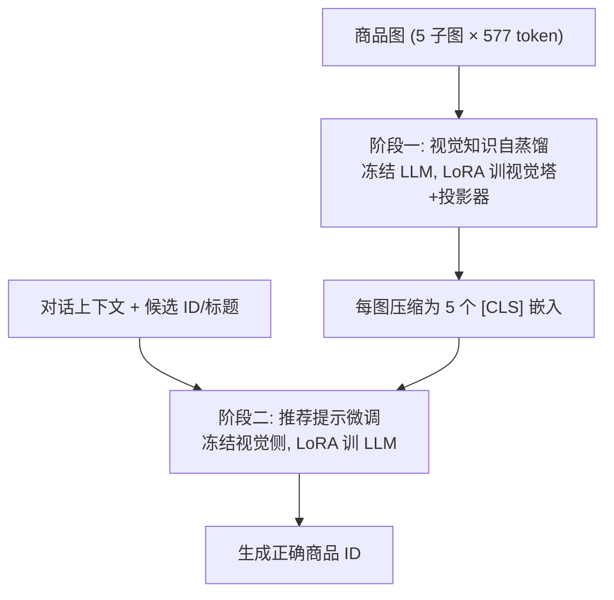

# LaViC: Adapting Large Vision-Language Models to Visually-Aware Conversational Recommendation (面向视觉感知对话推荐的大视觉语言模型适配)

- **会议/期刊**: KDD 2025
- **作者与机构**: Hyunsik Jeon, Satoshi Koide, Yu Wang, Zhankui He, Julian McAuley (UC San Diego / Toyota Motor North America)
- **推荐链路定位**: 重排（候选集内 10 选 1 的生成式选择）
- **研究方向**: 对话推荐与智能体仿真 / 多模态推荐
- **论文原文**: [https://arxiv.org/abs/2503.23312v1](https://arxiv.org/abs/2503.23312v1)
- **开源代码**: [https://github.com/jeon185/LaViC](https://github.com/jeon185/LaViC)

## TL;DR (1分钟核心速览)

时尚、美妆、家居等品类的对话推荐中，用户诉求（"连帽衫质感的军装夹克、胸前口袋"）高度依赖视觉细节，但纯文本 LLM 无法验证廓形与口袋布局；而直接把商品图喂给 VLM 又会因 LLaVA-v1.6 每图 2885 个 token 导致 10 候选场景下上下文爆炸、训练不稳。LaViC 提出两阶段框架：先用**视觉知识自蒸馏**把每张图压成 5 个 [CLS] 嵌入（仍能重建原描述），再做**推荐提示微调**让 LLM 在对话+压缩视觉 token 上直接生成正确商品 ID。在新建 Reddit-Amazon 三域数据集、SBERT 召回 top-10 的候选选择协议下，HR@1 相对最强开源基线最高提升 **54.2%**，并追平/超越 GPT-4o 等闭源模型。

## Background & Motivation (背景与核心矛盾)

- **主流范式**: 对话推荐已从模板/知识图谱（KBRD、KGSF、UniCRS）转向 LLM 直接理解多轮对话意图，零样本 LLM 甚至已超过专用 CRS 模型。
- **前人局限**: 其一，现有 CRS 几乎全是纯文本，无法处理"同品牌但风格更休闲""需要两条独立肩带+胸前横带"这类只能靠看图判定的诉求；其二，视觉推荐（VARS、Rec-GPT4V）虽引入图像，但逐图送入全部 patch token，多候选场景下 token 数线性膨胀、注意力二次开销直接撑爆 4096 上下文。
- **核心洞察 (Key Insight)**: 图像描述能力可以被"蒸馏"——冻结 LLM、只训视觉侧，让单个 [CLS] 嵌入就能复现原本需要数千 token 才能生成的丰富描述，说明视觉信息存在极大的可压缩冗余。
- **本文切入点**: 把"压缩视觉 token"与"候选 ID 生成"解耦成两阶段，先蒸馏再提示微调，从而在上下文预算内同时看 10 个候选商品图。

## Method (核心方法设计)

### 1. 整体框架 (Overall Architecture)

以 LLaVA-v1.6-7B 为骨干。阶段一冻结 LLM，仅用 LoRA 训练视觉塔与投影器，使每张图的 5 个子图各只保留一个 [CLS] 嵌入即可重建原本由 2885 token 生成的商品描述，得到"5 token/图"的压缩表示；阶段二冻结视觉侧，仅对 LLM 加 LoRA，把对话上下文、10 个候选的 ID/标题/5 个视觉嵌入拼成提示，让模型自回归输出唯一正确商品 ID。推理时同样走"SBERT 召回 top-10 → LLM 选 ID"的候选式管线，从根本上规避生成不存在商品名的幻觉。

<figure class="paper-figure" markdown="span">
  ![图 2：视觉知识自蒸馏示意图。生成过程（左）：视觉塔和投影器将每张子图编码为数百个 patch 嵌入（在 LLaVA-v1.6 中每张子图为 577 个），这些嵌入与文本提示一起传入大语言模型（LLM）。随后 LLM 生成聚焦视觉特征的详细产品描述。蒸馏过程（右）：我们冻结 LLM，仅训练视觉塔和投影器（通过 LoRA），将每张子图压缩为单个位于 \[CLS\] 位置的嵌入，同时仍生成相同的描述文本。](../../../../assets/papers/2503.23312v1/figure_2.png)<figcaption>图 2：视觉知识自蒸馏示意图。生成过程（左）：视觉塔和投影器将每张子图编码为数百个 patch 嵌入（在 LLaVA-v1.6 中每张子图为 577 个），这些嵌入与文本提示一起传入大语言模型（LLM）。随后 LLM 生成聚焦视觉特征的详细产品描述。蒸馏过程（右）：我们冻结 LLM，仅训练视觉塔和投影器（通过 LoRA），将每张子图压缩为单个位于 [CLS] 位置的嵌入，同时仍生成相同的描述文本。</figcaption>
</figure>

### 2. 关键设计拆解 (Key Designs)

1. **视觉知识自蒸馏 (Visual Knowledge Self-Distillation)**：痛点是多图场景 token 爆炸。做法是先让完整 VLM 生成描述 $D_i$，再冻结$\Omega_{\text{LM}}$、只训$\Omega_{\text{vision}}$，强制仅凭 5 个 [CLS] 嵌入重建同一描述：
$$\min_{\Omega_{\text{vision}}}\sum_i -\log P_{\Omega_{\text{LM}}+\Omega_{\text{vision}}}\big(D_i \mid \mathcal{T}_{\text{desc}}, \{\text{cls}_{i,r}\}_{r=1}^{5}\big)$$
直觉是"能复现描述 ⇒ 保留了颜色/材质/廓形等关键视觉语义"，token 数从 2885 降到 5，且验证困惑度 1–2 个 epoch 即收敛（PPL≈2），说明压缩几乎无损。

2. **推荐提示微调 (Recommendation Prompt Tuning)**：痛点是通用 VLM 不会"在候选里挑一个"。做法是把每个候选拼成 $\mathbf{X}_{i_j}=\text{Concat}(\text{id}_{i_j},\text{title}_{i_j},\text{cls}_{i_j,1},\dots,\text{cls}_{i_j,5})$，与对话上下文一起送入 LLM，令其只输出短 ID：
$$\min_{\Omega_{\text{LM}}}\sum_{(\mathcal{T}_{\text{conv}},\mathcal{I}_{\text{cand}})} -\log P\big(\text{ID}_{i^*}\mid \mathcal{T}_{\text{conv}},\{\mathbf{X}_{i_j}\}_{j=1}^{10}\big)$$
输出被约束为候选 ID 空间，天然消除幻觉；候选随机打乱以消除位置偏置。

3. **训练目标、负采样与推理效率**：两阶段均为"单正样本 + 9 负候选"的列表式监督（非 BPR/InfoNCE 式对比损失），负样本即 SBERT 召回的其余 9 项；若真值不在候选中则替换一个负样本保证恰一正例。推理时每图仅 5 token，10 候选共 50 视觉 token，单张 A100 40GB 即可完成训练与评测。

## Experimental Setup & Evaluation Protocol (实验设置与评估协议)

- **数据集与预处理**: 新建 Reddit-Amazon，用 GPT-3.5-turbo 过滤 Reddit 帖子并将提及商品对齐 Amazon Reviews 2023，每商品附标题与图片。

| 数据集 | #Conv. | #Turns | #Items | #Images | 场景说明 |
| :--- | :---: | :---: | :---: | :---: | :--- |
| Beauty | 7,672 | 22,966 | 5,433 | 28,082 | 美妆，视觉属性关键 |
| Fashion | 8,039 | 21,831 | 6,716 | 31,162 | 服饰，风格/廓形关键 |
| Home | 3,701 | 6,675 | 3,077 | 18,505 | 家居，设计/配色关键 |

- **数据划分与防穿越 (Splitting Strategy)**: 每域按 **8:1:1 比例划分**训练/验证/测试；多真值对话拆成多条单真值样本。
- **排名评测协议 (Ranking Protocol)**: 非全库排序，而是 **候选式选择（Sampled/Candidate Ranking）**——SBERT 召回 top-10 候选，模型从中选 1；指标为 HR@1 与 ValidRatio (VR，输出是否落在候选集内)。
- **对比基线与超参设置**: 检索类（BM25、SBERT、RoBERTa-large、SimCSE-large、BLaIR-base）与生成类（Vicuna-v1.5-7B、LLaVA-v1.5/1.6-7B、GPT-3.5-turbo、GPT-4o-mini、GPT-4o）；开源生成模型统一 7B 规模，单卡 A100 40GB。

## Key Experimental Results (实验关键数据)

### 1. 主实验对比 (Main Results)

开源基线（SBERT 召回 top-10，HR@1）：

| 方法 | Beauty | Fashion | Home |
| :--- | :---: | :---: | :---: |
| BM25 | 0.0169 | 0.0140 | 0.0479 |
| SBERT | 0.0551 | 0.0681 | 0.2166 |
| RoBERTa-large | 0.0640 | 0.0631 | 0.1814 |
| LLaVA-v1.6 (title) | 0.0770 | 0.0827 | 0.2030 |
| LLaVA-v1.6 (title+image) | 0.0584 | 0.0459 | 0.1089 |
| **LaViC (ours)** | **0.1187** | **0.1232** | **0.3197** |
| Improv.% | +54.2% | +49.0% | +47.6% |

闭源对比：LaViC 在 Beauty/Fashion 略低于 GPT-4o（0.1187 vs 0.1271；0.1232 vs 0.1278），Home 接近（0.3197 vs 0.3350），但全面超过 GPT-3.5-turbo（0.0968/0.0977/0.2343），以 7B 规模追平商用大模型。

### 2. 消融实验 (Ablation Study)

| 变体 | Beauty HR@1 | Fashion HR@1 | Home HR@1 |
| :--- | :---: | :---: | :---: |
| Entire tokens (5×577) | 0.0256 | o.o.m. | o.o.m. |
| w/o images | 0.0972 | 0.1022 | 0.2944 |
| w/o self-distillation | 0.0842 | 0.1084 | 0.2861 |
| **LaViC (ours)** | **0.1187** | **0.1232** | **0.3197** |

### 3. 关键实验发现 (Key Findings)

1. **不压缩的视觉输入是负收益**：直接喂全部 2885 token 的 "Entire tokens" 在 Beauty 仅 0.0256（远低于纯文本 0.0972），且 Fashion/Home 直接 OOM，单 epoch 需两张 A100 跑约一周——证明 token 爆炸不只是效率问题，更是精度问题。
2. **自蒸馏是核心增益来源**：去掉蒸馏（仅保留 [CLS] 抽取）后 Beauty 从 0.1187 掉到 0.0842（-29%），说明"用描述重建做监督"才让 [CLS] 真正承载视觉语义，而非简单降维。
3. **图像并非万能，需专门处理**：LLaVA-v1.6 加入图像后三域 HR@1 反而从 0.0770/0.0827/0.2030 降到 0.0584/0.0459/0.1089，GPT-4o 同样下降，印证"多图对话推荐"是独立于通用 VLM 能力的新问题；分域训练略优于三域合并（0.1187 vs 0.1021），说明当前数据规模下跨域共享收益有限。

## Highlights & Limitations (亮点、对比与审稿批判)

- **与代表作对比 (vs. Prior Work)**: 相比 KBRD/KGSF/UniCRS 等纯文本 CRS，本文首次把图像内容直接纳入对话推荐决策；相比 Rec-GPT4V 逐图全 token 提示，本文用 5 token/图实现同等甚至更强的多候选判别；相比直接微调 LLaVA-v1.6，本文的两阶段解耦避免了多图过拟合与显存崩溃。
- **可迁移亮点**: ①"冻结 LLM、只训视觉侧、以描述重建为监督"的压缩范式可迁移到任何需要多图/多模态上下文的推荐场景（如短视频封面、图文电商）；②"输出约束到候选 ID"是抑制生成式推荐幻觉的廉价通用技巧。
- **审稿级局限批判**: ①评测是 10 候选的 Sampled Ranking，未做全库 Full-Ranking，HR@1 绝对值受召回器上限约束，且强依赖 SBERT 召回质量；②每商品仅用单张代表图，真实 listing 多图场景未覆盖；③仅 7B 骨干、数据规模有限，跨域合并未获益，规模化结论待验证。

## Rating (四维评分)

- **方法创新性 (Novelty)**: ⭐⭐⭐⭐ （自蒸馏压缩视觉 token 的思路简洁有效，但两阶段 LoRA 微调本身属工程组合，理论分析偏弱）
- **评估协议与实验扎实度 (Protocol & Experiments)**: ⭐⭐⭐⭐ （三域真实数据+开源/闭源双线对比+完整消融与案例，但候选式排序与单图设定削弱了结论强度）
- **写作与数学规范度 (Clarity & Rigor)**: ⭐⭐⭐⭐ （两阶段公式与提示模板交代清晰，符号统一，缺少复杂度与延迟的定量分析）
- **工业落地与复现价值 (Industrial & Practical Value)**: ⭐⭐⭐⭐⭐ （代码与数据集全开源，单卡可训，5 token/图的压缩对线上多候选重排极具部署价值）

