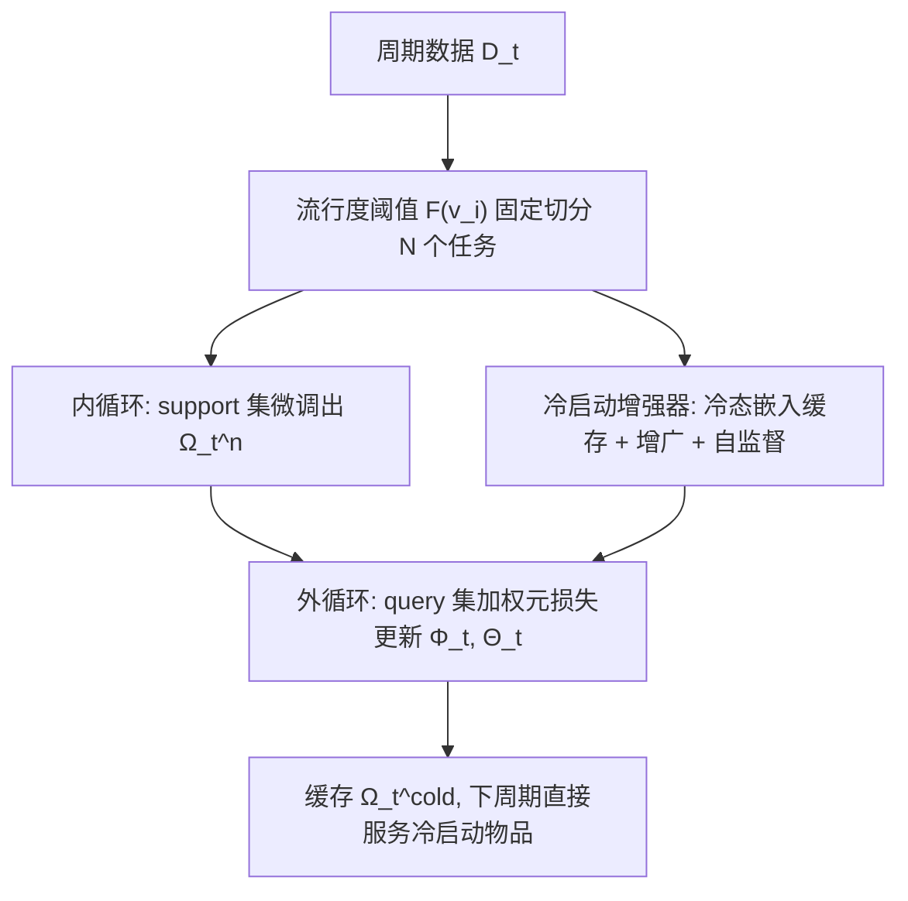
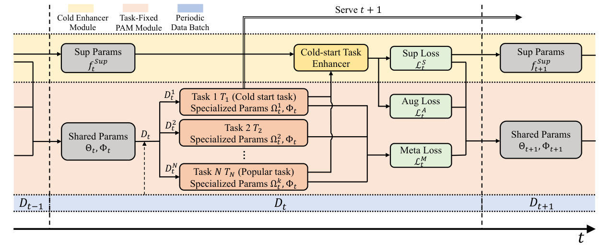
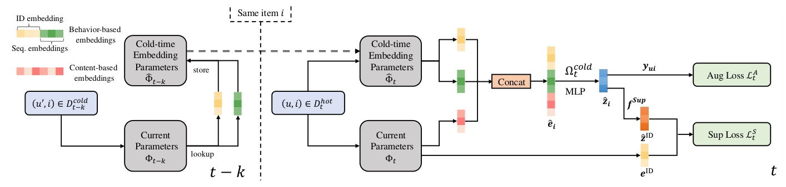

# Online Item Cold-Start Recommendation with Popularity-Aware Meta-Learning (流行度感知元学习的在线物品冷启动推荐)

- **会议/期刊**: KDD 2025 (Proceedings of the 31st ACM SIGKDD, V.1, pp. 927–937)
- **作者与机构**: Yunze Luo, Jingchi Wang, Kaigui Bian (北京大学 CS/AI 创新中心)；Yuezihan Jiang, Yinjie Jiang, Gaode Chen, Peiyi Li, Qi Zhang (快手科技)
- **推荐链路定位**: 召回（双塔流式在线训练与在线服务）
- **研究方向**: 冷启动与长尾推荐 / 自监督与去噪
- **论文原文**: [https://arxiv.org/abs/2411.11225v3](https://arxiv.org/abs/2411.11225v3)
- **开源代码**: [https://github.com/Sycamoretail/PAM](https://github.com/Sycamoretail/PAM)

## TL;DR (1分钟核心速览)

在线流式推荐中冷启动物品流量占比极低，传统元学习"逐物品建任务"的微调与存储开销无法上线，而纯周期微调（PF）又被马太效应拖向热门物品。本文提出模型无关的 PAM：用**预设流行度阈值把流式数据固定切成 N 个元任务**，冷启动任务获得独立参数与更高损失权重，并配"冷启动任务增强器"（历史冷态嵌入模拟 + 数据增广 + 自监督映射）。在 MovieLens/Yelp/Book 三个流式数据集上，冷启动物品 Recall@5 相对最优基线提升 **+20.06%~+64.51%**，NDCG@5 最高 **+74.09%**，且线上 A/B 的 LTR 提升 **+60.45%**。

## Background & Motivation (背景与核心矛盾)

- **主流范式**: 在线推荐按时间周期 $\{D_0,D_1,\dots,D_t\}$流式更新一套全局参数$\{\Phi_t,\Theta_t\}$（PF/IncCTR/SML/ASMG/MeLON 等），冷启动方案则多依赖离线预训练+逐物品微调或知识迁移。
- **前人局限一（离线方案不可上线）**: MeLU 类元学习把每个物品/场景当作独立任务，需为每个冷启动物品做 support-query 内循环微调并单独存储参数，在亿级物品、严格时延约束的流式管道中计算与存储均不可行（ASMG 甚至在 Yelp 上直接 OOM）。
- **前人局限二（在线方案被马太效应吞噬）**: 冷启动样本仅占流量极小比例，全局梯度被热门交互主导，模型对热门物品越训越好、对冷启动物品越训越差，形成自我强化的长尾恶化。
- **核心洞察 (Key Insight)**: 不同流行度物品对**行为类特征**（ID/序列嵌入）与**内容类特征**的依赖程度本质不同——冷启动物品几乎无行为信号，应主要靠内容；热门物品则相反。因此"按流行度切任务"天然对应"按特征依赖切任务"，且切分可**预先固定**，从而把元学习的个性化参数变成可离线缓存、在线直接查表的常量。
- **本文切入点**: 固定任务切分 + 任务级损失重加权 + 冷启动任务增强器，三件事共同把元学习"降本"到可上线，同时把热门样本的信息"反向灌注"给冷启动任务。

## Method (核心方法设计)

### 1. 整体框架 (Overall Architecture)

基座为双塔（用户/物品各自 MLP，InfoNCE 形式 softmax 打分）。每个周期数据 $D_t$到达后，先由分段常函数$F(v_i)$按物品历史曝光量$v_i$切成$\{D_t^1,\dots,D_t^N\}$（1 个冷启动任务 + 4 个热门任务），各任务再拆 support/query；内循环用 support 集把共享初始化$\Theta_t$微调成任务专属$\Omega_t^n$，外循环用 query 集加权汇总后更新共享的$\{\Phi_t,\Theta_t\}$。冷启动增强器额外从历史冷态嵌入缓存$\hat{\Phi}_{t-k}$中"复活"热门物品的冷启动时刻表征，构造模拟冷启动样本与自监督信号。服务阶段直接取上一周期存好的$\Omega_t^{cold}$ 对冷启动物品打分，**零在线微调**。

<figure class="paper-figure" markdown="span">
  <figcaption>图1：所提出的PAM方法概览。Φ𝑡表示任务共享的嵌入参数，Θ𝑡表示任务共享的网络参数初始化，其将被微调为专用参数Ω𝑛</figcaption>
</figure>

### 2. 关键设计拆解 (Key Designs)

1. **固定流行度任务切分 + 双层优化（把元学习降本为查表）**：痛点是把每个物品当任务导致参数爆炸。本文用预设阈值把 $v_i$映射到$T_n$，内循环只更新网络权重（support/query 无交互重叠，更新嵌入无意义）：
$\Omega_t^n \leftarrow \Theta_t - \alpha \nabla_{\Theta_t}\mathcal{L}_{T_n}(\Theta_t,\Phi_t^n \mid D_t^{n,S})$，
外循环 $\{\Phi_{t+1},\Theta_{t+1}\} \leftarrow \{\Phi_t,\Theta_t\} - \beta\nabla \mathcal{L}_t^M$，其中$\mathcal{L}_t^M=\sum_{n=1}^{N}\lambda_n \mathcal{L}_{T_n}(\Omega_t^n,\Phi_t^n\mid D_t^{n,Q})$。直觉：任务数固定为$N$后，参数规模与物品数解耦，冷启动任务可给$\lambda_{cold}=2$（其余 0.5）显式对抗长尾；同时不同任务共享低层嵌入、只在高层网络分化，恰好实现"冷启动重内容、热门重行为"的特征分工。

2. **冷启动任务增强器（用热门样本补冷启动监督）**：冷启动任务样本太少，故把物品嵌入拆为行为类 $\boldsymbol{e}^{beh}$（ID+序列）与内容类$\boldsymbol{e}^{con}$。系统在物品处于冷态时把其行为嵌入存入$\hat{\Phi}$，当它变热门后即可拼出"模拟冷启动嵌入"：
$\hat{\boldsymbol{e}}_i=[\hat{\boldsymbol{e}}_{i1}^{beh},\dots,\hat{\boldsymbol{e}}_{ik}^{beh},\boldsymbol{e}_{ik+1}^{con},\dots,\boldsymbol{e}_{iQ}^{con}]$。
由此派生两个辅助损失：(a) **数据增广** $\mathcal{L}_t^A=\mathcal{L}(\hat{\Omega}_t^{cold}\mid\hat{D}_t^{cold,Q})$，用热门交互的真实标签监督模拟冷样本；(b) **自监督映射** 把冷启动网络最后一层换成专用映射$f^{Sup}$，令其输出逼近该物品热门态的 ID 嵌入，$\mathcal{L}_t^S=\frac{1}{N}\lVert\hat{\boldsymbol{z}}_{ID}-\boldsymbol{e}_{ID}\rVert_2^2$。直觉：热门 ID 嵌入是"多次更新后的信息富集版本"，用它做回归目标等于把热门阶段的知识蒸馏进冷启动特征提取器。

3. **训练目标与推理效率**：总损失 $\mathcal{L}_t^T=\gamma_M\mathcal{L}_t^M+\gamma_S\mathcal{L}_t^S+\gamma_A\mathcal{L}_t^A$（$\gamma=1,3,2$），负采样为 **in-batch 负样本**（InfoNCE，温度$\tau$），无额外硬负采样。在线开销的关键在于：冷启动参数$\Omega_t^{cold}$ 在训练期即已算好并缓存，服务时仅做一次前向，避免了逐物品微调的时延与逐物品参数存储。

<figure class="paper-figure" markdown="span">
  <figcaption>图2：我们提出的冷启动任务增强器的结构。</figcaption>
</figure>

## Experimental Setup & Evaluation Protocol (实验设置与评估协议)

- **数据集与预处理**: 评分 >3 记正样本，其余负样本；含时间戳以模拟流式。

| 数据集 | #Users | #Items | #Interactions | #Tags | 密度 |
| :--- | :---: | :---: | :---: | :---: | :---: |
| MovieLens | 43,181 | 51,142 | 6,840,091 | 20 | 3.09‰ |
| Yelp | 1,987,929 | 150,346 | 6,990,280 | 1,312 | 0.02‰ |
| Book | 351,487 | 581,717 | 6,402,728 | 2,808 | 0.03‰ |

- **数据划分与防穿越**: **全局时间戳切分**——每个数据集等分为 31 个周期，**不做预训练**，所有模型从第 1 周期起流式训练；从第 24 周期开始测试，每周期模型在**下一周期**的冷启动数据上评估，报告各测试阶段均值。
- **排名评测协议**: **Sampled Ranking**——对每个冷启动物品，取真实交互用户为 1 正样本，当前 batch 内未交互用户为负样本（因物品低流行度，负样本数不少于 900），计算 Recall@K / NDCG@K（K=5/10/20）。
- **对比基线与超参**: 基线含 PF、s2Meta、IncCTR、SML、ASMG、MeLON、IMSR，统一双塔与相同特征输入；冷启动定义为流行度最低 5% 的物品，三数据集阈值 $v_{cold}$分别为 50/20/15，其余切 4 个热门任务；Adam，内外学习率均 0.001，batch=1024，$\lambda_{cold}=2$、其余 0.5。

## Key Experimental Results (实验关键数据)

### 1. 主实验对比 (Main Results)

冷启动物品（节选，完整见原文 Table 2）：

| 数据集 | 指标 | 最优基线 | PAM-F | Improv. |
| :--- | :--- | :---: | :---: | :---: |
| MovieLens | R@5 | 0.3132 (MeLON) | **0.4157** | +32.73% |
| MovieLens | N@5 | 0.2100 (IncCTR) | **0.3314** | +57.81% |
| MovieLens | N@20 | 0.2813 (IncCTR) | **0.3833** | +36.26% |
| Yelp | R@5 | 0.1375 (s2Meta) | **0.2262** | +64.51% |
| Yelp | N@5 | 0.0876 (s2Meta) | **0.1525** | +74.09% |
| Yelp | N@20 | 0.1459 (IncCTR) | **0.2173** | +48.93% |
| Book | R@5 | 0.2182 (ASMG) | **0.2609** | +20.06% |
| Book | N@20 | 0.2170 (MeLON) | **0.2449** | +12.86% |

热门物品（MovieLens，Table 3）：PAM 的 R@5=0.3340、N@20=0.3198 仍优于 MeLON（0.3205 / 0.3173）等全部基线，说明冷启动任务的参数分化**未以牺牲热门效果为代价**。

### 2. 消融实验 (Ablation Study)

| 变体 | ML R@10 | ML N@10 | Yelp R@10 | Yelp N@10 | Book R@10 | Book N@10 |
| :--- | :---: | :---: | :---: | :---: | :---: | :---: |
| PAM-M (无增强器) | 0.4733 | 0.3327 | 0.2966 | 0.1633 | 0.3460 | 0.2038 |
| PAM-S (仅自监督) | 0.4856 | 0.3450 | 0.3261 | 0.1813 | 0.3583 | 0.2119 |
| PAM-A (仅增广) | 0.4980 | 0.3547 | 0.3244 | 0.1802 | 0.3478 | 0.2040 |
| PAM-F (完整) | **0.5036** | **0.3598** | **0.3316** | **0.1865** | **0.3616** | **0.2149** |

### 3. 关键实验发现 (Key Findings)

1. **增益集中在头部名次**：PAM 在 K=5 上的相对提升（MovieLens N@5 +57.81%、Yelp N@5 +74.09%）显著高于 K=20（+36.26% / +48.93%），说明其优势在于把最匹配的冷启动物品精准顶到列表最前，而非泛化地"多召回几个"。
2. **增广与自监督互补但不同向**：PAM-A 在 MovieLens 上更强（R@10 0.4980 vs PAM-S 0.4856），PAM-S 在 Yelp 上更强（0.3261 vs 0.3244），与"MovieLens 内容特征集中、Yelp 内容特征分散"的解释一致；两者合并后 PAM-F 增益小于单独增益之和，说明二者优化方向部分重叠。
3. **掩码实验直接验证特征分工**：对冷启动任务掩掉行为类嵌入后顶层表征误差极小、掩掉内容类嵌入则部分维度剧变；热门任务恰好相反（掩行为类误差更大）。这从表征层面证实固定任务切分确实学到了"冷启动重内容、热门重行为"的参数特化，而非仅仅靠损失重加权。
4. **线上 A/B（亿级用户系统 vs PF）**：Show% +41.39%、LTR +60.45%、CMTR +4.26%、CLTR +6.34%，验证了"缓存冷启动参数、零在线微调"的工程路径在真实流量下可落地。

## Highlights & Limitations (亮点、对比与审稿批判)

- **与代表作对比 (vs. Prior Work)**: 相比 MeLU/s2Meta 的"逐物品/逐场景建任务"，PAM 把任务数从 $O(|\mathcal{I}|)$压到常数$N$，参数量与物品数解耦；相比 SML/ASMG/MeLON 这类"用历史模型生成新模型"的在线方案，PAM 不依赖初始化模型质量、不做生成式参数预测，因而在**无预训练**的流式设定下优势明显（ASMG 在 Yelp 直接 OOM）；相比 IncCTR 的知识蒸馏，PAM 的监督信号来自真实热门交互与 ID 嵌入回归，不额外造标签。
- **可迁移亮点**: (1) "按流行度分桶 + 任务级损失重加权"可作为通用插件挂到任意双塔/CTR 模型上对抗长尾；(2) "冷态嵌入快照缓存 + 热门期回放"是一种极低成本的历史行为重建技巧，可迁移到序列推荐的位置去偏与样本增广。
- **审稿级局限批判**: (1) 评测采用 **Sampled Ranking（≥900 负样本）** 而非全库 Full-Ranking，冷启动物品在百万级候选池中的真实排名可能被高估；(2) 任务切分阈值 $v_{cold}$与任务数$N$为人工预设且三数据集各不相同，缺少自适应确定方法，跨域迁移需重新调参；(3) 冷态嵌入缓存$\hat{\Phi}$ 随物品规模线性增长，论文未给出存储上界与淘汰策略分析。

## Rating (四维评分)

- **方法创新性 (Novelty)**: ⭐⭐⭐⭐ （"固定流行度任务切分"把元学习从逐物品微调降维为常数任务查表，配合掩码实验给出的特征分工证据，机制简洁且有表征层面支撑）
- **评估协议与实验扎实度 (Protocol & Experiments)**: ⭐⭐⭐⭐ （三数据集 + 31 周期严格流式无预训练 + 7 个基线 + 完整消融与线上 A/B，但采样排序协议与阈值敏感性削弱说服力）
- **写作与数学规范度 (Clarity & Rigor)**: ⭐⭐⭐⭐ （双层优化与三个损失的符号体系清晰、算法伪代码完整，但部分符号如 $\Phi_t^n$与$\Phi_t$ 的关系表述略含混）
- **工业落地与复现价值 (Industrial & Practical Value)**: ⭐⭐⭐⭐⭐ （模型无关、零在线微调、参数可预缓存，已在亿级用户系统上线并有 A/B 数据，代码开源，落地价值突出）

