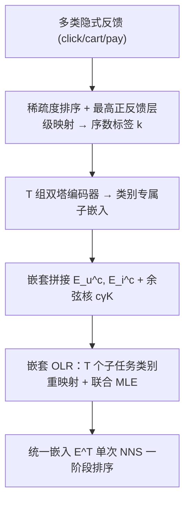
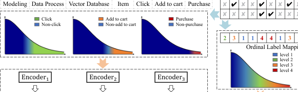

# Embed Progressive Implicit Preference in Unified Space for Deep Collaborative Filtering (将渐进式隐式偏好嵌入统一空间用于深度协同过滤)

- **会议/期刊**: KDD 2025
- **作者与机构**: Zhongjin Zhang, Yu Liang, Jiazhi Xia (中南大学)；Cong Fu, Yuxuan Zhu, Kun Wang (Shopee)；Yabo Ni, Anxiang Zeng (南洋理工大学)
- **推荐链路定位**: 召回（Embedding-based Retrieval + NNS）
- **研究方向**: 协同过滤与双塔召回 / 多任务学习
- **论文原文**: [https://arxiv.org/abs/2505.20900v2](https://arxiv.org/abs/2505.20900v2)
- **开源代码**: [https://github.com/FuCongResearchSquad/GNOLR](https://github.com/FuCongResearchSquad/GNOLR)

## TL;DR (1分钟核心速览)

现代推荐系统用点击/加购/购买等多类隐式反馈刻画偏好，但主流"按反馈分任务建模"范式存在三大痛点：忽略反馈间的参与度递进、各任务嵌入空间不可通约导致需多索引+启发式融合、矛盾标签引发梯度冲突。本文提出 GNOLR：先按反馈稀疏度将多反馈映射为严格有序类别，再用嵌套类别专属编码 + 嵌套 OLR 优化把渐进偏好压入**统一嵌入空间**，单次 NNS 即可完成一阶段排序。在 10 个真实数据集上，AUC 与 Recall 全面超越 SOTA，且无需样本重加权即可应对极端不平衡。

## Background & Motivation (背景与核心矛盾)

- **主流范式**: 双塔 CF + NNS 召回是工业标配；多反馈场景下普遍采用 NSB（Naive Shared Bottom）为每类反馈建独立二分类头，或 ESMM/ESCM2 等因果多任务结构。
- **前人局限**: (1) 把"点击未购买"与"未点击"同等视为负样本，丢失参与度递进语义；(2) 各任务嵌入空间不相容，相似度不可比，需冗余索引与加/乘融合，任务越多系统越复杂且精度受损；(3) 矛盾标签（点击=1、购买=0）在共享参数上产生梯度冲突。
- **核心洞察 (Key Insight)**: 反馈的**出现频率**天然编码偏好强度——越稀疏（购买）偏好越高。若按稀疏度排序并取"最高正反馈层级"作为序数标签，即可把多反馈压缩为单一有序类别，从而用 OLR 统一建模。
- **本文切入点**: 标准 OLR 只适用于显式评分且系数全局共享，无法处理隐式反馈的模糊序关系与反馈依赖协变量；本文将其神经化并嵌套化，在保持统一空间的同时恢复反馈专属表达力。

## Method (核心方法设计)

### 1. 整体框架 (Overall Architecture)

输入用户/物品特征，先经**序数标签映射**把 $T$类反馈转为单一类别$k\in\{0,\dots,T+1\}$；随后$T$组双塔编码器分别产出类别专属子嵌入，按层级**拼接为嵌套嵌入**$\boldsymbol{E}_u^c,\boldsymbol{E}_i^c$；每个子任务$t$在类别重映射后的子空间上计算余弦核并过 Sigmoid 累积概率，联合优化$T$个 OLR 子损失。推理时仅需最高层统一嵌入$\boldsymbol{E}_u^T,\boldsymbol{E}_i^T$ 做一次余弦 NNS，即可完成跨反馈的全局排序。

<figure class="paper-figure" markdown="span">
  <figcaption>图 1：比较先前范式与 GNOLR 的示意图。先前方法将实体嵌入到按反馈划分、不可通约的空间中，需要分别排序和融合后再展示给用户。相比之下，GNOLR 将多种反馈统一到共享嵌入空间中，使空间邻近性与用户偏好进展对齐，从而实现无缝的一阶段排序并提升预测效果。</figcaption>
</figure>

### 2. 关键设计拆解 (Key Designs)

1. **序数标签映射（Ordinal Label Mapping）**：解决"隐式反馈无严格序"问题。先按正样本数 $pos(y_t)$升序排列反馈（越稀疏越靠后），再取最高正反馈层级：$k=\max(\{t+1\mid y_t>0\})$，全负则$k=1$。这样"点击未购买"($k=2$) 严格优于"未点击"($k=1$)，把矛盾标签转为一致序关系，从根源消除梯度冲突。

2. **嵌套类别专属编码 + 广义比例优势模型**：解决"共享编码器表达力不足 vs. 独立编码器空间割裂"的两难。第 $c$层嵌入为前$c$层拼接$\boldsymbol{E}_u^c=\text{Concat}[\boldsymbol{e}_u^1,\dots,\boldsymbol{e}_u^c]$，累积概率为
$$P(k\le c\mid \boldsymbol{x}_u,\boldsymbol{x}_i)=\sigma\!\left(a_c-c\gamma\,\mathcal{K}(\boldsymbol{E}_u^c,\boldsymbol{E}_i^c)\right)$$
其中 $\mathcal{K}$为余弦核，$\gamma$重塑 Sigmoid 陡峭度。直觉：由 Sigmoid 单调性，最大化$P(k=c)$会推高前$c-1$层相似度、压低第$c$ 层相似度，使高层子嵌入成为"守门员"——只有偏好真正越过阈值才被激活，从而在**单一空间**内编码层级递进。

3. **嵌套 OLR 优化与阈值闭式估计**：仅最大化 $P(k=c)$不能保证前序类别概率分布合理（如$P(k{=}1){=}0.4,P(k{=}2){=}0,P(k{=}3){=}0.6$亦可行）。故设$T$个子任务，子任务$t$把$k\ge t+1$的样本重标为$t+1$，总损失$\mathcal{L}=\sum_{t=1}^{T}\mathcal{L}_t$为各子任务 MLE 之和。阈值不学习而闭式估计：$a_c\approx\log\frac{1-\mathbb{E}[P(k>c)]}{\mathbb{E}[P(k>c)]}$，由标签分布直接算出，天然递增且免调参。训练采用 Twin-Tower MLP、嵌入$\ell_2$ 归一化、无负采样（全库 softmax 式 MLE），推理为单次 ANN 检索。

## Experimental Setup & Evaluation Protocol (实验设置与评估协议)

- **数据集与预处理**: 10 个真实数据集，覆盖电商/短视频/电影/零售：

| 数据集 | #Users | #Items | #Interactions | 反馈类型 | 场景说明 |
| :--- | :---: | :---: | :---: | :---: | :--- |
| Ali-CCP | 0.24M | 0.47M | 69.1M | click/pay | 淘宝，极端不平衡 |
| AE-ES/FR/NL/US | / | / | 7.3M–31.7M | click/pay | AliExpress 四国市场 |
| KR-Pure | 24.9K | 6.8K | 0.92M | like/follow | 快手视频 |
| KR-1K | 1K | 2.4M | 6.75M | like/follow | 快手稀疏用户采样 |
| ML-1M / ML-20M | 6K/138K | 3.7K/27K | 1M/20M | 评分>4 二值化 | 电影 |
| RetailR | 1.4M | 0.24M | 2.76M | ATC/pay | 真实电商 |

- **数据划分与防穿越 (Splitting Strategy)**: 全局**时间戳切分**，前 70% 历史训练、后 30% 未来测试，严格防穿越。
- **排名评测协议 (Ranking Protocol)**: 排序任务用 AUC 与 GAUC（按用户会话平均）；召回任务用 **Full-Ranking** 式 Recall@K（按欧氏距离对全候选排序，统计 top-K 正例占比），非采样排序。
- **对比基线与超参设置**: 单任务 BCE/JRC；多任务 NSB/ESMM/ESCM2-IPS/ESCM2-DR/DCMT/NISE/TAFE（均加样本重加权 `*`）；召回对比 RankNet/λRank/ListNet/SetRank/S2SRank/JRC。统一 Twin-Tower MLP 骨干、嵌入 $\ell_2$归一化，各方法独立网格搜索，报告 10 次均值，显著性$p<0.05$。

## Key Experimental Results (实验关键数据)

### 1. 主实验对比 (Main Results)

**单任务排序 AUC**（节选）：

| 方法 | Ali-CCP | AE-ES | KR-Pure | KR-1K | ML-1M | RetailR |
| :--- | :---: | :---: | :---: | :---: | :---: | :---: |
| BCE* | 0.5896 | 0.7118 | 0.7665 | 0.8510 | 0.7896 | 0.7308 |
| JRC* | 0.5924 | 0.7357 | 0.8280 | 0.8684 | 0.7939 | 0.7165 |
| **GNOLR** | **0.6232** | **0.7366** | **0.8506** | **0.9024** | **0.8139** | **0.7537** |
| Improv. | +5.2% | +0.1% | +2.7% | +3.9% | +2.5% | +3.1% |

**多任务排序 AUC**（CTR / CTCVR 节选）：

| 方法 | Ali-CCP CTR | Ali-CCP CTCVR | AE-ES CTCVR | KR-1K Follow | RetailR ATC |
| :--- | :---: | :---: | :---: | :---: | :---: |
| NSB* | 0.5877 | 0.5070 | 0.8433 | 0.7318 | 0.6845 |
| ESCM2-DR* | 0.5962 | 0.5527 | 0.8563 | 0.7888 | 0.6926 |
| TAFE* | 0.5981 | 0.5336 | 0.8139 | 0.7327 | 0.7013 |
| **GNOLR** | **0.6153** | **0.5997** | **0.8827** | **0.8165** | **0.7764** |
| Improv. | +2.9% | +8.5% | +3.1% | +3.5% | +10.7% |

**多目标召回 Recall@K（KR-1K）**：Follow 目标下 GNOLR Recall@500 = **0.2966**，显著高于 NSB*_follow (0.2710) 与 NSB*_like (0.2512)；Like 目标 Recall@500 = **0.3841** vs. NSB*_like 0.3604。

### 2. 消融实验 (Ablation Study)

| 数据集/任务 | Neural OLR | GNOLR-V0 | GNOLR-V1 | GNOLR |
| :--- | :---: | :---: | :---: | :---: |
| Ali-CCP CTR | 0.6114 | 0.6041 | 0.5965 | 0.6085 |
| Ali-CCP CTCVR | 0.5221 | 0.5883 | 0.5854 | **0.6163** |
| KR-1K Like | 0.9061 | 0.9023 | 0.9047 | **0.9079** |
| KR-1K Follow | 0.7106 | 0.6815 | 0.8076 | **0.8163** |

（V0 = 仅任务专属编码器；V1 = 仅嵌套类别专属编码）

### 3. 关键实验发现 (Key Findings)

1. **稀疏目标收益最大**：Ali-CCP CTCVR 上 GNOLR 较最强基线 ESCM2-DR* 提升 8.5%（0.5527→0.5997），RetailR ATC 提升 10.7%；而稠密 CTR 目标提升仅约 2.9%，说明统一序数建模主要缓解了稀疏反馈的分布拟合不足。
2. **嵌套优化是稀疏目标的关键**：消融中仅加嵌套编码（V1）已使 KR-1K Follow 从 Neural OLR 的 0.7106 跃至 0.8076，再叠加嵌套 OLR 优化达 0.8163；而稠密 Like 目标各变体差异 <0.005，印证"嵌套结构专治稀疏层级边界"。
3. **统一空间带来跨目标召回增益**：NSB* 用 follow 编码器检索 like 目标时 Recall@500 从 0.3604 跌至 0.3312，而 GNOLR 单一嵌入在 Like/Follow 两目标上同时最优（0.3841/0.2966），验证了空间可通约性对一阶段检索的实际价值。

## Highlights & Limitations (亮点、对比与审稿批判)

- **与代表作对比 (vs. Prior Work)**: 相较 NSB/ESMM 等按反馈分头建模（空间割裂、需融合），GNOLR 用序数标签把多任务压成单任务；相较标准 OLR（仅显式评分、系数全局共享），GNOLR 通过嵌套编码恢复反馈专属表达力；相较 JRC（兼顾校准与个性化），GNOLR$_L$ 在 GAUC 上多数数据集领先（如 KR-1K 0.5380 vs. JRC 0.5036）。
- **可迁移亮点**: (1) "按稀疏度排序 + 取最高正反馈层级"的标签映射可直接用于任意多级行为埋点场景；(2) 阈值 $a_c$ 的闭式分布估计免去调参，可迁移至其他序数/分级预测任务。
- **审稿级局限批判**: (1) 嵌套编码需 $T$ 组双塔，参数量与训练开销随反馈类型线性增长，论文未给出线上延迟对比；(2) 序数假设依赖"稀疏度=偏好强度"，对"关注但未点赞"等非单调行为可能失真，且 Ali-CCP 上多任务 CTR 反比单任务略降（0.6232→0.6153），作者亦承认稀疏正例下类别边界拟合不足。

## Rating (四维评分)

- **方法创新性 (Novelty)**: ⭐⭐⭐⭐ （将 OLR 神经化+嵌套化以统一多反馈空间，理论对比 CE 的等价性与梯度冲突分析扎实）
- **评估协议与实验扎实度 (Protocol & Experiments)**: ⭐⭐⭐⭐ （10 数据集、时间切分、AUC/GAUC/Full-Ranking Recall 多协议、消融与敏感性完整，惟缺线上 A/B）
- **写作与数学规范度 (Clarity & Rigor)**: ⭐⭐⭐⭐ （比例优势模型推导清晰、阈值闭式估计有 Jensen 不等式支撑，符号略密）
- **工业落地与复现价值 (Industrial & Practical Value)**: ⭐⭐⭐⭐ （单次 NNS 替代多索引融合、免负采样、代码开源，但多塔开销需工程权衡）

