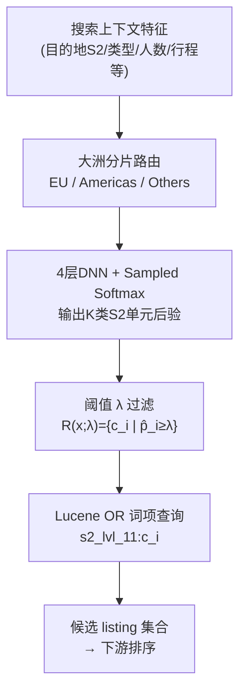

# High Precision Audience Expansion via Extreme Classification in a Two-Sided Marketplace (双边市场中基于极端分类的高精度受众扩展)

- **会议/期刊**: KDD TSMO 2025 (Test-time and Scalable Model Optimization Workshop)
- **作者与机构**: Dillon Davis, Huiji Gao, Thomas Legrand, Juan Manuel Caicedo Carvajal, Malay Haldar, Kedar Bellare, Moutupsi Paul, Soumyadip Banerjee, Liwei He, Stephanie Moyerman, Sanjeev Katariya (Airbnb, Inc.)
- **推荐链路定位**: 召回（位置召回层，位于排序之前）
- **研究方向**: 协同过滤与双塔召回 / 时空轨迹与 POI 本地生活推荐
- **论文原文**: [https://arxiv.org/abs/2602.14358v1](https://arxiv.org/abs/2602.14358v1)
- **开源代码**: 暂未开源

## TL;DR (1分钟核心速览)

Airbnb 搜索的位置召回长期依赖深度贝叶斯 Bandit 预测一个**矩形检索边界**，但矩形无法在提升可订区域召回的同时排除大量不可订区域（如 "San Francisco" 检索结果中 39.8% 落在从未被该查询预订的位置）。本文把位置召回重构为**极端多分类问题**：将全球划分为 25M 个 level-11 S2 单元，按大洲分片为 3 个模型（约 85K/139K/137K 类），用 sampled softmax 训练 DNN 预测每个单元的预订概率，阈值化后转为 Lucene 的 OR 词项查询。离线在召回持平（-0.04%）下精度 +11.01%、召回列表数 +9.91%；线上约 66M 用户 A/B 中未取消预订者 +0.17%（$p<0.05$）。

## Background & Motivation (背景与核心矛盾)

- **主流范式**: 双边市场的位置召回普遍用几何规则收窄候选池——Foursquare 扩张矩形框直到场馆数足够，Uber 用 H3 六边形网格聚合需求，Airbnb 生产系统则用深度贝叶斯 Bandit 预测矩形检索边界。
- **前人局限**: ① 矩形是**形状假设**，要覆盖 Cancun 搜索者实际会订的 Playa del Carmen，就必须把两地之间大量不可订区域一并纳入；② 由此导致候选集与曝光结果中大量位置从未被该查询预订（San Francisco 查询分别达 39.8% 与 14.7%），既浪费下游排序算力又损害体验。
- **核心洞察 (Key Insight)**: 用户的搜索上下文（目的地、POI 类型、人数、行程长度等）本身含有足够信号，可把最终预订位置**定位到极少数细粒度地理单元**；S2 单元互斥、等面积、层级可控，天然适合作为多分类标签空间。
- **本文切入点**: 用"先分类、再查询"（classify-then-query）替换"预测矩形、再过滤"，以极端多分类直接输出高精度单元集合。

## Method (核心方法设计)

### 1. 整体框架 (Overall Architecture)

训练样本由"搜索—归因预订"对构成：取搜索结果中最终被预订的 listing，将其经纬度映射为 level-11 S2 单元标签，构造多分类监督。模型输入 10 维搜索特征（目的地所在不同粒度的 S2 单元 ID、目的地类型、目的地国家、请求来源国、人数、是否 App、设备类型、行程长度、是否周末、目的地最小外接矩形对角线公里数），经 4 层 DNN（1024-2056-1024-256）输出该大洲分片内全部 S2 单元的后验概率；推理时保留概率超过阈值 $\lambda$ 的单元，翻译为 Lucene 的析取词项查询，取回这些单元内 listing 的并集作为候选集，再交给下游排序。

### 2. 关键设计拆解 (Key Designs)

1. **S2 单元离散化替代矩形边界**：矩形边界的根本缺陷是"形状不可分"，无法只保留离散的可订飞地。本文用 S2 四叉树把球面递归二分，$N(L)=6\times 4^{L}$，level-11 约 25M 个等面积、互斥、确定性单元，并以 Hilbert 曲线排序编码进 64 位 ID。物理直觉：把"连续几何覆盖"问题转成"离散标签预测"问题，模型才能表达"跳过中间不可订区域、直达远端可订区域"的非凸形状。

2. **三级规模压缩的极端分类**：25M 类约为前沿 LLM 词表的 100 倍，且预订数据远比语料稀疏，直接训练不可行。作者做两步压缩：先构建"至少含一个被订 listing"的显式词表，降至约 360K 类；再按目的地大洲分片为 3 个模型（约 85K/139K/137K 类），既适配现代框架与硬件，又保留相似目的地的跨样本泛化。训练用 sampled softmax，每步采样约 25K 负类，学习率 0.002、16 epoch、早停，2×A100 + Horovod，单区域 3–7 小时。

3. **阈值化检索与召回对齐**：推理输出稠密分布 $\hat{p}_i=P(C=c_i\mid \mathbf{x};\theta)$，保留$\mathcal{R}(\mathbf{x};\lambda)=\{c_i\in\mathcal{S}^{(11)}\mid \hat{p}_i\geq\lambda\}$，再转为析取查询$Q(\mathbf{x})=\bigcup_{c_i\in\mathcal{R}(\mathbf{x};\lambda)}\texttt{s2\_lvl\_11:}c_i$。$\lambda$ 在离线扫描中选取，使新方法**匹配基线矩形模型的预订位置召回**，从而把比较公平地落在精度与库存量上；三区域阈值分别为 0.0005 / 0.00075 / 0.000625。

4. **训练目标与归因难点**：总损失即 sampled softmax 交叉熵。关键工程细节是**预订归因**——用户平均发起约 49 次搜索、浏览约 9 个 listing 才下单，且常通过地图平移缩放发现房源，因此必须把后续地图搜索发现的预订归因回最初的目的地搜索，才能学到"Cancun 搜索者愿意住 Playa del Carmen"；代价是引入"搜 San Francisco 却订了地球另一端"的离群样本，故特征集刻意只保留最不易过拟合/分布外失效的子集。

## Experimental Setup & Evaluation Protocol (实验设置与评估协议)

- **数据集与预处理**: 训练集为 1 年归因预订搜索对（约 530M 样本），测试集为紧接训练期之后的 7 天（约 10M 样本）。标签空间经"含被订 listing"词表过滤 + 大洲分片压缩。

| 数据集 | #Users | #Items | #Interactions | 稀疏度/密度 | 特征/场景说明 |
| :--- | :---: | :---: | :---: | :---: | :--- |
| 训练集（1 年归因搜索） | 未披露 | 8M+ 活跃 listing | ~530M | 极稀疏（25M 类标签空间） | 全球目的地，按大洲分 3 片 |
| 测试集（后续 7 天） | 未披露 | 同上 | ~10M | 同上 | 时间外推，紧接训练期 |

- **数据划分与防穿越 (Splitting Strategy)**: **全局时间戳切分**——测试集取训练区间之后连续 7 天，严格防穿越。
- **排名评测协议 (Ranking Protocol)**: 非传统 Top-N 排序评测，而是**集合级召回/精度协议**：将基线矩形边界也转成 S2 单元集合以公平对比；指标为交叉熵、Booked Listing Location Recall（被订 listing 所在单元被预测命中的比例）、Booked Listing Location Precision（预测为正的单元中真阳性比例）、Number of Listings Retrieved。AUC 不适用，因基线无概率输出。
- **对比基线与超参设置**: 唯一基线为同数据、同日期训练的**矩形检索边界模型**（加权分段损失，输出 4 个浮点），其架构与学习率已充分调优且含目的地区域特征，故分片带来的收益不被误计。线上为约 66M 用户的 A/B 实验，显著性标准 $p<0.05$。

## Key Experimental Results (实验关键数据)

### 1. 主实验对比 (Main Results)

| 方法 | 未取消预订者 (线上) | 预订位置召回 | 预订位置精度 | 召回 listing 数 |
| :--- | :---: | :---: | :---: | :---: |
| 基线：矩形检索边界模型 | 基准 | 基准 | 基准 | 基准 |
| **本文：S2 单元极端分类** | **+0.17%** | -0.04% | **+11.01%** | **+9.91%** |

（原文因公司隐私未披露绝对数值，仅给出相对变化；线上提升在 $p<0.05$ 下显著。）

### 2. 消融实验 (Ablation Study)

原文未提供组件级消融表，但给出了等价的分区域精度-召回曲线（图 4–6）与阈值敏感性分析，可视为对核心设计的间接验证：

| 配置/区域 | 召回对齐方式 | 精度表现 | 召回 listing 数 |
| :--- | :--- | :---: | :---: |
| 欧洲目的地模型（~85K 类，$\lambda$=0.0005） | 匹配基线召回 | 优于基线 | 增加 |
| 美洲目的地模型（~139K 类，$\lambda$=0.00075） | 匹配基线召回 | 优于基线 | 增加 |
| 非欧美目的地模型（~137K 类，$\lambda$=0.000625） | 匹配基线召回 | 优于基线 | 增加 |
| 全量合并 | 匹配基线召回 | **+11.01%** | **+9.91%** |

### 3. 关键实验发现 (Key Findings)

1. **精度增益来自"形状自由度"而非更多算力**：在召回几乎不变（-0.04%）的前提下精度提升 11.01%，说明矩形假设本身就是精度瓶颈；同时召回 listing 数反增 9.91%，证明新方法能同时"剔除不可订区域"与"暴露此前未曝光的可订飞地"，实现真正的受众扩展。
2. **离线精度增益可翻译为线上业务增益**：约 66M 用户的 A/B 中未取消预订者 +0.17% 且统计显著，表明位置召回层的候选质量对最终转化有可测的因果贡献，而非仅指标好看。
3. **分片是极端分类可落地的前提**：将 360K 类拆为 3 个 85K–139K 类模型后，单模型可在 2×A100 上 3–7 小时训完，且三区域曲线一致优于基线，说明分片未牺牲跨区域泛化，反而使超参（学习率、$\lambda$）可按区域独立调优。

## Highlights & Limitations (亮点、对比与审稿批判)

- **与代表作对比 (vs. Prior Work)**: 与 Foursquare 的矩形扩张、Uber 的 H3 粗粒度网格聚合相比，本文首次把**单个 level-11 单元当作机器学习标签**并在亚秒级线上服务；与 Parabel 等树划分极端分类、以及 embedding + ANN 原型检索相比，本文证明 sampled softmax + 稠密 DNN 在 300K+ 地理标签、极稀疏监督下即可扩展，无需复杂标签树。
- **可迁移亮点**: ① "classify-then-query" 模式可迁移到任何地理约束供给的检索场景（本地生活、外卖、出行），只需把索引字段换成对应网格 ID；② 用"匹配基线召回"来选阈值，是在无法直接比较概率的异构召回系统间做公平离线对比的实用技巧。
- **审稿级局限批判**: ① 模型对每次搜索请求都要打分，计算/成本/延迟显著高于矩形模型，且集合式 Lucene 查询比矩形包含判断昂贵得多，论文未给出延迟与成本的量化数据；② 评估仅与单一矩形基线对比，缺少与 H3 网格、层次 softmax 或学习式稠密检索的对照，且离线指标（单元级精度/召回）与线上预订者之间的传导链条仅由一个 +0.17% 的总体数字支撑，缺乏分区域/分用户群的异质性分析。

## Rating (四维评分)

- **方法创新性 (Novelty)**: ⭐⭐⭐⭐ （把位置召回重构为 25M 级极端多分类、以 S2 单元替代矩形形状假设，思路简洁且此前未见，但技术组件本身多为成熟方法的巧妙组合）
- **评估协议与实验扎实度 (Protocol & Experiments)**: ⭐⭐⭐⭐ （530M 训练 / 10M 时间外推测试 + 66M 用户线上 A/B 且报告显著性，工业说服力强；扣分在于缺少组件消融与多基线对照）
- **写作与数学规范度 (Clarity & Rigor)**: ⭐⭐⭐⭐ （问题动机、S2 几何与检索机制交代清晰，公式精简；但部分符号（如式 11 与式 1 编号重复）与特征定义略显松散）
- **工业落地与复现价值 (Industrial & Practical Value)**: ⭐⭐⭐⭐⭐ （已在 Airbnb 生产全量上线并带来显著业务增益，工程细节如归因、分片、阈值调优、Lucene 查询改写均可直接借鉴；扣分仅因未开源）

