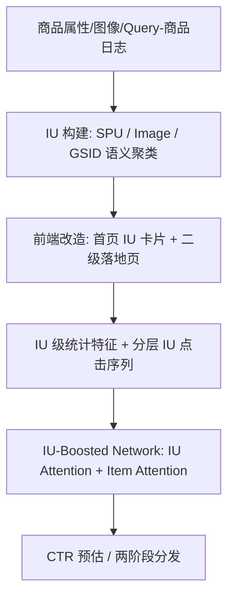

# IU4Rec: Interest Unit-Based Product Organization and Recommendation for E-Commerce Platform (基于兴趣单元的商品组织与推荐)

- **会议/期刊**: KDD 2025 (ADS Track, under review)
- **作者与机构**: Wenhao Wu, Xiaojie Li, Lin Wang 等，阿里巴巴集团（闲鱼）
- **推荐链路定位**: 召回（IU 级）+ 精排（CTR 预估）
- **研究方向**: 协同过滤与双塔召回 / 冷启动与长尾推荐
- **论文原文**: [https://arxiv.org/abs/2502.07658v1](https://arxiv.org/abs/2502.07658v1)
- **开源代码**: 暂未开源

## TL;DR (1分钟核心速览)

闲鱼 C2C 场景下个人卖家商品库存极少、售出即下架，导致 user-item 交互极度稀疏，传统 DIN 类依赖交互累积的范式失效。本文提出 IU4Rec：先用属性/图像/语义（GSID 层次码本）将商品聚类为**兴趣单元 (Interest Unit, IU)**，把交互锚定在可长期存续的 IU 上；再将推荐重构为「先推 IU、再推 IU 内商品」两阶段，并设计 IU-Boosted 网络融合 IU 统计特征与分层 IU 点击序列。生产数据集上 AUC 相对 DIN 提升 1.91%、GAUC 提升 2.17%，线上 7 天 A/B 全站 CTR +2.90%、成交单量 +1.02%。

## Background & Motivation (背景与核心矛盾)

- **主流范式**: 工业推荐普遍采用 DIN 类 user-item 交互序列 + Target Attention 建模兴趣，交互全部累积在**唯一商品 ID** 上。
- **前人局限**: ① C2C 商品库存有限、售出即失效，商品 ID 上的交互随下架而"作废"，模型长期处于冷启动；② 现有解法（独立冷启动通道、相似商品行为迁移 GroupEmb/GIFT、 popularity 去偏 ClassBalance/LogQ）都只是缓解症状，未触及"交互锚点选错"这一根本矛盾。
- **核心洞察 (Key Insight)**: 用户真实行为是"先匹配宽粒度兴趣（如 iPhone15 ProMax 256G），再在同质商品中比价挑选"；兴趣本身比具体商品持久得多，把交互锚定在兴趣粒度即可跨商品、跨用户累积。
- **本文切入点**: 用 LLM/聚类把商品组织成 IU，让交互沉淀在 IU 上，并同步改造前端交互形态与 CTR 模型，形成"商品组织—界面—算法"三位一体的协同演进。

## Method (核心方法设计)

### 1. 整体框架 (Overall Architecture)

离线侧构建三类 IU：结构化属性聚合的 **SPU IU**、图像聚类的 **Image IU**、以及基于 T5 encoder-decoder + CodeBook 离散化的 **GSID 语义 IU**（三级层次码本，各级 128 ID，二级空间约 1.6 万、三级约 210 万），并由 LLM 为每个 IU 自动生成前端标题。在线侧改造首页卡片（展示 IU 主题）与二级落地页（同 IU 商品密集排列），使交互天然落在 IU 上。精排模型以 DIN 为骨架，注入 IU 级统计/交叉特征与分层 IU 点击序列，经 IU 注意力与 item 注意力双路聚合后送入 MLP 输出 CTR。

<figure class="paper-figure" markdown="span">
  ![图1：IU4Rec框架概览，包括(a)兴趣单元构建：基于商品属性和文本信息，采用基于DSI的聚类方法将商品组织为兴趣单元\[23\]；(b)兴趣单元及对应商品的推荐。具体而言，后一部分分为两个阶段——第一阶段利用商品和兴趣单元属性进行商品推荐，第二阶段聚焦于在给定兴趣单元中识别商品。](../../../../assets/papers/2502.07658v1/figure_1.png)<figcaption>图1：IU4Rec框架概览，包括(a)兴趣单元构建：基于商品属性和文本信息，采用基于DSI的聚类方法将商品组织为兴趣单元[23]；(b)兴趣单元及对应商品的推荐。具体而言，后一部分分为两个阶段——第一阶段利用商品和兴趣单元属性进行商品推荐，第二阶段聚焦于在给定兴趣单元中识别商品。</figcaption>
</figure>

### 2. 关键设计拆解 (Key Designs)

1. **IU 层次化表征与序列构造（把交互锚点从 item 上移到 IU）**：痛点是个体商品下架后 ID 嵌入与行为序列全部失效。本文将 IU 表征定义为 ID、side 特征与其内部商品序列的拼接，再向上堆叠成 IU 序列：
$\boldsymbol{E}(IU)=\mathrm{Concat}\left[\boldsymbol{E}(\mathrm{F}_{IU\_ID}),\boldsymbol{E}(\mathrm{F}_{IU\_Side}),\boldsymbol{E}(ItemSeq)\right],\quad \boldsymbol{E}(IUSeq)=\mathrm{Concat}\left[\boldsymbol{E}(IU_1),\dots,\boldsymbol{E}(IU_n)\right]$
直觉上这构成"商品→兴趣单元→兴趣序列"的三层语义金字塔，商品售罄后 IU 节点及其历史交互仍可复用，天然缓解限库存导致的表征断裂。

2. **IU 级注意力（在兴趣粒度上度量偏好强度）**：传统 Target Attention 只比较目标商品与历史商品的 ID 相似度，稀疏场景下几乎无重叠。本文额外解析目标商品所属 IU ID 与历史点击序列中各商品的 IU ID，用同一套 scaled dot-product 注意力计算 IU 距离：
$\mathrm{TargetAttention}(Q,K,V)=\mathrm{softmax}\left(\frac{QK^{\top}}{\sqrt{d}}\right)V$其中$Q$来自目标商品（及其 IU），$K,V$ 来自历史 IU 序列。由于同一 IU 下多商品共享 ID，注意力权重不再被长尾商品 ID 稀释，等价于对稀疏交互做了"兴趣级平滑"。

3. **训练目标、负采样与推理效率**：沿用 DIN 的负对数似然 $\mathcal{L}=-\frac{1}{N}\sum_{(x,y)\in\mathcal{D}}\left[y\log f(x)+(1-y)\log(1-f(x))\right]$，工业日志天然含曝光未点击负样本，未额外构造 hard negative。IU 特征为离线预聚合的统计量（曝光/点击/咨询/成交）与 user-IU 交叉频次，在线仅需查表拼接，增量开销主要在 IU 序列注意力的$O(n\cdot d)$ 计算，序列长度上限 5，工程上可忽略。

## Experimental Setup & Evaluation Protocol (实验设置与评估协议)

- **数据集与预处理**: 闲鱼生产日志 8 天，共 100 亿样本（日均 15 亿），209 维特征；无公开数据集（作者明确说明工业实践无适配公开集）。

| 数据集 | #Users | #Items | #Interactions | 稀疏度/密度 | 特征/场景说明 |
| :--- | :---: | :---: | :---: | :---: | :--- |
| Xianyu Production | 未披露 | 未披露 | 10B (8 天) | 极高稀疏（限库存） | 209 特征，C2C 二手交易 |

- **数据划分与防穿越 (Splitting Strategy)**: **全局时间戳切分**——前 7 天训练、第 8 天测试，测试集随机分 10 份取均值，严格避免未来信息泄漏。
- **排名评测协议 (Ranking Protocol)**: 工业标准 **Sampled/日志内排序**评估，指标为 AUC、GAUC（按用户加权）与 RelaImpr；未采用 Full-Ranking 全库排序。
- **对比基线与超参设置**: 三类基线——DNN 类（DNN、Wide&Deep、DeepFM、DIN）、Gate 类（GateNet、FiBiNet、POSO）、图/元学习类（GroupEmb、GIFT），另加冷启动强基线 MSNet。所有 DNN 统一三层 MLP（512/256/128），注意力隐层 128，AdagradDecay、lr=1e-4、batch=4096，历史序列取近 30 天、最大长度 150，IU 内序列最大长度 5；显著性为双侧 t 检验 $p<0.05$。

## Key Experimental Results (实验关键数据)

### 1. 主实验对比 (Main Results)

| 方法 | Overall AUC | RI | Overall GAUC | RI | IU 域 AUC | 普通商品 AUC |
| :--- | :---: | :---: | :---: | :---: | :---: | :---: |
| DNN | 0.7348 | -0.75% | 0.6509 | -0.46% | 0.6972 | 0.7428 |
| Wide&Deep | 0.7346 | -0.83% | 0.6506 | -0.66% | 0.6970 | 0.7425 |
| DeepFM | 0.7335 | -1.30% | 0.6504 | -0.79% | 0.6965 | 0.7415 |
| DIN (base) | 0.7366 | 0.00% | 0.6516 | 0.00% | 0.6994 | 0.7441 |
| FiBiNet | 0.7355 | -0.45% | 0.6510 | -0.40% | 0.6982 | 0.7431 |
| POSO | 0.7365 | -0.03% | 0.6515 | -0.07% | 0.6988 | 0.7440 |
| GIFT | 0.7368 | 0.10% | 0.6520 | 0.26% | 0.6999 | 0.7445 |
| MSNet | 0.7392 | 1.11% | 0.6544 | 1.85% | 0.7039 | 0.7468 |
| **IU-Boosted (Ours)** | **0.7411** | **+1.91%** | **0.6549** | **+2.17%** | **0.7082** | **0.7484** |

线上 A/B（7 天，10% 流量起）：

| 域 | CTR | Clicks | Bills |
| :--- | :---: | :---: | :---: |
| Overall | +2.90% | +2.62% | +1.02% |
| IU 推荐域 | +11.76% | +10.22% | +5.61% |
| 普通商品域 | +1.58% | +1.49% | +0.33% |

### 2. 消融实验 (Ablation Study)

原文未提供标准组件消融表，但通过 IU 类型与产品形态的对照实验可等价观察各模块贡献：

| 配置 | 覆盖率 | 曝光占比 | 点击占比 | CTR 相对提升 |
| :--- | :---: | :---: | :---: | :---: |
| SPU IU | 23.0% | 9.28% | 10.4% | +21.92% |
| Image IU | 5.11% | 13.7% | 12.5% | +34.75% |
| Semantic IU (GSID) | 78.8% | 77.0% | 77.1% | +12.85% |
| 新商品形态 vs 原形态（A/B） | — | 13% 曝光 | — | 贡献 18% GMV，Bills +5%、GMV +10% |

### 3. 关键实验发现 (Key Findings)

1. **IU 域增益远大于普通商品域**：线上 IU 推荐域 CTR +11.76%，而普通商品域仅 +1.58%，说明收益主要来自"交互锚点上移"本身，而非模型容量——这直接验证了限库存场景下 item-ID 交互浪费是主要瓶颈。
2. **语义 IU 是覆盖率主力、图像 IU 是效率尖兵**：GSID 语义 IU 覆盖 78.8% 商品、承接 77% 曝光，是规模化基础；Image IU 仅覆盖 5.11% 却带来最高 +34.75% CTR，说明非标品的外观同质性聚类对决策效率提升最显著，二者互补。
3. **IU 建模对普通商品推荐亦有正迁移**：IU-Boosted 在普通商品域 AUC 从 0.7441 升至 0.7484（RI +1.76%），且显著超越专攻冷启动的 MSNet（0.7468），表明 IU 级特征提供了跨商品的兴趣先验，缓解了长尾商品表征不足。

## Highlights & Limitations (亮点、对比与审稿批判)

- **与代表作对比 (vs. Prior Work)**: 与 GroupEmb/GIFT 等"用相似商品 embedding 均值/特征生成来救冷启动 item"不同，本文不改 item 表征，而是**改变交互的归属对象**，从根上避免交互随下架作废；与 MSNet 的元学习冷启动相比，IU 方案无需为每个新商品单独适配，工程成本更低；与 ClassBalance/LogQ 的样本重加权去偏相比，本文是结构性重构而非训练期补偿。
- **可迁移亮点**: ① "把稀疏交互上卷到可持久化的聚类节点"这一思路可直接迁移到短视频（视频下架/版权到期）、招聘（职位关闭）、本地生活（团购下架）等高频失效场景；② 用 LLM 自动生成聚类标题并同步改造前端卡片，是"算法—产品形态协同设计"的可复用范式。
- **审稿级局限批判**: ① 无公开数据集、无开源代码，IU 构建依赖闲鱼内部 GSID 码本与 Query-商品日志，复现门槛极高；② 缺少标准组件消融（如去掉 IU 序列注意力、去掉 IU 统计特征各自的贡献），且线上 A/B 仅 7 天、未报告置信区间与长期留存指标，IU 聚类过粗可能带来的"兴趣窄化/过滤气泡"风险未被评估。

## Rating (四维评分)

- **方法创新性 (Novelty)**: ⭐⭐⭐⭐ （"交互锚点上移 + 商品组织/界面/模型三位一体"的范式级重构颇具工业洞察，但单点算子（注意力、拼接）本身较常规）
- **评估协议与实验扎实度 (Protocol & Experiments)**: ⭐⭐⭐ （百亿级生产数据 + 7 天线上 A/B 说服力强，但无公开数据集、缺标准消融与显著性区间，离线仅日志内排序）
- **写作与数学规范度 (Clarity & Rigor)**: ⭐⭐⭐ （工程叙述清晰、图表完整，但公式偏基础、GSID 细节外推至另一篇未发表工作，理论分析缺失）
- **工业落地与复现价值 (Industrial & Practical Value)**: ⭐⭐⭐⭐ （已在闲鱼全量部署、百万级用户受益，落地价值极高；但闭源与内部码本依赖削弱了复现性）

