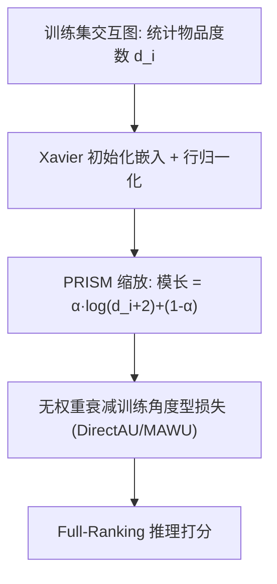

# On the Role of Weight Decay in Collaborative Filtering: A Popularity Perspective (协同过滤中权重衰减的角色：流行度视角)

- **会议/期刊**: KDD 2025
- **作者与机构**: Donald Loveland, Danai Koutra (University of Michigan); Mingxuan Ju, Tong Zhao, Neil Shah (Snap Inc.)
- **推荐链路定位**: 召回（Embedding 训练阶段）
- **研究方向**: 协同过滤与双塔召回 / 去偏公平与工业架构
- **论文原文**: [https://arxiv.org/abs/2505.11318v2](https://arxiv.org/abs/2505.11318v2)
- **开源代码**: [https://github.com/snap-research/PRISM](https://github.com/snap-research/PRISM)

## TL;DR (1分钟核心速览)

本文针对协同过滤训练中"角度型损失（如 DirectAU/MAWU）为何必须依赖权重衰减"这一长期被忽视的矛盾，从理论与实证两方面证明：权重衰减的核心作用并非正则化，而是通过 mini-batch 非对称梯度更新将**物品流行度编码进嵌入向量的模长**。据此提出 PRISM——一种在初始化阶段直接按流行度预编码模长的策略，彻底免除权重衰减及其调参。在 4 个基准数据集、Full-Ranking NDCG@20 协议下，PRISM 相比最优权重衰减调参模型最高提升 4.77%，训练时间平均缩短 38.48%，并可通过强度参数 $\alpha$ 有效缓解流行度偏置。

## Background & Motivation (背景与核心矛盾)

- **主流范式**: 现代 CF 训练以角度型损失（DirectAU、MAWU、SSM 等）为主流，其损失值对嵌入模长不敏感，理论上只需优化向量夹角。
- **前人局限**: 矛盾一——角度型损失本不应关心模长，却对权重衰减强度极度敏感，调参不当性能甚至被 BPR 反超（图 1）；矛盾二——全表权重衰减需频繁更新无法全部载入内存的大嵌入表，大规模场景下调参成本与计算开销双重不可行。
- **核心洞察 (Key Insight)**: 作者发现无论 BPR 还是 DirectAU，训练后物品嵌入模长与流行度高度相关（图 2a）；一旦去掉权重衰减，该相关性骤降且性能崩塌（图 2b）。即权重衰减是"披着正则化外衣的流行度编码器"。
- **本文切入点**: 既然模长编码流行度是性能关键，何不在初始化时一次性写入流行度，让训练专注学习角度信息，从而彻底移除权重衰减。

## Method (核心方法设计)

### 1. 整体框架 (Overall Architecture)

PRISM 是一个**预处理阶段**的嵌入初始化策略，不改变任何模型骨干或损失函数。流程为：先统计训练集物品度数 $d_i$作为流行度代理；对 Xavier 初始化的嵌入做行归一化得到单位向量；再按$\log(d_i+2)$缩放模长写入流行度信息；随后以$\lambda=0$（无权重衰减）正常训练角度型损失。由于模长信息已预先编码，优化过程只需专注夹角学习，且无需在每步梯度更新中触碰全量嵌入表。

### 2. 关键设计拆解 (Key Designs)

1. **非对称梯度更新理论（解释权重衰减为何编码流行度）**：痛点在于角度损失不含模长项，模长为何会携带流行度信息不明。作者证明：物品 $i$落入 batch 的概率为$P(i\in B)=1-(1-|B|/|E|)^{d_i}$，高度数物品更常获得排序损失更新（增大模长），而权重衰减对**全表**每步都施加收缩，形成非对称更新。第$k$ 步模长期望变化为：

$$\mathbb{E}[\Delta\|\mathbf{i}^{(k+1)}\|^2]=\mathbb{E}[\|\mathbf{i}^{(k)}\|^2]\eta\lambda(\eta\lambda-2)+\underbrace{\left(1-\left(1-\tfrac{|B|}{|E|}\right)^{d_i}\right)}_{P(i\in B)}\mathbb{E}\!\left[\tfrac{\eta^2}{\|\mathbf{i}^{(k)}\|^2}\left(1-\tfrac{(\mathbf{u}^{(k)}\cdot\mathbf{i}^{(k)})^2}{\|\mathbf{u}^{(k)}\|^2\|\mathbf{i}^{(k)}\|^2}\right)\right]$$

   第一项恒负（收缩），第二项由 Cauchy-Schwarz 恒正（扩张），二者比值由 $d_i$ 支配，故流行度被"刻"进模长。这解释了为何 batch 级权重衰减（对称更新）完全失效（图 3）。

2. **PRISM 流行度感知模长初始化**：既然模长编码可由初始化直接完成，则对物品 $i$的初始嵌入$\mathbf{i}^{init}$ 施加：

$$\mathbf{i}=\left(\alpha\cdot\log(d_i+2)+(1-\alpha)\right)\cdot\frac{\mathbf{i}^{init}}{\|\mathbf{i}^{init}\|}$$

   $\alpha=1$完全编码流行度、$\alpha=0$退化为单位向量。$+2$保证冷启动物品模长非零。物理直觉：将权重衰减需数百 epoch 缓慢学到的模长信息在$t=0$一次性写入，训练全程$\lambda=0$，既省去调参又省去全表更新。

3. **训练目标、负采样与推理效率**：总损失即原角度损失（如 DirectAU 的 alignment + uniformity），仅将权重衰减项置零。负采样沿用各损失原生策略（SSM 负采样比 10，DirectAU/MAWU 依赖 uniformity 隐式负样本）。推理阶段与标准 MF 完全一致，无额外开销；训练侧因免除全表权重衰减更新与模长收敛所需 epoch，实测平均加速 38.48%。

## Experimental Setup & Evaluation Protocol (实验设置与评估协议)

- **数据集与预处理**:

| 数据集 | #Users | #Items | #Interactions | 密度 | 场景说明 |
| :--- | :---: | :---: | :---: | :---: | :--- |
| MovieLens1M | 6,040 | 3,629 | 836,478 | 3.82% | 电影评分 |
| Gowalla | 29,858 | 40,981 | 1,027,370 | 0.08% | LBS 签到 |
| Yelp2018 | 31,668 | 38,048 | 1,561,406 | 0.13% | 本地商户 |
| AmazonBook | 52,643 | 91,599 | 2,984,108 | 0.06% | 图书电商 |

- **数据划分与防穿越**: 随机 `80%/10%/10%` 比例划分（train/val/test），非时间切分。
- **排名评测协议**: 采用 `Full-Ranking` 全库未交互物品排序，指标 NDCG@20；另做流行度分层 NDCG（Top 5% 为 Popular、5–20% 为 Neutral、后 80% 为 Unpopular），三层之和等于总体 NDCG。
- **对比基线与超参设置**: 骨干为线性 MF 与非线性 MF（2 层 MLP + ReLU），损失涵盖 BPR/SSM/DirectAU/MAWU；嵌入维度 $d=64$，学习率搜索$\{0.1,0.01,0.001\}$，权重衰减搜索$\{0,10^{-8},10^{-6},10^{-4}\}$，早停 patience=10，batch size 16384（BPR/SSM）与 4096（DirectAU/MAWU），3 次运行报告标准差。

## Key Experimental Results (实验关键数据)

### 1. 主实验对比 (Main Results)

PRISM（$\alpha=1$，零调参）vs. 逐数据集调优权重衰减（NDCG@20）：

| Backbone | Loss | 方法 | MovieLens1M | Gowalla | Yelp2018 | AmazonBook |
| :--- | :--- | :--- | :---: | :---: | :---: | :---: |
| MF | SSM | Tuned WD | **0.3061** | 0.0999 | **0.0616** | **0.0609** |
| MF | SSM | PRISM | 0.3002 | **0.1033** | 0.0605 | 0.0598 |
| MF | DirectAU | Tuned WD | **0.2406** | 0.1176 | 0.0735 | 0.0719 |
| MF | DirectAU | PRISM | 0.2304 | **0.1210** | **0.0745** | **0.0755** (+4.77%) |
| MF | MAWU | Tuned WD | **0.2455** | **0.1332** | **0.0745** | 0.0877 |
| MF | MAWU | PRISM | 0.2376 | 0.1331 | 0.0739 | **0.0891** |
| NL-MF | DirectAU | Tuned WD | 0.2318 | 0.0989 | 0.0646 | 0.0573 |
| NL-MF | DirectAU | PRISM | **0.2502** (+7.36%) | **0.1105** (+10.51%) | **0.0698** (+7.44%) | **0.0714** (+19.77%) |
| NL-MF | MAWU | Tuned WD | 0.2405 | 0.1274 | 0.0670 | 0.0800 |
| NL-MF | MAWU | PRISM | **0.2600** (+7.50%) | **0.1326** (+3.91%) | **0.0691** (+3.04%) | **0.0881** (+9.19%) |

### 2. 消融实验 (Ablation Study)

| 配置 | 关键现象 | 结论 |
| :--- | :--- | :--- |
| 无权重衰减 ($\lambda=0$) | DirectAU 性能崩塌，被 BPR 反超 | 模长编码是角度损失 SOTA 的必要条件 |
| Batch 级权重衰减 | 性能等同 $\lambda=0$，模长-流行度相关性消失 | 收益来自非对称更新而非正则化本身 |
| LightGCN + 各档权重衰减 | 性能几乎不变（图 8） | 消息传递架构自带模长编码，无需 WD |
| PRISM $\alpha$扫描 |$\alpha$降低可牺牲流行物品换冷门物品，总体损失极小 |$\alpha$ 是平滑的流行度偏置调节旋钮 |

### 3. 关键实验发现 (Key Findings)

1. **模长即流行度**：$\lambda=10^{-6}$时 BPR 与 DirectAU 的物品模长与流行度均呈强相关，$\lambda=0$ 时相关性消失——证明权重衰减是流行度编码器而非单纯正则项，且该机制对点积损失与角度损失同样成立。
2. **非线性骨干受益最大**：NL-MF + DirectAU/MAWU 上 PRISM 平均提升 8.59%（AmazonBook 高达 +19.77%），因 MLP 会破坏模长信息，预编码比训练中缓慢学习更稳健；唯一例外是 NL-MF + SSM（平均 -21.61%），因 SSM 高度依赖流行度且 MLP 无法维持该信息。
3. **效率与去偏双赢**：Gowalla 上训练 epoch 从 249 降至 125（-49.80%），平均加速 38.48%；调节 $\alpha$ 后最佳模型在 Unpopular/Popular NDCG 比值上平均提升 75.98%，同时总体性能还额外提升 1.7%，实现"去偏不降效"。

## Highlights & Limitations (亮点、对比与审稿批判)

- **与代表作对比 (vs. Prior Work)**: 相比 SSM（依赖消息传递隐式编码模长）、DirectAU/MAWU（依赖权重衰减但未解释原因），本文首次给出权重衰减编码流行度的闭式期望更新公式；相比 LightGCN 等图架构（自带模长编码但难扩展至大规模），PRISM 是纯预处理、零架构改动、可插拔于任意 MF 骨干。
- **可迁移亮点**: (1) 任何依赖权重衰减的角度型对比学习损失（含跨域/多模态对齐）均可尝试用度数/频次预编码模长替代；(2) $\alpha$ 提供了一个无需重训的流行度-新颖性权衡旋钮，可直接用于冷门物品扶持的 A/B 实验。
- **审稿级局限批判**: (1) 理论推导基于均匀采样与余弦损失的简化假设，对非均匀负采样、分布式分片权重衰减等工业实现仅给出定性讨论；(2) 实验限于 MF/NL-MF 骨干与中小规模基准，未在十亿级嵌入表或真实线上系统验证，且随机划分而非时间切分可能高估性能。

## Rating (四维评分)

- **方法创新性 (Novelty)**: ⭐⭐⭐⭐ （从"权重衰减=正则"的常识反转出"流行度编码器"新解释，闭式期望更新公式有说服力，但 PRISM 本身是简单初始化技巧）
- **评估协议与实验扎实度 (Protocol & Experiments)**: ⭐⭐⭐⭐ （4 数据集 × 2 骨干 × 4 损失 × 分层 NDCG 覆盖全面，3 次运行带标准差，但缺时间切分与大规模验证）
- **写作与数学规范度 (Clarity & Rigor)**: ⭐⭐⭐⭐⭐ （RQ 驱动叙事清晰，Observation/Theorem/Corollary 层层递进，理论与图 1–8 实证严格互证）
- **工业落地与复现价值 (Industrial & Practical Value)**: ⭐⭐⭐⭐⭐ （单次初始化计算、零调参、训练加速 38.48%，代码已开源，对大规模嵌入表训练极具工程价值）

