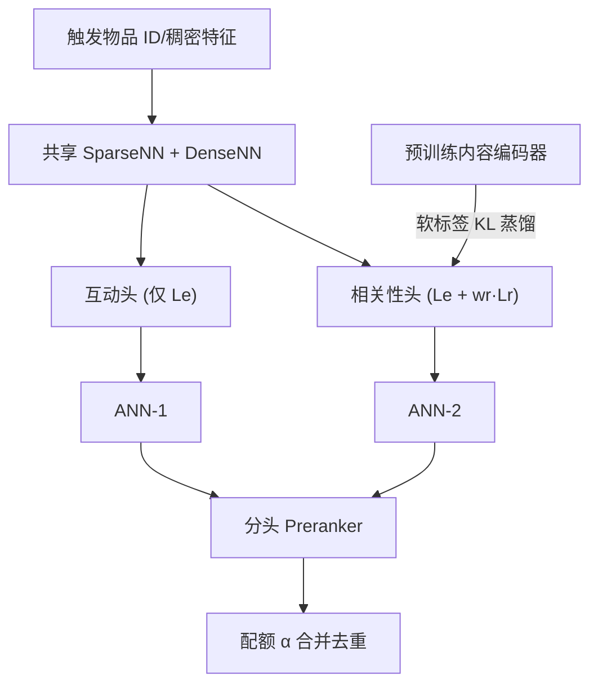

# Optimizing Recall or Relevance? A Multi-Task Multi-Head Approach for Item-to-Item Retrieval in Recommendation (优化召回还是相关性？面向推荐中物品到物品检索的多任务多头方法)

- **会议/期刊**: KDD 2025
- **作者与机构**: Jiang Zhang, Sumit Kumar, Wei Chang, Yubo Wang, Feng Zhang, Weize Mao, Hanchao Yu, Aashu Singh, Min Li, Qifan Wang（Meta Platforms, Inc.）
- **推荐链路定位**: 召回（I2I 触发式召回）
- **研究方向**: 协同过滤与双塔召回 / 大语言模型推荐（内容编码器蒸馏）
- **论文原文**: [https://arxiv.org/abs/2506.06239v1](https://arxiv.org/abs/2506.06239v1)
- **开源代码**: 暂未开源

## TL;DR (1分钟核心速览)

工业 I2I 召回模型几乎只用共互动（co-engagement）数据训练并优化召回率，导致过度拟合短期共互动、语义相关性差、新内容冷启慢。本文提出 MTMH：用「共互动 InfoNCE 损失 + 内容编码器 KL 蒸馏相关性损失」构成多任务损失，并设计「互动头 + 相关性头」双头架构，服务端用多 ANN + 配额合并同时取回高共互动与高语义相关候选。在十亿级用户商业平台私有数据上，Recall@500 相对最优基线提升 14.4%，L2 主题相关性提升 56.5%，线上 A/B 同时提升消费指标与长期体验指标。

## Background & Motivation (背景与核心矛盾)

- **主流范式**: 工业 I2I 召回以共互动数据构造正负对，用 InfoNCE 类损失最大化共互动率（即召回），物品嵌入完全由 ID/行为特征驱动。
- **前人局限**: ①纯共互动模型语义相关性仅 22.4%，过度拟合短期共互动趋势，损害新兴趣发现与内容多样性；②直接复用预训练内容编码器嵌入的模型语义相关性达 37.5%，但 Recall@500 不足 1%，与共互动模型（16.3%）严重脱节。
- **核心洞察 (Key Insight)**: 语义相关 ≠ 高共互动。作者进一步发现，多任务单头模型虽把相关性提升 50%+，但 Recall@K 在 $K>200$ 后远早于共互动模型饱和——说明「高相关候选」与「高共互动但低相关候选（如热门内容）」是互补而非替代关系，单头多任务无法同时拿满两者。
- **本文切入点**: 训练端用多任务损失把内容语义蒸馏进嵌入，服务端用双头分别保留两类候选再合并，从而在不牺牲召回的前提下提升相关性。

## Method (核心方法设计)

### 1. 整体框架 (Overall Architecture)

MTMH 由三部分组成：①多任务学习模块，共互动损失 $\mathcal{L}_e$与相关性蒸馏损失$\mathcal{L}_r$加权求和；②多头架构，底层共享 SparseNN（ID 特征）与 DenseNN（稠密特征），上层分出互动头（仅$\mathcal{L}_e$）与相关性头（$\mathcal{L}_{mt}$），两头映射到不同嵌入空间；③预训练多模态内容编码器（ViT-H14-632M + XLM-R-Large-550M，融合 MLP 输出 128 维），仅用于生成软相关性标签，不参与在线推理。服务端三模块：多头并行 ANN 各取$K_{ann}\approx1000$候选 → 每头独立 preranker 保留 top-$K$（$K\approx10$）→ 按配额$\alpha$ 合并去重。

<figure class="paper-figure" markdown="span">
  ![图3：所提出的MTMH方法概览。1）多任务学习由共同互动损失和相关性损失组成，其中共同互动损失采用InfoNCE \[35\]格式，使用来自共同互动数据的硬标签，相关性损失基于从预训练内容编码器的知识蒸馏。2）多头设计包括互动头（仅含共同互动损失）和相关性头（含多任务损失）。3）预训练内容编码器用于生成相关性监督，以将内容语义知识迁移到学习中。](../../../../assets/papers/2506.06239v1/figure_3.png)<figcaption>图3：所提出的MTMH方法概览。1）多任务学习由共同互动损失和相关性损失组成，其中共同互动损失采用InfoNCE [35]格式，使用来自共同互动数据的硬标签，相关性损失基于从预训练内容编码器的知识蒸馏。2）多头设计包括互动头（仅含共同互动损失）和相关性头（含多任务损失）。3）预训练内容编码器用于生成相关性监督，以将内容语义知识迁移到学习中。</figcaption>
</figure>

### 2. 关键设计拆解 (Key Designs)

1. **相关性蒸馏损失（把内容语义写进 ID 嵌入）**：痛点是无显式语义监督标签。做法是以内容编码器嵌入 $F$的 softmax 相似度作为目标分布$Q_{i,j}$，以学习嵌入$E$的相似度作为预测分布$P_{i,j}$，最小化逐对 KL：
$\mathcal{L}_r=\sum_{i}\sum_{j}D_{KL}(Q_{i,j}\|P_{i,j})$，其中$q^{+}_{i,j}=\frac{e^{\langle F_i,F^{+}_{i,j}\rangle}}{e^{\langle F_i,F^{+}_{i,j}\rangle}+\sum_{k=1}^{L}e^{\langle F_i,F^{-}_{i,k}\rangle}}$。直觉：不要求嵌入逼近内容向量本身，只要求**相对相似度排序**一致，从而在保留共互动几何结构的同时注入语义。
2. **多任务损失与多头解耦**：$\mathcal{L}_{mt}=\mathcal{L}_e+w_r\cdot\mathcal{L}_r$（默认$w_r=0.5$）。互动头只优化$\mathcal{L}_e$以守住高共互动候选；相关性头优化$\mathcal{L}_{mt}$以产出高相关候选。多头仅增加两个 MLP 头参数（主干参数在 SparseNN），几乎零额外成本，却把「召回-相关性」的权衡从训练期不可逆的标量化，转移到服务期可调的$\alpha$。
3. **训练目标、负采样与推理效率**：正样本由用户历史序列中第 $T$个物品与之前$T-1$个物品配对，并用 SIM 模型对语义相关正对加权；负样本为用户未交互物品随机采样，训练时采用倾向性打分去偏 + 混合负采样。推理侧多头 ANN 无计算依赖可并行，总开销约为单头 2 倍 ANN 检索，$w_r$与$\alpha$ 均无需重训即可调。

## Experimental Setup & Evaluation Protocol (实验设置与评估协议)

- **数据集与预处理**: 商业平台十亿级用户私有数据，训练用 $T_1$时段数据、测试用其后$T_2$ 时段真实用户数据（严格时间切分，防穿越）。评估采样用户各取 50 个历史交互物品作触发物品。

| 数据集 | #Users | #Items | #Interactions | 稀疏度/密度 | 特征/场景说明 |
| :--- | :---: | :---: | :---: | :---: | :--- |
| 工业私有数据 | 十亿级（采样评估） | 未披露 | 未披露 | 未披露 | 短视频/内容平台，含多模态内容特征 |

- **数据划分与防穿越 (Splitting Strategy)**: 全局时间戳切分（$T_1$训练 /$T_2$ 测试）。
- **排名评测协议 (Ranking Protocol)**: 每个触发物品经 ANN 取 top-2000 再经 preranker 取 top-30，50 个触发物品合并排序取 top-500 计算 `Recall@500`（命中未来真实交互比例）；相关性用人工标注 L1（粗粒度）/L2（细粒度）主题类目匹配率。属采样+重排后的近似全库评估，非严格 Full-Ranking。
- **对比基线与超参设置**: ItemCF、NeuCF、MoL（引入内容特征）、HLLM（LLM 内容嵌入增强）、HSTU*（SOTA U2I Transformer 嵌入复用）；所有基线共用同一 $\mathcal{L}_e$ 与去偏/混合负采样。嵌入维度 128，Adagrad，lr=0.01，batch=2048，48×A100，训练 1 epoch。

## Key Experimental Results (实验关键数据)

### 1. 主实验对比 (Main Results)

| 模型 | R@5 | R@20 | R@100 | R@500 | L1 Topic | L2 Topic |
| :--- | :---: | :---: | :---: | :---: | :---: | :---: |
| ItemCF | 1.01% | 2.50% | 6.89% | 14.88% | 21.31% | 17.90% |
| NeuCF | 1.10% | 2.73% | 7.51% | 16.33% | 25.77% | 22.40% |
| MoL | 1.10% | 2.75% | 7.49% | 16.05% | 27.70% | 24.74% |
| HLLM | 1.08% | 2.67% | 7.35% | 16.07% | 28.63% | 26.25% |
| HSTU* | 1.05% | 2.68% | 6.46% | 15.21% | 24.56% | 22.83% |
| **MTMH** | **1.10%** | **2.76%** | **7.65%** | **17.02%** | **30.17%** | **28.02%** |
| Improv. | +8.9% | +10.4% | +11.0% | **+14.4%** | +41.6% | **+56.5%** |

### 2. 消融实验 (Ablation Study)

| 变体 | R@100 | R@500 | L1 Topic | L2 Topic |
| :--- | :---: | :---: | :---: | :---: |
| MTMH（双头+多任务） | **7.65%** | **17.02%** | 30.17% | 28.02% |
| MTMH-H1（仅互动头） | 7.57% | 16.16% | 28.58% | 25.73% |
| MTMH-H2（仅相关性头） | 6.61% | 11.37% | **34.70%** | **33.73%** |
| MTSH（单头多任务） | 7.09% | 13.35% | 34.15% | 33.04% |
| STMH（双头单任务） | 7.64% | 14.31% | 28.97% | 27.84% |

### 3. 关键实验发现 (Key Findings)

1. **双头合并是唯一「不牺牲召回换相关性」的方案**：MTMH 相比互动头 R@500 再涨 5.3%（16.16%→17.02%），同时 L2 相关性涨 8.9%；而 MTSH/STMH 虽 L2 相关性达 33%+，R@500 却跌至 13.35%/14.31%，证实单头多任务或双头单任务都只能做零和权衡。
2. **服务期配额 $\alpha$是免费的性能旋钮**：$\alpha$从 100 降到 50 时召回与相关性同时上升（互动头中低效候选被相关性头的高相关高互动候选替换），$\alpha<50$后召回开始下滑；$\alpha=50$ 为帕累托最优点，且无需重训即可按业务调整。
3. **蒸馏显著加速新内容收敛并改善长期生态**：新内容嵌入收敛更快（图 7），线上 7 天 A/B 中 DAU +0.05%、时长 +0.22%、去重物品浏览 +0.31%、48h 新内容占比 +0.25%、新兴趣发现率 +0.33%、用户兴趣召回 +0.14%——短期消费与长期体验指标同向为正，验证了缓解短期共互动偏置的假设。

## Highlights & Limitations (亮点、对比与审稿批判)

- **与代表作对比 (vs. Prior Work)**: 相比 MoL/HLLM 把内容特征或 LLM 嵌入直接作为模型输入（提升相关性但拖累召回、且推理成本高），MTMH 仅在训练期蒸馏、推理期零内容编码开销；相比 MTSH 单头多任务，多头设计把不可逆的训练期权衡转为可调的服务期配额。
- **可迁移亮点**: ①「相对相似度 KL 蒸馏」可迁移到任何缺乏显式语义标签的召回任务（如 U2I、跨域召回）；②「多头 + 配额合并」是把多目标权衡外置到服务期的通用工程范式。
- **审稿级局限批判**: ①实验完全基于单一平台私有数据，无公开数据集复现，且未报告方差/显著性检验；②相关性评估依赖人工主题类目匹配率，粒度粗且与真实用户感知存在 gap；③多头使 ANN 检索量翻倍，十亿级物品库下的内存与延迟开销未量化；④$w_r$、$\alpha$ 双超参需联合调优，论文仅给出单变量扫描。

## Rating (四维评分)

- **方法创新性 (Novelty)**: ⭐⭐⭐⭐ （多任务蒸馏+多头配额合并的组合在工业 I2I 场景中务实且新颖，但单点技术均为成熟组件的巧妙重组）
- **评估协议与实验扎实度 (Protocol & Experiments)**: ⭐⭐⭐⭐ （离线+7 天线上 A/B 双验证、消融完整，但缺公开数据集与显著性检验）
- **写作与数学规范度 (Clarity & Rigor)**: ⭐⭐⭐⭐ （损失推导与符号定义清晰，权衡分析有预实验支撑，复杂度分析略简）
- **工业落地与复现价值 (Industrial & Practical Value)**: ⭐⭐⭐⭐ （已在十亿级平台全量部署、推理仅增双头 ANN，但无开源代码、私有数据难复现）

