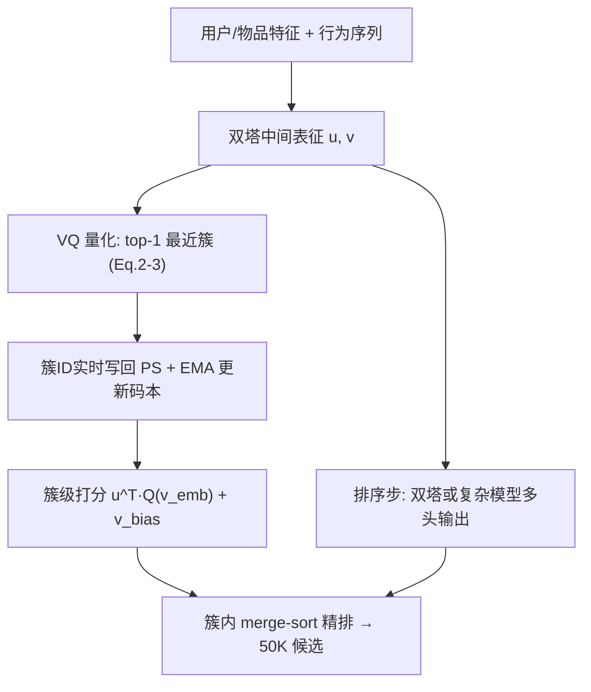
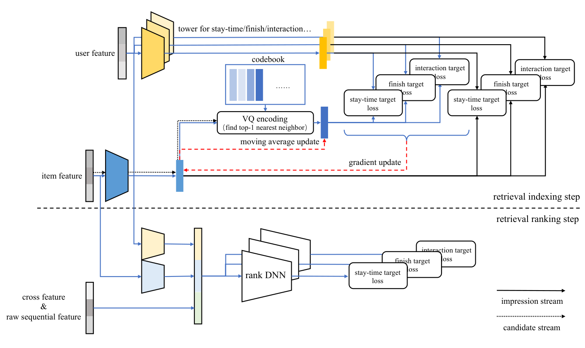

# Real-time Indexing for Large-scale Recommendation by Streaming Vector Quantization Retriever (流式向量量化召回器驱动的超大规模推荐实时索引)

- **会议/期刊**: KDD 2025
- **作者与机构**: Xingyan Bin, Jianfei Cui 等，字节跳动（抖音）
- **推荐链路定位**: 召回
- **研究方向**: 协同过滤与双塔召回 / 生成式离散语义 ID
- **论文原文**: [https://arxiv.org/abs/2501.08695v1](https://arxiv.org/abs/2501.08695v1)
- **开源代码**: 暂未开源

## TL;DR (1分钟核心速览)

工业召回长期依赖 HNSW/DR 等**离线重建**索引，导致新物品与新兴趋势无法即时入索引、热门物品挤占少数簇（DR 单路径 10 万候选），且索引构建与推荐目标不对齐。本文提出 **streaming VQ**：用可学习码本 + EMA 流式更新把物品实时挂载到簇上，配合 `L_aux` 替换 `L_sim` 实现索引可修复、流行度项与扰动实现索引均衡、merge-sort 实现簇内精排。在抖音/抖音极速版全量替换所有主召回器，EVR 目标下 Watch Time +0.127%、IR +59.4%，且索引构建从 1.5–2 小时降至实时。

## Background & Motivation (背景与核心矛盾)

- **主流范式**: 召回阶段用 HNSW/PQ 建 ANN 索引 + 双塔（DSSM）打分，或 TDM/NANN/DR 用树/路径结构承载复杂排序模型，核心思路都是"把模型做复杂"。
- **前人局限**: (1) 索引构建是**中断式**的（抖音 HNSW 需 1.5–2 小时、DR 的 M-step 需 1 小时），期间物品表征与索引分配冻结，新视频与新兴趋势被系统性遗漏；(2) 索引**严重不均衡**，DR 取 50 万候选时 top-1 路径独占 10 万，热门物品聚堆使模型难以区分。
- **核心洞察 (Key Insight)**: 索引即时性（immediacy）、可修复性（reparability）与均衡性（balancing）与模型复杂度同等重要——索引才是瓶颈，仅复杂化排序模型无法兑现其收益（表 3 中 NANN 复杂化后 VV 反降 0.14%）。
- **本文切入点**: 把 VQ-VAE 的码本从"视觉压缩工具"改造为"推荐索引结构"，用流式训练让物品与簇**互相拟合**，并遵循"item first"原则——物品决定索引，而非索引锁死物品。

## Method (核心方法设计)

### 1. 整体框架 (Overall Architecture)

模型分**索引步**与**排序步**两个时序阶段，共享特征嵌入。索引步用双塔产出用户/物品中间表征 $\mathbf{u},\mathbf{v}$，物品侧经 top-1 最近邻量化到$16K$（单任务）/$32K$（多任务）码本簇，簇 ID 实时写回 Parameter Server；排序步复用特征、可换用含 cross feature 与行为序列的复杂模型，按任务多头输出。服务时先按$\mathbf{u}^\top Q(\mathbf{v})$ 排簇，再对选中簇内物品做 k-way merge sort 精排，最终送 50K 候选入下一阶段。

<figure class="paper-figure" markdown="span">
  <figcaption>图1：所提出的流式VQ模型的训练框架。</figcaption>
</figure>

### 2. 关键设计拆解 (Key Designs)

1. **流式量化与索引即时性（Index Immediacy）**：痛点在于索引重建期间语义冻结。本文让物品表征 $\mathbf{v}_o$与簇表征$\mathbf{e}_k$ 在同一训练流中联合优化，物品-簇分配实时落库，模型更新周期从小时级压缩到 5–10 分钟。额外引入**候选流**（candidate stream）：对所有候选等概率前向、只存分配不算损失，解决新提交/冷门物品因曝光稀疏而分配滞后的偏差。

2. **索引可修复性：用 $L_{aux}$替换$L_{sim}$（Item First 原则）**：vanilla VQ-VAE 的$L_{sim}=\sum_o\|\mathbf{v}_o-\mathbf{e}_o\|^2$ 会把物品锁死在当前簇，全局分布漂移时模型持续退化。本文改用批内 Softmax 辅助任务
$$\mathcal{L}_{aux}=\sum_o-\log\frac{\exp(\mathbf{u}_o^\top\mathbf{v}_o)}{\sum_r\exp(\mathbf{u}_o^\top\mathbf{v}_r)}$$
使物品表征可独立及时更新，再由 $\mathcal{L}_{ind}$ 反向调整簇，实现"物品先动、簇后跟"的自修复闭环。

3. **索引均衡：流行度项 + 量化扰动 + merge-sort**：EMA 更新中插入流行度调节
$$\mathbf{w}_k^{t+1}=\alpha\mathbf{w}_k^t+(1-\alpha)(\delta^t)^\beta\mathbf{v}_j^t,\quad \mathbf{e}_k=\mathbf{w}_k/c_k$$
$\beta$ 越大越偏向冷门物品；量化时对低曝光簇打折
$$k_o^*=\arg\min_k\|\mathbf{e}_k-\mathbf{v}_o\|^2\cdot r,\quad r=\min\!\Big(\frac{c_k}{\sum_{k'}c_{k'}/K}\cdot s,\,1\Big)$$
将物品表征解耦为个性部分与流行度偏置 $\mathbf{u}^\top Q(\mathbf{v}_{emb})+v_{bias}$，簇按个性选、簇内按流行度用最大堆 k-way merge sort（chunk=8）精排，保证所有簇（含大簇）都有机会贡献候选。

4. **训练目标、负采样与推理效率**：总损失 $\mathcal{L}=\mathcal{L}_{aux}+\mathcal{L}_{ind}$（多任务时各任务分别计算并共享码本，EMA 中乘$\prod_p(1+h_{jp})^{\eta_p}$ 融合多目标奖励）。索引步沿用双塔故可直接用现成 in-batch debias 负采样；推理仅需一次码本检索 + 堆排序，索引步算力约等于数十次排序打分。

## Experimental Setup & Evaluation Protocol (实验设置与评估协议)

- **数据集与场景**: 全部实验在抖音与抖音极速版**线上工业环境**完成，语料十亿级、簇数 $16K$（单任务）/$32K$（多任务），索引步候选上限 ≥350M（HNSW 仅 170M、DR 250M）。

| 场景 | 语料规模 | 簇数 | 索引候选上限 | 排序步 touch node | 说明 |
| :--- | :---: | :---: | :---: | :---: | :--- |
| 抖音 / 抖音极速版 | 十亿级 | 16K / 32K | ≥350M | 50K | 短视频推荐，多目标（ST/FSH/EVR/AST/PST/OST/CST/LST） |

- **数据划分与防穿越**: 采用**流式训练**（streaming samples），无离线静态划分；候选流与曝光流分离，避免新物品分配滞后。
- **排名评测协议**: 线上 A/B 实验，用户均匀分组，指标为 **AAD（平均活跃天数）、AAH（平均活跃小时）、Watch Time、IR（曝光占比）**，仅报告统计显著提升；离线用 t-SNE 与簇规模直方图验证均衡性。
- **对比基线与超参**: HNSW Two-tower、DR、NANN（SOTA）、VQ Two-tower、VQ Complicated；NANN 与 VQ Complicated 严格对齐计算复杂度；$\beta$、$\eta$、$s=5$、chunk=8 为关键超参。

## Key Experimental Results (实验关键数据)

### 1. 主实验对比 (Main Results)

线上 A/B（抖音，相对控制组提升，仅列显著项）：

| 目标 | CG → EG 模型 | Watch Time | AAD | AAH | IR |
| :--- | :--- | :---: | :---: | :---: | :---: |
| ST | HNSW → VQ Two-tower | +0.0755% | - | +0.0301% | **+25.5%** |
| FSH | DR → VQ Two-tower | +0.0873% | - | +0.0505% | **+43.1%** |
| FSH | VQ Two-tower → VQ Complicated | +0.0613% | +0.0099% | +0.0359% | +19.5% |
| EVR | HNSW → VQ Two-tower | **+0.1270%** | +0.0093% | +0.0568% | **+59.4%** |
| PST | HNSW → VQ Two-tower | +0.0340% | +0.0068% | +0.0196% | **+85.4%** |
| EVR | VQ Two-tower → VQ Complicated | +0.0591% | +0.0075% | +0.0193% | +10.2% |

索引 vs 排序优先级对比（EVR，基线 HNSW Two-tower）：

| 方法 | Watch Time | AAH | VV |
| :--- | :---: | :---: | :---: |
| VQ Two-tower | +0.0335% | +0.0140% | +0.0604% |
| NANN | +0.0782% | +0.0232% | **-0.1376%** |
| VQ Complicated | **+0.0941%** | **+0.0313%** | -0.0748% |

### 2. 消融实验 (Ablation Study)

| 配置 | 关键结论 |
| :--- | :--- |
| vanilla VQ-VAE（$L_{sim}$） | 初期指标提升，随后**持续退化**（分布漂移下物品被锁死） |
| 替换为 $L_{aux}$ | 恢复一致提升，验证"item first"原则 |
| 去掉候选流 | 新提交/冷门物品分配滞后，性能下降 |
| 去掉流行度项 $\beta$/ 扰动$r$ | 簇分布失衡，热门聚堆 |
| 去掉 merge-sort | 大簇垄断候选，需更大候选集才能持平 |
| 索引步换复杂模型 | **性能反而下降**（非线性界面割裂簇与物品子空间） |
| 簇数扩 10 倍 | 仅中等提升，说明当前量化误差可被流式训练逐步纠正 |

### 3. 关键实验发现 (Key Findings)

1. **索引升级本身即产生 AAD 增益**：仅把 HNSW/DR 换成 VQ Two-tower（不改排序模型）就在多个目标上取得显著 AAD/AAH 提升，而此前数年召回模型更换从未在 AAD 上显著——证明索引有效性是被长期忽视的瓶颈。
2. **复杂化必须建立在好索引之上**：NANN 与 VQ Complicated 算力对齐，前者 Watch Time +0.078% 但 VV 掉 0.14%，后者 Watch Time +0.094% 且 VV 仅掉 0.075%；图 5 显示 VQ Complicated 把 10K–50K 曝光提升近 5%、100M+ 热门曝光降近 2%，而 NANN 曝光分布几乎不变，说明其未真正利用特征与复杂度。
3. **索引步不宜复杂化**：即便强制共享特征与 DNN 参数，复杂索引模型仍劣于双塔——非线性决策界面把簇与物品分到不同子空间，用户检索时漏掉相关主题（图 6），故索引步保持双塔、排序步才上复杂模型。

## Highlights & Limitations (亮点、对比与审稿批判)

- **与代表作对比**: 相比 HNSW（索引与目标无关、需离线重建、仅支持双塔），streaming VQ 索引由推荐损失监督且实时更新；相比 DR（路径结构、隐式负采样、热门聚堆、排序步被迫双塔），本文实现均衡索引与簇内精排，50K 候选即超越 DR 的 500K；相比 BLISS（人工强塞尾部桶保均衡），本文用流行度项与扰动**自然涌现**均衡，无需硬约束。
- **可迁移亮点**: (1) 用 $L_{aux}$替代$L_{sim}$ 的"item first"自修复思路可迁移到任何在线码本/聚类系统（如生成式推荐的 RQ-VAE 码本漂移问题）；(2) 候选流等概率前向更新冷门物品分配，是解决流式训练曝光偏差的轻量技巧。
- **审稿级局限批判**: (1) 全部证据来自抖音内部线上 A/B，缺少公开数据集与离线可复现基准，学术可比性弱；(2) 多任务 EMA 中 $\eta_p$、$\beta$、扰动阈值$s$ 等超参较多且未给出敏感性分析，跨场景迁移成本不明；(3) 码本规模与候选上限的扩展性分析仅给理论估计（附录 B），缺乏大规模压力测试。

## Rating (四维评分)

- **方法创新性 (Novelty)**: ⭐⭐⭐⭐ （把 VQ-VAE 码本重构为实时推荐索引，$L_{aux}$替换$L_{sim}$ 的"item first"原则与流行度扰动设计有清晰物理直觉，但单点技术多为已有组件的巧妙重组）
- **评估协议与实验扎实度 (Protocol & Experiments)**: ⭐⭐⭐⭐ （十亿级工业全量上线、多目标多场景 A/B 与算力对齐的 NANN 对比极具说服力，但缺公开数据集与离线复现、超参敏感性分析）
- **写作与数学规范度 (Clarity & Rigor)**: ⭐⭐⭐⭐ （框架图与公式链条清晰、表 1 的七维对比很有洞察，但部分符号（如 $\delta^t$、$h_{jp}$）定义偏简，附录依赖较重）
- **工业落地与复现价值 (Industrial & Practical Value)**: ⭐⭐⭐⭐⭐ （已替换抖音全部主召回器、索引构建从小时级降至实时、实现仅基于现成 VQ-VAE，工程可落地性极强；可惜未开源）

