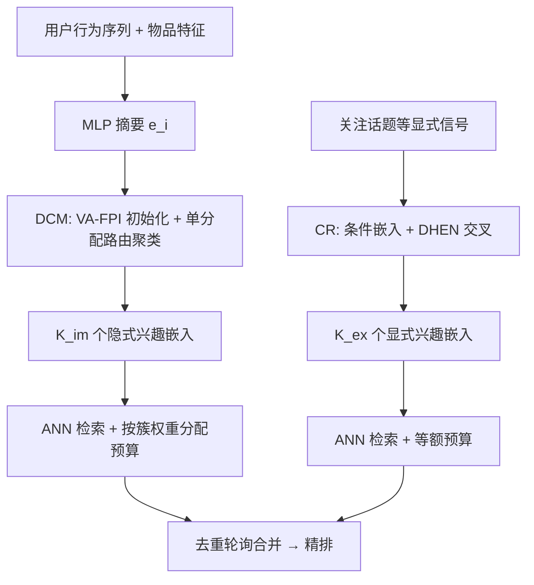
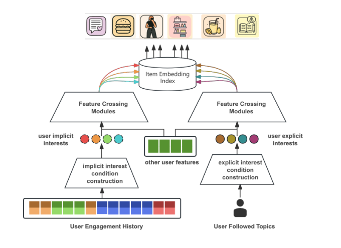

# Synergizing Implicit and Explicit User Interests: A Multi-Embedding Retrieval Framework at Pinterest (融合隐式与显式用户兴趣：Pinterest 多嵌入召回框架)

- **会议/期刊**: KDD 2025 (Applied Data Science Track)
- **作者与机构**: Zhibo Fan, Hongtao Lin, Haoyu Chen, Bowen Deng, Hedi Xia, Yuke Yan, James Li — Pinterest
- **推荐链路定位**: 召回 (Retrieval)
- **研究方向**: 协同过滤与双塔召回 / 冷启动与长尾推荐
- **论文原文**: [https://arxiv.org/abs/2506.23060v1](https://arxiv.org/abs/2506.23060v1)
- **开源代码**: 暂未开源

## TL;DR (1分钟核心速览)

双塔召回因缺乏塔间特征交互，用户单向量被头部兴趣主导，长尾兴趣覆盖不足。本文提出多嵌入召回框架：用可微聚类模块 (DCM) 从行为序列挖掘 $K_{im}$个隐式兴趣条件，用条件召回 (CR) 从关注话题等显式信号构建$K_{ex}$个显式兴趣条件，将打分从$f(i|u)$改写为$f(i|u,c)$。离线 HR@100 由 MIND 的 0.175 提升至 0.185；Pinterest 线上 A/B 两周，HF Repins +1.09%、A-Pincepts +0.81%，全站 Repins +0.48%。

## Background & Motivation (背景与核心矛盾)

- **主流范式**: 工业召回以双塔内积 + ANNS 为主，用户侧压缩为单一向量 $\phi(u)$，追求高召回与低延迟。
- **前人局限**: 其一，塔间无早期特征交互，头部兴趣在 $\phi(u)$ 中过度放大，躯干/尾部兴趣被淹没（图 1 失败案例：用户收藏含美食、教育，召回结果却全是单一主题）；其二，序列长度受限，长期兴趣与"已遗忘"兴趣无法进入用户塔。
- **核心洞察 (Key Insight)**: 兴趣覆盖问题本质是**条件表征学习**问题——只要为每个兴趣构造条件 $c$ 并正确关联正样本，就能把单向量打分拆成多条件打分；且隐式兴趣（实时、适配活跃用户）与显式兴趣（长期、可控、适配低信号用户）来源互补，线上候选重叠率仅 3.2%。
- **本文切入点**: 以 DCM 与 CR 两条支路分别完成"条件构造 + 条件关联"，再在服务端轮询合并，兼顾覆盖度与延迟。

## Method (核心方法设计)

### 1. 整体框架 (Overall Architecture)

框架将召回打分重构为 $f(i|u,c)\propto\exp(\phi(u,c)^{\top}\psi(i))$。隐式支路：用户行为序列经 MLP 摘要为物品表征$e_i$，DCM 在塔内做可微聚类得到$K_{im}=7$个兴趣质心作为条件，训练时用 argmax 将正样本关联到最相似的用户嵌入，采样 softmax + logQ 校正训练。显式支路：关注话题等显式信号嵌入后与用户特征经 DHEN 交叉层融合，条件关联在**日志落库时**完成（记录交互的来源兴趣），服务端对$K_{ex}=5$ 个条件嵌入各分配等额预算。两路候选经去重轮询合并后送入精排。

<figure class="paper-figure" markdown="span">
  <figcaption>图2：以隐式和显式用户兴趣为条件的多嵌入检索框架。</figcaption>
</figure>

### 2. 关键设计拆解 (Key Designs)

1. **DCM：有效性感知最远点初始化 (VA-FPI)**：MIND 用高斯随机初始化质心，易收敛到同一点且可能选中分布外物品。本文改用最远点采样保证质心分散，并引入有效性掩码 $\mathbb{I}_{valid}$ 过滤缺特征或负反馈物品：
$$i^{*}=\arg\max_{i}\min_{j}-\mathbb{I}_{valid}(e_i)\,c_j^{\top}e_i$$
直觉：初始化即决定聚类骨架，分散且合法的起点直接决定兴趣覆盖的上限。

2. **DCM：单分配路由 (SAR)**：原胶囊路由中每个物品对全部质心都有非零权重，邻近质心会被同一批物品"拉近"而坍缩。SAR 仅保留最大相似度对应的路由权重：
$$b_{ij}\leftarrow\mathbb{I}\!\left(c_j^{\top}e_i=\max_{k}c_k^{\top}e_i\right)\frac{\exp(c_j^{\top}e_i)}{\sum_{k}\exp(c_k^{\top}e_i)}$$
配合 squashing 激活，质心按构造即相互发散，避免退化为单嵌入模型。

3. **训练目标、负采样与推理效率**：损失为带 logQ 频率校正的采样 softmax，仅用被选中的 $o^{j^*}_u$ 计算负样本相似度以省显存：
$$\mathcal{L}_{SSM}=-\log\frac{\exp(o^{j^*\top}_u o_{y_i}-\log p_{y_i})}{\exp(o^{j^*\top}_u o_{y_i}-\log p_{y_i})+\sum_{k\in\mathcal{B}}\exp(o^{j^*\top}_u o_{y_k}-\log p_{y_k})}$$
负样本为 in-batch 采样；服务端按簇路由权重和 $\sum_i b_{ij}$ 分配检索预算，抑制躯干/尾部兴趣过度取数。用户塔每请求只算一次，p90 延迟由 150ms 升至 205ms。

## Experimental Setup & Evaluation Protocol (实验设置与评估协议)

- **数据集与预处理**: 工业日志，15 天窗口（前 14 天训练、第 15 天评估），6B 交互、160M 用户；离线检索语料取交互最多的 1M 物品。

| 数据集 | #Users | #Items | #Interactions | 稀疏度/密度 | 特征/场景说明 |
| :--- | :---: | :---: | :---: | :---: | :--- |
| Pinterest 工业日志 | 160M | 1M (评测语料) | 6B | 极稀疏 | 首页信息流，多正行为复合标签 |

- **数据划分与防穿越 (Splitting Strategy)**: 全局时间戳切分（14 天训练 / 第 15 天测试），严格防穿越。
- **排名评测协议 (Ranking Protocol)**: 每条样本单个正样本，在 1M 语料内做全库排序计算 HR@100 / HR@1000；多嵌入打分取各嵌入最大分。线上以两周 A/B 的 HF Repins、A-Pincepts 及非核心用户 (NC-) 分桶指标为准。
- **对比基线与超参设置**: 隐式侧对比 Self-Attention、Interest Token (MVKE 简化)、MIND、PFS；显式侧对比倒排索引与 CR w/ item interest。统一采样 softmax + logQ，交叉层为 DHEN，$K_{im}=7$、$K_{ex}=5$，各支路预算$O(1k)$。

## Key Experimental Results (实验关键数据)

### 1. 主实验对比 (Main Results)

离线隐式兴趣建模（表 1）：

| Method | HR@100 | HR@1000 |
| :--- | :---: | :---: |
| Self-Attention | 0.167 | 0.470 |
| Interest Token | 0.180 | 0.474 |
| MIND | 0.175 | 0.464 |
| **DCM (Ours)** | **0.185** | **0.476** |

离线显式兴趣建模（表 2）：

| Method | filtered HR@100 | filtered HR@1000 | HR@100 |
| :--- | :---: | :---: | :---: |
| CR w/ item interest | 0.164 | 0.541 | 0.139 |
| **CR w/ source interest (Ours)** | **0.191** | **0.565** | **0.145** |

线上隐式侧对比（表 4，CR 已上线，衡量互补增益）：

| Methods | HF Repins (all) | HF Repins (core) | A-Pincepts (all) | A-Pincepts (core) |
| :--- | :---: | :---: | :---: | :---: |
| Self-Attention | +0.83% | +1.01% | +0.44% | +0.63% |
| Interest Token | +0.68% | +0.95% | +0.21% | +0.19% |
| MIND | +0.43% | +0.56% | +0.04% | +0.15% |
| PFS | +0.47% | +1.02% | +0.32% | +0.46% |
| **DCM** | **+0.86%** | **+1.23%** | **+0.46%** | **+0.87%** |

框架整体线上增益（表 5）：Sitewide Repins **+0.48%**、HF Repins **+1.09%**、A-Pincepts **+0.81%**。

### 2. 消融实验 (Ablation Study)

| VA-FPI | SAR | #Cluster | HR@100 | HF Repins ↑ | A-Pincepts ↑ |
| :---: | :---: | :---: | :---: | :---: | :---: |
| × | × | 7 | 0.175 | +0.43% | +0.04% |
| × | ✓ | 7 | 0.176 | +0.37% | +0.30% |
| ✓ | × | 7 | 0.175 | −0.10% | +0.17% |
| ✓ | ✓ | 2 | 0.176 | −0.53% | +0.25% |
| ✓ | ✓ | 4 | 0.180 | −0.15% | +0.29% |
| ✓ | ✓ | 7 | **0.185** | **+0.86%** | **+0.46%** |

### 3. 关键实验发现 (Key Findings)

1. **两组件必须协同**：单独加 VA-FPI 或 SAR 线上 HF Repins 均不及基线（−0.10% / +0.37%），二者同时启用才跃升至 +0.86%，说明"分散初始化 + 单分配路由"是同一机制的两半，缺一则质心仍会坍缩（图 5 的 t-SNE 可视化佐证）。
2. **簇数敏感且不可自适应**：$K_{im}$ 从 7 降到 4/2，线上 HF Repins 由 +0.86% 跌至 −0.15%/−0.53%；尝试按用户自适应簇数反而 −0.12%，说明固定较大簇数是覆盖主要兴趣的必要条件。
3. **显式支路对低信号用户增益最大**：CR w/ source interest 在非核心用户上 HF Repins +3.04%、A-Pincepts +1.03%，远高于全体用户，验证了显式兴趣作为冷启动/低活跃用户候选源的价值；同时 A-Pincepts 与 HF Repins 强正相关，证明召回端多样性提升可直接转化为参与度。

## Highlights & Limitations (亮点、对比与审稿批判)

- **与代表作对比 (vs. Prior Work)**: 相比 MIND/ComiRec 仅做隐式多兴趣，本文额外引入显式条件支路并证明二者候选重叠仅 3.2%；相比 CR 原文在训练时随机采样话题做条件，本文改为日志落库时记录真实来源兴趣，消除训练-服务偏差（离线 filtered HR@100 0.164→0.191）；相比 Trinity 依赖多源启发式抽取显式兴趣，本文用统一的条件表征学习范式收敛两条支路。
- **可迁移亮点**: ①"条件构造 + 条件关联"两段式拆解可直接套用到任何多兴趣召回改造；②按簇路由权重分配检索预算、轮询合并去重，是低成本控制多嵌入取数偏置的工程技巧。
- **审稿级局限批判**: ①离线评测语料仅取 1M 高频物品，长尾物品的召回收益无法在离线体现，结论高度依赖线上 A/B；②DCM 的 argmax 关联在自注意力/兴趣 token 类结构上会引发 winner-takes-all 坍缩（作者自述需换 Gumbel Softmax），说明方法对结构有较强耦合，泛化性论证不足；③p90 延迟上涨 37%（150→205ms），且未报告训练成本与簇数增加时的延迟曲线。

## Rating (四维评分)

- **方法创新性 (Novelty)**: ⭐⭐⭐ （DCM 的 VA-FPI + SAR 是对胶囊路由的扎实工程改良而非全新范式，但"隐式+显式条件互补"的框架级洞察有实用价值）
- **评估协议与实验扎实度 (Protocol & Experiments)**: ⭐⭐⭐⭐ （6B 交互工业数据 + 两周线上 A/B + 分用户群分桶 + 完整消融，离线语料截断是主要短板）
- **写作与数学规范度 (Clarity & Rigor)**: ⭐⭐⭐⭐ （条件构造/关联的统一视角叙述清晰，公式紧凑；部分实现细节如标签加权、PFS 附录被省略）
- **工业落地与复现价值 (Industrial & Practical Value)**: ⭐⭐⭐⭐ （已在 Pinterest 首页全量部署并有全站级增益，延迟可控；但未开源，复现依赖内部特征与日志管线）

