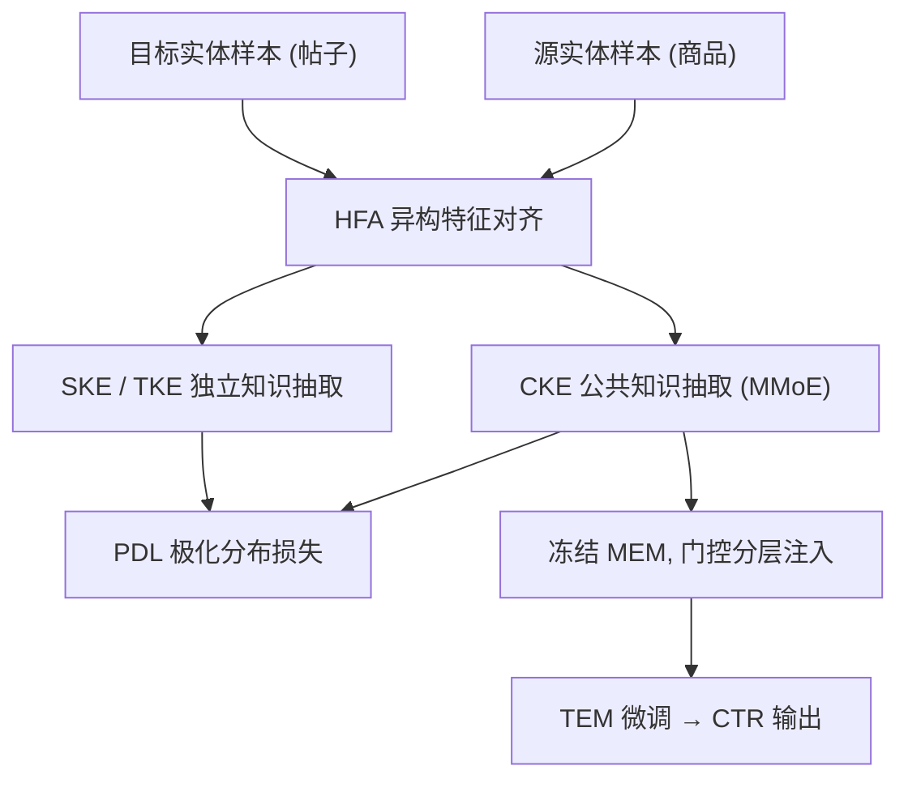
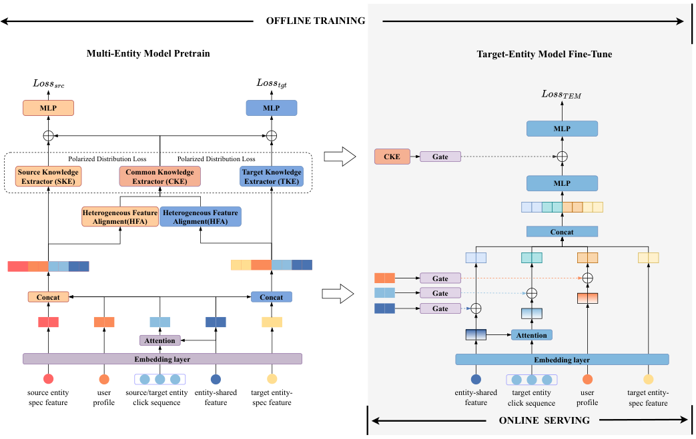

# Effective Two-Stage Knowledge Transfer for Multi-Entity Cross-Domain Recommendation (面向多实体跨域推荐的有效两阶段知识迁移)

- **会议/期刊**: KDD 2025
- **作者与机构**: Jianyu Guan, Zongming Yin, Tianyi Zhang, Leihui Chen, Yin Zhang, Fei Huang, Shuguang Han, Jufeng Chen（阿里巴巴集团 / 闲鱼）
- **推荐链路定位**: 精排（CTR 预估）
- **研究方向**: 跨域与多场景推荐 / CTR 预估与特征交叉
- **论文原文**: [https://arxiv.org/abs/2402.19101v2](https://arxiv.org/abs/2402.19101v2)
- **开源代码**: 暂未开源

## TL;DR (1分钟核心速览)

闲鱼首页信息流同时混排「售卖商品」与「内容帖子」两类实体，目标实体（帖子）曝光稀疏、且与源实体（商品）特征 schema 不对齐（如价格仅商品有）。本文提出 MKT 两阶段框架：第一阶段用混合数据预训练多实体模型 MEM，以异构特征对齐模块 HFA 缩放对齐异质特征、以极化分布损失 PDL 强制公共知识与独立知识正交；第二阶段冻结 MEM，用门控分层注入语义对齐的知识微调目标实体模型 TEM。在 Tenrec 与 93 亿样本工业集上，AUC/GAUC 全面超越 MMoE/PLE/STAR/MiNet/CTNet，线上 A/B 取得 CTR +4.13%、UER +7.07%。

## Background & Motivation (背景与核心矛盾)

- **主流范式**: 跨域推荐分两支——联合训练（MMoE/PLE/STAR/CoNet/MiNet 共享参数或专家网络）与预训练-微调（Finetune/CTNet 知识插件）。
- **前人局限**: ① 联合训练在源域样本量 3 倍于目标域时梯度被源域主导，产生负迁移；② 现有预训练-微调方法均假设源/目标实体**同类型、同特征 schema**，无法处理「商品有价格、帖子有内容风格」这类异构特征缺失。
- **核心洞察 (Key Insight)**: 多实体场景下真正可迁移的是「用户画像、行为序列、实体共享特征、用户-实体交叉」这些**语义层**知识，而实体特有特征只应作为对齐与筛选的辅助信号，不应直接共享。
- **本文切入点**: 用 HFA 把异质 schema 投影到同一维度空间，再用 PDL 显式分离「公共知识」与「实体独立知识」，最后在微调阶段按语义层级门控注入，从架构上切断负迁移通路。

## Method (核心方法设计)

### 1. 整体框架 (Overall Architecture)

输入特征被划分为四组：用户画像、多实体行为序列（源/目标各一条，经共享参数 Attention 编码）、实体共享特征、实体特有特征。MEM 预训练阶段：源/目标样本分别经 HFA 对齐后送入共享的 CKE（MMoE 结构）抽取公共知识，同时各经 SKE/TKE 抽取独立知识，PDL 拉远二者余弦相似度；MEM 损失为双域 CTR 交叉熵加 $\gamma\cdot$PDL。TEM 微调阶段：冻结 MEM，仅用目标域样本训练，将用户画像嵌入、序列向量、共享特征嵌入与 CKE 交叉向量四类同语义知识经 GLU 门控后残差注入 TEM 对应位置，最终 MLP 输出点击概率。线上仅需部署灰色部分的 TEM 子图。

<figure class="paper-figure" markdown="span">
  <figcaption>图2：MKT模型架构概览，由在混合域数据上训练的多实体模型（左）和用于目标实体推荐的目标实体模型（右）组成。灰色模块表示在线服务部分。</figcaption>
</figure>

### 2. 关键设计拆解 (Key Designs)

1. **异构特征对齐 HFA（解决 schema 不对齐）**：痛点是对实体特有特征一视同仁地拼接会引入噪声且维度不可比。HFA 先用 DCN 显式交叉 + MLP 隐式交叉联合评估每个特有特征的重要性分数 $p^s=2\cdot\text{Sigmoid}(\text{FC}(\text{Concat}(v^s_{ex},v^s_{im})))$，再对特征矩阵逐元素加权后 Flatten 并经 MLP 映射到统一维度$q^s=\text{Concat}(v^s_{shared},\text{MLP}(\text{Flatten}(\text{Multiply}(V^s,p^s))))$。直觉：先「筛选」再「对齐」，使源/目标实体输出同维向量，CKE 的共享参数才有意义。

2. **极化分布损失 PDL（保证公共知识纯度）**：痛点是共享参数是否真学到公共知识无法度量，若 CKE 与独立抽取器学到相似表征则迁移增益趋零。PDL 直接最小化公共与独立表征的余弦相似度：$\mathcal{L}_{pdl}=\cos(g^s_{com},g^s_{ind})+\cos(g^t_{com},g^t_{ind})$。直觉：把表征空间显式「推开」，迫使 CKE 只保留跨实体共性，等价于一个无需负采样的解耦正则。

3. **训练目标、负采样与推理效率**：MEM 损失 $\mathcal{L}_{MEM}=\mathcal{L}_{src}+\mathcal{L}_{tgt}+\gamma\mathcal{L}_{pdl}$（$\gamma=0.01$），TEM 损失为纯目标域交叉熵；均为曝光日志全量样本训练，无额外负采样。推理时只保留 TEM 子图，源实体相关模块全部离线，在线开销与单域精排模型基本持平。

## Experimental Setup & Evaluation Protocol (实验设置与评估协议)

- **数据集与预处理**:

| 数据集 | #Users | #Items | #Interactions | 稀疏度/密度 | 特征/场景说明 |
| :--- | :---: | :---: | :---: | :---: | :--- |
| Tenrec (QK-video→QK-article) | 5M / 1.3M | 1.9M / 0.2M | 142M / 46M | 正样本率 0.036 / 0.018 | 腾讯双信息流，like 为正、no-like 为负 |
| Industrial (product→post) | 130M | 290M / 4M | 9.3B / 3.1B | 正样本率未披露 | 闲鱼首页 31 天曝光日志，商品:帖子 ≈ 3:1 |

- **数据划分与防穿越 (Splitting Strategy)**: Tenrec 按时间序取前 80% 训练、后 20% 测试；工业集用 30 天训练、第 31 天测试，均为**全局时间戳切分**。
- **排名评测协议 (Ranking Protocol)**: 采用 AUC 与 GAUC（按用户曝光加权），属工业日志上的**全量曝光打分**评估，非采样排序；文中指出 GAUC 绝对提升 0.1% 约对应线上 CTR +1%。
- **对比基线与超参设置**: 单域 MLP/DIN/FiBiNet，联合训练 MMoE/PLE/STAR/CoNet/MiNet，预训练-微调 Finetune/CTNet；稀疏特征嵌入维度 $d=8$，TEM 为 4 层 DNN（工业 [1024,512,64,1]），MEM 共享层 2 层 + 各域双塔，MMoE 专家数 3，$\gamma=0.01$，多次实验取均值。

## Key Experimental Results (实验关键数据)

### 1. 主实验对比 (Main Results)

| 类别 | 模型 | Tenrec AUC | Tenrec GAUC | Industrial AUC | Industrial GAUC |
| :--- | :--- | :---: | :---: | :---: | :---: |
| 单域 | DIN | 0.9381 | 0.6441 | 0.7335 | 0.5761 |
| 单域 | FiBiNet | 0.9374 | 0.6427 | 0.7345 | 0.5824 |
| 联合 | MMoE | 0.9402 | 0.6461 | 0.7367 | 0.5856 |
| 联合 | PLE | 0.9393 | 0.6473 | 0.7363 | 0.5837 |
| 联合 | STAR | 0.9382 | 0.6422 | 0.7362 | 0.5845 |
| 联合 | MiNet | 0.9420 | 0.6499 | 0.7370 | 0.5863 |
| 预训练 | Finetune | 0.9456 | 0.6520 | 0.7372 | 0.5897 |
| 预训练 | CTNet | 0.9439 | 0.6492 | 0.7380 | 0.5872 |
| **本文** | **MKT** | **0.9524** | **0.6583** | **0.7398** | **0.5958** |
| — | Improv. vs 最优基线 | +0.72% | +0.97% | +0.24% | +1.03% |

### 2. 消融实验 (Ablation Study)

| 配置 | Tenrec AUC | Tenrec GAUC | Industrial AUC | Industrial GAUC |
| :--- | :---: | :---: | :---: | :---: |
| w/o MEM Pretrain | 0.9381 (-1.50%) | 0.6441 (-2.15%) | 0.7345 (-0.71%) | 0.5824 (-1.21%) |
| w/o TEM Finetune | 0.9447 (-0.81%) | 0.6503 (-1.21%) | 0.7374 (-0.33%) | 0.5884 (-1.26%) |
| w/o PDL | 0.9505 (-0.19%) | 0.6569 (-0.21%) | 0.7390 (-0.11%) | 0.5937 (-0.35%) |
| w/o HFA | 0.9477 (-0.49%) | 0.6522 (-0.92%) | 0.7386 (-0.16%) | 0.5906 (-0.88%) |
| **Full MKT** | **0.9524** | **0.6583** | **0.7398** | **0.5958** |

### 3. 关键实验发现 (Key Findings)

1. **两阶段结构本身贡献最大**：去掉 MEM 预训练后 GAUC 在 Tenrec 上暴跌 2.15%，甚至低于单域 DIN（0.6441），说明混合域预训练若不经 TEM 解耦反而会引入负迁移，验证了「预训练 + 冻结微调」是切断源域主导的必要条件。
2. **HFA 的增益集中在排序质量而非绝对拟合**：去掉 HFA 后工业集 AUC 仅降 0.16%，但 GAUC 降 0.88%（约为 PDL 降幅的 2.5 倍），表明特征对齐主要改善用户内相对排序，对长尾用户尤为关键。
3. **迁移收益随用户活跃度递减**：0–10 次行为用户组 MKT 相对 Finetune 的 GAUC 提升 2.8%，10–30 组降至 2.3%，>30 组仅 1.7%，定量印证源实体知识主要补偿目标域稀疏用户；线上 7 天 A/B（各 5% 流量）CTR +4.13%、UER +7.07%。

## Highlights & Limitations (亮点、对比与审稿批判)

- **与代表作对比 (vs. Prior Work)**: 相比 MMoE/PLE/STAR 等联合训练方法，MKT 用两阶段冻结机制从架构上规避梯度冲突，而非靠门控缓解；相比 Finetune/CTNet 等同构假设的知识插件方法，MKT 的 HFA 首次让异构 schema 实体可共享 CKE 参数，且 PDL 提供了「公共知识是否真被学到」的可优化代理目标。
- **可迁移亮点**: ① PDL 这种「公共/独立表征余弦拉远」的正则无需负采样，可直接移植到多场景多任务共享塔的解耦训练；② 微调阶段按语义层级（画像/序列/共享特征/交叉向量）分别门控注入，比整体拼接更可控，适合任何预训练-微调推荐管线。
- **审稿级局限批判**: ① 工业集正样本率未披露、仅单平台单业务验证，Tenrec 上 AUC 提升仅 0.72%，泛化性证据偏弱；② HFA 中 DCN 交叉 + 双 MLP + 重要性打分的额外开销与 $\gamma$、$d_{HFA}$ 的敏感性均未做超参分析，且 PDL 权重固定 0.01 缺乏理论指导。

## Rating (四维评分)

- **方法创新性 (Novelty)**: ⭐⭐⭐⭐ （HFA 解决异构 schema 对齐 + PDL 显式解耦公共/独立知识，工程问题抽象到位，但组件均为已有模块的组合式创新）
- **评估协议与实验扎实度 (Protocol & Experiments)**: ⭐⭐⭐⭐ （公开集 + 93 亿工业集 + 线上 A/B 三层验证完整，消融覆盖四模块，但缺显著性检验与超参敏感性分析）
- **写作与数学规范度 (Clarity & Rigor)**: ⭐⭐⭐⭐ （公式与符号定义清晰、HFA 流程有图示配合，但部分符号上下标不统一，缺少复杂度分析）
- **工业落地与复现价值 (Industrial & Practical Value)**: ⭐⭐⭐⭐⭐ （已在闲鱼全量部署，在线仅需 TEM 子图、开销可控，CTR +4.13% 的线上收益极具说服力；可惜未开源）

