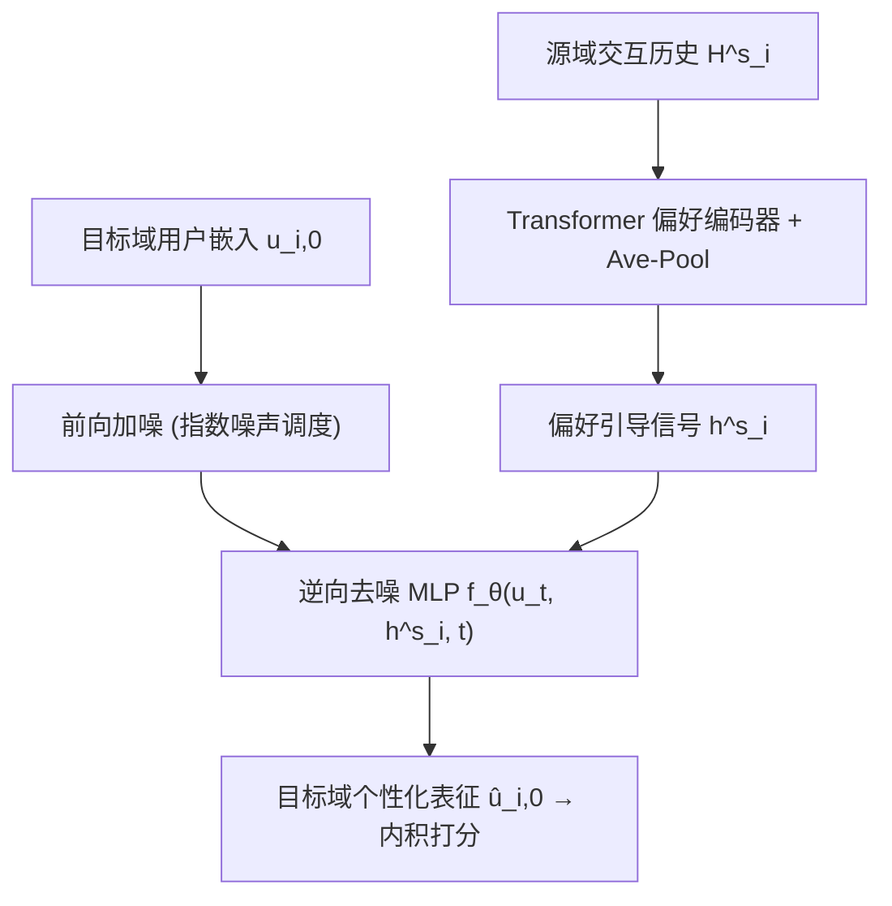
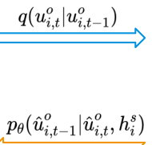

# Exploring Preference-Guided Diffusion Model for Cross-Domain Recommendation (面向跨域推荐的偏好引导扩散模型)

- **会议/期刊**: KDD 2025
- **作者与机构**: Xiaodong Li, Jiawei Sheng, Xinghua Zhang, Tingwen Liu (中科院信工所/UCAS)；Hengzhu Tang, Li Gao, Suqi Cheng, Dawei Yin (百度)
- **推荐链路定位**: 召回（冷启动用户表征生成）
- **研究方向**: 跨域与多场景推荐 / 冷启动与长尾推荐
- **论文原文**: [https://arxiv.org/abs/2501.11671v1](https://arxiv.org/abs/2501.11671v1)
- **开源代码**: 暂未开源

## TL;DR (1分钟核心速览)

跨域冷启动推荐的主流范式是"源域嵌入 + 跨域映射"，但映射前的**偏好整合过程被当作黑箱**，导致用户表征粗糙。本文提出 DMCDR：用 Transformer 编码源域交互历史得到偏好引导信号 $\boldsymbol{h}^s_i$，在扩散逆向过程的**每一步**显式注入该信号，逐步去噪生成目标域个性化用户表征，并用 classifier-free guidance 控制引导强度。在 Amazon 三组跨域场景（Movie→Music / Book→Movie / Book→Music）上，MAE 相对最强基线 CDRNP 最高降低 **32.60%**，且冷启动比例$\alpha=80\%$ 时优势依然稳定。

## Background & Motivation (背景与核心矛盾)

- **主流范式**: EMCDR/PTUPCDR/REMIT/CDRNP 均属 embedding-and-mapping：先在源域把偏好压进一个用户向量，再用映射函数（线性、MAML 元学习、Neural Process）搬到目标域。
- **前人局限一**: 映射前的"偏好整合"仅靠一次矩阵乘法或简单池化完成，**整合过程本身未被显式建模**，信息在单步压缩中大量丢失，得到的是 coarse representation。
- **前人局限二**: 现有扩散推荐（DiffRec/DreamRec/MCDRec）虽具备显式信息注入能力，但**条件信号只来自本域**（序列行为、多模态），无法直接吸收源域偏好，直接迁移到 CDR 会退化（原文 4.3 节 Variant-1 最差即为佐证）。
- **核心洞察 (Key Insight)**: 扩散模型的逆向过程天然是"多步、可条件化"的信息注入通道——若把源域偏好作为条件在每一步注入，等价于把偏好整合从"一步映射"展开为"$T$ 步渐进精炼"，恰好补上被忽略的整合建模。
- **本文切入点**: 不做跨域映射，而是把目标域用户表征的**生成过程**本身作为偏好迁移载体。

## Method (核心方法设计)

### 1. 整体框架 (Overall Architecture)

训练阶段仅用重叠用户 $\mathcal{U}^o$：嵌入层初始化用户/物品向量；偏好编码器将源域交互历史$\mathcal{H}^s_i$经 Transformer 编码 + 平均池化得到引导信号$\boldsymbol{h}^s_i$；对目标域用户表征$\boldsymbol{u}_{i,0}$执行前向加噪得$\boldsymbol{u}_{i,t}$，再由以$(\hat{\boldsymbol{u}}_{i,t}, \boldsymbol{h}^s_i, t)$为输入的 MLP 预测$\hat{\boldsymbol{u}}_{i,0}$，与目标域物品内积后算 MSE；同时以 KL 项约束逆向分布，并以概率$p_{\text{uncond}}$置空$\boldsymbol{h}^s_i$联合训练无条件分支。推理阶段对冷启动用户**不做纯噪声采样**，而是以其自身嵌入$\boldsymbol{u}^{s\backslash o}_{i}$为起点，在引导信号下逆向$T$ 步生成目标域表征。

<figure class="paper-figure" markdown="span">
  <figcaption>图2：DMCDR在训练阶段的整体框架。为实现偏好迁移，DMCDR对用户的交互历史H𝑠进行编码。</figcaption>
</figure>

### 2. 关键设计拆解 (Key Designs)

1. **偏好引导信号与逐步注入（Preference Guidance）**：针对"整合过程黑箱"痛点，把逆向分布改写为条件形式 $p_\theta(\hat{\boldsymbol{u}}_{i,t-1}\mid\hat{\boldsymbol{u}}_{i,t},\boldsymbol{h}^s_i)=\mathcal{N}(\hat{\boldsymbol{u}}_{i,t-1};\boldsymbol{\mu}_\theta(\hat{\boldsymbol{u}}_{i,t},\boldsymbol{h}^s_i,t),\sigma_t^2\mathbf{I})$，即$\boldsymbol{h}^s_i$ 在**每个去噪步**参与均值预测，而非仅在首尾拼接。直觉上，每步注入相当于一次"偏好校正"，使生成轨迹始终被源域偏好牵引，避免单步映射的信息瓶颈。

2. **指数噪声调度（Exponential Noise Schedule）**：常规线性调度在 $t$较大时把用户向量噪化过度，抹掉个性化信息。本文改为$1-\bar{\alpha}_t=\eta\left[1-\exp\left(-\frac{\alpha_{\min}}{T}-\frac{S_t(\alpha_{\max}-\alpha_{\min})}{2T^2}\right)\right]$，用$\eta\in(0,1)$整体压低噪声上限，使前向过程"温和腐蚀"，保留可恢复的偏好结构——这也解释了后文$\eta$ 过大即掉点的现象。

3. **预测 $\hat{\boldsymbol{u}}_{i,0}$的重参数化 + 免分类器引导**：不预测噪声$\boldsymbol{\epsilon}$而直接预测$\hat{\boldsymbol{u}}_{i,0}$，损失为$\mathcal{L}_{t-1}=\mathbb{E}\left[\frac{\bar{\alpha}_{t-1}}{2\sigma_t^2}\|\boldsymbol{u}^o_{i,0}-f_\theta(\hat{\boldsymbol{u}}^o_{i,t},\boldsymbol{h}^s_i,t)\|^2\right]+C$，因 CDR 的最终目标就是拿到$\hat{\boldsymbol{u}}_{i,0}$打分，直接监督更贴合任务。推理时用$\tilde{f}_\theta=(1+\omega)f_\theta(\cdot,\boldsymbol{h}^s_i,t)-\omega f_\theta(\cdot,\varnothing,t)$调节引导强度。总损失$\mathcal{L}=\mathcal{L}_{rec}+\lambda\mathcal{L}_{t-1}$，$\lambda=1\text{e-}2$；训练无需负采样（回归式打分），推理开销为$T$ 步 MLP 前向。

## Experimental Setup & Evaluation Protocol (实验设置与评估协议)

- **数据集与预处理**: Amazon 评论数据，**使用全量数据**（区别于多数仅用子集的 CDR 工作），评分 0–5：

| 场景 | 源域 Users/Items/Ratings | 目标域 Users/Items/Ratings | Overlap |
| :--- | :---: | :---: | :---: |
| Movie→Music | 123,960 / 50,052 / 1,697,533 | 75,258 / 64,443 / 1,097,592 | 18,031 |
| Book→Movie | 603,668 / 367,982 / 8,898,041 | 123,960 / 50,052 / 1,697,533 | 37,388 |
| Book→Music | 603,668 / 367,982 / 8,898,041 | 75,258 / 64,443 / 1,097,592 | 16,738 |

- **数据划分与防穿越**: 随机抽取 $\alpha\in\{20\%,50\%,80\%\}$ 的重叠用户，**删除其在目标域的全部评分**作为冷启动测试用户，其余重叠用户作训练；显式考虑时间戳顺序以避免信息泄漏。
- **排名评测协议**: 采用 **评分预测** 而非 Top-N 排序，指标为 MAE / RMSE（全量测试集回归误差，无负采样）。
- **对比基线与超参**: 10 个基线覆盖 MF（TGT/CMF）、映射式（EMCDR/DCDCSR/SSCDR/CATN）、元学习式（PTUPCDR/REMIT/CDRNP）与扩散式（DiffCDR）；$d=64$，hidden 64，batch 128，lr 0.01，$p_{\text{uncond}}=0.1$，$T$搜索于$\{50,\dots,1000\}$，$\omega\in\{0,\dots,5\}$，$\eta\in\{0.1,\dots,0.9\}$，结果取 5 次随机运行均值。

## Key Experimental Results (实验关键数据)

### 1. 主实验对比 (Main Results)

$\alpha=20\%$与$80\%$ 两档（50% 趋势一致，略）：

| 方法 | M→M 20% MAE/RMSE | M→M 80% MAE/RMSE | B→M 20% MAE/RMSE | B→Mu 20% MAE/RMSE |
| :--- | :---: | :---: | :---: | :---: |
| TGT | 4.4803 / 5.1580 | 4.5020 / 5.1891 | 4.1831 / 4.7536 | 4.4873 / 5.1672 |
| EMCDR | 1.2350 / 1.5515 | 1.5008 / 1.8771 | 1.1162 / 1.4120 | 1.3524 / 1.6737 |
| PTUPCDR | 1.1504 / 1.5195 | 1.4049 / 1.8234 | 0.9970 / 1.3317 | 1.2286 / 1.6085 |
| DiffCDR | 1.0435 / 1.3840 | 1.5606 / 2.1754 | 0.9476 / 1.2338 | 1.1220 / 1.5390 |
| REMIT | 0.9393 / 1.2709 | 1.2181 / 1.6601 | 0.8759 / 1.1650 | 1.3749 / 1.9940 |
| CDRNP | 0.7974 / 1.0638 | 0.8280 / 1.0758 | 0.8846 / 1.1327 | 0.7453 / 0.9914 |
| **DMCDR** | **0.6173 / 0.9425** | **0.6450 / 0.9706** | **0.5904 / 0.9929** | **0.5360 / 0.8726** |
| Improv. | 22.59% / 11.40% | 22.10% / 9.78% | **32.60%** / 12.34% | 28.08% / 11.98% |

### 2. 消融与变体实验 (Ablation & Variants, $\alpha=20\%$)

| 变体 | M→M MAE | B→M MAE | B→Mu MAE |
| :--- | :---: | :---: | :---: |
| w/o TF（去 Transformer） | 0.6438 | 0.6286 | 0.5573 |
| w/o GS（去引导信号） | 0.6889 | 0.7041 | 0.6189 |
| w/o DM（去扩散，直接拼接） | 0.8197 | 0.8714 | 0.7753 |
| Variant-1（无引导纯扩散） | 0.6889 | 0.7041 | 0.6189 |
| Variant-3（仅逆向首步拼接） | 0.6532 | 0.6634 | 0.5891 |
| Variant-5（对 $\boldsymbol{h}^s_i$ 加噪后拼接） | 0.6458 | 0.6461 | 0.5759 |
| **DMCDR** | **0.6173** | **0.5904** | **0.5360** |

### 3. 关键实验发现 (Key Findings)

1. **扩散模块是最大增益源**：去掉扩散（w/o DM）MAE 从 0.6173 升至 0.8197（+32.8%），远超去掉 Transformer（+4.3%）与去掉引导信号（+11.6%），说明收益主要来自"多步生成式整合"而非编码器本身。
2. **"逐步注入"优于"一次性拼接"**：Variant-3（仅逆向首步拼接 $\boldsymbol{h}^s_i$）MAE 0.6532，比逐步引导的 0.6173 差 5.8%，直接验证了作者关于"整合过程需被显式展开"的核心论点；Variant-1 无引导最差，证明跨域偏好迁移不可省。
3. **数据越稀缺优势越大**：$\alpha$从 20% 增至 80%（可训练重叠用户减少 4 倍），DMCDR 相对 CDRNP 的 MAE 降幅仍维持 22% 左右，而 DiffCDR 在$\alpha=80\%$ 时 MAE 反升至 1.5606（劣于 PTUPCDR），说明纯扩散缺乏偏好条件时对训练数据量高度敏感。

## Highlights & Limitations (亮点、对比与审稿批判)

- **与代表作对比**: 相比 EMCDR/PTUPCDR/CDRNP 的"先压缩再映射"两段式，DMCDR 把偏好整合与跨域迁移**合并为同一个多步生成过程**，消除了映射函数的容量瓶颈；相比 DiffCDR 的"无偏好条件扩散"，本文补上了跨域条件注入这一关键缺口，$\alpha=80\%$ 时 MAE 领先 58.7%。
- **可迁移亮点**: (1) 推理时用用户自身嵌入替代高斯噪声作为扩散起点，这一"非纯噪声初始化"技巧可迁移到任何以实体表征为生成目标的扩散推荐；(2) 指数噪声调度压低 $1-\bar{\alpha}_t$ 上限的思路，适用于所有"表征本身携带强个性化信号、不可过度破坏"的扩散场景。
- **审稿级局限批判**: (1) 评估仅用 MAE/RMSE 回归指标，未给出 Top-N 排序（HR/NDCG）结果，而冷启动召回的工业价值主要体现在排序质量上；(2) 推理需 $T=200$步 MLP 前向，图 7 显示 GPU 占用与参数量均高于 CDRNP，论文仅以"同数量级"带过，缺少与映射式方法在同等延迟预算下的对比；(3) 引导强度$\omega$、噪声尺度$\eta$ 均呈明显倒 U 型，超参敏感度较高，且三场景最优值不一致，落地调参成本不低。

## Rating (四维评分)

- **方法创新性 (Novelty)**: ⭐⭐⭐⭐ （首次将条件扩散的逐步信息注入用于跨域偏好整合，视角新颖，但扩散与条件引导本身均为已有组件的组合）
- **评估协议与实验扎实度 (Protocol & Experiments)**: ⭐⭐⭐ （三场景 + 三档冷启动比例 + 6 变体 + 完整消融较扎实，但仅回归指标、缺 Top-N 排序与显著性检验）
- **写作与数学规范度 (Clarity & Rigor)**: ⭐⭐⭐⭐ （前向/逆向/重参数化推导链条完整，噪声调度与引导公式定义清晰，符号统一）
- **工业落地与复现价值 (Industrial & Practical Value)**: ⭐⭐⭐ （全量数据实验贴近真实分布，但 200 步迭代推理延迟与未开源代码削弱了直接部署价值）

