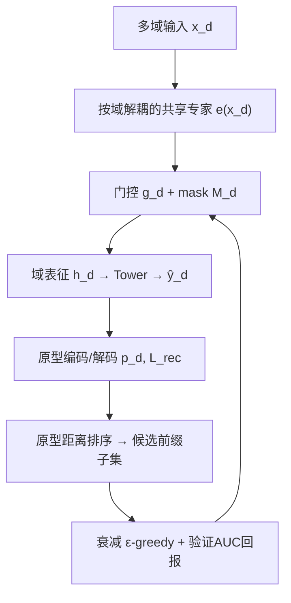
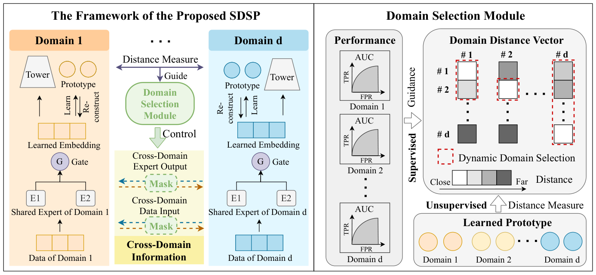

# Measure Domain's Gap: A Similar Domain Selection Principle for Multi-Domain Recommendation (度量域间鸿沟：多域推荐的相似域选择原则)

- **会议/期刊**: KDD 2025
- **作者与机构**: Yi Wen, Yue Liu, Derong Xu, Huishi Luo, Pengyue Jia, Yiqing Wu, Siwei Wang, Ke Liang, Maolin Wang, Yiqi Wang, Fuzhen Zhuang, Xiangyu Zhao（香港城市大学、新加坡国立大学、北航、国防科大等）
- **推荐链路定位**: 精排（多域 CTR 预估）
- **研究方向**: 跨域与多场景推荐 / 强化学习与动态探索推荐
- **论文原文**: [https://arxiv.org/abs/2505.20227v1](https://arxiv.org/abs/2505.20227v1)
- **开源代码**: [https://github.com/Applied-Machine-Learning-Lab/SDSP](https://github.com/Applied-Machine-Learning-Lab/SDSP)

## TL;DR (1分钟核心速览)

多域推荐（MDR）普遍用**单一共享结构**迁移所有域的知识，但域间存在知识冲突与低质域，无差别共享会引发严重负迁移（NTP）。本文提出轻量级**相似域选择原则 SDSP**：先用原型学习把每域压缩为 $M$个原型，定义**非对称**的域间距离（$O(BM+M^2)$替代$O(B^2)$），再把"为每域选域子集"建模为多臂老虎机，用带衰减的$\epsilon$-greedy 以验证集 AUC 为监督信号动态搜索，最后用 mask 屏蔽非相似域的专家输出。在 Movielens/Amazon/Douban 三数据集上，MMOE+SDSP 整体 AUC 分别提升 0.74%/0.34%/0.50%，推理仅增 0.4ms 量级。

## Background & Motivation (背景与核心矛盾)

- **主流范式**: MDR 分两支——DW 类（M2M、STAR 用场景敏感特征生成参数）与 SS 类（MMOE、PLE 划分共享/独有专家），二者均以**一个共享结构**承载全部跨域知识。
- **前人局限**: ① DW 类依赖人工挑选场景敏感特征，新域到来时泛化差；② SS 类假设"对他域有益的共享知识对本域也有益"，当域间知识冲突或某域质量差时直接触发 NTP；③ 已有选择方法（贪心搜索、梯度建模、预聚类）要么组合爆炸 $O(2^{D-1})$、要么隐含**对称性假设**。
- **核心洞察 (Key Insight)**: 作者在 Movielens 上按年龄切出 YOUNG/MIDDLE/SENIOR 三域做迁移实验（图 1），发现三点：域间负迁移真实存在（引入 SENIOR 反而拉低 YOUNG）；**域关系非对称**（SENIOR→YOUNG 与 YOUNG→SENIOR 效果相反）；域关系还随模型学习能力变化。
- **本文切入点**: 既然关系非对称且随模型演化，就不该用静态对称度量，而应"**用模型自己学出的原型来量距离、用模型自己的验证指标来监督选域**"。

## Method (核心方法设计)

### 1. 整体框架 (Overall Architecture)

以 MMOE 为骨架，但把全局共享专家**按域解耦**为 $\{\boldsymbol{e}^1_1,...,\boldsymbol{e}^D_{E_D}\}$，每域门控只在自己被选中的专家子集上做 softmax。训练时每域数据经门控加权得到$\boldsymbol{h}_d$，送入原型编码器压缩为$M$个原型并用解码重构保真；每隔$l$轮用原型距离排出各域"由近及远"的顺序，将候选子集从$O(2^{D-1})$压缩到$O(D)$个前缀状态，再由衰减$\epsilon$-greedy 以验证集 AUC 为回报挑选最优前缀，生成 mask 回写门控。推理阶段仅保留 mask 与门控，无额外原型计算。

<figure class="paper-figure" markdown="span">
  <figcaption>图2：所提出的 SDSP 的框架。</figcaption>
</figure>

### 2. 关键设计拆解 (Key Designs)

1. **原型化非对称域距离（把 $O(B^2)$压到$O(BM+M^2)$且保留方向性）**：直接算$\text{dis}(\boldsymbol{h}_d,\boldsymbol{h}_{d'})$是批内两两比较，代价高且被噪声样本污染。改为先学域原型$\boldsymbol{p}_d=\text{P-Encoder}(\boldsymbol{h}_d)$，再定义"原型到域"距离为该原型到目标域**最近原型**的距离，域到域距离为源域全部原型的平均：
$$\text{dis}(d_1,d_2)=\frac{1}{M}\sum_{i=1}^{M}\min_{j}\|\boldsymbol{p}^{d_1}_i-\boldsymbol{p}^{d_2}_j\|_2$$
由于取 min 再平均，$\text{dis}(d_1,d_2)\neq\text{dis}(d_2,d_1)$ 天然成立，恰好匹配图 1 观察到的非对称迁移；且原型由模型表征而非原始特征学出，度量自带"模型当前学习能力"感知。

2. **距离引导 + 监督回报的衰减 $\epsilon$-greedy 选域**：距离只给出排序，不给"选到第几个前缀最优"的答案。将每域的选域建模为多臂老虎机，状态空间即排序后的前缀子集$\{[d],[d,d^{+1}],...\}$，价值函数取该子集下验证集 AUC；以概率$p$随机探索、否则贪心利用，$p\leftarrow p\times d\_r$（$d\_r=0.9$）逐步收敛。选定后经 mask 注入门控：
$$\boldsymbol{g}^{mask}_d=\text{softmax}(\boldsymbol{g}_d+\boldsymbol{M}_d),\quad M_{d,i}=\begin{cases}0, & d'_i\in\mathcal{S}_d\\ -\infty, & \text{otherwise}\end{cases}$$
即把非相似域专家的 logit 直接压到 $-\infty$，从结构上切断负迁移通路。

3. **训练目标与开销**：总损失 $\mathcal{L}_{final}=\mathcal{L}_{ctr}+\gamma\mathcal{L}_{rec}$，其中$\mathcal{L}_{rec}=\sum_d\|\boldsymbol{h}_d-\hat{\boldsymbol{h}}_d\|_2^2$ 保证原型可解码、具代表性；CTR 部分为标准 BCE，无额外负采样设计（精排 CTR 范式）。推理时 SDSP 只增加一次门控 mask 加法，实测每 batch（4096）仅增 0.38–0.55ms。

## Experimental Setup & Evaluation Protocol (实验设置与评估协议)

- **数据集与预处理**:

| 数据集 | #Users | #Items | #Interactions | 稀疏度/密度 | 特征/场景说明 |
| :--- | :---: | :---: | :---: | :---: | :--- |
| Movielens | 6,040 | 10,413 | 800,167 | 密度约 1.27% | 按用户 age 切为 YOUNG/MIDDLE/SENIOR 三域 |
| Amazon | 100,345 | 53,665 | 658,827 | 密度约 0.012% | 5-core 过滤，Clothing/Beauty/Health 三域，用户物品有重叠 |
| Douban | 6,671 | 184,619 | 1,348,399 | 密度约 0.11% | 评分 >3 视为有效点击，随机切三域 |

- **数据划分与防穿越 (Splitting Strategy)**: 三数据集均按 **8:1:1 随机划分**训练/验证/测试；验证集同时承担 bandit 的回报信号，需注意其与测试集同分布但独立。
- **排名评测协议 (Ranking Protocol)**: CTR 场景，报告 **AUC（越高越好）与 LogLoss（越低越好）**，按域分别报告并汇总整体；未采用全库排序或负采样排序，属标准 CTR 点估计评估。显著性采用**双侧 t 检验 $p<0.05$**，并援引 CTR 领域"$0.001$ AUC 即显著"的惯例。
- **对比基线与超参设置**: 10 个基线覆盖多任务（SharedBottom/MMOE/PLE）、多域（STAR/SAR-Net/AdaptDHM/M2M）、稀疏与参数生成（Adasparse/PPNet/EPNet）。原型编码解码均为单层 MLP，原型数 $M=10$，每域专家数 1，学习率搜 [0.01,0.001,0.0001]，$\gamma$搜 [$10^{-3},10^{-4},10^{-5}$]，初始$p=1$、衰减 0.9。

## Key Experimental Results (实验关键数据)

### 1. 主实验对比 (Main Results)

| Method | Movielens AUC↑ | Movielens LogLoss↓ | Amazon AUC↑ | Amazon LogLoss↓ | Douban AUC↑ | Douban LogLoss↓ |
| :--- | :---: | :---: | :---: | :---: | :---: | :---: |
| SharedBottom | 0.8024 | 0.5348 | 0.7058 | 0.4910 | 0.7992 | 0.5179 |
| MMOE | 0.8077 | 0.5238 | 0.7073 | 0.4915 | 0.7974 | 0.5200 |
| PLE | 0.8085 | 0.5230 | 0.7075 | 0.4910 | 0.7976 | 0.5202 |
| STAR | 0.7996 | 0.5344 | 0.6747 | 0.4980 | 0.7952 | 0.5225 |
| SAR-Net | 0.8087 | 0.5244 | 0.7020 | 0.4954 | 0.7991 | 0.5196 |
| Adasparse | 0.8073 | 0.5230 | 0.6895 | 0.4791 | 0.7981 | 0.5201 |
| M2M | 0.8017 | 0.5297 | 0.6915 | 0.4887 | 0.7983 | 0.5230 |
| EPNet | 0.8049 | 0.5249 | 0.7078 | 0.4746 | 0.8000 | 0.5180 |
| **MMOE+SDSP** | **0.8151** | **0.5143** | **0.7107** | 0.4680 | **0.8024** | 0.5158 |
| **PLE+SDSP** | **0.8147** | 0.5151 | **0.7116** | **0.4652** | **0.8031** | **0.5147** |
| Improv.% (vs 最优基线) | +0.79% | -1.66% | +0.54% | -2.00% | +0.39% | -0.64% |

兼容性实验（表 3）进一步显示 SDSP 可插拔：MMOE 0.8077→0.8151、PLE 0.8085→0.8147、SAR-Net 0.8087→0.8113（Movielens 整体 AUC），三骨干均获显著提升。

### 2. 消融实验 (Ablation Study)

| 变体（Movielens 整体 AUC） | MMOE | PLE |
| :--- | :---: | :---: |
| 原始骨干 | 0.8077 | 0.8085 |
| + Random 选域 | 约 0.811 | 约 0.812 |
| + Average 表征距离 | 约 0.813 | 约 0.814 |
| + **SDSP（完整）** | **0.8151** | **0.8147** |

### 3. 关键实验发现 (Key Findings)

1. **共享结构越多，SDSP 收益越大**：MMOE 因共享专家比例最高、负迁移最重，接入 SDSP 后提升最显著（Movielens +0.74%），而本身已做共享/独有分离的 PLE 增益略小（+0.62%），说明 SDSP 精准打击的是"过度共享"这一病根。
2. **监督信号可兜底不完美度量**：即便用有缺陷的 Average 距离（无法建模非对称），仍优于 Random 选域，证明以验证 AUC 为回报的 bandit 层能在度量失准时纠偏，两模块互补而非冗余。
3. **负迁移被实质消除而非掩盖**：图 5 显示原 PLE 在引入 SENIOR 时 YOUNG 明显掉点，PLE+SDSP 不仅避免掉点，还能反向从 SENIOR 抽取有益信息提升 YOUNG；同时推理开销仅增 0.38–0.55ms/batch，远低于 STAR（2.78ms）与 M2M（2.91ms）。

## Highlights & Limitations (亮点、对比与审稿批判)

- **与代表作对比 (vs. Prior Work)**: 相比 PLE/STAR 的"固定共享+独有"划分，SDSP 把"共享给谁"变成**可学习、可动态调整**的决策；相比 M2M 依赖人工场景特征生成参数，SDSP 无需特征工程；相比贪心搜索类选域方法，SDSP 借距离排序把搜索空间从 $O(2^{D-1})$降到$O(D)$，且首次显式建模域间**非对称**关系。
- **可迁移亮点**: ① "原型距离排序 + bandit 前缀搜索"这一套可低成本套用到多任务/多场景的专家路由、乃至多模态特征源选择；② 用验证指标作 bandit 回报、以 mask 硬切断负迁移通路的做法，工程上极易落地。
- **审稿级局限批判**: ① 域数仅 3，$O(D)$前缀假设与 bandit 收敛性在数十域的真实工业场景下未验证，且 bandit 需反复跑验证集，离线训练成本被低估；② 距离度量与选域均依赖"域内原型可代表该域"的强假设，对域内高度异质（多兴趣混杂）的情形可能失效，且$\gamma$、$M$、衰减率等超参虽称鲁棒但仍需逐数据集调。

## Rating (四维评分)

- **方法创新性 (Novelty)**: ⭐⭐⭐⭐ （首次显式度量域级 gap 并动态选域，非对称原型距离 + bandit 前缀搜索组合新颖，且有定理给出负迁移下界）
- **评估协议与实验扎实度 (Protocol & Experiments)**: ⭐⭐⭐⭐ （三数据集、10 基线、三骨干兼容性、消融/超参/负迁移/效率五问齐全，但仅 3 域、缺线上 A/B）
- **写作与数学规范度 (Clarity & Rigor)**: ⭐⭐⭐⭐ （距离定义与复杂度分析清晰，定理 3 给出信息论解释；部分符号如 $E=\cup E_d$ 表述略松）
- **工业落地与复现价值 (Industrial & Practical Value)**: ⭐⭐⭐⭐⭐ （即插即用、推理仅增 0.4ms 量级、代码已开源，对多业务线共享架构的负迁移治理直接可用）

