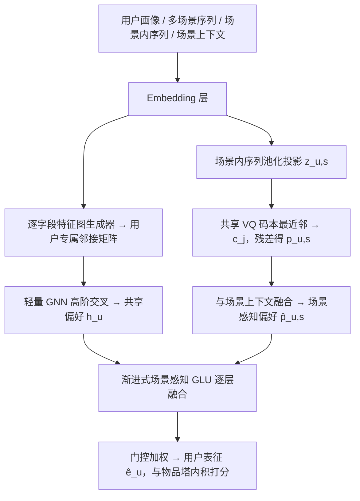
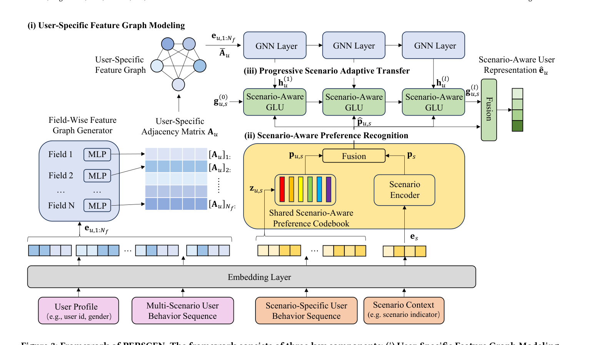

# PERSCEN: Learning Personalized Interaction Pattern and Scenario Preference for Multi-Scenario Matching (面向多场景召回的个性化交互模式与场景偏好学习)

- **会议/期刊**: KDD 2025
- **作者与机构**: Haotong Du, Yaqing Wang, Fei Xiong, Lei Shao, Ming Liu, Hao Gu, Quanming Yao, Zhen Wang（西北工业大学 / 北京雁栖湖应用数学研究院 / 美团 / 清华大学）
- **推荐链路定位**: 召回（双塔 Matching）
- **研究方向**: 跨域与多场景推荐 / 冷启动与长尾推荐
- **论文原文**: [https://arxiv.org/abs/2506.18382v1](https://arxiv.org/abs/2506.18382v1)
- **开源代码**: [https://github.com/LARS-research/PERSCEN](https://github.com/LARS-research/PERSCEN)

## TL;DR (1分钟核心速览)

现有多场景召回（ICAN/ADIN/SASS/M5）用统一的特征交叉模式与通用场景上下文来调制共享表征，导致同一场景内所有用户拿到几乎相同的偏好向量，且稀疏场景被富数据场景的优化目标淹没。PERSCEN 把"用户专属建模"引入召回：为每个用户生成专属特征图并用轻量 GNN 捕获高阶交互，用共享 VQ 码本从场景内行为序列蒸馏场景感知偏好，再用渐进式场景感知 GLU 低延迟融合。在 KuaiRand-Pure 与 Alimama 的 4 场景全库召回协议下，R@50/R@500 全面领先，稀疏场景（K4 仅占 3%）R@50 相对 ADIN 提升约 11.9%，FLOPs 仅约 10G。

## Background & Motivation (背景与核心矛盾)

- **主流范式**: 双塔召回 + 场景调制。ICAN 用场景感知注意力调制行为序列，ADIN 用共享骨干 + 独立场景 Predictor，SASS 用场景编码器 + 多层自适应迁移，M5 用门控调制 + 拆分 MoE。
- **前人局限一（个性化缺失）**: 上述方法对所有用户使用**同一套特征交叉模式**，仅靠场景上下文特征区分场景，同一场景内用户偏好表征趋同，无法刻画"用户 A 在网格流偏好美妆、在滚动流转向美食"这类个体差异（图 1）。
- **前人局限二（稀疏场景塌陷）**: 优化目标被富数据场景主导，ICAN/ADIN 在 KuaiRand 的 K4（3% 数据）上 R@50 仅 3.47%/19.12%，甚至**劣于单场景模型** DSSM-S 的 8.34%。
- **核心洞察 (Key Insight)**: 用户专属建模更贴合真实行为，但召回阶段有严格延迟约束，不能直接搬重模型；关键在于找到"个性化"与"轻量"的平衡点——用矩阵乘替代消息传递的 GNN、用共享码本实现跨场景知识迁移。
- **本文切入点**: 首次将用户专属建模引入多场景召回，三条支路分别解决"共享偏好个性化""场景偏好个性化""高效融合"。

## Method (核心方法设计)

### 1. 整体框架 (Overall Architecture)

输入为用户画像稀疏/稠密特征、多场景行为序列、场景内行为序列与场景指示特征。先经 Embedding 层得到各字段向量；支路 (i) 由逐字段图生成器为每个用户产出专属邻接矩阵 $\bar{\mathbf{A}}_u^{(l)}$，轻量 GNN 在其上做高阶特征交叉得到跨场景共享表征$\mathbf{h}_u^{(l)}$；支路 (ii) 将场景内序列池化投影为$\mathbf{z}_{u,s}$，在共享码本中最近邻检索码向量$\mathbf{c}_j$并残差相加，再与场景上下文表征融合得$\hat{\mathbf{p}}_{u,s}$；支路 (iii) 用逐层场景感知 GLU 将$\mathbf{h}_u^{(l)}$与$\hat{\mathbf{p}}_{u,s}$渐进融合，最终门控加权得用户表征$\hat{\mathbf{e}}_u$，与同构物品塔内积打分，随机负采样 + BCE 训练。

<figure class="paper-figure" markdown="span">
  <figcaption>图3：PERSCEN框架。该框架由三个关键组件组成：(i) 用户特定特征图建模，其中由逐字段特征图生成器生成用户特定邻接矩阵，以记录用户特定的交互模式；(ii) 场景感知偏好识别，其中融合场景特定用户行为序列和场景上下文特征，以联合建模用户特定偏好和场景感知偏好；(iii) 渐进式场景自适应迁移，促进不同场景间的灵活信息迁移。</figcaption>
</figure>

### 2. 关键设计拆解 (Key Designs)

1. **逐字段用户专属特征图 + 轻量 GNN（个性化共享偏好）**：痛点是用统一 MLP 交叉无法区分用户。为第 $m$个字段单独设 MLP，以全部字段嵌入拼接 one-hot 字段标识为输入生成邻接矩阵第$m$行：$[\mathbf{A}_u^{(1)}]_{m:}=\mathrm{MLP}_m([\mathbf{e}_{u,1},\dots,\mathbf{e}_{u,N_f},\mathrm{onehot}(m)])$，高阶邻接由$\mathbf{A}_u^{(l)}=\mathbf{A}_u^{(l-1)}\cdot\mathbf{A}_u^{(1)}$递归矩阵乘得到（免消息传递、免存储高阶图），再归一化/稀疏化/对称化。GNN 层采用$\mathbf{h}_{u,m}^{(l)}=\mathbf{h}_{u,m}^{(l-1)}\odot\big(\sum_n[\bar{\mathbf{A}}_u^{(l-1)}]_{mn}\mathbf{W}_g^{(l-1)}\mathbf{h}_{u,n}^{(0)}\big)$，即"逐元素门控 × 邻域聚合"，既保留自身信息又注入高阶交互。直觉：不同用户（如 Alimama 用户 493040 的 cms_segid↔age_level、用户 497613 的消费层级↔购物频次）天然有不同强交互边，专属图把这种差异显式编码。

2. **共享 VQ 码本蒸馏场景感知偏好（个性化 + 稀疏迁移）**：痛点是仅用场景上下文会让同场景用户偏好同质化。将场景内序列编码为 $\mathbf{z}_{u,s}$，在**跨全部场景共享**的码本中取最近码向量$j=\arg\min_i\|\mathbf{z}_{u,s}-\mathbf{c}_i\|_2^2$，残差连接得$\mathbf{p}_{u,s}=\mathbf{z}_{u,s}+\mathbf{c}_j$，再与场景上下文表征$\mathbf{p}_s$融合为$\hat{\mathbf{p}}_{u,s}$。VQ 损失$\mathcal{L}_{\mathrm{VQ}}=\|\mathrm{sg}[\mathbf{z}_{u,s}]-\mathbf{c}_j\|_2^2+\beta\|\mathbf{z}_{u,s}-\mathrm{sg}[\mathbf{c}_j]\|_2^2$（码本损失 + 承诺损失，直通估计器回传）。关键直觉：码本是共享的，富场景学到的偏好向量可被稀疏场景用户直接检索复用，天然缓解场景数据不平衡。

3. **渐进式场景感知 GLU 与训练目标**：GRU 的重置/更新门计算重且灵活性不足。改为逐层 GLU：$\mathbf{g}_{u,s}^{(l)}=(\mathbf{W}_{r1}^{(l)}[\mathbf{h}_u^{(l)},\mathbf{g}_{u,s}^{(l-1)}]+\mathbf{W}_{r2}^{(l)}\hat{\mathbf{p}}_{u,s})\otimes\sigma(\mathbf{W}_{r3}^{(l)}[\mathbf{h}_u^{(l)},\mathbf{g}_{u,s}^{(l-1)}]+\mathbf{W}_{r4}^{(l)}\hat{\mathbf{p}}_{u,s})$，与 GNN 层数对齐逐层注入场景偏好；末端用$\alpha=\sigma(\mathbf{W}_o[\mathbf{g}_{u,s}^{(L)},\hat{\mathbf{p}}_{u,s}])$做凸组合$\hat{\mathbf{e}}_u=\alpha\cdot\mathbf{g}_{u,s}^{(L)}+(1-\alpha)\cdot\hat{\mathbf{p}}_{u,s}$。总损失$\mathcal{L}=\mathcal{L}_{\mathrm{task}}+\mathcal{L}_{\mathrm{VQ}}$，$\mathcal{L}_{\mathrm{task}}$ 为随机负采样下的 BCE；推理仅需内积 + ANN，无额外重计算。

## Experimental Setup & Evaluation Protocol (实验设置与评估协议)

- **数据集与预处理**（仅保留点击正样本，过滤交互数 < 2 的用户，序列最大长度 50）：

| 数据集 | #Scenarios | #Users | #Items | #Interactions | 场景划分方式 |
| :--- | :---: | :---: | :---: | :---: | :--- |
| KuaiRand-Pure | 4 (K1–K4) | 24,122 | 7,583 | 650,283 | 按 attribute tab，取占比 >96% 的前 4 场景 |
| Alimama | 4 (A1–A4) | 138,622 | 846,811 | 933,633 | 按城市等级划分 |

- **数据划分与防穿越**: **全局时间戳切分**。KuaiRand 训练 04-08~04-21 / 验证 04-22~04-28 / 测试 04-29~05-08；Alimama 训练 05-06~05-11 / 验证 05-12 / 测试 05-13。
- **排名评测协议**: **Full-Ranking 全库排序**（非采样），$K$取候选物品总量约 1%：KuaiRand$K\in\{50,100\}$，Alimama$K\in\{500,1000\}$；指标 Recall@K 与 Hits@K，5 次运行取均值。
- **对比基线**: 单场景双塔 YoutubeDNN-S / DSSM-S；多场景双塔 YoutubeDNN-M / DSSM-M / ICAN / ADIN / SASS / M5。硬件 RTX 3090Ti 24GB。

## Key Experimental Results (实验关键数据)

### 1. 主实验对比 (Main Results)

KuaiRand-Pure（R@50 / R@100，%）：

| 模型 | K1 (84%) | K2 (9%) | K3 (4%) | K4 (3%) |
| :--- | :---: | :---: | :---: | :---: |
| DSSM-S | 17.71 / 28.42 | 20.04 / 29.15 | 12.55 / 19.00 | 8.34 / 13.45 |
| DSSM-M | 17.89 / 28.83 | 21.66 / 31.94 | 16.93 / 27.17 | 3.19 / 6.87 |
| ICAN | 18.06 / 28.93 | 21.63 / 31.99 | 17.64 / 28.19 | 3.47 / 6.98 |
| ADIN | 18.46 / 29.29 | 29.50 / 40.83 | 18.88 / 29.82 | 19.12 / 29.72 |
| SASS | 17.70 / 28.28 | 30.10 / 41.25 | 17.99 / 28.03 | 18.95 / 28.17 |
| M5 | 17.91 / 28.62 | 28.06 / 39.55 | 18.57 / 27.98 | 15.81 / 24.51 |
| **PERSCEN** | **18.74 / 29.95** | **30.69 / 42.62** | **19.60 / 30.50** | **21.39 / 31.68** |
| Improv. vs 最优基线 | +1.5% | +2.0% | +3.8% | **+11.9%** |

Alimama（R@500 / R@1000，%）：

| 模型 | A1 (45%) | A2 (25%) | A3 (20%) | A4 (10%) |
| :--- | :---: | :---: | :---: | :---: |
| DSSM-M | 9.58 / 14.43 | 9.49 / 14.46 | 9.34 / 14.03 | 9.93 / 14.94 |
| ICAN | 9.76 / 15.02 | 9.81 / 15.28 | 9.51 / 14.91 | 10.18 / 15.55 |
| ADIN | 11.01 / 15.50 | 11.38 / 16.13 | 10.94 / 16.02 | 11.82 / 16.72 |
| SASS | 10.39 / 15.06 | 10.80 / 15.72 | 10.36 / 15.32 | 11.04 / 15.86 |
| M5 | 11.01 / 15.71 | 11.06 / 15.56 | 10.95 / 15.49 | 11.00 / 15.45 |
| **PERSCEN** | **12.72 / 17.63** | **12.66 / 17.60** | **12.34 / 17.32** | **12.63 / 17.47** |
| Improv. vs 最优基线 | +15.5% | +11.2% | +12.8% | +6.9% |

### 2. 消融实验 (Ablation Study)

Alimama R@500（%）：

| 变体 | A1 | A2 | A3 | A4 |
| :--- | :---: | :---: | :---: | :---: |
| w/o GNN（MLP 交叉） | 12.10 | 12.17 | 11.94 | 12.33 |
| w/ shared graph（共享邻接） | 12.35 | 12.33 | 12.03 | 12.48 |
| w/o spec sequence（仅场景上下文） | 11.79 | 11.81 | 11.46 | 11.99 |
| w/o VQ（直接融合） | 11.98 | 12.00 | 11.71 | 12.50 |
| w/o GLU（直接拼接融合） | 11.82 | 11.96 | 11.74 | 11.96 |
| **PERSCEN** | **12.72** | **12.66** | **12.34** | **12.63** |

### 3. 关键实验发现 (Key Findings)

1. **稀疏场景是最大受益者**：KuaiRand K4（仅 3% 数据）上 PERSCEN 的 R@50 达 21.39%，相对 ADIN 的 19.12% 提升 11.9%，而 ICAN/DSSM-M 在该场景仅 3.47%/3.19%——证明共享 VQ 码本确实把富场景偏好迁移到了稀疏场景，避免了"优化目标被 K1 主导"的塌陷。
2. **用户专属图不可退化为共享图**：w/ shared graph 在 A1 上从 12.72 掉到 12.35，w/o GNN 掉到 12.10，说明收益既来自"用 GNN 做高阶交叉"也来自"邻接矩阵因人而异"；图 4 的可视化佐证不同用户强交互边完全不同（493040 为 cms_segid↔age_level，497613 为消费层级↔购物频次）。
3. **场景内序列与 VQ 缺一不可**：w/o spec sequence 在 A3 掉至 11.46（降 0.88），w/o VQ 在 A3 掉至 11.71，说明仅靠场景上下文无法个性化、而缺少码本则失去跨场景迁移能力；效率上 PERSCEN 约 10 GFLOPs、4.30MB 参数，推理 4.83ms/batch（4096），优于 GRU 变体的 5.02ms，处于工业召回可部署区间。

## Highlights & Limitations (亮点、对比与审稿批判)

- **与代表作对比 (vs. Prior Work)**: ICAN 用场景注意力调制序列但特征交叉仍全局统一；ADIN 靠独立场景 Predictor 区分场景，稀疏场景下 Predictor 欠拟合（K4 仅 19.12%）；SASS 用多层迁移但依赖场景编码器，同场景用户表征仍趋同。PERSCEN 的本质差异是把"个性化"下沉到**特征图拓扑**与**码本检索**两个层面，而非仅在输出端做场景调制。
- **可迁移亮点**: (1) 用矩阵乘递归生成高阶邻接 + 逐元素门控 GNN，可在任意召回塔中以极低开销替换 MLP 特征交叉；(2) 共享 VQ 码本作为跨场景/跨域的"偏好字典"，是缓解稀疏场景冷启动的通用手段，可迁移到跨域推荐与长尾物品扶持。
- **审稿级局限批判**: (1) 训练时间明显高于基线（KuaiRand 13431s vs ADIN 8352s），逐字段 MLP 生成邻接矩阵在字段数 $N_f$大时开销线性增长，论文未给出字段规模敏感性分析；(2) 码本大小、承诺损失权重$\beta$、GNN 层数$L$ 等超参未做敏感性扫描，且仅在两个公开数据集验证，缺少线上 A/B 与真实工业延迟（含 ANN 检索）的端到端数据。

## Rating (四维评分)

- **方法创新性 (Novelty)**: ⭐⭐⭐⭐ （首次将用户专属特征图 + 共享 VQ 码本引入多场景召回，思路清晰但各组件均为已有技术的组合创新）
- **评估协议与实验扎实度 (Protocol & Experiments)**: ⭐⭐⭐⭐ （Full-Ranking 全库排序 + 时间戳切分 + 5 次运行，双数据集四场景覆盖稀疏/富数据，消融完整；缺超参敏感性与线上验证）
- **写作与数学规范度 (Clarity & Rigor)**: ⭐⭐⭐⭐ （三支路公式定义完整、算法伪代码清晰，VQ 直通估计器与 GLU 推导规范；部分符号如 $\mathbf{W}_{r2}$ 被称为"bias matrix"表述略含糊）
- **工业落地与复现价值 (Industrial & Practical Value)**: ⭐⭐⭐⭐⭐ （代码开源，~10 GFLOPs / 4.30MB / 4.83ms 推理，明确面向美团级工业召回，落地价值高）

